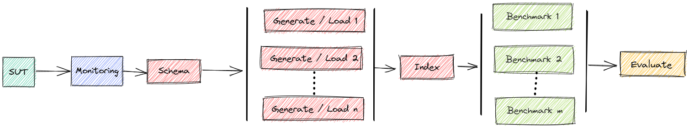

# Example: Benchmark MariaDB

This example shows how to benchmark MariaDB with TPC-H, TPC-DS, Benchbase's TPC-C, HammerDB's TPC-C and YCSB.



[MariaDB](https://mariadb.org/) is a relational DBMS, a fork of MySQL. Bexhoma runs it on a single node.
It uses a dedicated `bexhoma` database user rather than `root`.
For the columnar engine of MariaDB see [MariaDB ColumnStore](Example-MariaDBCS.md).

**The results are not official benchmark results.
Exact performance depends on a number of parameters.
You may get different results.
These examples are solely to illustrate how to use bexhoma and show the result evaluation.**

References:
1. [MariaDB](https://mariadb.org/)
1. [MariaDB in Docker](https://hub.docker.com/_/mariadb)
1. [TPC-H](https://www.tpc.org/tpch/)
1. [TPC-DS](https://www.tpc.org/tpcds/)
1. [Benchbase Repository](https://github.com/cmu-db/benchbase/wiki/TPC-C)
1. [HammerDB](https://www.hammerdb.com/)
1. [YCSB Repository](https://github.com/brianfrankcooper/YCSB/wiki/Running-a-Workload)
1. [Benchmarking cloud serving systems with YCSB](https://dl.acm.org/doi/10.1145/1807128.1807152)
1. [Orchestrating DBMS Benchmarking in the Cloud with Kubernetes](https://doi.org/10.1007/978-3-030-94437-7_6)
1. [A Cloud-Native Adoption of Classical DBMS Performance Benchmarks and Tools](https://doi.org/10.1007/978-3-031-68031-1_9)
1. Test script of this page: [test-docs-mariadb.sh](https://github.com/Beuth-Erdelt/Benchmark-Experiment-Host-Manager/blob/master/scripts/test-docs-mariadb.sh), [test-docs-mariadb.ps1](https://github.com/Beuth-Erdelt/Benchmark-Experiment-Host-Manager/blob/master/scripts/test-docs-mariadb.ps1)


## Perform TPC-H Benchmark

You will have to change the node selectors there (to names of nodes, that exist in your cluster - or to leave out the corresponding parameters):
```bash
BEXHOMA_NODE_SUT="cl-worker11"
BEXHOMA_NODE_LOAD="cl-worker19"
BEXHOMA_NODE_BENCHMARK="cl-worker19"
LOG_DIR="./logs_tests"
BEXHOMA_MS=1
BEXHOMA_STORAGE_CLASS="shared"

mkdir -p $LOG_DIR
```

The experiment is run with the [tpch file](https://github.com/Beuth-Erdelt/Benchmark-Experiment-Host-Manager/blob/master/tpch.py).

Example:
```bash
bexhoma tpch \
  -dbms MariaDB \
  -sf 1 \
  -nc 1 \
  -ne 1 \
  -nlp 8 \
  -nlt 8 \
  -nbp 1 \
  -xii -xic -xis \
  -xdt \
  -ms $BEXHOMA_MS \
  -t 1200 \
  -tr \
  -lr 128Gi \
  -rr 128Gi \
  -rss 50Gi \
  -rnn $BEXHOMA_NODE_SUT -rnl $BEXHOMA_NODE_LOAD -rnb $BEXHOMA_NODE_BENCHMARK \
  run &>$LOG_DIR/docs_tpch_mariadb.log
```

This
* starts a clean instance of MariaDB (`-dbms`)
  * data directory inside a Docker container
* creates the TPC-H schema
* starts 8 loader pods (`-nlp`); `-nlt 8` is ignored: the TPC-H loader uses one connection per pod, and bexhoma says so in the log
  * with a data generator (init container) each, which generates a share of TPC-H data of SF=1 (`-sf`)
  * and a loading container each, which loads the data into the DBMS
* creates indexes (`-xii`), constraints (`-xic`) and statistics (`-xis`)
* runs 1 stream of the 22 TPC-H queries (`-ne`) with a timeout of 1200 s per query (`-t`), measuring the data transfer volume per query (`-xdt`)
* tests if results match workflow (`-tr`)
* shows a summary

### Status

You can watch the status while benchmark is running via `bexhoma status`

```bash
Dashboard: Running
Cluster Prometheus: Running
Message Queue: Running
Data directory: Running
Result directory: Running

```

The code of the experiment is its unique identifier.
You can find the number also in the output of the benchmark script.

### Cleanup

The script is supposed to clean up and remove everything from the cluster that is related to the experiment after finishing.
If something goes wrong, you can also clean up manually with `bexperiment stop` (removes everything) or `bexperiment stop -e <code>` (removes everything that is related to experiment `<code>`).

### Evaluate Results

At the end of a benchmark you will see a summary like

<details>
<summary>Show <a href="https://github.com/Beuth-Erdelt/Benchmark-Experiment-Host-Manager/blob/master/logs_tests/docs_tpch_mariadb_summary.md" target="_blank" rel="noopener">docs_tpch_mariadb.log</a></summary>

```markdown
## Show Summary

### Workload
TPC-H Queries SF=1
* Type: tpch
* Duration: 658s 
* Code: 1794761138
* This includes the reading queries of TPC-H.
* This experiment compares run time and resource consumption of TPC-H queries in different DBMS.
  * TPC-H (SF=1) data is loaded and benchmark is executed.
  * Query ordering is Q1 - Q22.
  * All instances use the same query parameters.
  * Timeout per query is 1200.
  * Data transfer volume per query is also measured.
  * Import sets indexes, constraints, statistics recomputation after loading.
  * Load durability is relaxed (-xld; restored after the load).
  * Experiment uses bexhoma version 0.11.18.
  * Experiment is limited to DBMS ['MariaDB'].
  * Import is handled by 8 processes (pods).
  * Loading is fixed to cl-worker38.
  * Benchmarking is fixed to cl-worker38.
  * SUT is fixed to cl-worker36.
  * Database uses ephemeral storage of size 50Gi.
  * Loading is tested with [8] threads, split into [8] pods.
  * Benchmarking is tested with [1] threads, split into [1] pods.
  * Benchmarking is run as [1] times the number of benchmarking pods.
  * Experiment is run once.
  * Maximum DBMS across the whole cluster is 10.
  * Results are validated against basic correctness requirements.
  * SUT requests 4 CPU and 128Gi RAM. RAM limit is 128Gi.

### Connections
* mariadb-1-1-1-1-1 uses docker image mariadb:12.3.3
  * RAM:2164173156352
  * CPU:INTEL(R) XEON(R) PLATINUM 8570
  * Cores:224
  * host:6.8.0-147-generic
  * node:cl-worker36
  * disk:1111310
  * datadisk:1974
  * volume_size:1.8T
  * volume_used:1.1T
  * cpu_list:0-223
  * args:['--max_connections=1500', '--character-set-server=utf8mb4', '--collation-server=utf8mb4_bin', '--innodb-read-io-threads=64', '--innodb-write-io-threads=64', '--innodb-use-native-aio=0', '--innodb-buffer-pool-size=8G', '--innodb-io-capacity=200', '--innodb-io-capacity-max=1000', '--innodb-log-buffer-size=1G', '--tmp-table-size=1G', '--max-heap-table-size=1G']
  * requests_cpu:4
  * requests_memory:128Gi
  * limits_memory:128Gi
  * resources_total: 4.0 CPU, 128.0 GiB RAM requested in 1 pods
    * sut: 1 x, 4.0 CPU, 128.0 GiB RAM
  * load_durability: relaxed
  * eval_parameters
    * code:1794761138

### Ingestion
* MariaDB-1: 50 of 50 units ok

### SUT Container Restarts
* bexhoma-sut-mariadb-1-1794761138-5bf9b9cc8b-xfd4t: 0

### Workflow

#### Actual

* DBMS MariaDB-1 - Experiment 1 Client 1: tpch (1 pods)

#### Planned

* DBMS MariaDB-1 - Experiment 1 Client 1: tpch (1 pods)

### Loading

#### Per Run

| DBMS        |   experiment_run |   SF |   time_load |   time_preload |   time_generate |   time_ingest |   time_postload |   loading_pods |   threads | tenant_id   | type_tenants   |   num_tenants | vol_tenants   |   Throughput [SF/h] | loading_inherited   |
|:------------|-----------------:|-----:|------------:|---------------:|----------------:|--------------:|----------------:|---------------:|----------:|:------------|:---------------|--------------:|:--------------|--------------------:|:--------------------|
| MariaDB-1-1 |                1 |    1 |      111.00 |           4.00 |           45.00 |         15.00 |           34.00 |              8 |         0 |             | None           |             0 | False         |               32.43 | False               |

### Benchmarking

#### Per Connection

| connection        | phase         | job             |   experiment_run |   client |   benchmark_run |   child |   SF |   num_of_queries |   num_of_executions |   time [s] |   Geo Times [s] |   Power@Size [~Q/h] |   Throughput@Size |   tenant_id |
|:------------------|:--------------|:----------------|-----------------:|---------:|----------------:|--------:|-----:|-----------------:|--------------------:|-----------:|----------------:|--------------------:|------------------:|------------:|
| mariadb-1-1-1-1-1 | mariadb-1-1-1 | mariadb-1-1-1-1 |                1 |        1 |               1 |       1 | 1.00 |               22 |                  22 |        117 |            1.17 |             3255.01 |            676.92 |          -1 |

#### Per Phase

| DBMS          | phase         |   experiment_run |   client |   benchmark_run |   pod_count |   SF |   num_of_queries |   num_of_executions |   time [s] |   Geo Times [s] |   Power@Size [~Q/h] |   Throughput@Size |   tenant_id |
|:--------------|:--------------|-----------------:|---------:|----------------:|------------:|-----:|-----------------:|--------------------:|-----------:|----------------:|--------------------:|------------------:|------------:|
| mariadb-1-1-1 | mariadb-1-1-1 |                1 |        1 |               1 |           1 | 1.00 |               22 |                  22 |        117 |            1.17 |             3255.01 |            676.92 |          -1 |

#### Query Completion per Phase

| phase         |   pods | Pricing Summary Report (TPC-H Q1)   | Minimum Cost Supplier Query (TPC-H Q2)   | Shipping Priority (TPC-H Q3)   | Order Priority Checking Query (TPC-H Q4)   | Local Supplier Volume (TPC-H Q5)   | Forecasting Revenue Change (TPC-H Q6)   | Volume Shipping Query (TPC-H Q7)   | National Market Share (TPC-H Q8)   | Product Type Profit Measure (TPC-H Q9)   | Returned Item Reporting Query (TPC-H Q10)   | Important Stock Identification (TPC-H Q11)   | Shipping Modes and Order Priority (TPC-H Q12)   | Customer Distribution (TPC-H Q13)   | Promotion Effect Query (TPC-H Q14)   | Top Supplier Query (TPC-H Q15)   | Parts/Supplier Relationship (TPC-H Q16)   | Small-Quantity-Order Revenue (TPC-H Q17)   | Large Volume Customer (TPC-H Q18)   | Discounted Revenue (TPC-H Q19)   | Potential Part Promotion (TPC-H Q20)   | Suppliers Who Kept Orders Waiting Query (TPC-H Q21)   | Global Sales Opportunity Query (TPC-H Q22)   | complete   |
|:--------------|-------:|:------------------------------------|:-----------------------------------------|:-------------------------------|:-------------------------------------------|:-----------------------------------|:----------------------------------------|:-----------------------------------|:-----------------------------------|:-----------------------------------------|:--------------------------------------------|:---------------------------------------------|:------------------------------------------------|:------------------------------------|:-------------------------------------|:---------------------------------|:------------------------------------------|:-------------------------------------------|:------------------------------------|:---------------------------------|:---------------------------------------|:------------------------------------------------------|:---------------------------------------------|:-----------|
| mariadb-1-1-1 |      1 | 1/1                                 | 1/1                                      | 1/1                            | 1/1                                        | 1/1                                | 1/1                                     | 1/1                                | 1/1                                | 1/1                                      | 1/1                                         | 1/1                                          | 1/1                                             | 1/1                                 | 1/1                                  | 1/1                              | 1/1                                       | 1/1                                        | 1/1                                 | 1/1                              | 1/1                                    | 1/1                                                   | 1/1                                          | yes        |

Pods that completed each query, out of the pods the phase ran (`completed/pods`). Counted per phase, so a failure in one phase does not change another phase's row. `complete` = every pod completed every active query.

### Latency of Timer Execution [ms]
| Queries                                             |   mariadb-1-1-1-1-1 |
|:----------------------------------------------------|--------------------:|
| Pricing Summary Report (TPC-H Q1)                   |             7635.62 |
| Minimum Cost Supplier Query (TPC-H Q2)              |              567.89 |
| Shipping Priority (TPC-H Q3)                        |             2034.28 |
| Order Priority Checking Query (TPC-H Q4)            |              502.48 |
| Local Supplier Volume (TPC-H Q5)                    |             1077.02 |
| Forecasting Revenue Change (TPC-H Q6)               |             1042.07 |
| Volume Shipping Query (TPC-H Q7)                    |             1125.17 |
| National Market Share (TPC-H Q8)                    |             2012.46 |
| Product Type Profit Measure (TPC-H Q9)              |             1885.64 |
| Returned Item Reporting Query (TPC-H Q10)           |              950.37 |
| Important Stock Identification (TPC-H Q11)          |              134.79 |
| Shipping Modes and Order Priority (TPC-H Q12)       |             3498.76 |
| Customer Distribution (TPC-H Q13)                   |             3292.87 |
| Promotion Effect Query (TPC-H Q14)                  |            11439.05 |
| Top Supplier Query (TPC-H Q15)                      |             2372.72 |
| Parts/Supplier Relationship (TPC-H Q16)             |              207.74 |
| Small-Quantity-Order Revenue (TPC-H Q17)            |               61.04 |
| Large Volume Customer (TPC-H Q18)                   |             3402.68 |
| Discounted Revenue (TPC-H Q19)                      |              113.84 |
| Potential Part Promotion (TPC-H Q20)                |              275.20 |
| Suppliers Who Kept Orders Waiting Query (TPC-H Q21) |            63551.52 |
| Global Sales Opportunity Query (TPC-H Q22)          |              125.51 |

### Errors (failed queries)

No errors

### Warnings (result mismatch)

No warnings

### Tests
* TEST passed: Loading measured in this experiment
* TEST passed: Data parameters as requested
* TEST passed: Init scripts without errors
* TEST passed: Loader pods without errors
* TEST passed: Loading completed without failures
* TEST passed: No SUT container restarts
* TEST skipped: SUT data survived container restarts (no restarts)
* TEST passed: Geo Times [s] contains no 0 or NaN
* TEST passed: Power@Size [~Q/h] contains no 0 or NaN
* TEST passed: Throughput@Size contains no 0 or NaN
* TEST passed: No SQL errors
* TEST passed: No SQL warnings
* TEST passed: All active queries counted in the totals
* TEST skipped: EXPLAIN captured for every active query (-se/--store-explain not used)
* TEST passed: Workflow as planned
```

</details>

To see the summary again you can simply call `bexhoma summary -e <code>` with the experiment code.

Results are transformed into pandas DataFrames and can be inspected in detail.
See for example the [Jupyter notebooks](https://github.com/Beuth-Erdelt/Benchmark-Experiment-Host-Manager/tree/master/notebooks/), in particular [Collector-TPC-H.ipynb](https://github.com/Beuth-Erdelt/Benchmark-Experiment-Host-Manager/blob/master/notebooks/Collector-TPC-H.ipynb).

You can connect to an evaluation server locally by `bexhoma jupyter`.
This forwards ports, so you have
* a Jupyter notebook server at http://localhost:8888


## Monitoring

[Monitoring](Monitoring.md) can be activated for DBMS only (`-m`) or for all components (`-mc`).
Metrics are sampled every few seconds, so the benchmarking phase should take at least a minute.

```bash
bexhoma tpch \
  -dbms MariaDB \
  -sf 1 \
  -nc 1 \
  -ne 1 \
  -nlp 8 \
  -nlt 8 \
  -nbp 1 \
  -xii -xic -xis \
  -xdt \
  -m \
  -mc \
  -ms $BEXHOMA_MS \
  -t 1200 \
  -tr \
  -lr 128Gi \
  -rr 128Gi \
  -rss 50Gi \
  -rnn $BEXHOMA_NODE_SUT -rnl $BEXHOMA_NODE_LOAD -rnb $BEXHOMA_NODE_BENCHMARK \
  run &>$LOG_DIR/docs_tpch_mariadb_monitoring.log
```

### Example Result

<details>
<summary>Show <a href="https://github.com/Beuth-Erdelt/Benchmark-Experiment-Host-Manager/blob/master/logs_tests/docs_tpch_mariadb_monitoring_summary.md" target="_blank" rel="noopener">docs_tpch_mariadb_monitoring.log</a></summary>

```markdown
## Show Summary

### Workload
TPC-H Queries SF=1
* Type: tpch
* Duration: 513s 
* Code: 1794761837
* This includes the reading queries of TPC-H.
* This experiment compares run time and resource consumption of TPC-H queries in different DBMS.
  * TPC-H (SF=1) data is loaded and benchmark is executed.
  * Query ordering is Q1 - Q22.
  * All instances use the same query parameters.
  * Timeout per query is 1200.
  * Data transfer volume per query is also measured.
  * Import sets indexes, constraints, statistics recomputation after loading.
  * Load durability is relaxed (-xld; restored after the load).
  * Experiment uses bexhoma version 0.11.18.
  * System metrics are monitored by a cluster-wide installation.
  * Experiment is limited to DBMS ['MariaDB'].
  * Import is handled by 8 processes (pods).
  * Loading is fixed to cl-worker38.
  * Benchmarking is fixed to cl-worker38.
  * SUT is fixed to cl-worker36.
  * Database uses ephemeral storage of size 50Gi.
  * Loading is tested with [8] threads, split into [8] pods.
  * Benchmarking is tested with [1] threads, split into [1] pods.
  * Benchmarking is run as [1] times the number of benchmarking pods.
  * Experiment is run once.
  * Maximum DBMS across the whole cluster is 10.
  * Results are validated against basic correctness requirements.
  * SUT requests 4 CPU and 128Gi RAM. RAM limit is 128Gi.

### Connections
* mariadb-1-1-1-1-1 uses docker image mariadb:12.3.3
  * RAM:2164173156352
  * CPU:INTEL(R) XEON(R) PLATINUM 8570
  * Cores:224
  * host:6.8.0-147-generic
  * node:cl-worker36
  * disk:1140302
  * datadisk:1974
  * volume_size:1.8T
  * volume_used:1.1T
  * cpu_list:0-223
  * args:['--max_connections=1500', '--character-set-server=utf8mb4', '--collation-server=utf8mb4_bin', '--innodb-read-io-threads=64', '--innodb-write-io-threads=64', '--innodb-use-native-aio=0', '--innodb-buffer-pool-size=8G', '--innodb-io-capacity=200', '--innodb-io-capacity-max=1000', '--innodb-log-buffer-size=1G', '--tmp-table-size=1G', '--max-heap-table-size=1G']
  * requests_cpu:4
  * requests_memory:128Gi
  * limits_memory:128Gi
  * resources_total: 4.0 CPU, 128.0 GiB RAM requested in 1 pods
    * sut: 1 x, 4.0 CPU, 128.0 GiB RAM
  * load_durability: relaxed
  * eval_parameters
    * code:1794761837

### Ingestion
* MariaDB-1: 50 of 50 units ok

### SUT Container Restarts
* bexhoma-sut-mariadb-1-1794761837-f78955587-5p4jd: 0

### Workflow

#### Actual

* DBMS MariaDB-1 - Experiment 1 Client 1: tpch (1 pods)

#### Planned

* DBMS MariaDB-1 - Experiment 1 Client 1: tpch (1 pods)

### Loading

#### Per Run

| DBMS        |   experiment_run |   SF |   time_load |   time_preload |   time_generate |   time_ingest |   time_postload |   loading_pods |   threads | tenant_id   | type_tenants   |   num_tenants | vol_tenants   |   Throughput [SF/h] | loading_inherited   |
|:------------|-----------------:|-----:|------------:|---------------:|----------------:|--------------:|----------------:|---------------:|----------:|:------------|:---------------|--------------:|:--------------|--------------------:|:--------------------|
| MariaDB-1-1 |                1 |    1 |       71.00 |           3.00 |           24.00 |         16.00 |           23.00 |              8 |         0 |             | None           |             0 | False         |               50.70 | False               |

### Benchmarking

#### Per Connection

| connection        | phase         | job             |   experiment_run |   client |   benchmark_run |   child |   SF |   num_of_queries |   num_of_executions |   time [s] |   Geo Times [s] |   Power@Size [~Q/h] |   Throughput@Size |   tenant_id |
|:------------------|:--------------|:----------------|-----------------:|---------:|----------------:|--------:|-----:|-----------------:|--------------------:|-----------:|----------------:|--------------------:|------------------:|------------:|
| mariadb-1-1-1-1-1 | mariadb-1-1-1 | mariadb-1-1-1-1 |                1 |        1 |               1 |       1 | 1.00 |               22 |                  22 |         85 |            0.85 |             4495.43 |            931.76 |          -1 |

#### Per Phase

| DBMS          | phase         |   experiment_run |   client |   benchmark_run |   pod_count |   SF |   num_of_queries |   num_of_executions |   time [s] |   Geo Times [s] |   Power@Size [~Q/h] |   Throughput@Size |   tenant_id |
|:--------------|:--------------|-----------------:|---------:|----------------:|------------:|-----:|-----------------:|--------------------:|-----------:|----------------:|--------------------:|------------------:|------------:|
| mariadb-1-1-1 | mariadb-1-1-1 |                1 |        1 |               1 |           1 | 1.00 |               22 |                  22 |         85 |            0.85 |             4495.43 |            931.76 |          -1 |

#### Query Completion per Phase

| phase         |   pods | Pricing Summary Report (TPC-H Q1)   | Minimum Cost Supplier Query (TPC-H Q2)   | Shipping Priority (TPC-H Q3)   | Order Priority Checking Query (TPC-H Q4)   | Local Supplier Volume (TPC-H Q5)   | Forecasting Revenue Change (TPC-H Q6)   | Volume Shipping Query (TPC-H Q7)   | National Market Share (TPC-H Q8)   | Product Type Profit Measure (TPC-H Q9)   | Returned Item Reporting Query (TPC-H Q10)   | Important Stock Identification (TPC-H Q11)   | Shipping Modes and Order Priority (TPC-H Q12)   | Customer Distribution (TPC-H Q13)   | Promotion Effect Query (TPC-H Q14)   | Top Supplier Query (TPC-H Q15)   | Parts/Supplier Relationship (TPC-H Q16)   | Small-Quantity-Order Revenue (TPC-H Q17)   | Large Volume Customer (TPC-H Q18)   | Discounted Revenue (TPC-H Q19)   | Potential Part Promotion (TPC-H Q20)   | Suppliers Who Kept Orders Waiting Query (TPC-H Q21)   | Global Sales Opportunity Query (TPC-H Q22)   | complete   |
|:--------------|-------:|:------------------------------------|:-----------------------------------------|:-------------------------------|:-------------------------------------------|:-----------------------------------|:----------------------------------------|:-----------------------------------|:-----------------------------------|:-----------------------------------------|:--------------------------------------------|:---------------------------------------------|:------------------------------------------------|:------------------------------------|:-------------------------------------|:---------------------------------|:------------------------------------------|:-------------------------------------------|:------------------------------------|:---------------------------------|:---------------------------------------|:------------------------------------------------------|:---------------------------------------------|:-----------|
| mariadb-1-1-1 |      1 | 1/1                                 | 1/1                                      | 1/1                            | 1/1                                        | 1/1                                | 1/1                                     | 1/1                                | 1/1                                | 1/1                                      | 1/1                                         | 1/1                                          | 1/1                                             | 1/1                                 | 1/1                                  | 1/1                              | 1/1                                       | 1/1                                        | 1/1                                 | 1/1                              | 1/1                                    | 1/1                                                   | 1/1                                          | yes        |

Pods that completed each query, out of the pods the phase ran (`completed/pods`). Counted per phase, so a failure in one phase does not change another phase's row. `complete` = every pod completed every active query.

### Latency of Timer Execution [ms]
| Queries                                             |   mariadb-1-1-1-1-1 |
|:----------------------------------------------------|--------------------:|
| Pricing Summary Report (TPC-H Q1)                   |             6109.68 |
| Minimum Cost Supplier Query (TPC-H Q2)              |              298.20 |
| Shipping Priority (TPC-H Q3)                        |             1144.52 |
| Order Priority Checking Query (TPC-H Q4)            |              311.72 |
| Local Supplier Volume (TPC-H Q5)                    |              781.49 |
| Forecasting Revenue Change (TPC-H Q6)               |              885.01 |
| Volume Shipping Query (TPC-H Q7)                    |             1033.34 |
| National Market Share (TPC-H Q8)                    |             1528.40 |
| Product Type Profit Measure (TPC-H Q9)              |             1457.60 |
| Returned Item Reporting Query (TPC-H Q10)           |              702.16 |
| Important Stock Identification (TPC-H Q11)          |              105.01 |
| Shipping Modes and Order Priority (TPC-H Q12)       |             2402.55 |
| Customer Distribution (TPC-H Q13)                   |             2307.72 |
| Promotion Effect Query (TPC-H Q14)                  |             8345.04 |
| Top Supplier Query (TPC-H Q15)                      |             1720.69 |
| Parts/Supplier Relationship (TPC-H Q16)             |              142.99 |
| Small-Quantity-Order Revenue (TPC-H Q17)            |               50.75 |
| Large Volume Customer (TPC-H Q18)                   |             2353.17 |
| Discounted Revenue (TPC-H Q19)                      |               91.54 |
| Potential Part Promotion (TPC-H Q20)                |              200.81 |
| Suppliers Who Kept Orders Waiting Query (TPC-H Q21) |            45064.39 |
| Global Sales Opportunity Query (TPC-H Q22)          |               87.81 |

### Errors (failed queries)

No errors

### Warnings (result mismatch)

No warnings

### Monitoring

### Loading phase: SUT deployment

| DBMS            |   CPU [CPUs] |   Max CPU |   Max RAM [Gb] |   Max RAM Cached [Gb] |
|:----------------|-------------:|----------:|---------------:|----------------------:|
| mariadb-1-1-1-1 |        88.52 |      3.19 |           1.73 |                  1.75 |

### Loading phase: component data generator

| DBMS            | CPU [CPUs]   |   Max CPU |   Max RAM [Gb] |   Max RAM Cached [Gb] |
|:----------------|:-------------|----------:|---------------:|----------------------:|
| mariadb-1-1-1-1 | n/a          |         0 |           0.00 |                  0.00 |

### Loading phase: component loader

| DBMS            | CPU [CPUs]   |   Max CPU |   Max RAM [Gb] |   Max RAM Cached [Gb] |
|:----------------|:-------------|----------:|---------------:|----------------------:|
| mariadb-1-1-1-1 | n/a          |      0.04 |           0.00 |                  0.09 |

### Benchmarking phase: SUT deployment

| DBMS            |   CPU [CPUs] |   Max CPU |   Max RAM [Gb] |   Max RAM Cached [Gb] |
|:----------------|-------------:|----------:|---------------:|----------------------:|
| mariadb-1-1-1-1 |        72.80 |      1.00 |           2.06 |                  2.07 |

### Benchmarking phase: component benchmarker

| DBMS            |   CPU [CPUs] |   Max CPU |   Max RAM [Gb] |   Max RAM Cached [Gb] |
|:----------------|-------------:|----------:|---------------:|----------------------:|
| mariadb-1-1-1-1 |        16.03 |      0.41 |           0.34 |                  0.35 |

### Missing Monitoring Metrics
* CPU Throttling Rate [s/s] for connection mariadb-1-1-1-1 (bexhoma-metrics-mariadb-1-1-1-1-benchmarking.log, expected: series exists only while non-zero)
* CPU Throttled Time [s] for connection mariadb-1-1-1-1 (bexhoma-metrics-mariadb-1-1-1-1-benchmarking.log, expected: series exists only while non-zero)
* CPU Utilization [CPUs] for connection mariadb-1-1-1-1 (bexhoma-metrics-mariadb-1-1-1-1-datagenerator.log, expected: data pre-existing)
* Memory Usage incl. Page Cache [MiB] for connection mariadb-1-1-1-1 (bexhoma-metrics-mariadb-1-1-1-1-datagenerator.log, expected: data pre-existing)
* CPU Throttling Rate [s/s] for connection mariadb-1-1-1-1 (bexhoma-metrics-mariadb-1-1-1-1-datagenerator.log, expected: data pre-existing)
* Memory Usage, Working Set [MiB] for connection mariadb-1-1-1-1 (bexhoma-metrics-mariadb-1-1-1-1-datagenerator.log, expected: data pre-existing)
* CPU Throttled Time [s] for connection mariadb-1-1-1-1 (bexhoma-metrics-mariadb-1-1-1-1-datagenerator.log, expected: data pre-existing)
* CPU Utilization Time [s] for connection mariadb-1-1-1-1 (bexhoma-metrics-mariadb-1-1-1-1-datagenerator.log, expected: data pre-existing)
* CPU System Time [s] for connection mariadb-1-1-1-1 (bexhoma-metrics-mariadb-1-1-1-1-datagenerator.log, expected: data pre-existing)
* CPU User Time [s] for connection mariadb-1-1-1-1 (bexhoma-metrics-mariadb-1-1-1-1-datagenerator.log, expected: data pre-existing)
* Filesystem Read Total, Largest Device (RAID Counted Once) [MiB] for connection mariadb-1-1-1-1 (bexhoma-metrics-mariadb-1-1-1-1-datagenerator.log, expected: data pre-existing)
* Filesystem Write Total, Largest Device (RAID Counted Once) [MiB] for connection mariadb-1-1-1-1 (bexhoma-metrics-mariadb-1-1-1-1-datagenerator.log, expected: data pre-existing)
* CPU Throttling Rate [s/s] for connection mariadb-1-1-1-1 (bexhoma-metrics-mariadb-1-1-1-1-loader.log, expected: series exists only while non-zero)
* CPU Throttled Time [s] for connection mariadb-1-1-1-1 (bexhoma-metrics-mariadb-1-1-1-1-loader.log, expected: series exists only while non-zero)
* Filesystem Read Total, Largest Device (RAID Counted Once) [MiB] for connection mariadb-1-1-1-1 (bexhoma-metrics-mariadb-1-1-1-1-loader.log, expected: series exists only while non-zero)
* Filesystem Write Total, Largest Device (RAID Counted Once) [MiB] for connection mariadb-1-1-1-1 (bexhoma-metrics-mariadb-1-1-1-1-loader.log, expected: series exists only while non-zero)
* CPU Throttling Rate [s/s] for connection mariadb-1-1-1-1 (bexhoma-metrics-mariadb-1-1-1-1-loading.log, expected: series exists only while non-zero)
* CPU Throttled Time [s] for connection mariadb-1-1-1-1 (bexhoma-metrics-mariadb-1-1-1-1-loading.log, expected: series exists only while non-zero)

### Tests
* TEST passed: Loading measured in this experiment
* TEST passed: Data parameters as requested
* TEST passed: Init scripts without errors
* TEST passed: Loader pods without errors
* TEST passed: Loading completed without failures
* TEST passed: No SUT container restarts
* TEST skipped: SUT data survived container restarts (no restarts)
* TEST passed: Loading phase: SUT deployment contains no 0 or NaN in CPU [CPUs]
* TEST skipped: Loading phase: component data generator contains 0 or NaN in CPU [CPUs] (data pre-existing)
* TEST skipped: Loading phase: component loader contains 0 or NaN in CPU [CPUs] (phase shorter than monitoring scrape interval)
* TEST passed: Benchmarking phase: SUT deployment contains no 0 or NaN in CPU [CPUs]
* TEST passed: Benchmarking phase: component benchmarker contains no 0 or NaN in CPU [CPUs]
* TEST skipped: Monitoring metrics missing (data pre-existing; series exists only while non-zero)
* TEST passed: Geo Times [s] contains no 0 or NaN
* TEST passed: Power@Size [~Q/h] contains no 0 or NaN
* TEST passed: Throughput@Size contains no 0 or NaN
* TEST passed: No SQL errors
* TEST passed: No SQL warnings
* TEST passed: All active queries counted in the totals
* TEST skipped: EXPLAIN captured for every active query (-se/--store-explain not used)
* TEST passed: Workflow as planned
```

</details>


## Persistent Storage

The default behaviour of bexhoma is that the database is stored inside the ephemeral storage of the Docker container.
If your cluster allows dynamic provisioning of volumes, you might request a persistent storage of a certain type (storageClass) and size.
With repetitions (`-nc`), `-rsr` removes an existing volume only before the first repetition and later repetitions reuse it without loading; `-rsrp` removes it before every repetition. See [Concepts](Concepts.md).

This is a throughput test: one round with 1 stream and one with 2 parallel streams (`-ne 1,2`), repeated (`-nc 2`), so the second repetition runs on the loaded volume:

```bash
bexhoma tpch \
  -dbms MariaDB \
  -sf 1 \
  -nc 2 \
  -ne 1,2 \
  -nlp 8 \
  -nlt 8 \
  -nbp 1 \
  -xii -xic -xis \
  -xdt \
  -m \
  -mc \
  -ms $BEXHOMA_MS \
  -t 1200 \
  -tr \
  -lr 128Gi \
  -rr 128Gi \
  -rsr \
  -rss 50Gi \
  -rst $BEXHOMA_STORAGE_CLASS \
  -rnn $BEXHOMA_NODE_SUT -rnl $BEXHOMA_NODE_LOAD -rnb $BEXHOMA_NODE_BENCHMARK \
  run &>$LOG_DIR/docs_tpch_mariadb_storage.log
```

### Example Result

<details>
<summary>Show <a href="https://github.com/Beuth-Erdelt/Benchmark-Experiment-Host-Manager/blob/master/logs_tests/docs_tpch_mariadb_storage_summary.md" target="_blank" rel="noopener">docs_tpch_mariadb_storage.log</a></summary>

```markdown
## Show Summary

### Workload
TPC-H Queries SF=1
* Type: tpch
* Duration: 1284s 
* Code: 1794762413
* This includes the reading queries of TPC-H.
* This experiment compares run time and resource consumption of TPC-H queries in different DBMS.
  * TPC-H (SF=1) data is loaded and benchmark is executed.
  * Query ordering is Q1 - Q22.
  * All instances use the same query parameters.
  * Timeout per query is 1200.
  * Data transfer volume per query is also measured.
  * Import sets indexes, constraints, statistics recomputation after loading.
  * Load durability is relaxed (-xld; restored after the load).
  * Experiment uses bexhoma version 0.11.18.
  * System metrics are monitored by a cluster-wide installation.
  * Experiment is limited to DBMS ['MariaDB'].
  * Import is handled by 8 processes (pods).
  * Loading is fixed to cl-worker38.
  * Benchmarking is fixed to cl-worker38.
  * SUT is fixed to cl-worker36.
  * Database is persisted to disk of type nvme and size 50Gi. Persistent storage is removed at experiment start.
  * Loading is tested with [8] threads, split into [8] pods.
  * Benchmarking is tested with [1] threads, split into [1] pods.
  * Benchmarking is run as [1, 2] times the number of benchmarking pods.
  * Experiment is run 2 times.
  * Maximum DBMS across the whole cluster is 10.
  * Results are validated against basic correctness requirements.
  * SUT requests 4 CPU and 128Gi RAM. RAM limit is 128Gi.

### Connections
* mariadb-1-1-1-1-1 uses docker image mariadb:12.3.3
  * RAM:2164173156352
  * CPU:INTEL(R) XEON(R) PLATINUM 8570
  * Cores:224
  * host:6.8.0-147-generic
  * node:cl-worker36
  * disk:1113878
  * datadisk:1966
  * volume_size:49G
  * volume_used:2.0G
  * cpu_list:0-223
  * args:['--max_connections=1500', '--character-set-server=utf8mb4', '--collation-server=utf8mb4_bin', '--innodb-read-io-threads=64', '--innodb-write-io-threads=64', '--innodb-use-native-aio=0', '--innodb-buffer-pool-size=8G', '--innodb-io-capacity=200', '--innodb-io-capacity-max=1000', '--innodb-log-buffer-size=1G', '--tmp-table-size=1G', '--max-heap-table-size=1G']
  * requests_cpu:4
  * requests_memory:128Gi
  * limits_memory:128Gi
  * resources_total: 4.0 CPU, 128.0 GiB RAM requested in 1 pods
    * sut: 1 x, 4.0 CPU, 128.0 GiB RAM
  * load_durability: relaxed
  * eval_parameters
    * code:1794762413
* mariadb-1-1-2-1-1 uses docker image mariadb:12.3.3
  * RAM:2164173156352
  * CPU:INTEL(R) XEON(R) PLATINUM 8570
  * Cores:224
  * host:6.8.0-147-generic
  * node:cl-worker36
  * disk:1114312
  * datadisk:1966
  * volume_size:49G
  * volume_used:2.0G
  * cpu_list:0-223
  * args:['--max_connections=1500', '--character-set-server=utf8mb4', '--collation-server=utf8mb4_bin', '--innodb-read-io-threads=64', '--innodb-write-io-threads=64', '--innodb-use-native-aio=0', '--innodb-buffer-pool-size=8G', '--innodb-io-capacity=200', '--innodb-io-capacity-max=1000', '--innodb-log-buffer-size=1G', '--tmp-table-size=1G', '--max-heap-table-size=1G']
  * requests_cpu:4
  * requests_memory:128Gi
  * limits_memory:128Gi
  * resources_total: 4.0 CPU, 128.0 GiB RAM requested in 1 pods
    * sut: 1 x, 4.0 CPU, 128.0 GiB RAM
  * load_durability: relaxed
  * eval_parameters
    * code:1794762413
* mariadb-1-1-2-1-2 uses docker image mariadb:12.3.3
  * RAM:2164173156352
  * CPU:INTEL(R) XEON(R) PLATINUM 8570
  * Cores:224
  * host:6.8.0-147-generic
  * node:cl-worker36
  * disk:1114312
  * datadisk:1966
  * volume_size:49G
  * volume_used:2.0G
  * cpu_list:0-223
  * args:['--max_connections=1500', '--character-set-server=utf8mb4', '--collation-server=utf8mb4_bin', '--innodb-read-io-threads=64', '--innodb-write-io-threads=64', '--innodb-use-native-aio=0', '--innodb-buffer-pool-size=8G', '--innodb-io-capacity=200', '--innodb-io-capacity-max=1000', '--innodb-log-buffer-size=1G', '--tmp-table-size=1G', '--max-heap-table-size=1G']
  * requests_cpu:4
  * requests_memory:128Gi
  * limits_memory:128Gi
  * resources_total: 4.0 CPU, 128.0 GiB RAM requested in 1 pods
    * sut: 1 x, 4.0 CPU, 128.0 GiB RAM
  * load_durability: relaxed
  * eval_parameters
    * code:1794762413
* mariadb-1-2-1-1-1 uses docker image mariadb:12.3.3
  * RAM:2164173156352
  * CPU:INTEL(R) XEON(R) PLATINUM 8570
  * Cores:224
  * host:6.8.0-147-generic
  * node:cl-worker36
  * disk:1111945
  * datadisk:1967
  * volume_size:49G
  * volume_used:2.0G
  * cpu_list:0-223
  * args:['--max_connections=1500', '--character-set-server=utf8mb4', '--collation-server=utf8mb4_bin', '--innodb-read-io-threads=64', '--innodb-write-io-threads=64', '--innodb-use-native-aio=0', '--innodb-buffer-pool-size=8G', '--innodb-io-capacity=200', '--innodb-io-capacity-max=1000', '--innodb-log-buffer-size=1G', '--tmp-table-size=1G', '--max-heap-table-size=1G']
  * requests_cpu:4
  * requests_memory:128Gi
  * limits_memory:128Gi
  * resources_total: 4.0 CPU, 128.0 GiB RAM requested in 1 pods
    * sut: 1 x, 4.0 CPU, 128.0 GiB RAM
  * load_durability: relaxed
  * eval_parameters
    * code:1794762413
* mariadb-1-2-2-1-1 uses docker image mariadb:12.3.3
  * RAM:2164173156352
  * CPU:INTEL(R) XEON(R) PLATINUM 8570
  * Cores:224
  * host:6.8.0-147-generic
  * node:cl-worker36
  * disk:1113421
  * datadisk:1967
  * volume_size:49G
  * volume_used:2.0G
  * cpu_list:0-223
  * args:['--max_connections=1500', '--character-set-server=utf8mb4', '--collation-server=utf8mb4_bin', '--innodb-read-io-threads=64', '--innodb-write-io-threads=64', '--innodb-use-native-aio=0', '--innodb-buffer-pool-size=8G', '--innodb-io-capacity=200', '--innodb-io-capacity-max=1000', '--innodb-log-buffer-size=1G', '--tmp-table-size=1G', '--max-heap-table-size=1G']
  * requests_cpu:4
  * requests_memory:128Gi
  * limits_memory:128Gi
  * resources_total: 4.0 CPU, 128.0 GiB RAM requested in 1 pods
    * sut: 1 x, 4.0 CPU, 128.0 GiB RAM
  * load_durability: relaxed
  * eval_parameters
    * code:1794762413
* mariadb-1-2-2-1-2 uses docker image mariadb:12.3.3
  * RAM:2164173156352
  * CPU:INTEL(R) XEON(R) PLATINUM 8570
  * Cores:224
  * host:6.8.0-147-generic
  * node:cl-worker36
  * disk:1113421
  * datadisk:1967
  * volume_size:49G
  * volume_used:2.0G
  * cpu_list:0-223
  * args:['--max_connections=1500', '--character-set-server=utf8mb4', '--collation-server=utf8mb4_bin', '--innodb-read-io-threads=64', '--innodb-write-io-threads=64', '--innodb-use-native-aio=0', '--innodb-buffer-pool-size=8G', '--innodb-io-capacity=200', '--innodb-io-capacity-max=1000', '--innodb-log-buffer-size=1G', '--tmp-table-size=1G', '--max-heap-table-size=1G']
  * requests_cpu:4
  * requests_memory:128Gi
  * limits_memory:128Gi
  * resources_total: 4.0 CPU, 128.0 GiB RAM requested in 1 pods
    * sut: 1 x, 4.0 CPU, 128.0 GiB RAM
  * load_durability: relaxed
  * eval_parameters
    * code:1794762413

### Inherited Loading
* loading skipped, loading times copied from an earlier repetition: MariaDB-1-2

### Data Parameters of Reused Volumes
* MariaDB-1: DDL values of the volume: engine=InnoDB, histograms=off
* MariaDB-1: loading values of the volume: script=Schema, indexing=Index_and_Constraints_and_Statistics

### Ingestion
* MariaDB-1: 50 of 50 units ok

### SUT Container Restarts
* bexhoma-sut-mariadb-1-1794762413-68d6dd6b4-7tv72: 0
* bexhoma-sut-mariadb-1-1794762413-6876bf666c-qlgc7: 0

### Workflow

#### Actual

* DBMS MariaDB-1 - Experiment 1 Client 1: tpch (1 pods)
* DBMS MariaDB-1 - Experiment 1 Client 2: tpch (2 pods)
* DBMS MariaDB-1 - Experiment 2 Client 1: tpch (1 pods)
* DBMS MariaDB-1 - Experiment 2 Client 2: tpch (2 pods)

#### Planned

* DBMS MariaDB-1 - Experiment 1 Client 1: tpch (1 pods)
* DBMS MariaDB-1 - Experiment 1 Client 2: tpch (2 pods)
* DBMS MariaDB-1 - Experiment 2 Client 1: tpch (1 pods)
* DBMS MariaDB-1 - Experiment 2 Client 2: tpch (2 pods)

### Loading

#### Per Run

| DBMS        |   experiment_run |   SF |   time_load |   time_preload |   time_generate |   time_ingest |   time_postload |   loading_pods |   threads | tenant_id   | type_tenants   |   num_tenants | vol_tenants   |   Throughput [SF/h] | loading_inherited   |
|:------------|-----------------:|-----:|------------:|---------------:|----------------:|--------------:|----------------:|---------------:|----------:|:------------|:---------------|--------------:|:--------------|--------------------:|:--------------------|
| MariaDB-1-1 |                1 |    1 |       77.00 |           5.00 |           25.00 |         19.00 |           25.00 |              8 |         0 |             | None           |             0 | False         |               46.75 | False               |
| MariaDB-1-2 |                2 |    1 |       77.00 |           5.00 |           25.00 |         19.00 |           25.00 |              8 |         0 |             | None           |             0 | False         |               46.75 | True                |

### Benchmarking

#### Per Connection

| connection        | phase         | job             |   experiment_run |   client |   benchmark_run |   child |   SF |   num_of_queries |   num_of_executions |   time [s] |   Geo Times [s] |   Power@Size [~Q/h] |   Throughput@Size |   tenant_id |
|:------------------|:--------------|:----------------|-----------------:|---------:|----------------:|--------:|-----:|-----------------:|--------------------:|-----------:|----------------:|--------------------:|------------------:|------------:|
| mariadb-1-1-1-1-1 | mariadb-1-1-1 | mariadb-1-1-1-1 |                1 |        1 |               1 |       1 | 1.00 |               22 |                  22 |         91 |            0.96 |             3962.09 |            870.33 |          -1 |
| mariadb-1-1-2-1-1 | mariadb-1-1-2 | mariadb-1-1-2-1 |                1 |        2 |               1 |       1 | 1.00 |               22 |                  22 |        108 |            1.09 |             3482.33 |            733.33 |          -1 |
| mariadb-1-1-2-1-2 | mariadb-1-1-2 | mariadb-1-1-2-1 |                1 |        2 |               1 |       2 | 1.00 |               22 |                  22 |        109 |            1.10 |             3405.90 |            726.61 |          -1 |
| mariadb-1-2-1-1-1 | mariadb-1-2-1 | mariadb-1-2-1-1 |                2 |        1 |               1 |       1 | 1.00 |               22 |                  22 |         96 |            1.04 |             3679.93 |            825.00 |          -1 |
| mariadb-1-2-2-1-1 | mariadb-1-2-2 | mariadb-1-2-2-1 |                2 |        2 |               1 |       1 | 1.00 |               22 |                  22 |        100 |            1.04 |             3690.53 |            792.00 |          -1 |
| mariadb-1-2-2-1-2 | mariadb-1-2-2 | mariadb-1-2-2-1 |                2 |        2 |               1 |       2 | 1.00 |               22 |                  22 |         97 |            0.98 |             3922.94 |            816.49 |          -1 |

#### Per Phase

| DBMS          | phase         |   experiment_run |   client |   benchmark_run |   pod_count |   SF |   num_of_queries |   num_of_executions |   time [s] |   Geo Times [s] |   Power@Size [~Q/h] |   Throughput@Size |   tenant_id |
|:--------------|:--------------|-----------------:|---------:|----------------:|------------:|-----:|-----------------:|--------------------:|-----------:|----------------:|--------------------:|------------------:|------------:|
| mariadb-1-1-1 | mariadb-1-1-1 |                1 |        1 |               1 |           1 | 1.00 |               22 |                  22 |         91 |            0.96 |             3962.09 |            870.33 |          -1 |
| mariadb-1-1-2 | mariadb-1-1-2 |                1 |        2 |               1 |           2 | 1.00 |               44 |                  44 |        109 |            1.10 |             3443.91 |           1453.21 |          -1 |
| mariadb-1-2-1 | mariadb-1-2-1 |                2 |        1 |               1 |           1 | 1.00 |               22 |                  22 |         96 |            1.04 |             3679.93 |            825.00 |          -1 |
| mariadb-1-2-2 | mariadb-1-2-2 |                2 |        2 |               1 |           2 | 1.00 |               44 |                  44 |        100 |            1.01 |             3804.96 |           1584.00 |          -1 |

#### Query Completion per Phase

| phase         |   pods | Pricing Summary Report (TPC-H Q1)   | Minimum Cost Supplier Query (TPC-H Q2)   | Shipping Priority (TPC-H Q3)   | Order Priority Checking Query (TPC-H Q4)   | Local Supplier Volume (TPC-H Q5)   | Forecasting Revenue Change (TPC-H Q6)   | Volume Shipping Query (TPC-H Q7)   | National Market Share (TPC-H Q8)   | Product Type Profit Measure (TPC-H Q9)   | Returned Item Reporting Query (TPC-H Q10)   | Important Stock Identification (TPC-H Q11)   | Shipping Modes and Order Priority (TPC-H Q12)   | Customer Distribution (TPC-H Q13)   | Promotion Effect Query (TPC-H Q14)   | Top Supplier Query (TPC-H Q15)   | Parts/Supplier Relationship (TPC-H Q16)   | Small-Quantity-Order Revenue (TPC-H Q17)   | Large Volume Customer (TPC-H Q18)   | Discounted Revenue (TPC-H Q19)   | Potential Part Promotion (TPC-H Q20)   | Suppliers Who Kept Orders Waiting Query (TPC-H Q21)   | Global Sales Opportunity Query (TPC-H Q22)   | complete   |
|:--------------|-------:|:------------------------------------|:-----------------------------------------|:-------------------------------|:-------------------------------------------|:-----------------------------------|:----------------------------------------|:-----------------------------------|:-----------------------------------|:-----------------------------------------|:--------------------------------------------|:---------------------------------------------|:------------------------------------------------|:------------------------------------|:-------------------------------------|:---------------------------------|:------------------------------------------|:-------------------------------------------|:------------------------------------|:---------------------------------|:---------------------------------------|:------------------------------------------------------|:---------------------------------------------|:-----------|
| mariadb-1-1-1 |      1 | 1/1                                 | 1/1                                      | 1/1                            | 1/1                                        | 1/1                                | 1/1                                     | 1/1                                | 1/1                                | 1/1                                      | 1/1                                         | 1/1                                          | 1/1                                             | 1/1                                 | 1/1                                  | 1/1                              | 1/1                                       | 1/1                                        | 1/1                                 | 1/1                              | 1/1                                    | 1/1                                                   | 1/1                                          | yes        |
| mariadb-1-1-2 |      2 | 2/2                                 | 2/2                                      | 2/2                            | 2/2                                        | 2/2                                | 2/2                                     | 2/2                                | 2/2                                | 2/2                                      | 2/2                                         | 2/2                                          | 2/2                                             | 2/2                                 | 2/2                                  | 2/2                              | 2/2                                       | 2/2                                        | 2/2                                 | 2/2                              | 2/2                                    | 2/2                                                   | 2/2                                          | yes        |
| mariadb-1-2-1 |      1 | 1/1                                 | 1/1                                      | 1/1                            | 1/1                                        | 1/1                                | 1/1                                     | 1/1                                | 1/1                                | 1/1                                      | 1/1                                         | 1/1                                          | 1/1                                             | 1/1                                 | 1/1                                  | 1/1                              | 1/1                                       | 1/1                                        | 1/1                                 | 1/1                              | 1/1                                    | 1/1                                                   | 1/1                                          | yes        |
| mariadb-1-2-2 |      2 | 2/2                                 | 2/2                                      | 2/2                            | 2/2                                        | 2/2                                | 2/2                                     | 2/2                                | 2/2                                | 2/2                                      | 2/2                                         | 2/2                                          | 2/2                                             | 2/2                                 | 2/2                                  | 2/2                              | 2/2                                       | 2/2                                        | 2/2                                 | 2/2                              | 2/2                                    | 2/2                                                   | 2/2                                          | yes        |

Pods that completed each query, out of the pods the phase ran (`completed/pods`). Counted per phase, so a failure in one phase does not change another phase's row. `complete` = every pod completed every active query.

### Latency of Timer Execution [ms]
| Queries                                             |   mariadb-1-1-1-1-1 |   mariadb-1-1-2-1-1 |   mariadb-1-1-2-1-2 |   mariadb-1-2-1-1-1 |   mariadb-1-2-2-1-1 |   mariadb-1-2-2-1-2 |
|:----------------------------------------------------|--------------------:|--------------------:|--------------------:|--------------------:|--------------------:|--------------------:|
| Pricing Summary Report (TPC-H Q1)                   |             5955.41 |             5740.48 |             5520.67 |             6813.87 |             6696.95 |             6736.39 |
| Minimum Cost Supplier Query (TPC-H Q2)              |              331.82 |              499.56 |              502.78 |              610.84 |              414.73 |              329.08 |
| Shipping Priority (TPC-H Q3)                        |             1273.96 |             2135.72 |             2231.64 |             1508.54 |             1829.59 |             1883.08 |
| Order Priority Checking Query (TPC-H Q4)            |              284.49 |              388.22 |              387.79 |              304.23 |              640.43 |              303.98 |
| Local Supplier Volume (TPC-H Q5)                    |              728.28 |              948.17 |              947.42 |              844.84 |             1179.73 |             1022.00 |
| Forecasting Revenue Change (TPC-H Q6)               |              706.77 |              855.72 |              855.61 |             1086.81 |              766.65 |              757.14 |
| Volume Shipping Query (TPC-H Q7)                    |              963.50 |             1203.92 |             1206.71 |              861.51 |             1223.52 |             1104.11 |
| National Market Share (TPC-H Q8)                    |             1441.52 |             2257.23 |             2258.52 |             1506.74 |             2402.01 |             2290.49 |
| Product Type Profit Measure (TPC-H Q9)              |             1740.54 |             1970.97 |             1970.23 |             1617.18 |             3109.72 |             2989.01 |
| Returned Item Reporting Query (TPC-H Q10)           |              830.95 |              905.59 |              902.39 |             1201.32 |              835.22 |              781.64 |
| Important Stock Identification (TPC-H Q11)          |              130.42 |              159.46 |              159.92 |              162.73 |               96.42 |              107.80 |
| Shipping Modes and Order Priority (TPC-H Q12)       |             2988.02 |             3468.63 |             3348.95 |             2707.01 |             3329.20 |             3234.56 |
| Customer Distribution (TPC-H Q13)                   |             2739.43 |             3481.87 |             3488.63 |             2619.50 |             2820.91 |             2844.11 |
| Promotion Effect Query (TPC-H Q14)                  |             9549.03 |            12019.69 |            12022.50 |             9525.36 |            10588.24 |            10891.22 |
| Top Supplier Query (TPC-H Q15)                      |             2085.73 |             2255.79 |             2640.51 |             1809.82 |             1684.49 |             1865.49 |
| Parts/Supplier Relationship (TPC-H Q16)             |              186.39 |              218.38 |              316.67 |              158.53 |              149.47 |              142.73 |
| Small-Quantity-Order Revenue (TPC-H Q17)            |              123.24 |               55.07 |               54.17 |               83.41 |               46.75 |               47.35 |
| Large Volume Customer (TPC-H Q18)                   |             3551.63 |             3504.78 |             4016.26 |             2692.76 |             2778.28 |             2727.69 |
| Discounted Revenue (TPC-H Q19)                      |               92.94 |               87.95 |               87.00 |               95.89 |               80.25 |               86.31 |
| Potential Part Promotion (TPC-H Q20)                |              212.11 |              205.92 |              198.27 |              392.43 |              222.34 |              166.80 |
| Suppliers Who Kept Orders Waiting Query (TPC-H Q21) |            51809.38 |            60460.36 |            61021.78 |            53361.73 |            54221.17 |            52037.21 |
| Global Sales Opportunity Query (TPC-H Q22)          |               92.55 |               92.11 |               83.40 |               98.06 |               84.96 |               93.58 |

### Errors (failed queries)

No errors

### Warnings (result mismatch)

No warnings

### Monitoring

### Loading phase: SUT deployment

| DBMS            |   CPU [CPUs] |   Max CPU |   Max RAM [Gb] |   Max RAM Cached [Gb] |
|:----------------|-------------:|----------:|---------------:|----------------------:|
| mariadb-1-1-1-1 |        84.86 |      1.81 |           1.77 |                  1.83 |
| mariadb-1-1-2-1 |        84.86 |      1.81 |           1.77 |                  1.83 |

### Loading phase: component data generator

| DBMS            | CPU [CPUs]   |   Max CPU |   Max RAM [Gb] |   Max RAM Cached [Gb] |
|:----------------|:-------------|----------:|---------------:|----------------------:|
| mariadb-1-1-1-1 | n/a          |         0 |           0.00 |                  0.00 |
| mariadb-1-1-2-1 | n/a          |         0 |           0.00 |                  0.00 |

### Loading phase: component loader

| DBMS            | CPU [CPUs]   |   Max CPU |   Max RAM [Gb] |   Max RAM Cached [Gb] |
|:----------------|:-------------|----------:|---------------:|----------------------:|
| mariadb-1-1-1-1 | n/a          |         0 |           0.00 |                  0.00 |
| mariadb-1-1-2-1 | n/a          |         0 |           0.00 |                  0.00 |

### Benchmarking phase: SUT deployment

| DBMS            |   CPU [CPUs] |   Max CPU |   Max RAM [Gb] |   Max RAM Cached [Gb] |
|:----------------|-------------:|----------:|---------------:|----------------------:|
| mariadb-1-1-1-1 |        97.20 |      1.00 |           2.07 |                  2.08 |
| mariadb-1-1-2-1 |       167.78 |      2.00 |           2.08 |                  2.09 |
| mariadb-1-2-1-1 |        81.51 |      1.00 |           1.88 |                  1.88 |
| mariadb-1-2-2-1 |       155.13 |      2.00 |           1.89 |                  1.89 |

### Benchmarking phase: component benchmarker

| DBMS            |   CPU [CPUs] |   Max CPU |   Max RAM [Gb] |   Max RAM Cached [Gb] |
|:----------------|-------------:|----------:|---------------:|----------------------:|
| mariadb-1-1-1-1 |        15.02 |      0.06 |           0.33 |                  0.34 |
| mariadb-1-1-2-1 |        31.19 |      0.16 |           0.34 |                  0.34 |
| mariadb-1-2-1-1 |        15.90 |      0.09 |           0.33 |                  0.34 |
| mariadb-1-2-2-1 |        31.54 |      0.16 |           0.32 |                  0.32 |

### Missing Monitoring Metrics
* CPU Throttling Rate [s/s] for connection mariadb-1-1-1-1 (bexhoma-metrics-mariadb-1-1-1-1-benchmarking.log, expected: series exists only while non-zero)
* CPU Throttled Time [s] for connection mariadb-1-1-1-1 (bexhoma-metrics-mariadb-1-1-1-1-benchmarking.log, expected: series exists only while non-zero)
* Memory Usage, Working Set [MiB] for connection mariadb-1-1-1-1 (bexhoma-metrics-mariadb-1-1-1-1-datagenerator.log, expected: data pre-existing)
* Memory Usage incl. Page Cache [MiB] for connection mariadb-1-1-1-1 (bexhoma-metrics-mariadb-1-1-1-1-datagenerator.log, expected: data pre-existing)
* CPU Utilization [CPUs] for connection mariadb-1-1-1-1 (bexhoma-metrics-mariadb-1-1-1-1-datagenerator.log, expected: data pre-existing)
* CPU Throttling Rate [s/s] for connection mariadb-1-1-1-1 (bexhoma-metrics-mariadb-1-1-1-1-datagenerator.log, expected: data pre-existing)
* CPU Throttled Time [s] for connection mariadb-1-1-1-1 (bexhoma-metrics-mariadb-1-1-1-1-datagenerator.log, expected: data pre-existing)
* CPU Utilization Time [s] for connection mariadb-1-1-1-1 (bexhoma-metrics-mariadb-1-1-1-1-datagenerator.log, expected: data pre-existing)
* CPU User Time [s] for connection mariadb-1-1-1-1 (bexhoma-metrics-mariadb-1-1-1-1-datagenerator.log, expected: data pre-existing)
* CPU System Time [s] for connection mariadb-1-1-1-1 (bexhoma-metrics-mariadb-1-1-1-1-datagenerator.log, expected: data pre-existing)
* Filesystem Read Total, Largest Device (RAID Counted Once) [MiB] for connection mariadb-1-1-1-1 (bexhoma-metrics-mariadb-1-1-1-1-datagenerator.log, expected: data pre-existing)
* Filesystem Write Total, Largest Device (RAID Counted Once) [MiB] for connection mariadb-1-1-1-1 (bexhoma-metrics-mariadb-1-1-1-1-datagenerator.log, expected: data pre-existing)
* CPU Utilization [CPUs] for connection mariadb-1-1-1-1 (bexhoma-metrics-mariadb-1-1-1-1-loader.log, expected: job pods ran shorter than scrape interval)
* CPU Throttling Rate [s/s] for connection mariadb-1-1-1-1 (bexhoma-metrics-mariadb-1-1-1-1-loader.log, expected: series exists only while non-zero)
* CPU Throttled Time [s] for connection mariadb-1-1-1-1 (bexhoma-metrics-mariadb-1-1-1-1-loader.log, expected: series exists only while non-zero)
* Filesystem Read Total, Largest Device (RAID Counted Once) [MiB] for connection mariadb-1-1-1-1 (bexhoma-metrics-mariadb-1-1-1-1-loader.log, expected: series exists only while non-zero)
* Filesystem Write Total, Largest Device (RAID Counted Once) [MiB] for connection mariadb-1-1-1-1 (bexhoma-metrics-mariadb-1-1-1-1-loader.log, expected: series exists only while non-zero)
* CPU Throttling Rate [s/s] for connection mariadb-1-1-1-1 (bexhoma-metrics-mariadb-1-1-1-1-loading.log, expected: series exists only while non-zero)
* CPU Throttled Time [s] for connection mariadb-1-1-1-1 (bexhoma-metrics-mariadb-1-1-1-1-loading.log, expected: series exists only while non-zero)
* CPU Throttling Rate [s/s] for connection mariadb-1-1-2-1 (bexhoma-metrics-mariadb-1-1-2-1-benchmarking.log, expected: series exists only while non-zero)
* CPU Throttled Time [s] for connection mariadb-1-1-2-1 (bexhoma-metrics-mariadb-1-1-2-1-benchmarking.log, expected: series exists only while non-zero)
* CPU Throttling Rate [s/s] for connection mariadb-1-2-1-1 (bexhoma-metrics-mariadb-1-2-1-1-benchmarking.log, expected: series exists only while non-zero)
* CPU Throttled Time [s] for connection mariadb-1-2-1-1 (bexhoma-metrics-mariadb-1-2-1-1-benchmarking.log, expected: series exists only while non-zero)
* CPU Throttling Rate [s/s] for connection mariadb-1-2-2-1 (bexhoma-metrics-mariadb-1-2-2-1-benchmarking.log, expected: series exists only while non-zero)
* CPU Throttled Time [s] for connection mariadb-1-2-2-1 (bexhoma-metrics-mariadb-1-2-2-1-benchmarking.log, expected: series exists only while non-zero)

### Tests
* TEST passed: Loading measured in this experiment
* TEST passed: Data parameters as requested
* TEST passed: Init scripts without errors
* TEST passed: Loader pods without errors
* TEST passed: Loading completed without failures
* TEST passed: No SUT container restarts
* TEST skipped: SUT data survived container restarts (no restarts)
* TEST passed: Loading phase: SUT deployment contains no 0 or NaN in CPU [CPUs]
* TEST skipped: Loading phase: component data generator contains 0 or NaN in CPU [CPUs] (data pre-existing)
* TEST skipped: Loading phase: component loader contains 0 or NaN in CPU [CPUs] (phase shorter than monitoring scrape interval)
* TEST passed: Benchmarking phase: SUT deployment contains no 0 or NaN in CPU [CPUs]
* TEST passed: Benchmarking phase: component benchmarker contains no 0 or NaN in CPU [CPUs]
* TEST skipped: Monitoring metrics missing (data pre-existing; job pods ran shorter than scrape interval; series exists only while non-zero)
* TEST passed: Geo Times [s] contains no 0 or NaN
* TEST passed: Power@Size [~Q/h] contains no 0 or NaN
* TEST passed: Throughput@Size contains no 0 or NaN
* TEST passed: No SQL errors
* TEST passed: No SQL warnings
* TEST passed: All active queries counted in the totals
* TEST skipped: EXPLAIN captured for every active query (-se/--store-explain not used)
* TEST passed: Workflow as planned
```

</details>

### RAM Disk

This loads TPC-H data into a database that is stored on a RAM disk (`-rst ramdisk`).
Make sure you have enough RAM.

```bash
bexhoma tpch \
  -dbms MariaDB \
  -sf 10 \
  -nlp 8 \
  -nlt 8 \
  -xii -xic -xis \
  -xdt \
  -m \
  -ma \
  -mc \
  -ms $BEXHOMA_MS \
  -t 1200 \
  -tr \
  -lr 128Gi \
  -rr 128Gi \
  -rss 150Gi \
  -rst ramdisk \
  -rnn $BEXHOMA_NODE_SUT -rnl $BEXHOMA_NODE_LOAD -rnb $BEXHOMA_NODE_BENCHMARK \
  run &>$LOG_DIR/docs_tpch_mariadb_ramdisk.log
```

<details>
<summary>Show <a href="https://github.com/Beuth-Erdelt/Benchmark-Experiment-Host-Manager/blob/master/logs_tests/docs_tpch_mariadb_ramdisk_summary.md" target="_blank" rel="noopener">docs_tpch_mariadb_ramdisk.log</a></summary>

```markdown
## Show Summary

### Workload
TPC-H Queries SF=10
* Type: tpch
* Duration: 1821s 
* Code: 1794763800
* This includes the reading queries of TPC-H.
* This experiment compares run time and resource consumption of TPC-H queries in different DBMS.
  * TPC-H (SF=10) data is loaded and benchmark is executed.
  * Query ordering is Q1 - Q22.
  * All instances use the same query parameters.
  * Timeout per query is 1200.
  * Data transfer volume per query is also measured.
  * Import sets indexes, constraints, statistics recomputation after loading.
  * Load durability is relaxed (-xld; restored after the load).
  * Experiment uses bexhoma version 0.11.18.
  * System metrics are monitored by a cluster-wide installation.
  * Application metrics are monitored by sidecar containers.
  * Experiment is limited to DBMS ['MariaDB'].
  * Import is handled by 8 processes (pods).
  * Loading is fixed to cl-worker38.
  * Benchmarking is fixed to cl-worker38.
  * SUT is fixed to cl-worker36.
  * Database is persisted to disk of type ramdisk and size 150Gi.
  * Loading is tested with [8] threads, split into [8] pods.
  * Benchmarking is tested with [1] threads, split into [1] pods.
  * Benchmarking is run as [1] times the number of benchmarking pods.
  * Experiment is run once.
  * Maximum DBMS across the whole cluster is 10.
  * Results are validated against basic correctness requirements.
  * SUT requests 4 CPU and 128Gi RAM. RAM limit is 128Gi.

### Connections
* mariadb-1-1-1-1-1 uses docker image mariadb:12.3.3
  * RAM:2164173156352
  * CPU:INTEL(R) XEON(R) PLATINUM 8570
  * Cores:224
  * host:6.8.0-147-generic
  * node:cl-worker36
  * disk:1119788
  * datadisk:17659
  * volume_size:128G
  * volume_used:18G
  * cpu_list:0-223
  * args:['--max_connections=1500', '--character-set-server=utf8mb4', '--collation-server=utf8mb4_bin', '--innodb-read-io-threads=64', '--innodb-write-io-threads=64', '--innodb-use-native-aio=0', '--innodb-buffer-pool-size=8G', '--innodb-io-capacity=200', '--innodb-io-capacity-max=1000', '--innodb-log-buffer-size=1G', '--tmp-table-size=1G', '--max-heap-table-size=1G']
  * requests_cpu:4
  * requests_memory:128Gi
  * limits_memory:128Gi
  * resources_total: 4.0 CPU, 128.0 GiB RAM requested in 1 pods
    * sut: 1 x, 4.0 CPU, 128.0 GiB RAM
  * load_durability: relaxed
  * eval_parameters
    * code:1794763800

### Ingestion
* MariaDB-1: 50 of 50 units ok

### SUT Container Restarts
* bexhoma-sut-mariadb-1-1794763800-58c9cc575c-t2995: 0

### Workflow

#### Actual

* DBMS MariaDB-1 - Experiment 1 Client 1: tpch (1 pods)

#### Planned

* DBMS MariaDB-1 - Experiment 1 Client 1: tpch (1 pods)

### Loading

#### Per Run

| DBMS        |   experiment_run |   SF |   time_load |   time_preload |   time_generate |   time_ingest |   time_postload |   loading_pods |   threads | tenant_id   | type_tenants   |   num_tenants | vol_tenants   |   Throughput [SF/h] | loading_inherited   |
|:------------|-----------------:|-----:|------------:|---------------:|----------------:|--------------:|----------------:|---------------:|----------:|:------------|:---------------|--------------:|:--------------|--------------------:|:--------------------|
| MariaDB-1-1 |                1 |   10 |      368.00 |           3.00 |           27.00 |        128.00 |          206.00 |              8 |         0 |             | None           |             0 | False         |               97.83 | False               |

### Benchmarking

#### Per Connection

| connection        | phase         | job             |   experiment_run |   client |   benchmark_run |   child |    SF |   num_of_queries |   num_of_executions |   time [s] |   Geo Times [s] |   Power@Size [~Q/h] |   Throughput@Size |   tenant_id |
|:------------------|:--------------|:----------------|-----------------:|---------:|----------------:|--------:|------:|-----------------:|--------------------:|-----------:|----------------:|--------------------:|------------------:|------------:|
| mariadb-1-1-1-1-1 | mariadb-1-1-1 | mariadb-1-1-1-1 |                1 |        1 |               1 |       1 | 10.00 |               22 |                  22 |       1071 |           12.33 |             2956.64 |            739.50 |          -1 |

#### Per Phase

| DBMS          | phase         |   experiment_run |   client |   benchmark_run |   pod_count |    SF |   num_of_queries |   num_of_executions |   time [s] |   Geo Times [s] |   Power@Size [~Q/h] |   Throughput@Size |   tenant_id |
|:--------------|:--------------|-----------------:|---------:|----------------:|------------:|------:|-----------------:|--------------------:|-----------:|----------------:|--------------------:|------------------:|------------:|
| mariadb-1-1-1 | mariadb-1-1-1 |                1 |        1 |               1 |           1 | 10.00 |               22 |                  22 |       1071 |           12.33 |             2956.64 |            739.50 |          -1 |

#### Query Completion per Phase

| phase         |   pods | Pricing Summary Report (TPC-H Q1)   | Minimum Cost Supplier Query (TPC-H Q2)   | Shipping Priority (TPC-H Q3)   | Order Priority Checking Query (TPC-H Q4)   | Local Supplier Volume (TPC-H Q5)   | Forecasting Revenue Change (TPC-H Q6)   | Volume Shipping Query (TPC-H Q7)   | National Market Share (TPC-H Q8)   | Product Type Profit Measure (TPC-H Q9)   | Returned Item Reporting Query (TPC-H Q10)   | Important Stock Identification (TPC-H Q11)   | Shipping Modes and Order Priority (TPC-H Q12)   | Customer Distribution (TPC-H Q13)   | Promotion Effect Query (TPC-H Q14)   | Top Supplier Query (TPC-H Q15)   | Parts/Supplier Relationship (TPC-H Q16)   | Small-Quantity-Order Revenue (TPC-H Q17)   | Large Volume Customer (TPC-H Q18)   | Discounted Revenue (TPC-H Q19)   | Potential Part Promotion (TPC-H Q20)   | Suppliers Who Kept Orders Waiting Query (TPC-H Q21)   | Global Sales Opportunity Query (TPC-H Q22)   | complete   |
|:--------------|-------:|:------------------------------------|:-----------------------------------------|:-------------------------------|:-------------------------------------------|:-----------------------------------|:----------------------------------------|:-----------------------------------|:-----------------------------------|:-----------------------------------------|:--------------------------------------------|:---------------------------------------------|:------------------------------------------------|:------------------------------------|:-------------------------------------|:---------------------------------|:------------------------------------------|:-------------------------------------------|:------------------------------------|:---------------------------------|:---------------------------------------|:------------------------------------------------------|:---------------------------------------------|:-----------|
| mariadb-1-1-1 |      1 | 1/1                                 | 1/1                                      | 1/1                            | 1/1                                        | 1/1                                | 1/1                                     | 1/1                                | 1/1                                | 1/1                                      | 1/1                                         | 1/1                                          | 1/1                                             | 1/1                                 | 1/1                                  | 1/1                              | 1/1                                       | 1/1                                        | 1/1                                 | 1/1                              | 1/1                                    | 1/1                                                   | 1/1                                          | yes        |

Pods that completed each query, out of the pods the phase ran (`completed/pods`). Counted per phase, so a failure in one phase does not change another phase's row. `complete` = every pod completed every active query.

### Latency of Timer Execution [ms]
| Queries                                             |   mariadb-1-1-1-1-1 |
|:----------------------------------------------------|--------------------:|
| Pricing Summary Report (TPC-H Q1)                   |            66391.71 |
| Minimum Cost Supplier Query (TPC-H Q2)              |             4774.24 |
| Shipping Priority (TPC-H Q3)                        |            18878.74 |
| Order Priority Checking Query (TPC-H Q4)            |             4677.48 |
| Local Supplier Volume (TPC-H Q5)                    |            11057.63 |
| Forecasting Revenue Change (TPC-H Q6)               |            11397.93 |
| Volume Shipping Query (TPC-H Q7)                    |            12749.98 |
| National Market Share (TPC-H Q8)                    |            19770.72 |
| Product Type Profit Measure (TPC-H Q9)              |            25329.79 |
| Returned Item Reporting Query (TPC-H Q10)           |             8401.03 |
| Important Stock Identification (TPC-H Q11)          |             1569.86 |
| Shipping Modes and Order Priority (TPC-H Q12)       |            26795.27 |
| Customer Distribution (TPC-H Q13)                   |            29315.43 |
| Promotion Effect Query (TPC-H Q14)                  |           154571.48 |
| Top Supplier Query (TPC-H Q15)                      |            22904.92 |
| Parts/Supplier Relationship (TPC-H Q16)             |             2680.90 |
| Small-Quantity-Order Revenue (TPC-H Q17)            |             1601.96 |
| Large Volume Customer (TPC-H Q18)                   |            36371.32 |
| Discounted Revenue (TPC-H Q19)                      |             2536.82 |
| Potential Part Promotion (TPC-H Q20)                |             3499.50 |
| Suppliers Who Kept Orders Waiting Query (TPC-H Q21) |           592176.43 |
| Global Sales Opportunity Query (TPC-H Q22)          |             1120.97 |

### Errors (failed queries)

No errors

### Warnings (result mismatch)

No warnings

### Monitoring

### Loading phase: SUT deployment

| DBMS            |   CPU [CPUs] |   Max CPU |   Max RAM [Gb] |   Max RAM Cached [Gb] |
|:----------------|-------------:|----------:|---------------:|----------------------:|
| mariadb-1-1-1-1 |      1066.62 |      7.68 |          24.81 |                 25.53 |

### Loading phase: component data generator

| DBMS            | CPU [CPUs]   |   Max CPU |   Max RAM [Gb] |   Max RAM Cached [Gb] |
|:----------------|:-------------|----------:|---------------:|----------------------:|
| mariadb-1-1-1-1 | n/a          |         0 |           0.00 |                  0.00 |

### Loading phase: component loader

| DBMS            |   CPU [CPUs] |   Max CPU |   Max RAM [Gb] |   Max RAM Cached [Gb] |
|:----------------|-------------:|----------:|---------------:|----------------------:|
| mariadb-1-1-1-1 |        29.03 |      0.25 |           0.01 |                  1.14 |

### Benchmarking phase: SUT deployment

| DBMS            |   CPU [CPUs] |   Max CPU |   Max RAM [Gb] |   Max RAM Cached [Gb] |
|:----------------|-------------:|----------:|---------------:|----------------------:|
| mariadb-1-1-1-1 |      1094.97 |      1.25 |          25.87 |                 25.87 |

### Benchmarking phase: component benchmarker

| DBMS            |   CPU [CPUs] |   Max CPU |   Max RAM [Gb] |   Max RAM Cached [Gb] |
|:----------------|-------------:|----------:|---------------:|----------------------:|
| mariadb-1-1-1-1 |        19.99 |      0.50 |           0.34 |                  0.34 |

### Missing Monitoring Metrics
* CPU Throttling Rate [s/s] for connection mariadb-1-1-1-1 (bexhoma-metrics-mariadb-1-1-1-1-benchmarking.log, expected: series exists only while non-zero)
* CPU Throttled Time [s] for connection mariadb-1-1-1-1 (bexhoma-metrics-mariadb-1-1-1-1-benchmarking.log, expected: series exists only while non-zero)
* Memory Usage, Working Set [MiB] for connection mariadb-1-1-1-1 (bexhoma-metrics-mariadb-1-1-1-1-datagenerator.log, expected: data pre-existing)
* Memory Usage incl. Page Cache [MiB] for connection mariadb-1-1-1-1 (bexhoma-metrics-mariadb-1-1-1-1-datagenerator.log, expected: data pre-existing)
* CPU Utilization [CPUs] for connection mariadb-1-1-1-1 (bexhoma-metrics-mariadb-1-1-1-1-datagenerator.log, expected: data pre-existing)
* CPU Throttling Rate [s/s] for connection mariadb-1-1-1-1 (bexhoma-metrics-mariadb-1-1-1-1-datagenerator.log, expected: data pre-existing)
* CPU Throttled Time [s] for connection mariadb-1-1-1-1 (bexhoma-metrics-mariadb-1-1-1-1-datagenerator.log, expected: data pre-existing)
* CPU Utilization Time [s] for connection mariadb-1-1-1-1 (bexhoma-metrics-mariadb-1-1-1-1-datagenerator.log, expected: data pre-existing)
* CPU System Time [s] for connection mariadb-1-1-1-1 (bexhoma-metrics-mariadb-1-1-1-1-datagenerator.log, expected: data pre-existing)
* CPU User Time [s] for connection mariadb-1-1-1-1 (bexhoma-metrics-mariadb-1-1-1-1-datagenerator.log, expected: data pre-existing)
* Filesystem Write Total, Largest Device (RAID Counted Once) [MiB] for connection mariadb-1-1-1-1 (bexhoma-metrics-mariadb-1-1-1-1-datagenerator.log, expected: data pre-existing)
* Filesystem Read Total, Largest Device (RAID Counted Once) [MiB] for connection mariadb-1-1-1-1 (bexhoma-metrics-mariadb-1-1-1-1-datagenerator.log, expected: data pre-existing)
* CPU Throttling Rate [s/s] for connection mariadb-1-1-1-1 (bexhoma-metrics-mariadb-1-1-1-1-loader.log, expected: series exists only while non-zero)
* CPU Throttled Time [s] for connection mariadb-1-1-1-1 (bexhoma-metrics-mariadb-1-1-1-1-loader.log, expected: series exists only while non-zero)
* CPU Throttling Rate [s/s] for connection mariadb-1-1-1-1 (bexhoma-metrics-mariadb-1-1-1-1-loading.log, expected: series exists only while non-zero)
* CPU Throttled Time [s] for connection mariadb-1-1-1-1 (bexhoma-metrics-mariadb-1-1-1-1-loading.log, expected: series exists only while non-zero)

### Tests
* TEST passed: Loading measured in this experiment
* TEST passed: Data parameters as requested
* TEST passed: Init scripts without errors
* TEST passed: Loader pods without errors
* TEST passed: Loading completed without failures
* TEST passed: No SUT container restarts
* TEST skipped: SUT data survived container restarts (no restarts)
* TEST passed: Loading phase: SUT deployment contains no 0 or NaN in CPU [CPUs]
* TEST skipped: Loading phase: component data generator contains 0 or NaN in CPU [CPUs] (data pre-existing)
* TEST passed: Loading phase: component loader contains no 0 or NaN in CPU [CPUs]
* TEST passed: Benchmarking phase: SUT deployment contains no 0 or NaN in CPU [CPUs]
* TEST passed: Benchmarking phase: component benchmarker contains no 0 or NaN in CPU [CPUs]
* TEST skipped: Monitoring metrics missing (data pre-existing; series exists only while non-zero)
* TEST passed: Geo Times [s] contains no 0 or NaN
* TEST passed: Power@Size [~Q/h] contains no 0 or NaN
* TEST passed: Throughput@Size contains no 0 or NaN
* TEST passed: No SQL errors
* TEST passed: No SQL warnings
* TEST passed: All active queries counted in the totals
* TEST skipped: EXPLAIN captured for every active query (-se/--store-explain not used)
* TEST passed: Workflow as planned
```

</details>


## Refresh Stream

`-xrs N` runs the TPC-H refresh functions RF1 (insert new orders) and RF2 (delete old orders) as an additional job next to the query streams, see [TPC-H](Example-TPC-H.md#refresh-stream).
For MariaDB, the loader image applies RF1 with `LOAD DATA LOCAL INFILE` and RF2 with a temporary table and a `DELETE` joined to it.
Here, 3 query streams run in parallel with a refresh stream of 3 RF1+RF2 pairs.

```bash
bexhoma tpch \
  -dbms MariaDB \
  -sf 1 \
  -ne 3 \
  -xrs 3 \
  -nlp 8 \
  -nlt 8 \
  -xii -xic -xis \
  -ms $BEXHOMA_MS \
  -tr \
  -lr 128Gi \
  -rr 128Gi \
  -rss 50Gi \
  -rnn $BEXHOMA_NODE_SUT -rnl $BEXHOMA_NODE_LOAD -rnb $BEXHOMA_NODE_BENCHMARK \
  run &>$LOG_DIR/docs_tpch_mariadb_refresh.log
```

<details>
<summary>Show <a href="https://github.com/Beuth-Erdelt/Benchmark-Experiment-Host-Manager/blob/master/logs_tests/docs_tpch_mariadb_refresh_summary.md" target="_blank" rel="noopener">docs_tpch_mariadb_refresh.log</a></summary>

```markdown
## Show Summary

### Workload
TPC-H Queries SF=1
* Type: tpch
* Duration: 585s 
* Code: 1794796189
* This includes the reading queries of TPC-H.
* This experiment compares run time and resource consumption of TPC-H queries in different DBMS.
  * TPC-H (SF=1) data is loaded and benchmark is executed.
  * Query ordering is Q1 - Q22.
  * All instances use the same query parameters.
  * Timeout per query is 1800.
  * A TPC-H refresh stream (RF1+RF2) runs in parallel, with 3 pair(s) applied per round.
  * Import sets indexes, constraints, statistics recomputation after loading.
  * Load durability is relaxed (-xld; restored after the load).
  * Experiment uses bexhoma version 0.11.18.
  * Experiment is limited to DBMS ['MariaDB'].
  * Import is handled by 8 processes (pods).
  * Loading is fixed to cl-worker38.
  * Benchmarking is fixed to cl-worker38.
  * SUT is fixed to cl-worker36.
  * Database uses ephemeral storage of size 50Gi.
  * Loading is tested with [8] threads, split into [8] pods.
  * Benchmarking is tested with [1] threads, split into [1] pods.
  * Benchmarking is run as [3] times the number of benchmarking pods.
  * Experiment is run once.
  * Maximum DBMS across the whole cluster is 10.
  * Results are validated against basic correctness requirements.
  * SUT requests 4 CPU and 128Gi RAM. RAM limit is 128Gi.

### Connections
* mariadb-1-1-1-1-1 uses docker image mariadb:12.3.3
  * RAM:2164173156352
  * CPU:INTEL(R) XEON(R) PLATINUM 8570
  * Cores:224
  * host:6.8.0-147-generic
  * node:cl-worker36
  * disk:1055165
  * datadisk:1958
  * volume_size:1.8T
  * volume_used:1.1T
  * cpu_list:0-223
  * args:['--max_connections=1500', '--character-set-server=utf8mb4', '--collation-server=utf8mb4_bin', '--innodb-read-io-threads=64', '--innodb-write-io-threads=64', '--innodb-use-native-aio=0', '--innodb-buffer-pool-size=8G', '--innodb-io-capacity=200', '--innodb-io-capacity-max=1000', '--innodb-log-buffer-size=1G', '--tmp-table-size=1G', '--max-heap-table-size=1G']
  * requests_cpu:4
  * requests_memory:128Gi
  * limits_memory:128Gi
  * resources_total: 4.0 CPU, 128.0 GiB RAM requested in 1 pods
    * sut: 1 x, 4.0 CPU, 128.0 GiB RAM
  * load_durability: relaxed
  * eval_parameters
    * code:1794796189
* mariadb-1-1-1-1-2 uses docker image mariadb:12.3.3
  * RAM:2164173156352
  * CPU:INTEL(R) XEON(R) PLATINUM 8570
  * Cores:224
  * host:6.8.0-147-generic
  * node:cl-worker36
  * disk:1055165
  * datadisk:1958
  * volume_size:1.8T
  * volume_used:1.1T
  * cpu_list:0-223
  * args:['--max_connections=1500', '--character-set-server=utf8mb4', '--collation-server=utf8mb4_bin', '--innodb-read-io-threads=64', '--innodb-write-io-threads=64', '--innodb-use-native-aio=0', '--innodb-buffer-pool-size=8G', '--innodb-io-capacity=200', '--innodb-io-capacity-max=1000', '--innodb-log-buffer-size=1G', '--tmp-table-size=1G', '--max-heap-table-size=1G']
  * requests_cpu:4
  * requests_memory:128Gi
  * limits_memory:128Gi
  * resources_total: 4.0 CPU, 128.0 GiB RAM requested in 1 pods
    * sut: 1 x, 4.0 CPU, 128.0 GiB RAM
  * load_durability: relaxed
  * eval_parameters
    * code:1794796189
* mariadb-1-1-1-1-3 uses docker image mariadb:12.3.3
  * RAM:2164173156352
  * CPU:INTEL(R) XEON(R) PLATINUM 8570
  * Cores:224
  * host:6.8.0-147-generic
  * node:cl-worker36
  * disk:1055165
  * datadisk:1958
  * volume_size:1.8T
  * volume_used:1.1T
  * cpu_list:0-223
  * args:['--max_connections=1500', '--character-set-server=utf8mb4', '--collation-server=utf8mb4_bin', '--innodb-read-io-threads=64', '--innodb-write-io-threads=64', '--innodb-use-native-aio=0', '--innodb-buffer-pool-size=8G', '--innodb-io-capacity=200', '--innodb-io-capacity-max=1000', '--innodb-log-buffer-size=1G', '--tmp-table-size=1G', '--max-heap-table-size=1G']
  * requests_cpu:4
  * requests_memory:128Gi
  * limits_memory:128Gi
  * resources_total: 4.0 CPU, 128.0 GiB RAM requested in 1 pods
    * sut: 1 x, 4.0 CPU, 128.0 GiB RAM
  * load_durability: relaxed
  * eval_parameters
    * code:1794796189

### Ingestion
* MariaDB-1: 50 of 50 units ok

### SUT Container Restarts
* bexhoma-sut-mariadb-1-1794796189-7786d867c8-ld5r9: 0

### Workflow

#### Actual

* DBMS MariaDB-1 - Experiment 1 Client 1: tpch (3 pods), tpch_refresh (1 pods)

#### Planned

* DBMS MariaDB-1 - Experiment 1 Client 1: tpch (3 pods), tpch_refresh (1 pods)

### Loading

#### Per Run

| DBMS        |   experiment_run |   SF |   time_load |   time_preload |   time_generate |   time_ingest |   time_postload |   loading_pods |   threads | tenant_id   | type_tenants   |   num_tenants | vol_tenants   |   Throughput [SF/h] | loading_inherited   |
|:------------|-----------------:|-----:|------------:|---------------:|----------------:|--------------:|----------------:|---------------:|----------:|:------------|:---------------|--------------:|:--------------|--------------------:|:--------------------|
| MariaDB-1-1 |                1 |    1 |       75.00 |           4.00 |           27.00 |         14.00 |           23.00 |              8 |         0 |             | None           |             0 | False         |               48.00 | False               |

### Benchmarking

#### Per Connection

| connection        | phase         | job             |   experiment_run |   client |   benchmark_run |   child |   SF |   num_of_queries |   num_of_executions |   time [s] |   Geo Times [s] |   Power@Size [~Q/h] |   Throughput@Size |   tenant_id |
|:------------------|:--------------|:----------------|-----------------:|---------:|----------------:|--------:|-----:|-----------------:|--------------------:|-----------:|----------------:|--------------------:|------------------:|------------:|
| mariadb-1-1-1-1-1 | mariadb-1-1-1 | mariadb-1-1-1-1 |                1 |        1 |               1 |       1 | 1.00 |               22 |                  22 |         95 |            0.89 |             4064.34 |            833.68 |          -1 |
| mariadb-1-1-1-1-2 | mariadb-1-1-1 | mariadb-1-1-1-1 |                1 |        1 |               1 |       2 | 1.00 |               22 |                  22 |         95 |            0.83 |             4318.10 |            833.68 |          -1 |
| mariadb-1-1-1-1-3 | mariadb-1-1-1 | mariadb-1-1-1-1 |                1 |        1 |               1 |       3 | 1.00 |               22 |                  22 |         91 |            0.84 |             4302.10 |            870.33 |          -1 |

#### Per Phase

| DBMS          | phase         |   experiment_run |   client |   benchmark_run |   pod_count |   SF |   num_of_queries |   num_of_executions |   time [s] |   Geo Times [s] |   Power@Size [~Q/h] |   Throughput@Size |   tenant_id |
|:--------------|:--------------|-----------------:|---------:|----------------:|------------:|-----:|-----------------:|--------------------:|-----------:|----------------:|--------------------:|------------------:|------------:|
| mariadb-1-1-1 | mariadb-1-1-1 |                1 |        1 |               1 |           3 | 1.00 |               66 |                  66 |         95 |            0.85 |             4226.57 |           2501.05 |          -1 |

#### Query Completion per Phase

| phase         |   pods | Pricing Summary Report (TPC-H Q1)   | Minimum Cost Supplier Query (TPC-H Q2)   | Shipping Priority (TPC-H Q3)   | Order Priority Checking Query (TPC-H Q4)   | Local Supplier Volume (TPC-H Q5)   | Forecasting Revenue Change (TPC-H Q6)   | Volume Shipping Query (TPC-H Q7)   | National Market Share (TPC-H Q8)   | Product Type Profit Measure (TPC-H Q9)   | Returned Item Reporting Query (TPC-H Q10)   | Important Stock Identification (TPC-H Q11)   | Shipping Modes and Order Priority (TPC-H Q12)   | Customer Distribution (TPC-H Q13)   | Promotion Effect Query (TPC-H Q14)   | Top Supplier Query (TPC-H Q15)   | Parts/Supplier Relationship (TPC-H Q16)   | Small-Quantity-Order Revenue (TPC-H Q17)   | Large Volume Customer (TPC-H Q18)   | Discounted Revenue (TPC-H Q19)   | Potential Part Promotion (TPC-H Q20)   | Suppliers Who Kept Orders Waiting Query (TPC-H Q21)   | Global Sales Opportunity Query (TPC-H Q22)   | complete   |
|:--------------|-------:|:------------------------------------|:-----------------------------------------|:-------------------------------|:-------------------------------------------|:-----------------------------------|:----------------------------------------|:-----------------------------------|:-----------------------------------|:-----------------------------------------|:--------------------------------------------|:---------------------------------------------|:------------------------------------------------|:------------------------------------|:-------------------------------------|:---------------------------------|:------------------------------------------|:-------------------------------------------|:------------------------------------|:---------------------------------|:---------------------------------------|:------------------------------------------------------|:---------------------------------------------|:-----------|
| mariadb-1-1-1 |      3 | 3/3                                 | 3/3                                      | 3/3                            | 3/3                                        | 3/3                                | 3/3                                     | 3/3                                | 3/3                                | 3/3                                      | 3/3                                         | 3/3                                          | 3/3                                             | 3/3                                 | 3/3                                  | 3/3                              | 3/3                                       | 3/3                                        | 3/3                                 | 3/3                              | 3/3                                    | 3/3                                                   | 3/3                                          | yes        |

Pods that completed each query, out of the pods the phase ran (`completed/pods`). Counted per phase, so a failure in one phase does not change another phase's row. `complete` = every pod completed every active query.

### tpch_refresh

| connection        | phase         | job             |   experiment_run |   client |   benchmark_run |   pod_count | benchmark_begin     | benchmark_end       |   benchmark_duration |
|:------------------|:--------------|:----------------|-----------------:|---------:|----------------:|------------:|:--------------------|:--------------------|---------------------:|
| mariadb-1-1-1-2-1 | mariadb-1-1-1 | mariadb-1-1-1-2 |                1 |        1 |               2 |           1 | 2026-11-16 03:37:23 | 2026-11-16 03:37:25 |                    2 |

### Latency of Timer Execution [ms]
| Queries                                             |   mariadb-1-1-1-1-1 |   mariadb-1-1-1-1-2 |   mariadb-1-1-1-1-3 |
|:----------------------------------------------------|--------------------:|--------------------:|--------------------:|
| Pricing Summary Report (TPC-H Q1)                   |             5487.35 |             5833.57 |             5467.40 |
| Minimum Cost Supplier Query (TPC-H Q2)              |              322.69 |              291.36 |              277.39 |
| Shipping Priority (TPC-H Q3)                        |             2132.43 |             2468.31 |             2205.35 |
| Order Priority Checking Query (TPC-H Q4)            |              307.64 |              327.42 |              293.31 |
| Local Supplier Volume (TPC-H Q5)                    |             1003.08 |              782.50 |              952.34 |
| Forecasting Revenue Change (TPC-H Q6)               |              729.02 |              722.51 |              725.39 |
| Volume Shipping Query (TPC-H Q7)                    |              849.69 |              878.10 |              861.65 |
| National Market Share (TPC-H Q8)                    |             1713.41 |             1584.54 |             1733.00 |
| Product Type Profit Measure (TPC-H Q9)              |             1579.53 |             1395.90 |             1580.49 |
| Returned Item Reporting Query (TPC-H Q10)           |              734.16 |              676.36 |              733.88 |
| Important Stock Identification (TPC-H Q11)          |              118.23 |               81.00 |              118.65 |
| Shipping Modes and Order Priority (TPC-H Q12)       |             3449.97 |             3185.04 |             3055.13 |
| Customer Distribution (TPC-H Q13)                   |             3222.02 |             3237.78 |             3163.67 |
| Promotion Effect Query (TPC-H Q14)                  |            10824.46 |            10819.56 |            10273.83 |
| Top Supplier Query (TPC-H Q15)                      |             1708.16 |             1713.23 |             1644.52 |
| Parts/Supplier Relationship (TPC-H Q16)             |              259.51 |              143.94 |              143.70 |
| Small-Quantity-Order Revenue (TPC-H Q17)            |               41.37 |               42.64 |               43.61 |
| Large Volume Customer (TPC-H Q18)                   |             3092.55 |             3151.19 |             2736.02 |
| Discounted Revenue (TPC-H Q19)                      |               70.97 |               69.97 |               71.18 |
| Potential Part Promotion (TPC-H Q20)                |              155.60 |              155.89 |              154.07 |
| Suppliers Who Kept Orders Waiting Query (TPC-H Q21) |            54985.60 |            55350.14 |            53425.59 |
| Global Sales Opportunity Query (TPC-H Q22)          |               98.67 |               99.17 |               86.87 |

### Errors (failed queries)

No errors

### Warnings (result mismatch)

No warnings

### Tests
* TEST passed: Loading measured in this experiment
* TEST passed: Data parameters as requested
* TEST passed: Init scripts without errors
* TEST passed: Loader pods without errors
* TEST passed: Loading completed without failures
* TEST passed: No SUT container restarts
* TEST skipped: SUT data survived container restarts (no restarts)
* TEST passed: Geo Times [s] contains no 0 or NaN
* TEST passed: Power@Size [~Q/h] contains no 0 or NaN
* TEST passed: Throughput@Size contains no 0 or NaN
* TEST passed: No SQL errors
* TEST passed: No SQL warnings
* TEST passed: All active queries counted in the totals
* TEST skipped: EXPLAIN captured for every active query (-se/--store-explain not used)
* TEST passed: Workflow as planned
```

</details>

The section `### tpch_refresh` shows the refresh job: it applied the 3 pairs in ---------------------: s, while the query streams ran.


## Technical Details

### Configuration of Bexhoma

In `cluster.config` there is a section:

```python
'MariaDB': {
    'loadData': 'mariadb --user=bexhoma --password=password < {scriptname}',
    'template': {
        'version': 'v10.4.6',
        'alias': 'General-A',
        'docker_alias': 'GP-A',
        'dialect': 'MySQL',
        'JDBC': {
            'driver': "org.mariadb.jdbc.Driver",
            'auth': ["bexhoma", "password"],
            'url': 'jdbc:mariadb://{serverip}:9091/{dbname}?rewriteBatchedStatements=true',
            'jar': 'mariadb-java-client-3.1.0.jar',
            'database': 'mariadb',  # placeholder — must be overwritten per experiment
        },
        'init_SQL': "SET optimizer_switch = 'mrr=on,mrr_cost_based=off'",
    },
    'logfile': '/usr/local/data/logfile',
    'datadir': '/var/lib/mysql/',
    'priceperhourdollar': 0.0,
},
```

### Deployment

* [deploymenttemplate-MariaDB.yml](https://github.com/Beuth-Erdelt/Benchmark-Experiment-Host-Manager/blob/master/k8s/deploymenttemplate-MariaDB.yml): one SUT pod.
* The default deployment sets the I/O threads, `innodb-log-buffer-size=1G`, temporary table sizes and `innodb-buffer-pool-size=8G`.
* As for MySQL, the 8G pool fits the default pod size (`-rr 16Gi`); give larger pods a larger pool with `--set ...container[dbms].innodb_buffer_pool_size=32G`.
* The `init_SQL` statement is executed after each connection is established and enables multi-range read optimisation.

### Schema and Scripts

DDL scripts per benchmark:
- [TPC-H](https://github.com/Beuth-Erdelt/Benchmark-Experiment-Host-Manager/tree/master/experiments/tpch/MariaDB)
- [TPC-DS](https://github.com/Beuth-Erdelt/Benchmark-Experiment-Host-Manager/tree/master/experiments/tpcds/MariaDB)
- [TPC-C](https://github.com/Beuth-Erdelt/Benchmark-Experiment-Host-Manager/tree/master/experiments/tpcc/MariaDB)
- [YCSB](https://github.com/Beuth-Erdelt/Benchmark-Experiment-Host-Manager/tree/master/experiments/ycsb/MariaDB)


DDL parameters (`-xddl`, see [DDL parameters](DBMS.md#ddl-parameters--xddl)):

| Key | Benchmarks | Values | Default | Effect |
|---|---|---|---|---|
| `engine` | TPC-H | `InnoDB`, `Aria`, `MyISAM` | `InnoDB` | storage engine of all tables (for ColumnStore use -dbms MariaDBCS) |
| `histograms` | TPC-H, SSB, TPC-DS | `off`, `on` | `off` | engine-independent statistics with histograms (ANALYZE TABLE ... PERSISTENT FOR ALL, JSON_HB, a full scan per table) in initstatistics (-xis); off: plain ANALYZE TABLE, which collects none (use_stat_tables = PREFERABLY_FOR_QUERIES, MariaDB 12.3) |
| `row_format` | YCSB, TPC-H, TPC-DS, SSB | `default`, `DYNAMIC`, `COMPRESSED` | `default` | InnoDB row format of the tables (TPC-H: only with `engine=InnoDB`) (default: innodb_default_row_format, DYNAMIC): COMPRESSED stores pages zlib-compressed: less I/O, more CPU |
| `collation` | YCSB | `default`, `utf8mb4_bin`, `latin1` | `default` | character set and collation of usertable (default: the database default): cost of comparing the VARCHAR(255) key (binary vs. linguistic) and bytes per character |

### Load Durability

With `-xld`, the durability scripts (`.sh`, run as root) run before and after the load:

* `durable`: `innodb_flush_log_at_trx_commit=1`, doublewrite on
* `relaxed` (default): `innodb_flush_log_at_trx_commit=2`
* `unsafe`: also doublewrite off

The restore returns to the startup values, which the scripts save in `bexhoma.saved_settings`.

See [Load durability](DBMS.md#load-durability--xld) and [Test: Load Durability](Test-Durability.md), with results for [TPC-H relaxed](https://github.com/Beuth-Erdelt/Benchmark-Experiment-Host-Manager/blob/master/logs_tests/docs_durability_tpch_mariadb_relaxed_summary.md).

### Reset Scripts

With `-ar`, the reset runs before each benchmarking round:

1. Statistics: `ANALYZE TABLE` (`reset-<benchmark>.sql`)
2. Persist: `reset-flush.sh`: `innodb_max_dirty_pages_pct = 0`, wait until no dirty pages are left (at most 600 s), restore the old value
3. Counters: `FLUSH STATUS` (in `reset-flush.sh`)

See [Reset scripts](DBMS.md#reset-scripts--ar) for the reset contract and [Test: Reset Scripts](Test-Reset.md) for the test runs, with results for [YCSB](https://github.com/Beuth-Erdelt/Benchmark-Experiment-Host-Manager/blob/master/logs_tests/docs_reset_ycsb_mariadb_summary.md), [Benchbase](https://github.com/Beuth-Erdelt/Benchmark-Experiment-Host-Manager/blob/master/logs_tests/docs_reset_benchbase_mariadb_summary.md), [HammerDB](https://github.com/Beuth-Erdelt/Benchmark-Experiment-Host-Manager/blob/master/logs_tests/docs_reset_hammerdb_mariadb_summary.md), [TPC-H](https://github.com/Beuth-Erdelt/Benchmark-Experiment-Host-Manager/blob/master/logs_tests/docs_reset_tpch_mariadb_summary.md), [TPC-DS](https://github.com/Beuth-Erdelt/Benchmark-Experiment-Host-Manager/blob/master/logs_tests/docs_reset_tpcds_mariadb_summary.md).


## TPC-DS

The experiment is run with the [tpcds file](https://github.com/Beuth-Erdelt/Benchmark-Experiment-Host-Manager/blob/master/tpcds.py).

### Power Test

```bash
bexhoma tpcds \
  -dbms MariaDB \
  -sf 1 \
  -nc 1 \
  -ne 1 \
  -nlp 8 \
  -nlt 8 \
  -nbp 1 \
  -xii -xic -xis \
  -xdt \
  -ms $BEXHOMA_MS \
  -t 1200 \
  -tr \
  -lr 128Gi \
  -rr 128Gi \
  -rss 50Gi \
  -rnn $BEXHOMA_NODE_SUT -rnl $BEXHOMA_NODE_LOAD -rnb $BEXHOMA_NODE_BENCHMARK \
  run &>$LOG_DIR/docs_tpcds_mariadb.log
```

<details>
<summary>Show <a href="https://github.com/Beuth-Erdelt/Benchmark-Experiment-Host-Manager/blob/master/logs_tests/docs_tpcds_mariadb_summary.md" target="_blank" rel="noopener">docs_tpcds_mariadb.log</a></summary>

```markdown
## Show Summary

### Workload
TPC-DS Queries SF=1
* Type: tpcds
* Duration: 892s 
* Code: 1794765683
* This includes the reading queries of TPC-DS.
* This experiment compares run time and resource consumption of TPC-DS queries in different DBMS.
  * TPC-DS (SF=1) data is loaded and benchmark is executed.
  * Query ordering is Q1 - Q99.
  * All instances use the same query parameters.
  * Timeout per query is 1200.
  * Data transfer volume per query is also measured.
  * Import sets indexes and constraints after loading and recomputes statistics.
  * Load durability is relaxed (-xld; restored after the load).
  * Experiment uses bexhoma version 0.11.18.
  * Experiment is limited to DBMS ['MariaDB'].
  * Import is handled by 8 processes (pods).
  * Loading is fixed to cl-worker38.
  * Benchmarking is fixed to cl-worker38.
  * SUT is fixed to cl-worker36.
  * Database uses ephemeral storage of size 50Gi.
  * Loading is tested with [8] threads, split into [8] pods.
  * Benchmarking is tested with [1] threads, split into [1] pods.
  * Benchmarking is run as [1] times the number of benchmarking pods.
  * Experiment is run once.
  * Maximum DBMS across the whole cluster is 10.
  * Results are validated against basic correctness requirements.
  * SUT requests 4 CPU and 128Gi RAM. RAM limit is 128Gi.

### Connections
* mariadb-1-1-1-1-1 uses docker image mariadb:12.3.3
  * RAM:2164173156352
  * CPU:INTEL(R) XEON(R) PLATINUM 8570
  * Cores:224
  * host:6.8.0-147-generic
  * node:cl-worker36
  * disk:1130982
  * datadisk:4478
  * volume_size:1.8T
  * volume_used:1.1T
  * cpu_list:0-223
  * args:['--max_connections=1500', '--character-set-server=utf8mb4', '--collation-server=utf8mb4_bin', '--innodb-read-io-threads=64', '--innodb-write-io-threads=64', '--innodb-use-native-aio=0', '--innodb-buffer-pool-size=8G', '--innodb-io-capacity=200', '--innodb-io-capacity-max=1000', '--innodb-log-buffer-size=1G', '--tmp-table-size=1G', '--max-heap-table-size=1G']
  * requests_cpu:4
  * requests_memory:128Gi
  * limits_memory:128Gi
  * resources_total: 4.0 CPU, 128.0 GiB RAM requested in 1 pods
    * sut: 1 x, 4.0 CPU, 128.0 GiB RAM
  * load_durability: relaxed
  * eval_parameters
    * code:1794765683

### Ingestion
* MariaDB-1: 39 of 39 units ok

### SUT Container Restarts
* bexhoma-sut-mariadb-1-1794765683-85884f795c-fdm4k: 0

### Workflow

#### Actual

* DBMS MariaDB-1 - Experiment 1 Client 1: tpcds (1 pods)

#### Planned

* DBMS MariaDB-1 - Experiment 1 Client 1: tpcds (1 pods)

### Loading

#### Per Run

| DBMS        |   experiment_run |   SF |   time_load |   time_preload |   time_generate |   time_ingest |   time_postload |   loading_pods |   threads | tenant_id   | type_tenants   |   num_tenants | vol_tenants   |   Throughput [SF/h] | loading_inherited   |
|:------------|-----------------:|-----:|------------:|---------------:|----------------:|--------------:|----------------:|---------------:|----------:|:------------|:---------------|--------------:|:--------------|--------------------:|:--------------------|
| MariaDB-1-1 |                1 |    1 |      165.00 |           3.00 |            1.00 |         67.00 |           86.00 |              8 |         0 |             | None           |             0 | False         |               21.82 | False               |

### Benchmarking

#### Per Connection

| connection        | phase         | job             |   experiment_run |   client |   benchmark_run |   child |   SF |   num_of_queries |   num_of_executions |   time [s] |   Geo Times [s] |   Power@Size [~Q/h] |   Throughput@Size |   tenant_id |
|:------------------|:--------------|:----------------|-----------------:|---------:|----------------:|--------:|-----:|-----------------:|--------------------:|-----------:|----------------:|--------------------:|------------------:|------------:|
| mariadb-1-1-1-1-1 | mariadb-1-1-1 | mariadb-1-1-1-1 |                1 |        1 |               1 |       1 | 1.00 |               99 |                  99 |        299 |            0.66 |             5567.50 |           1191.97 |          -1 |

#### Per Phase

| DBMS          | phase         |   experiment_run |   client |   benchmark_run |   pod_count |   SF |   num_of_queries |   num_of_executions |   time [s] |   Geo Times [s] |   Power@Size [~Q/h] |   Throughput@Size |   tenant_id |
|:--------------|:--------------|-----------------:|---------:|----------------:|------------:|-----:|-----------------:|--------------------:|-----------:|----------------:|--------------------:|------------------:|------------:|
| mariadb-1-1-1 | mariadb-1-1-1 |                1 |        1 |               1 |           1 | 1.00 |               99 |                  99 |        299 |            0.66 |             5567.50 |           1191.97 |          -1 |

#### Query Completion per Phase

| phase         |   pods | TPC-DS Q1   | TPC-DS Q2   | TPC-DS Q3   | TPC-DS Q4   | TPC-DS Q5   | TPC-DS Q6   | TPC-DS Q7   | TPC-DS Q8   | TPC-DS Q9   | TPC-DS Q10   | TPC-DS Q11   | TPC-DS Q12   | TPC-DS Q13   | TPC-DS Q14a+b   | TPC-DS Q15   | TPC-DS Q16   | TPC-DS Q17   | TPC-DS Q18   | TPC-DS Q19   | TPC-DS Q20   | TPC-DS Q21   | TPC-DS Q22   | TPC-DS Q23a+b   | TPC-DS Q24a+b   | TPC-DS Q25   | TPC-DS Q26   | TPC-DS Q27   | TPC-DS Q28   | TPC-DS Q29   | TPC-DS Q30   | TPC-DS Q31   | TPC-DS Q32   | TPC-DS Q33   | TPC-DS Q34   | TPC-DS Q35   | TPC-DS Q36   | TPC-DS Q37   | TPC-DS Q38   | TPC-DS Q39a+b   | TPC-DS Q40   | TPC-DS Q41   | TPC-DS Q42   | TPC-DS Q43   | TPC-DS Q44   | TPC-DS Q45   | TPC-DS Q46   | TPC-DS Q47   | TPC-DS Q48   | TPC-DS Q49   | TPC-DS Q50   | TPC-DS Q51   | TPC-DS Q52   | TPC-DS Q53   | TPC-DS Q54   | TPC-DS Q55   | TPC-DS Q56   | TPC-DS Q57   | TPC-DS Q58   | TPC-DS Q59   | TPC-DS Q60   | TPC-DS Q61   | TPC-DS Q62   | TPC-DS Q63   | TPC-DS Q64   | TPC-DS Q65   | TPC-DS Q66   | TPC-DS Q67   | TPC-DS Q68   | TPC-DS Q69   | TPC-DS Q70   | TPC-DS Q71   | TPC-DS Q72   | TPC-DS Q73   | TPC-DS Q74   | TPC-DS Q75   | TPC-DS Q76   | TPC-DS Q77   | TPC-DS Q78   | TPC-DS Q79   | TPC-DS Q80   | TPC-DS Q81   | TPC-DS Q82   | TPC-DS Q83   | TPC-DS Q84   | TPC-DS Q85   | TPC-DS Q86   | TPC-DS Q87   | TPC-DS Q88   | TPC-DS Q89   | TPC-DS Q90   | TPC-DS Q91   | TPC-DS Q92   | TPC-DS Q93   | TPC-DS Q94   | TPC-DS Q95   | TPC-DS Q96   | TPC-DS Q97   | TPC-DS Q98   | TPC-DS Q99   | complete   |
|:--------------|-------:|:------------|:------------|:------------|:------------|:------------|:------------|:------------|:------------|:------------|:-------------|:-------------|:-------------|:-------------|:----------------|:-------------|:-------------|:-------------|:-------------|:-------------|:-------------|:-------------|:-------------|:----------------|:----------------|:-------------|:-------------|:-------------|:-------------|:-------------|:-------------|:-------------|:-------------|:-------------|:-------------|:-------------|:-------------|:-------------|:-------------|:----------------|:-------------|:-------------|:-------------|:-------------|:-------------|:-------------|:-------------|:-------------|:-------------|:-------------|:-------------|:-------------|:-------------|:-------------|:-------------|:-------------|:-------------|:-------------|:-------------|:-------------|:-------------|:-------------|:-------------|:-------------|:-------------|:-------------|:-------------|:-------------|:-------------|:-------------|:-------------|:-------------|:-------------|:-------------|:-------------|:-------------|:-------------|:-------------|:-------------|:-------------|:-------------|:-------------|:-------------|:-------------|:-------------|:-------------|:-------------|:-------------|:-------------|:-------------|:-------------|:-------------|:-------------|:-------------|:-------------|:-------------|:-------------|:-------------|:-------------|:-------------|:-----------|
| mariadb-1-1-1 |      1 | 1/1         | 1/1         | 1/1         | 1/1         | 1/1         | 1/1         | 1/1         | 1/1         | 1/1         | 1/1          | 1/1          | 1/1          | 1/1          | 1/1             | 1/1          | 1/1          | 1/1          | 1/1          | 1/1          | 1/1          | 1/1          | 1/1          | 1/1             | 1/1             | 1/1          | 1/1          | 1/1          | 1/1          | 1/1          | 1/1          | 1/1          | 1/1          | 1/1          | 1/1          | 1/1          | 1/1          | 1/1          | 1/1          | 1/1             | 1/1          | 1/1          | 1/1          | 1/1          | 1/1          | 1/1          | 1/1          | 1/1          | 1/1          | 1/1          | 1/1          | 1/1          | 1/1          | 1/1          | 1/1          | 1/1          | 1/1          | 1/1          | 1/1          | 1/1          | 1/1          | 1/1          | 1/1          | 1/1          | 1/1          | 1/1          | 1/1          | 1/1          | 1/1          | 1/1          | 1/1          | 1/1          | 1/1          | 1/1          | 1/1          | 1/1          | 1/1          | 1/1          | 1/1          | 1/1          | 1/1          | 1/1          | 1/1          | 1/1          | 1/1          | 1/1          | 1/1          | 1/1          | 1/1          | 1/1          | 1/1          | 1/1          | 1/1          | 1/1          | 1/1          | 1/1          | 1/1          | 1/1          | 1/1          | 1/1          | yes        |

Pods that completed each query, out of the pods the phase ran (`completed/pods`). Counted per phase, so a failure in one phase does not change another phase's row. `complete` = every pod completed every active query.

### Latency of Timer Execution [ms]
| Queries       |   mariadb-1-1-1-1-1 |
|:--------------|--------------------:|
| TPC-DS Q1     |               12.02 |
| TPC-DS Q2     |             3914.59 |
| TPC-DS Q3     |               17.91 |
| TPC-DS Q4     |             9160.35 |
| TPC-DS Q5     |             7505.51 |
| TPC-DS Q6     |              814.13 |
| TPC-DS Q7     |             2759.07 |
| TPC-DS Q8     |              292.00 |
| TPC-DS Q9     |             3869.20 |
| TPC-DS Q10    |              104.49 |
| TPC-DS Q11    |             6649.44 |
| TPC-DS Q12    |              227.88 |
| TPC-DS Q13    |              779.72 |
| TPC-DS Q14a+b |            39232.98 |
| TPC-DS Q15    |              131.73 |
| TPC-DS Q16    |             7811.43 |
| TPC-DS Q17    |              637.26 |
| TPC-DS Q18    |             1706.17 |
| TPC-DS Q19    |              294.63 |
| TPC-DS Q20    |              348.97 |
| TPC-DS Q21    |              909.52 |
| TPC-DS Q22    |            14266.50 |
| TPC-DS Q23a+b |            42775.20 |
| TPC-DS Q24a+b |               47.53 |
| TPC-DS Q25    |              164.29 |
| TPC-DS Q26    |              689.16 |
| TPC-DS Q27    |             2634.24 |
| TPC-DS Q28    |             2615.38 |
| TPC-DS Q29    |              102.67 |
| TPC-DS Q30    |               85.42 |
| TPC-DS Q31    |             1178.74 |
| TPC-DS Q32    |               10.02 |
| TPC-DS Q33    |              148.21 |
| TPC-DS Q34    |             2542.69 |
| TPC-DS Q35    |              996.12 |
| TPC-DS Q36    |             2220.82 |
| TPC-DS Q37    |             2971.84 |
| TPC-DS Q38    |             5753.15 |
| TPC-DS Q39a+b |              880.16 |
| TPC-DS Q40    |              135.32 |
| TPC-DS Q41    |              348.12 |
| TPC-DS Q42    |              207.51 |
| TPC-DS Q43    |              792.77 |
| TPC-DS Q44    |                1.20 |
| TPC-DS Q45    |              104.79 |
| TPC-DS Q46    |             2451.52 |
| TPC-DS Q47    |            13468.00 |
| TPC-DS Q48    |              869.20 |
| TPC-DS Q49    |              119.95 |
| TPC-DS Q50    |               26.55 |
| TPC-DS Q51    |             6601.84 |
| TPC-DS Q52    |              170.13 |
| TPC-DS Q53    |              119.60 |
| TPC-DS Q54    |              899.79 |
| TPC-DS Q55    |              163.12 |
| TPC-DS Q56    |              110.91 |
| TPC-DS Q57    |             5088.11 |
| TPC-DS Q58    |             4560.75 |
| TPC-DS Q59    |             6717.47 |
| TPC-DS Q60    |              221.90 |
| TPC-DS Q61    |              251.79 |
| TPC-DS Q62    |             1286.78 |
| TPC-DS Q63    |              352.19 |
| TPC-DS Q64    |              440.30 |
| TPC-DS Q65    |             4331.30 |
| TPC-DS Q66    |              895.15 |
| TPC-DS Q67    |             5221.76 |
| TPC-DS Q68    |             2710.04 |
| TPC-DS Q69    |                1.39 |
| TPC-DS Q70    |             6055.95 |
| TPC-DS Q71    |              391.02 |
| TPC-DS Q72    |              616.09 |
| TPC-DS Q73    |             2102.17 |
| TPC-DS Q74    |             4538.50 |
| TPC-DS Q75    |             4165.49 |
| TPC-DS Q76    |              378.01 |
| TPC-DS Q77    |             5410.07 |
| TPC-DS Q78    |             4506.59 |
| TPC-DS Q79    |             2523.45 |
| TPC-DS Q80    |              402.74 |
| TPC-DS Q81    |              155.67 |
| TPC-DS Q82    |             2939.23 |
| TPC-DS Q83    |              691.34 |
| TPC-DS Q84    |               40.69 |
| TPC-DS Q85    |               97.33 |
| TPC-DS Q86    |              629.35 |
| TPC-DS Q87    |             5373.73 |
| TPC-DS Q88    |             9685.38 |
| TPC-DS Q89    |             1047.48 |
| TPC-DS Q90    |               87.69 |
| TPC-DS Q91    |               10.13 |
| TPC-DS Q92    |                4.28 |
| TPC-DS Q93    |               39.74 |
| TPC-DS Q94    |              441.47 |
| TPC-DS Q95    |              580.72 |
| TPC-DS Q96    |              519.51 |
| TPC-DS Q97    |             4007.83 |
| TPC-DS Q98    |              677.82 |
| TPC-DS Q99    |             2492.48 |

### Errors (failed queries)

No errors

### Warnings (result mismatch)

No warnings

### Tests
* TEST passed: Loading measured in this experiment
* TEST passed: Data parameters as requested
* TEST passed: Init scripts without errors
* TEST passed: Loader pods without errors
* TEST passed: Loading completed without failures
* TEST passed: No SUT container restarts
* TEST skipped: SUT data survived container restarts (no restarts)
* TEST passed: Geo Times [s] contains no 0 or NaN
* TEST passed: Power@Size [~Q/h] contains no 0 or NaN
* TEST passed: Throughput@Size contains no 0 or NaN
* TEST passed: No SQL errors
* TEST passed: No SQL warnings
* TEST passed: All active queries counted in the totals
* TEST skipped: EXPLAIN captured for every active query (-se/--store-explain not used)
* TEST passed: Workflow as planned
```

</details>

### Monitoring

```bash
bexhoma tpcds \
  -dbms MariaDB \
  -sf 1 \
  -nc 1 \
  -ne 1 \
  -nlp 8 \
  -nlt 8 \
  -nbp 1 \
  -xii -xic -xis \
  -xdt \
  -m \
  -mc \
  -ms $BEXHOMA_MS \
  -t 1200 \
  -tr \
  -lr 128Gi \
  -rr 128Gi \
  -rss 50Gi \
  -rnn $BEXHOMA_NODE_SUT -rnl $BEXHOMA_NODE_LOAD -rnb $BEXHOMA_NODE_BENCHMARK \
  run &>$LOG_DIR/docs_tpcds_mariadb_monitoring.log
```

<details>
<summary>Show <a href="https://github.com/Beuth-Erdelt/Benchmark-Experiment-Host-Manager/blob/master/logs_tests/docs_tpcds_mariadb_monitoring_summary.md" target="_blank" rel="noopener">docs_tpcds_mariadb_monitoring.log</a></summary>

```markdown
## Show Summary

### Workload
TPC-DS Queries SF=1
* Type: tpcds
* Duration: 968s 
* Code: 1794766713
* This includes the reading queries of TPC-DS.
* This experiment compares run time and resource consumption of TPC-DS queries in different DBMS.
  * TPC-DS (SF=1) data is loaded and benchmark is executed.
  * Query ordering is Q1 - Q99.
  * All instances use the same query parameters.
  * Timeout per query is 1200.
  * Data transfer volume per query is also measured.
  * Import sets indexes and constraints after loading and recomputes statistics.
  * Load durability is relaxed (-xld; restored after the load).
  * Experiment uses bexhoma version 0.11.18.
  * System metrics are monitored by a cluster-wide installation.
  * Experiment is limited to DBMS ['MariaDB'].
  * Import is handled by 8 processes (pods).
  * Loading is fixed to cl-worker38.
  * Benchmarking is fixed to cl-worker38.
  * SUT is fixed to cl-worker36.
  * Database uses ephemeral storage of size 50Gi.
  * Loading is tested with [8] threads, split into [8] pods.
  * Benchmarking is tested with [1] threads, split into [1] pods.
  * Benchmarking is run as [1] times the number of benchmarking pods.
  * Experiment is run once.
  * Maximum DBMS across the whole cluster is 10.
  * Results are validated against basic correctness requirements.
  * SUT requests 4 CPU and 128Gi RAM. RAM limit is 128Gi.

### Connections
* mariadb-1-1-1-1-1 uses docker image mariadb:12.3.3
  * RAM:2164173156352
  * CPU:INTEL(R) XEON(R) PLATINUM 8570
  * Cores:224
  * host:6.8.0-147-generic
  * node:cl-worker36
  * disk:1096895
  * datadisk:4474
  * volume_size:1.8T
  * volume_used:1.1T
  * cpu_list:0-223
  * args:['--max_connections=1500', '--character-set-server=utf8mb4', '--collation-server=utf8mb4_bin', '--innodb-read-io-threads=64', '--innodb-write-io-threads=64', '--innodb-use-native-aio=0', '--innodb-buffer-pool-size=8G', '--innodb-io-capacity=200', '--innodb-io-capacity-max=1000', '--innodb-log-buffer-size=1G', '--tmp-table-size=1G', '--max-heap-table-size=1G']
  * requests_cpu:4
  * requests_memory:128Gi
  * limits_memory:128Gi
  * resources_total: 4.0 CPU, 128.0 GiB RAM requested in 1 pods
    * sut: 1 x, 4.0 CPU, 128.0 GiB RAM
  * load_durability: relaxed
  * eval_parameters
    * code:1794766713

### Ingestion
* MariaDB-1: 39 of 39 units ok

### SUT Container Restarts
* bexhoma-sut-mariadb-1-1794766713-758c9797fb-drqcl: 0

### Workflow

#### Actual

* DBMS MariaDB-1 - Experiment 1 Client 1: tpcds (1 pods)

#### Planned

* DBMS MariaDB-1 - Experiment 1 Client 1: tpcds (1 pods)

### Loading

#### Per Run

| DBMS        |   experiment_run |   SF |   time_load |   time_preload |   time_generate |   time_ingest |   time_postload |   loading_pods |   threads | tenant_id   | type_tenants   |   num_tenants | vol_tenants   |   Throughput [SF/h] | loading_inherited   |
|:------------|-----------------:|-----:|------------:|---------------:|----------------:|--------------:|----------------:|---------------:|----------:|:------------|:---------------|--------------:|:--------------|--------------------:|:--------------------|
| MariaDB-1-1 |                1 |    1 |      194.00 |           3.00 |            0.00 |         76.00 |          105.00 |              8 |         0 |             | None           |             0 | False         |               18.56 | False               |

### Benchmarking

#### Per Connection

| connection        | phase         | job             |   experiment_run |   client |   benchmark_run |   child |   SF |   num_of_queries |   num_of_executions |   time [s] |   Geo Times [s] |   Power@Size [~Q/h] |   Throughput@Size |   tenant_id |
|:------------------|:--------------|:----------------|-----------------:|---------:|----------------:|--------:|-----:|-----------------:|--------------------:|-----------:|----------------:|--------------------:|------------------:|------------:|
| mariadb-1-1-1-1-1 | mariadb-1-1-1 | mariadb-1-1-1-1 |                1 |        1 |               1 |       1 | 1.00 |               99 |                  99 |        366 |            0.81 |             4526.53 |            973.77 |          -1 |

#### Per Phase

| DBMS          | phase         |   experiment_run |   client |   benchmark_run |   pod_count |   SF |   num_of_queries |   num_of_executions |   time [s] |   Geo Times [s] |   Power@Size [~Q/h] |   Throughput@Size |   tenant_id |
|:--------------|:--------------|-----------------:|---------:|----------------:|------------:|-----:|-----------------:|--------------------:|-----------:|----------------:|--------------------:|------------------:|------------:|
| mariadb-1-1-1 | mariadb-1-1-1 |                1 |        1 |               1 |           1 | 1.00 |               99 |                  99 |        366 |            0.81 |             4526.53 |            973.77 |          -1 |

#### Query Completion per Phase

| phase         |   pods | TPC-DS Q1   | TPC-DS Q2   | TPC-DS Q3   | TPC-DS Q4   | TPC-DS Q5   | TPC-DS Q6   | TPC-DS Q7   | TPC-DS Q8   | TPC-DS Q9   | TPC-DS Q10   | TPC-DS Q11   | TPC-DS Q12   | TPC-DS Q13   | TPC-DS Q14a+b   | TPC-DS Q15   | TPC-DS Q16   | TPC-DS Q17   | TPC-DS Q18   | TPC-DS Q19   | TPC-DS Q20   | TPC-DS Q21   | TPC-DS Q22   | TPC-DS Q23a+b   | TPC-DS Q24a+b   | TPC-DS Q25   | TPC-DS Q26   | TPC-DS Q27   | TPC-DS Q28   | TPC-DS Q29   | TPC-DS Q30   | TPC-DS Q31   | TPC-DS Q32   | TPC-DS Q33   | TPC-DS Q34   | TPC-DS Q35   | TPC-DS Q36   | TPC-DS Q37   | TPC-DS Q38   | TPC-DS Q39a+b   | TPC-DS Q40   | TPC-DS Q41   | TPC-DS Q42   | TPC-DS Q43   | TPC-DS Q44   | TPC-DS Q45   | TPC-DS Q46   | TPC-DS Q47   | TPC-DS Q48   | TPC-DS Q49   | TPC-DS Q50   | TPC-DS Q51   | TPC-DS Q52   | TPC-DS Q53   | TPC-DS Q54   | TPC-DS Q55   | TPC-DS Q56   | TPC-DS Q57   | TPC-DS Q58   | TPC-DS Q59   | TPC-DS Q60   | TPC-DS Q61   | TPC-DS Q62   | TPC-DS Q63   | TPC-DS Q64   | TPC-DS Q65   | TPC-DS Q66   | TPC-DS Q67   | TPC-DS Q68   | TPC-DS Q69   | TPC-DS Q70   | TPC-DS Q71   | TPC-DS Q72   | TPC-DS Q73   | TPC-DS Q74   | TPC-DS Q75   | TPC-DS Q76   | TPC-DS Q77   | TPC-DS Q78   | TPC-DS Q79   | TPC-DS Q80   | TPC-DS Q81   | TPC-DS Q82   | TPC-DS Q83   | TPC-DS Q84   | TPC-DS Q85   | TPC-DS Q86   | TPC-DS Q87   | TPC-DS Q88   | TPC-DS Q89   | TPC-DS Q90   | TPC-DS Q91   | TPC-DS Q92   | TPC-DS Q93   | TPC-DS Q94   | TPC-DS Q95   | TPC-DS Q96   | TPC-DS Q97   | TPC-DS Q98   | TPC-DS Q99   | complete   |
|:--------------|-------:|:------------|:------------|:------------|:------------|:------------|:------------|:------------|:------------|:------------|:-------------|:-------------|:-------------|:-------------|:----------------|:-------------|:-------------|:-------------|:-------------|:-------------|:-------------|:-------------|:-------------|:----------------|:----------------|:-------------|:-------------|:-------------|:-------------|:-------------|:-------------|:-------------|:-------------|:-------------|:-------------|:-------------|:-------------|:-------------|:-------------|:----------------|:-------------|:-------------|:-------------|:-------------|:-------------|:-------------|:-------------|:-------------|:-------------|:-------------|:-------------|:-------------|:-------------|:-------------|:-------------|:-------------|:-------------|:-------------|:-------------|:-------------|:-------------|:-------------|:-------------|:-------------|:-------------|:-------------|:-------------|:-------------|:-------------|:-------------|:-------------|:-------------|:-------------|:-------------|:-------------|:-------------|:-------------|:-------------|:-------------|:-------------|:-------------|:-------------|:-------------|:-------------|:-------------|:-------------|:-------------|:-------------|:-------------|:-------------|:-------------|:-------------|:-------------|:-------------|:-------------|:-------------|:-------------|:-------------|:-------------|:-------------|:-----------|
| mariadb-1-1-1 |      1 | 1/1         | 1/1         | 1/1         | 1/1         | 1/1         | 1/1         | 1/1         | 1/1         | 1/1         | 1/1          | 1/1          | 1/1          | 1/1          | 1/1             | 1/1          | 1/1          | 1/1          | 1/1          | 1/1          | 1/1          | 1/1          | 1/1          | 1/1             | 1/1             | 1/1          | 1/1          | 1/1          | 1/1          | 1/1          | 1/1          | 1/1          | 1/1          | 1/1          | 1/1          | 1/1          | 1/1          | 1/1          | 1/1          | 1/1             | 1/1          | 1/1          | 1/1          | 1/1          | 1/1          | 1/1          | 1/1          | 1/1          | 1/1          | 1/1          | 1/1          | 1/1          | 1/1          | 1/1          | 1/1          | 1/1          | 1/1          | 1/1          | 1/1          | 1/1          | 1/1          | 1/1          | 1/1          | 1/1          | 1/1          | 1/1          | 1/1          | 1/1          | 1/1          | 1/1          | 1/1          | 1/1          | 1/1          | 1/1          | 1/1          | 1/1          | 1/1          | 1/1          | 1/1          | 1/1          | 1/1          | 1/1          | 1/1          | 1/1          | 1/1          | 1/1          | 1/1          | 1/1          | 1/1          | 1/1          | 1/1          | 1/1          | 1/1          | 1/1          | 1/1          | 1/1          | 1/1          | 1/1          | 1/1          | 1/1          | yes        |

Pods that completed each query, out of the pods the phase ran (`completed/pods`). Counted per phase, so a failure in one phase does not change another phase's row. `complete` = every pod completed every active query.

### Latency of Timer Execution [ms]
| Queries       |   mariadb-1-1-1-1-1 |
|:--------------|--------------------:|
| TPC-DS Q1     |               16.63 |
| TPC-DS Q2     |             4674.50 |
| TPC-DS Q3     |               10.90 |
| TPC-DS Q4     |            10881.70 |
| TPC-DS Q5     |             8563.24 |
| TPC-DS Q6     |              740.96 |
| TPC-DS Q7     |             4313.07 |
| TPC-DS Q8     |              301.81 |
| TPC-DS Q9     |             4495.50 |
| TPC-DS Q10    |               46.86 |
| TPC-DS Q11    |             7013.28 |
| TPC-DS Q12    |              208.85 |
| TPC-DS Q13    |              793.82 |
| TPC-DS Q14a+b |            53921.51 |
| TPC-DS Q15    |              119.30 |
| TPC-DS Q16    |             9583.42 |
| TPC-DS Q17    |              622.22 |
| TPC-DS Q18    |             1438.41 |
| TPC-DS Q19    |              179.21 |
| TPC-DS Q20    |              357.86 |
| TPC-DS Q21    |             1032.22 |
| TPC-DS Q22    |            17259.20 |
| TPC-DS Q23a+b |            51565.55 |
| TPC-DS Q24a+b |               26.34 |
| TPC-DS Q25    |              100.59 |
| TPC-DS Q26    |              671.48 |
| TPC-DS Q27    |             3135.97 |
| TPC-DS Q28    |             3584.38 |
| TPC-DS Q29    |               99.02 |
| TPC-DS Q30    |               89.62 |
| TPC-DS Q31    |             1095.40 |
| TPC-DS Q32    |                6.41 |
| TPC-DS Q33    |              167.96 |
| TPC-DS Q34    |             2191.75 |
| TPC-DS Q35    |              962.78 |
| TPC-DS Q36    |             2449.35 |
| TPC-DS Q37    |             3906.49 |
| TPC-DS Q38    |             6795.59 |
| TPC-DS Q39a+b |              908.95 |
| TPC-DS Q40    |              134.60 |
| TPC-DS Q41    |              335.92 |
| TPC-DS Q42    |              243.44 |
| TPC-DS Q43    |              862.92 |
| TPC-DS Q44    |             1223.05 |
| TPC-DS Q45    |              113.88 |
| TPC-DS Q46    |             2880.51 |
| TPC-DS Q47    |            15360.66 |
| TPC-DS Q48    |              946.05 |
| TPC-DS Q49    |              134.19 |
| TPC-DS Q50    |               19.34 |
| TPC-DS Q51    |             7934.74 |
| TPC-DS Q52    |              352.17 |
| TPC-DS Q53    |              112.65 |
| TPC-DS Q54    |             1290.91 |
| TPC-DS Q55    |              731.12 |
| TPC-DS Q56    |              215.62 |
| TPC-DS Q57    |             5172.35 |
| TPC-DS Q58    |             6473.42 |
| TPC-DS Q59    |             7772.38 |
| TPC-DS Q60    |              380.32 |
| TPC-DS Q61    |              262.26 |
| TPC-DS Q62    |             1799.64 |
| TPC-DS Q63    |              124.23 |
| TPC-DS Q64    |              518.47 |
| TPC-DS Q65    |             4756.03 |
| TPC-DS Q66    |              967.54 |
| TPC-DS Q67    |             5882.17 |
| TPC-DS Q68    |             2797.94 |
| TPC-DS Q69    |              310.29 |
| TPC-DS Q70    |             6996.61 |
| TPC-DS Q71    |              365.87 |
| TPC-DS Q72    |              695.70 |
| TPC-DS Q73    |             3237.96 |
| TPC-DS Q74    |             5853.43 |
| TPC-DS Q75    |             5085.77 |
| TPC-DS Q76    |              629.13 |
| TPC-DS Q77    |             5636.33 |
| TPC-DS Q78    |             4644.36 |
| TPC-DS Q79    |             2342.20 |
| TPC-DS Q80    |              450.04 |
| TPC-DS Q81    |              109.12 |
| TPC-DS Q82    |             3309.58 |
| TPC-DS Q83    |              708.27 |
| TPC-DS Q84    |               39.99 |
| TPC-DS Q85    |               98.72 |
| TPC-DS Q86    |              628.92 |
| TPC-DS Q87    |             5647.28 |
| TPC-DS Q88    |            11092.55 |
| TPC-DS Q89    |             1490.36 |
| TPC-DS Q90    |               85.99 |
| TPC-DS Q91    |               18.76 |
| TPC-DS Q92    |                4.37 |
| TPC-DS Q93    |               39.27 |
| TPC-DS Q94    |              366.88 |
| TPC-DS Q95    |             1343.83 |
| TPC-DS Q96    |              530.21 |
| TPC-DS Q97    |             5148.10 |
| TPC-DS Q98    |              679.36 |
| TPC-DS Q99    |             3083.98 |

### Errors (failed queries)

No errors

### Warnings (result mismatch)

No warnings

### Monitoring

### Loading phase: SUT deployment

| DBMS            |   CPU [CPUs] |   Max CPU |   Max RAM [Gb] |   Max RAM Cached [Gb] |
|:----------------|-------------:|----------:|---------------:|----------------------:|
| mariadb-1-1-1-1 |       281.67 |      3.34 |           4.14 |                  4.18 |

### Loading phase: component data generator

| DBMS            | CPU [CPUs]   |   Max CPU |   Max RAM [Gb] |   Max RAM Cached [Gb] |
|:----------------|:-------------|----------:|---------------:|----------------------:|
| mariadb-1-1-1-1 | n/a          |         0 |           0.00 |                  0.00 |

### Loading phase: component loader

| DBMS            |   CPU [CPUs] |   Max CPU |   Max RAM [Gb] |   Max RAM Cached [Gb] |
|:----------------|-------------:|----------:|---------------:|----------------------:|
| mariadb-1-1-1-1 |         2.54 |      0.04 |           0.01 |                  0.76 |

### Benchmarking phase: SUT deployment

| DBMS            |   CPU [CPUs] |   Max CPU |   Max RAM [Gb] |   Max RAM Cached [Gb] |
|:----------------|-------------:|----------:|---------------:|----------------------:|
| mariadb-1-1-1-1 |       339.82 |      1.00 |           4.39 |                  4.41 |

### Benchmarking phase: component benchmarker

| DBMS            |   CPU [CPUs] |   Max CPU |   Max RAM [Gb] |   Max RAM Cached [Gb] |
|:----------------|-------------:|----------:|---------------:|----------------------:|
| mariadb-1-1-1-1 |        19.35 |      0.36 |           0.30 |                  0.31 |

### Missing Monitoring Metrics
* CPU Throttling Rate [s/s] for connection mariadb-1-1-1-1 (bexhoma-metrics-mariadb-1-1-1-1-benchmarking.log, expected: series exists only while non-zero)
* CPU Throttled Time [s] for connection mariadb-1-1-1-1 (bexhoma-metrics-mariadb-1-1-1-1-benchmarking.log, expected: series exists only while non-zero)
* Memory Usage incl. Page Cache [MiB] for connection mariadb-1-1-1-1 (bexhoma-metrics-mariadb-1-1-1-1-datagenerator.log, expected: data pre-existing)
* CPU Utilization [CPUs] for connection mariadb-1-1-1-1 (bexhoma-metrics-mariadb-1-1-1-1-datagenerator.log, expected: data pre-existing)
* CPU Throttling Rate [s/s] for connection mariadb-1-1-1-1 (bexhoma-metrics-mariadb-1-1-1-1-datagenerator.log, expected: data pre-existing)
* Memory Usage, Working Set [MiB] for connection mariadb-1-1-1-1 (bexhoma-metrics-mariadb-1-1-1-1-datagenerator.log, expected: data pre-existing)
* CPU Throttled Time [s] for connection mariadb-1-1-1-1 (bexhoma-metrics-mariadb-1-1-1-1-datagenerator.log, expected: data pre-existing)
* CPU Utilization Time [s] for connection mariadb-1-1-1-1 (bexhoma-metrics-mariadb-1-1-1-1-datagenerator.log, expected: data pre-existing)
* CPU User Time [s] for connection mariadb-1-1-1-1 (bexhoma-metrics-mariadb-1-1-1-1-datagenerator.log, expected: data pre-existing)
* CPU System Time [s] for connection mariadb-1-1-1-1 (bexhoma-metrics-mariadb-1-1-1-1-datagenerator.log, expected: data pre-existing)
* Filesystem Read Total, Largest Device (RAID Counted Once) [MiB] for connection mariadb-1-1-1-1 (bexhoma-metrics-mariadb-1-1-1-1-datagenerator.log, expected: data pre-existing)
* Filesystem Write Total, Largest Device (RAID Counted Once) [MiB] for connection mariadb-1-1-1-1 (bexhoma-metrics-mariadb-1-1-1-1-datagenerator.log, expected: data pre-existing)
* CPU Throttling Rate [s/s] for connection mariadb-1-1-1-1 (bexhoma-metrics-mariadb-1-1-1-1-loader.log, expected: series exists only while non-zero)
* CPU Throttled Time [s] for connection mariadb-1-1-1-1 (bexhoma-metrics-mariadb-1-1-1-1-loader.log, expected: series exists only while non-zero)
* CPU Throttling Rate [s/s] for connection mariadb-1-1-1-1 (bexhoma-metrics-mariadb-1-1-1-1-loading.log, expected: series exists only while non-zero)
* CPU Throttled Time [s] for connection mariadb-1-1-1-1 (bexhoma-metrics-mariadb-1-1-1-1-loading.log, expected: series exists only while non-zero)

### Tests
* TEST passed: Loading measured in this experiment
* TEST passed: Data parameters as requested
* TEST passed: Init scripts without errors
* TEST passed: Loader pods without errors
* TEST passed: Loading completed without failures
* TEST passed: No SUT container restarts
* TEST skipped: SUT data survived container restarts (no restarts)
* TEST passed: Loading phase: SUT deployment contains no 0 or NaN in CPU [CPUs]
* TEST skipped: Loading phase: component data generator contains 0 or NaN in CPU [CPUs] (data pre-existing)
* TEST passed: Loading phase: component loader contains no 0 or NaN in CPU [CPUs]
* TEST passed: Benchmarking phase: SUT deployment contains no 0 or NaN in CPU [CPUs]
* TEST passed: Benchmarking phase: component benchmarker contains no 0 or NaN in CPU [CPUs]
* TEST skipped: Monitoring metrics missing (data pre-existing; series exists only while non-zero)
* TEST passed: Geo Times [s] contains no 0 or NaN
* TEST passed: Power@Size [~Q/h] contains no 0 or NaN
* TEST passed: Throughput@Size contains no 0 or NaN
* TEST passed: No SQL errors
* TEST passed: No SQL warnings
* TEST passed: All active queries counted in the totals
* TEST skipped: EXPLAIN captured for every active query (-se/--store-explain not used)
* TEST passed: Workflow as planned
```

</details>

### Throughput Test on Persistent Storage

```bash
bexhoma tpcds \
  -dbms MariaDB \
  -sf 1 \
  -nc 2 \
  -ne 1,2 \
  -nlp 8 \
  -nlt 8 \
  -nbp 1 \
  -xii -xic -xis \
  -xdt \
  -m \
  -mc \
  -ms $BEXHOMA_MS \
  -t 1200 \
  -tr \
  -lr 128Gi \
  -rr 128Gi \
  -rsr \
  -rss 50Gi \
  -rst $BEXHOMA_STORAGE_CLASS \
  -rnn $BEXHOMA_NODE_SUT -rnl $BEXHOMA_NODE_LOAD -rnb $BEXHOMA_NODE_BENCHMARK \
  run &>$LOG_DIR/docs_tpcds_mariadb_storage.log
```

<details>
<summary>Show <a href="https://github.com/Beuth-Erdelt/Benchmark-Experiment-Host-Manager/blob/master/logs_tests/docs_tpcds_mariadb_storage_summary.md" target="_blank" rel="noopener">docs_tpcds_mariadb_storage.log</a></summary>

```markdown
## Show Summary

### Workload
TPC-DS Queries SF=1
* Type: tpcds
* Duration: 2517s 
* Code: 1794767846
* This includes the reading queries of TPC-DS.
* This experiment compares run time and resource consumption of TPC-DS queries in different DBMS.
  * TPC-DS (SF=1) data is loaded and benchmark is executed.
  * Query ordering is Q1 - Q99.
  * All instances use the same query parameters.
  * Timeout per query is 1200.
  * Data transfer volume per query is also measured.
  * Import sets indexes and constraints after loading and recomputes statistics.
  * Load durability is relaxed (-xld; restored after the load).
  * Experiment uses bexhoma version 0.11.18.
  * System metrics are monitored by a cluster-wide installation.
  * Experiment is limited to DBMS ['MariaDB'].
  * Import is handled by 8 processes (pods).
  * Loading is fixed to cl-worker38.
  * Benchmarking is fixed to cl-worker38.
  * SUT is fixed to cl-worker36.
  * Database is persisted to disk of type nvme and size 50Gi. Persistent storage is removed at experiment start.
  * Loading is tested with [8] threads, split into [8] pods.
  * Benchmarking is tested with [1] threads, split into [1] pods.
  * Benchmarking is run as [1, 2] times the number of benchmarking pods.
  * Experiment is run 2 times.
  * Maximum DBMS across the whole cluster is 10.
  * Results are validated against basic correctness requirements.
  * SUT requests 4 CPU and 128Gi RAM. RAM limit is 128Gi.

### Connections
* mariadb-1-1-1-1-1 uses docker image mariadb:12.3.3
  * RAM:2164173156352
  * CPU:INTEL(R) XEON(R) PLATINUM 8570
  * Cores:224
  * host:6.8.0-147-generic
  * node:cl-worker36
  * disk:1091493
  * datadisk:4474
  * volume_size:49G
  * volume_used:4.4G
  * cpu_list:0-223
  * args:['--max_connections=1500', '--character-set-server=utf8mb4', '--collation-server=utf8mb4_bin', '--innodb-read-io-threads=64', '--innodb-write-io-threads=64', '--innodb-use-native-aio=0', '--innodb-buffer-pool-size=8G', '--innodb-io-capacity=200', '--innodb-io-capacity-max=1000', '--innodb-log-buffer-size=1G', '--tmp-table-size=1G', '--max-heap-table-size=1G']
  * requests_cpu:4
  * requests_memory:128Gi
  * limits_memory:128Gi
  * resources_total: 4.0 CPU, 128.0 GiB RAM requested in 1 pods
    * sut: 1 x, 4.0 CPU, 128.0 GiB RAM
  * load_durability: relaxed
  * eval_parameters
    * code:1794767846
* mariadb-1-1-2-1-1 uses docker image mariadb:12.3.3
  * RAM:2164173156352
  * CPU:INTEL(R) XEON(R) PLATINUM 8570
  * Cores:224
  * host:6.8.0-147-generic
  * node:cl-worker36
  * disk:1086019
  * datadisk:4474
  * volume_size:49G
  * volume_used:4.4G
  * cpu_list:0-223
  * args:['--max_connections=1500', '--character-set-server=utf8mb4', '--collation-server=utf8mb4_bin', '--innodb-read-io-threads=64', '--innodb-write-io-threads=64', '--innodb-use-native-aio=0', '--innodb-buffer-pool-size=8G', '--innodb-io-capacity=200', '--innodb-io-capacity-max=1000', '--innodb-log-buffer-size=1G', '--tmp-table-size=1G', '--max-heap-table-size=1G']
  * requests_cpu:4
  * requests_memory:128Gi
  * limits_memory:128Gi
  * resources_total: 4.0 CPU, 128.0 GiB RAM requested in 1 pods
    * sut: 1 x, 4.0 CPU, 128.0 GiB RAM
  * load_durability: relaxed
  * eval_parameters
    * code:1794767846
* mariadb-1-1-2-1-2 uses docker image mariadb:12.3.3
  * RAM:2164173156352
  * CPU:INTEL(R) XEON(R) PLATINUM 8570
  * Cores:224
  * host:6.8.0-147-generic
  * node:cl-worker36
  * disk:1086019
  * datadisk:4474
  * volume_size:49G
  * volume_used:4.4G
  * cpu_list:0-223
  * args:['--max_connections=1500', '--character-set-server=utf8mb4', '--collation-server=utf8mb4_bin', '--innodb-read-io-threads=64', '--innodb-write-io-threads=64', '--innodb-use-native-aio=0', '--innodb-buffer-pool-size=8G', '--innodb-io-capacity=200', '--innodb-io-capacity-max=1000', '--innodb-log-buffer-size=1G', '--tmp-table-size=1G', '--max-heap-table-size=1G']
  * requests_cpu:4
  * requests_memory:128Gi
  * limits_memory:128Gi
  * resources_total: 4.0 CPU, 128.0 GiB RAM requested in 1 pods
    * sut: 1 x, 4.0 CPU, 128.0 GiB RAM
  * load_durability: relaxed
  * eval_parameters
    * code:1794767846
* mariadb-1-2-1-1-1 uses docker image mariadb:12.3.3
  * RAM:2164173156352
  * CPU:INTEL(R) XEON(R) PLATINUM 8570
  * Cores:224
  * host:6.8.0-147-generic
  * node:cl-worker36
  * disk:1086023
  * datadisk:4475
  * volume_size:49G
  * volume_used:4.4G
  * cpu_list:0-223
  * args:['--max_connections=1500', '--character-set-server=utf8mb4', '--collation-server=utf8mb4_bin', '--innodb-read-io-threads=64', '--innodb-write-io-threads=64', '--innodb-use-native-aio=0', '--innodb-buffer-pool-size=8G', '--innodb-io-capacity=200', '--innodb-io-capacity-max=1000', '--innodb-log-buffer-size=1G', '--tmp-table-size=1G', '--max-heap-table-size=1G']
  * requests_cpu:4
  * requests_memory:128Gi
  * limits_memory:128Gi
  * resources_total: 4.0 CPU, 128.0 GiB RAM requested in 1 pods
    * sut: 1 x, 4.0 CPU, 128.0 GiB RAM
  * load_durability: relaxed
  * eval_parameters
    * code:1794767846
* mariadb-1-2-2-1-1 uses docker image mariadb:12.3.3
  * RAM:2164173156352
  * CPU:INTEL(R) XEON(R) PLATINUM 8570
  * Cores:224
  * host:6.8.0-147-generic
  * node:cl-worker36
  * disk:1091166
  * datadisk:4475
  * volume_size:49G
  * volume_used:4.4G
  * cpu_list:0-223
  * args:['--max_connections=1500', '--character-set-server=utf8mb4', '--collation-server=utf8mb4_bin', '--innodb-read-io-threads=64', '--innodb-write-io-threads=64', '--innodb-use-native-aio=0', '--innodb-buffer-pool-size=8G', '--innodb-io-capacity=200', '--innodb-io-capacity-max=1000', '--innodb-log-buffer-size=1G', '--tmp-table-size=1G', '--max-heap-table-size=1G']
  * requests_cpu:4
  * requests_memory:128Gi
  * limits_memory:128Gi
  * resources_total: 4.0 CPU, 128.0 GiB RAM requested in 1 pods
    * sut: 1 x, 4.0 CPU, 128.0 GiB RAM
  * load_durability: relaxed
  * eval_parameters
    * code:1794767846
* mariadb-1-2-2-1-2 uses docker image mariadb:12.3.3
  * RAM:2164173156352
  * CPU:INTEL(R) XEON(R) PLATINUM 8570
  * Cores:224
  * host:6.8.0-147-generic
  * node:cl-worker36
  * disk:1091166
  * datadisk:4475
  * volume_size:49G
  * volume_used:4.4G
  * cpu_list:0-223
  * args:['--max_connections=1500', '--character-set-server=utf8mb4', '--collation-server=utf8mb4_bin', '--innodb-read-io-threads=64', '--innodb-write-io-threads=64', '--innodb-use-native-aio=0', '--innodb-buffer-pool-size=8G', '--innodb-io-capacity=200', '--innodb-io-capacity-max=1000', '--innodb-log-buffer-size=1G', '--tmp-table-size=1G', '--max-heap-table-size=1G']
  * requests_cpu:4
  * requests_memory:128Gi
  * limits_memory:128Gi
  * resources_total: 4.0 CPU, 128.0 GiB RAM requested in 1 pods
    * sut: 1 x, 4.0 CPU, 128.0 GiB RAM
  * load_durability: relaxed
  * eval_parameters
    * code:1794767846

### Inherited Loading
* loading skipped, loading times copied from an earlier repetition: MariaDB-1-2

### Data Parameters of Reused Volumes
* MariaDB-1: DDL values of the volume: histograms=off
* MariaDB-1: loading values of the volume: script=Schema, indexing=Index_and_Constraints_and_Statistics

### Ingestion
* MariaDB-1: 39 of 39 units ok

### SUT Container Restarts
* bexhoma-sut-mariadb-1-1794767846-54d8968cfb-ccqd9: 0
* bexhoma-sut-mariadb-1-1794767846-5ff495685f-ghf69: 0

### Workflow

#### Actual

* DBMS MariaDB-1 - Experiment 1 Client 1: tpcds (1 pods)
* DBMS MariaDB-1 - Experiment 1 Client 2: tpcds (2 pods)
* DBMS MariaDB-1 - Experiment 2 Client 1: tpcds (1 pods)
* DBMS MariaDB-1 - Experiment 2 Client 2: tpcds (2 pods)

#### Planned

* DBMS MariaDB-1 - Experiment 1 Client 1: tpcds (1 pods)
* DBMS MariaDB-1 - Experiment 1 Client 2: tpcds (2 pods)
* DBMS MariaDB-1 - Experiment 2 Client 1: tpcds (1 pods)
* DBMS MariaDB-1 - Experiment 2 Client 2: tpcds (2 pods)

### Loading

#### Per Run

| DBMS        |   experiment_run |   SF |   time_load |   time_preload |   time_generate |   time_ingest |   time_postload |   loading_pods |   threads | tenant_id   | type_tenants   |   num_tenants | vol_tenants   |   Throughput [SF/h] | loading_inherited   |
|:------------|-----------------:|-----:|------------:|---------------:|----------------:|--------------:|----------------:|---------------:|----------:|:------------|:---------------|--------------:|:--------------|--------------------:|:--------------------|
| MariaDB-1-1 |                1 |    1 |      208.00 |           5.00 |            1.00 |         85.00 |          107.00 |              8 |         0 |             | None           |             0 | False         |               17.31 | False               |
| MariaDB-1-2 |                2 |    1 |      208.00 |           5.00 |            1.00 |         85.00 |          107.00 |              8 |         0 |             | None           |             0 | False         |               17.31 | True                |

### Benchmarking

#### Per Connection

| connection        | phase         | job             |   experiment_run |   client |   benchmark_run |   child |   SF |   num_of_queries |   num_of_executions |   time [s] |   Geo Times [s] |   Power@Size [~Q/h] |   Throughput@Size |   tenant_id |
|:------------------|:--------------|:----------------|-----------------:|---------:|----------------:|--------:|-----:|-----------------:|--------------------:|-----------:|----------------:|--------------------:|------------------:|------------:|
| mariadb-1-1-1-1-1 | mariadb-1-1-1 | mariadb-1-1-1-1 |                1 |        1 |               1 |       1 | 1.00 |               99 |                  99 |        312 |            0.75 |             4895.39 |           1142.31 |          -1 |
| mariadb-1-1-2-1-1 | mariadb-1-1-2 | mariadb-1-1-2-1 |                1 |        2 |               1 |       1 | 1.00 |               99 |                  99 |        336 |            0.74 |             4924.90 |           1060.71 |          -1 |
| mariadb-1-1-2-1-2 | mariadb-1-1-2 | mariadb-1-1-2-1 |                1 |        2 |               1 |       2 | 1.00 |               99 |                  99 |        343 |            0.72 |             5054.78 |           1039.07 |          -1 |
| mariadb-1-2-1-1-1 | mariadb-1-2-1 | mariadb-1-2-1-1 |                2 |        1 |               1 |       1 | 1.00 |               99 |                  99 |        306 |            0.76 |             4781.79 |           1164.71 |          -1 |
| mariadb-1-2-2-1-1 | mariadb-1-2-2 | mariadb-1-2-2-1 |                2 |        2 |               1 |       1 | 1.00 |               99 |                  99 |        377 |            0.80 |             4542.08 |            945.36 |          -1 |
| mariadb-1-2-2-1-2 | mariadb-1-2-2 | mariadb-1-2-2-1 |                2 |        2 |               1 |       2 | 1.00 |               99 |                  99 |        383 |            0.83 |             4405.96 |            930.55 |          -1 |

#### Per Phase

| DBMS          | phase         |   experiment_run |   client |   benchmark_run |   pod_count |   SF |   num_of_queries |   num_of_executions |   time [s] |   Geo Times [s] |   Power@Size [~Q/h] |   Throughput@Size |   tenant_id |
|:--------------|:--------------|-----------------:|---------:|----------------:|------------:|-----:|-----------------:|--------------------:|-----------:|----------------:|--------------------:|------------------:|------------:|
| mariadb-1-1-1 | mariadb-1-1-1 |                1 |        1 |               1 |           1 | 1.00 |               99 |                  99 |        312 |            0.75 |             4895.39 |           1142.31 |          -1 |
| mariadb-1-1-2 | mariadb-1-1-2 |                1 |        2 |               1 |           2 | 1.00 |              198 |                 198 |        343 |            0.73 |             4989.42 |           2078.13 |          -1 |
| mariadb-1-2-1 | mariadb-1-2-1 |                2 |        1 |               1 |           1 | 1.00 |               99 |                  99 |        306 |            0.76 |             4781.79 |           1164.71 |          -1 |
| mariadb-1-2-2 | mariadb-1-2-2 |                2 |        2 |               1 |           2 | 1.00 |              198 |                 198 |        383 |            0.82 |             4473.50 |           1861.10 |          -1 |

#### Query Completion per Phase

| phase         |   pods | TPC-DS Q1   | TPC-DS Q2   | TPC-DS Q3   | TPC-DS Q4   | TPC-DS Q5   | TPC-DS Q6   | TPC-DS Q7   | TPC-DS Q8   | TPC-DS Q9   | TPC-DS Q10   | TPC-DS Q11   | TPC-DS Q12   | TPC-DS Q13   | TPC-DS Q14a+b   | TPC-DS Q15   | TPC-DS Q16   | TPC-DS Q17   | TPC-DS Q18   | TPC-DS Q19   | TPC-DS Q20   | TPC-DS Q21   | TPC-DS Q22   | TPC-DS Q23a+b   | TPC-DS Q24a+b   | TPC-DS Q25   | TPC-DS Q26   | TPC-DS Q27   | TPC-DS Q28   | TPC-DS Q29   | TPC-DS Q30   | TPC-DS Q31   | TPC-DS Q32   | TPC-DS Q33   | TPC-DS Q34   | TPC-DS Q35   | TPC-DS Q36   | TPC-DS Q37   | TPC-DS Q38   | TPC-DS Q39a+b   | TPC-DS Q40   | TPC-DS Q41   | TPC-DS Q42   | TPC-DS Q43   | TPC-DS Q44   | TPC-DS Q45   | TPC-DS Q46   | TPC-DS Q47   | TPC-DS Q48   | TPC-DS Q49   | TPC-DS Q50   | TPC-DS Q51   | TPC-DS Q52   | TPC-DS Q53   | TPC-DS Q54   | TPC-DS Q55   | TPC-DS Q56   | TPC-DS Q57   | TPC-DS Q58   | TPC-DS Q59   | TPC-DS Q60   | TPC-DS Q61   | TPC-DS Q62   | TPC-DS Q63   | TPC-DS Q64   | TPC-DS Q65   | TPC-DS Q66   | TPC-DS Q67   | TPC-DS Q68   | TPC-DS Q69   | TPC-DS Q70   | TPC-DS Q71   | TPC-DS Q72   | TPC-DS Q73   | TPC-DS Q74   | TPC-DS Q75   | TPC-DS Q76   | TPC-DS Q77   | TPC-DS Q78   | TPC-DS Q79   | TPC-DS Q80   | TPC-DS Q81   | TPC-DS Q82   | TPC-DS Q83   | TPC-DS Q84   | TPC-DS Q85   | TPC-DS Q86   | TPC-DS Q87   | TPC-DS Q88   | TPC-DS Q89   | TPC-DS Q90   | TPC-DS Q91   | TPC-DS Q92   | TPC-DS Q93   | TPC-DS Q94   | TPC-DS Q95   | TPC-DS Q96   | TPC-DS Q97   | TPC-DS Q98   | TPC-DS Q99   | complete   |
|:--------------|-------:|:------------|:------------|:------------|:------------|:------------|:------------|:------------|:------------|:------------|:-------------|:-------------|:-------------|:-------------|:----------------|:-------------|:-------------|:-------------|:-------------|:-------------|:-------------|:-------------|:-------------|:----------------|:----------------|:-------------|:-------------|:-------------|:-------------|:-------------|:-------------|:-------------|:-------------|:-------------|:-------------|:-------------|:-------------|:-------------|:-------------|:----------------|:-------------|:-------------|:-------------|:-------------|:-------------|:-------------|:-------------|:-------------|:-------------|:-------------|:-------------|:-------------|:-------------|:-------------|:-------------|:-------------|:-------------|:-------------|:-------------|:-------------|:-------------|:-------------|:-------------|:-------------|:-------------|:-------------|:-------------|:-------------|:-------------|:-------------|:-------------|:-------------|:-------------|:-------------|:-------------|:-------------|:-------------|:-------------|:-------------|:-------------|:-------------|:-------------|:-------------|:-------------|:-------------|:-------------|:-------------|:-------------|:-------------|:-------------|:-------------|:-------------|:-------------|:-------------|:-------------|:-------------|:-------------|:-------------|:-------------|:-------------|:-----------|
| mariadb-1-1-1 |      1 | 1/1         | 1/1         | 1/1         | 1/1         | 1/1         | 1/1         | 1/1         | 1/1         | 1/1         | 1/1          | 1/1          | 1/1          | 1/1          | 1/1             | 1/1          | 1/1          | 1/1          | 1/1          | 1/1          | 1/1          | 1/1          | 1/1          | 1/1             | 1/1             | 1/1          | 1/1          | 1/1          | 1/1          | 1/1          | 1/1          | 1/1          | 1/1          | 1/1          | 1/1          | 1/1          | 1/1          | 1/1          | 1/1          | 1/1             | 1/1          | 1/1          | 1/1          | 1/1          | 1/1          | 1/1          | 1/1          | 1/1          | 1/1          | 1/1          | 1/1          | 1/1          | 1/1          | 1/1          | 1/1          | 1/1          | 1/1          | 1/1          | 1/1          | 1/1          | 1/1          | 1/1          | 1/1          | 1/1          | 1/1          | 1/1          | 1/1          | 1/1          | 1/1          | 1/1          | 1/1          | 1/1          | 1/1          | 1/1          | 1/1          | 1/1          | 1/1          | 1/1          | 1/1          | 1/1          | 1/1          | 1/1          | 1/1          | 1/1          | 1/1          | 1/1          | 1/1          | 1/1          | 1/1          | 1/1          | 1/1          | 1/1          | 1/1          | 1/1          | 1/1          | 1/1          | 1/1          | 1/1          | 1/1          | 1/1          | yes        |
| mariadb-1-1-2 |      2 | 2/2         | 2/2         | 2/2         | 2/2         | 2/2         | 2/2         | 2/2         | 2/2         | 2/2         | 2/2          | 2/2          | 2/2          | 2/2          | 2/2             | 2/2          | 2/2          | 2/2          | 2/2          | 2/2          | 2/2          | 2/2          | 2/2          | 2/2             | 2/2             | 2/2          | 2/2          | 2/2          | 2/2          | 2/2          | 2/2          | 2/2          | 2/2          | 2/2          | 2/2          | 2/2          | 2/2          | 2/2          | 2/2          | 2/2             | 2/2          | 2/2          | 2/2          | 2/2          | 2/2          | 2/2          | 2/2          | 2/2          | 2/2          | 2/2          | 2/2          | 2/2          | 2/2          | 2/2          | 2/2          | 2/2          | 2/2          | 2/2          | 2/2          | 2/2          | 2/2          | 2/2          | 2/2          | 2/2          | 2/2          | 2/2          | 2/2          | 2/2          | 2/2          | 2/2          | 2/2          | 2/2          | 2/2          | 2/2          | 2/2          | 2/2          | 2/2          | 2/2          | 2/2          | 2/2          | 2/2          | 2/2          | 2/2          | 2/2          | 2/2          | 2/2          | 2/2          | 2/2          | 2/2          | 2/2          | 2/2          | 2/2          | 2/2          | 2/2          | 2/2          | 2/2          | 2/2          | 2/2          | 2/2          | 2/2          | yes        |
| mariadb-1-2-1 |      1 | 1/1         | 1/1         | 1/1         | 1/1         | 1/1         | 1/1         | 1/1         | 1/1         | 1/1         | 1/1          | 1/1          | 1/1          | 1/1          | 1/1             | 1/1          | 1/1          | 1/1          | 1/1          | 1/1          | 1/1          | 1/1          | 1/1          | 1/1             | 1/1             | 1/1          | 1/1          | 1/1          | 1/1          | 1/1          | 1/1          | 1/1          | 1/1          | 1/1          | 1/1          | 1/1          | 1/1          | 1/1          | 1/1          | 1/1             | 1/1          | 1/1          | 1/1          | 1/1          | 1/1          | 1/1          | 1/1          | 1/1          | 1/1          | 1/1          | 1/1          | 1/1          | 1/1          | 1/1          | 1/1          | 1/1          | 1/1          | 1/1          | 1/1          | 1/1          | 1/1          | 1/1          | 1/1          | 1/1          | 1/1          | 1/1          | 1/1          | 1/1          | 1/1          | 1/1          | 1/1          | 1/1          | 1/1          | 1/1          | 1/1          | 1/1          | 1/1          | 1/1          | 1/1          | 1/1          | 1/1          | 1/1          | 1/1          | 1/1          | 1/1          | 1/1          | 1/1          | 1/1          | 1/1          | 1/1          | 1/1          | 1/1          | 1/1          | 1/1          | 1/1          | 1/1          | 1/1          | 1/1          | 1/1          | 1/1          | yes        |
| mariadb-1-2-2 |      2 | 2/2         | 2/2         | 2/2         | 2/2         | 2/2         | 2/2         | 2/2         | 2/2         | 2/2         | 2/2          | 2/2          | 2/2          | 2/2          | 2/2             | 2/2          | 2/2          | 2/2          | 2/2          | 2/2          | 2/2          | 2/2          | 2/2          | 2/2             | 2/2             | 2/2          | 2/2          | 2/2          | 2/2          | 2/2          | 2/2          | 2/2          | 2/2          | 2/2          | 2/2          | 2/2          | 2/2          | 2/2          | 2/2          | 2/2             | 2/2          | 2/2          | 2/2          | 2/2          | 2/2          | 2/2          | 2/2          | 2/2          | 2/2          | 2/2          | 2/2          | 2/2          | 2/2          | 2/2          | 2/2          | 2/2          | 2/2          | 2/2          | 2/2          | 2/2          | 2/2          | 2/2          | 2/2          | 2/2          | 2/2          | 2/2          | 2/2          | 2/2          | 2/2          | 2/2          | 2/2          | 2/2          | 2/2          | 2/2          | 2/2          | 2/2          | 2/2          | 2/2          | 2/2          | 2/2          | 2/2          | 2/2          | 2/2          | 2/2          | 2/2          | 2/2          | 2/2          | 2/2          | 2/2          | 2/2          | 2/2          | 2/2          | 2/2          | 2/2          | 2/2          | 2/2          | 2/2          | 2/2          | 2/2          | 2/2          | yes        |

Pods that completed each query, out of the pods the phase ran (`completed/pods`). Counted per phase, so a failure in one phase does not change another phase's row. `complete` = every pod completed every active query.

### Latency of Timer Execution [ms]
| Queries       |   mariadb-1-1-1-1-1 |   mariadb-1-1-2-1-1 |   mariadb-1-1-2-1-2 |   mariadb-1-2-1-1-1 |   mariadb-1-2-2-1-1 |   mariadb-1-2-2-1-2 |
|:--------------|--------------------:|--------------------:|--------------------:|--------------------:|--------------------:|--------------------:|
| TPC-DS Q1     |               13.98 |               13.48 |               13.35 |               39.18 |               12.38 |               12.23 |
| TPC-DS Q2     |             4248.82 |             3478.19 |             3447.24 |             9142.27 |             3809.72 |             3701.34 |
| TPC-DS Q3     |                6.38 |                6.51 |                5.79 |               22.48 |                5.79 |                6.65 |
| TPC-DS Q4     |            10194.10 |             8935.50 |             8954.20 |             9511.79 |             9542.89 |             9532.54 |
| TPC-DS Q5     |             8296.98 |             7401.73 |             7555.41 |             8171.50 |             8685.09 |             8639.08 |
| TPC-DS Q6     |              755.58 |              880.34 |              711.84 |              731.61 |              844.56 |              823.72 |
| TPC-DS Q7     |             3132.27 |             2743.40 |             2628.64 |             2778.28 |             3895.01 |             3807.57 |
| TPC-DS Q8     |              376.84 |              245.55 |              237.95 |              255.99 |              257.25 |              235.61 |
| TPC-DS Q9     |             3815.42 |             3245.61 |             3245.02 |             3336.82 |             3259.50 |             3247.84 |
| TPC-DS Q10    |              143.62 |               49.32 |               42.93 |              969.54 |               53.70 |               42.41 |
| TPC-DS Q11    |             6844.99 |             6034.35 |             6076.21 |             6026.37 |             7221.48 |             7220.95 |
| TPC-DS Q12    |              190.23 |              182.92 |              261.37 |              205.80 |              247.52 |              245.29 |
| TPC-DS Q13    |             1334.50 |              803.87 |              692.24 |              909.03 |              892.38 |              892.09 |
| TPC-DS Q14a+b |            43903.89 |            41159.80 |            40456.53 |            39916.32 |            53474.76 |            53467.51 |
| TPC-DS Q15    |              124.26 |              127.04 |              114.33 |              117.31 |              141.19 |              145.31 |
| TPC-DS Q16    |             8036.54 |             8393.73 |             8005.94 |             8209.77 |             9535.29 |             9234.61 |
| TPC-DS Q17    |              585.92 |              490.15 |              472.35 |             1407.57 |              560.83 |              734.55 |
| TPC-DS Q18    |             1448.57 |             1455.88 |             1415.46 |             1608.34 |             1902.36 |             1926.71 |
| TPC-DS Q19    |              167.60 |              169.39 |              162.51 |              163.32 |              162.85 |              178.37 |
| TPC-DS Q20    |              333.93 |              341.56 |              352.55 |              331.51 |              395.90 |              393.15 |
| TPC-DS Q21    |              907.36 |              904.86 |              969.19 |             1240.96 |             1071.89 |             1174.74 |
| TPC-DS Q22    |            13329.66 |            16154.44 |            15235.43 |            13375.42 |            19397.71 |            18960.73 |
| TPC-DS Q23a+b |            50605.41 |            56824.86 |            55973.25 |            47816.09 |            63063.09 |            63473.84 |
| TPC-DS Q24a+b |             1911.17 |             1636.55 |             1589.18 |             1411.74 |             1810.87 |             1760.12 |
| TPC-DS Q25    |              158.14 |              116.14 |               94.18 |              111.88 |               86.38 |              104.49 |
| TPC-DS Q26    |              788.99 |              624.53 |              563.33 |              621.26 |              603.82 |              659.09 |
| TPC-DS Q27    |             2547.80 |             3236.09 |             3189.14 |             2419.62 |             3830.55 |             3849.91 |
| TPC-DS Q28    |             2513.95 |             2555.47 |             2530.42 |             2642.16 |             2949.51 |             2859.14 |
| TPC-DS Q29    |               44.93 |               39.45 |               36.12 |               39.16 |               48.70 |               55.97 |
| TPC-DS Q30    |               79.24 |               75.31 |               73.87 |               74.46 |               70.56 |              115.63 |
| TPC-DS Q31    |             1082.61 |              978.36 |              941.39 |              989.87 |              980.47 |             1061.83 |
| TPC-DS Q32    |                3.99 |                3.72 |                3.84 |                4.04 |                3.22 |                3.82 |
| TPC-DS Q33    |              126.68 |              111.75 |              103.25 |              109.67 |               89.61 |              106.38 |
| TPC-DS Q34    |             2198.49 |             2758.84 |             2751.31 |             2167.50 |             3196.76 |             2933.91 |
| TPC-DS Q35    |             1042.09 |              840.56 |              814.58 |              844.42 |              807.45 |             1033.34 |
| TPC-DS Q36    |             2330.44 |             2792.17 |             2852.85 |             2152.81 |             3185.50 |             3173.06 |
| TPC-DS Q37    |             2961.26 |             3141.08 |             3099.69 |             2928.78 |             3840.47 |             3710.60 |
| TPC-DS Q38    |             5423.89 |             6470.26 |             6421.74 |             5278.39 |             6864.70 |             7585.96 |
| TPC-DS Q39a+b |              974.57 |             1049.38 |             1041.06 |              975.83 |             1123.71 |             1188.97 |
| TPC-DS Q40    |              133.18 |              130.72 |              127.17 |              134.68 |              136.74 |              133.48 |
| TPC-DS Q41    |              343.73 |              344.60 |              346.02 |              345.42 |              356.58 |              329.26 |
| TPC-DS Q42    |              166.32 |              163.81 |              159.98 |              162.85 |              164.46 |              157.13 |
| TPC-DS Q43    |              949.89 |              808.60 |              770.34 |              761.52 |              825.41 |             1569.60 |
| TPC-DS Q44    |             1024.52 |             1114.38 |             1126.30 |             1060.12 |             1400.97 |             1261.25 |
| TPC-DS Q45    |              109.86 |              110.42 |               93.41 |               98.90 |              121.40 |               97.45 |
| TPC-DS Q46    |             2430.12 |             2724.65 |             3078.68 |             2403.66 |             2737.11 |             3548.09 |
| TPC-DS Q47    |            13272.64 |            15184.99 |            14770.98 |            13489.43 |            16421.18 |            17771.29 |
| TPC-DS Q48    |              874.64 |              813.12 |              789.29 |              863.90 |              964.94 |              808.44 |
| TPC-DS Q49    |              107.49 |               83.81 |               79.79 |              100.03 |               92.87 |               98.55 |
| TPC-DS Q50    |               20.47 |               19.41 |               19.79 |               21.26 |               19.99 |               21.03 |
| TPC-DS Q51    |             6692.38 |             6904.93 |             6955.42 |             6772.31 |             7221.83 |             7132.00 |
| TPC-DS Q52    |              168.28 |              163.69 |              158.40 |              164.91 |              177.77 |              168.90 |
| TPC-DS Q53    |              105.31 |              105.04 |              105.85 |              105.80 |              105.89 |              104.99 |
| TPC-DS Q54    |              920.02 |              879.83 |              849.83 |              899.21 |              882.66 |              989.82 |
| TPC-DS Q55    |              168.29 |              213.65 |              182.00 |              170.20 |              169.83 |              187.21 |
| TPC-DS Q56    |              126.88 |              123.53 |              134.28 |              129.62 |              130.52 |              133.09 |
| TPC-DS Q57    |             4492.12 |             4568.75 |             4618.32 |             4615.31 |             4702.54 |             5595.88 |
| TPC-DS Q58    |             4285.69 |             4828.89 |             5598.56 |             4264.57 |             5137.81 |             5499.27 |
| TPC-DS Q59    |             7053.68 |             8556.73 |             8094.73 |             6814.73 |             9467.93 |             9200.63 |
| TPC-DS Q60    |              220.09 |              213.17 |              211.01 |              213.23 |              248.89 |              216.31 |
| TPC-DS Q61    |              267.18 |              263.71 |              260.09 |              260.68 |              297.23 |              265.66 |
| TPC-DS Q62    |             1287.69 |             1522.87 |             1580.38 |             1424.93 |             2402.69 |             1578.57 |
| TPC-DS Q63    |              123.80 |              155.99 |              161.59 |              122.39 |              152.57 |              160.03 |
| TPC-DS Q64    |              473.18 |              437.53 |              437.00 |              431.40 |              434.80 |              432.46 |
| TPC-DS Q65    |             4326.18 |             6055.93 |             6306.00 |             4317.86 |             4890.43 |             6906.14 |
| TPC-DS Q66    |              966.83 |              935.35 |              918.64 |             1365.53 |              965.26 |              963.39 |
| TPC-DS Q67    |             5453.27 |             5994.04 |             5279.63 |             5221.33 |             8224.67 |             5603.91 |
| TPC-DS Q68    |             2395.72 |             2395.61 |             3157.79 |             2459.84 |             2728.90 |             4469.53 |
| TPC-DS Q69    |              282.42 |              290.60 |              257.53 |              260.34 |              372.81 |              319.22 |
| TPC-DS Q70    |             6076.35 |             7745.19 |             6937.43 |             5982.71 |            10139.52 |             9398.40 |
| TPC-DS Q71    |              337.71 |              320.07 |              315.39 |              318.67 |              555.90 |              343.11 |
| TPC-DS Q72    |              626.12 |              572.39 |              568.04 |              584.83 |              660.67 |              576.79 |
| TPC-DS Q73    |             2091.19 |             2094.59 |             2153.20 |             2091.32 |             3277.89 |             2894.55 |
| TPC-DS Q74    |             4310.71 |             4563.48 |             4496.93 |             4396.15 |             5687.85 |             5911.17 |
| TPC-DS Q75    |             4120.59 |             4124.56 |             4015.13 |             3945.30 |             5462.55 |             5135.82 |
| TPC-DS Q76    |              336.81 |              349.67 |              366.09 |              344.05 |              410.00 |              385.46 |
| TPC-DS Q77    |             4564.31 |             5240.22 |             5301.93 |             4681.04 |             5241.65 |             5856.78 |
| TPC-DS Q78    |             4100.86 |             4330.88 |             4348.52 |             4221.56 |             4968.93 |             5048.52 |
| TPC-DS Q79    |             2469.14 |             2585.34 |             2502.47 |             2414.97 |             2870.22 |             3153.88 |
| TPC-DS Q80    |              446.93 |              478.85 |              381.02 |              382.53 |              402.34 |              469.82 |
| TPC-DS Q81    |              154.78 |              158.21 |              151.81 |              152.47 |              155.85 |              153.69 |
| TPC-DS Q82    |             3153.45 |             2884.49 |             3011.57 |             2926.66 |             3431.19 |             3118.77 |
| TPC-DS Q83    |              708.58 |              709.52 |              856.09 |              706.86 |              711.68 |              961.59 |
| TPC-DS Q84    |               41.09 |               44.15 |               39.34 |               44.85 |               40.95 |               38.73 |
| TPC-DS Q85    |               96.38 |              281.67 |               97.26 |               97.06 |              111.11 |              178.24 |
| TPC-DS Q86    |              630.32 |              630.37 |              816.16 |              623.58 |              640.66 |              771.49 |
| TPC-DS Q87    |             5411.91 |             5597.48 |             5344.26 |             5298.00 |             6332.07 |             6144.98 |
| TPC-DS Q88    |             7363.97 |             7606.21 |             7417.53 |             7395.54 |             8480.28 |             8431.50 |
| TPC-DS Q89    |             1075.23 |             1130.86 |             1200.26 |             1036.18 |             1721.28 |             1036.99 |
| TPC-DS Q90    |              262.10 |              256.32 |              232.92 |              246.80 |              264.80 |              249.08 |
| TPC-DS Q91    |               12.92 |               14.33 |               13.74 |               16.12 |               15.65 |               15.55 |
| TPC-DS Q92    |                4.61 |                4.86 |                5.22 |                4.67 |                5.15 |                5.25 |
| TPC-DS Q93    |               28.76 |               27.31 |               28.79 |               27.71 |               34.22 |               30.94 |
| TPC-DS Q94    |              345.66 |              367.68 |              354.22 |              353.18 |              377.78 |             1085.76 |
| TPC-DS Q95    |              563.79 |              595.97 |              599.46 |              574.71 |              599.97 |              697.65 |
| TPC-DS Q96    |              761.88 |              504.13 |              475.66 |              506.53 |              496.05 |              512.84 |
| TPC-DS Q97    |             4490.07 |             4022.18 |             4323.74 |             4094.75 |             4445.97 |             5175.05 |
| TPC-DS Q98    |              658.93 |              674.50 |              658.96 |              661.82 |              791.63 |              693.97 |
| TPC-DS Q99    |             2667.89 |             2827.63 |             2524.26 |             2487.64 |             3246.37 |             3222.51 |

### Errors (failed queries)

No errors

### Warnings (result mismatch)

No warnings

### Monitoring

### Loading phase: SUT deployment

| DBMS            |   CPU [CPUs] |   Max CPU |   Max RAM [Gb] |   Max RAM Cached [Gb] |
|:----------------|-------------:|----------:|---------------:|----------------------:|
| mariadb-1-1-1-1 |       278.56 |      5.30 |           4.26 |                  4.27 |
| mariadb-1-1-2-1 |       278.56 |      5.30 |           4.26 |                  4.27 |

### Loading phase: component data generator

| DBMS            | CPU [CPUs]   |   Max CPU |   Max RAM [Gb] |   Max RAM Cached [Gb] |
|:----------------|:-------------|----------:|---------------:|----------------------:|
| mariadb-1-1-1-1 | n/a          |         0 |           0.00 |                  0.00 |
| mariadb-1-1-2-1 | n/a          |         0 |           0.00 |                  0.00 |

### Loading phase: component loader

| DBMS            |   CPU [CPUs] |   Max CPU |   Max RAM [Gb] |   Max RAM Cached [Gb] |
|:----------------|-------------:|----------:|---------------:|----------------------:|
| mariadb-1-1-1-1 |         5.37 |      0.05 |           0.01 |                  0.76 |
| mariadb-1-1-2-1 |         5.37 |      0.05 |           0.01 |                  0.76 |

### Benchmarking phase: SUT deployment

| DBMS            |   CPU [CPUs] |   Max CPU |   Max RAM [Gb] |   Max RAM Cached [Gb] |
|:----------------|-------------:|----------:|---------------:|----------------------:|
| mariadb-1-1-1-1 |       280.84 |      1.00 |           4.33 |                  4.35 |
| mariadb-1-1-2-1 |       581.80 |      2.00 |           5.19 |                  5.21 |
| mariadb-1-2-1-1 |       258.98 |      1.00 |           2.70 |                  2.71 |
| mariadb-1-2-2-1 |       702.55 |      2.00 |           2.97 |                  2.97 |

### Benchmarking phase: component benchmarker

| DBMS            |   CPU [CPUs] |   Max CPU |   Max RAM [Gb] |   Max RAM Cached [Gb] |
|:----------------|-------------:|----------:|---------------:|----------------------:|
| mariadb-1-1-1-1 |        19.88 |      0.40 |           0.30 |                  0.31 |
| mariadb-1-1-2-1 |        42.06 |      1.01 |           0.34 |                  0.34 |
| mariadb-1-2-1-1 |        19.22 |      0.46 |           0.29 |                  0.29 |
| mariadb-1-2-2-1 |        37.90 |      0.06 |           0.33 |                  0.34 |

### Missing Monitoring Metrics
* CPU Throttling Rate [s/s] for connection mariadb-1-1-1-1 (bexhoma-metrics-mariadb-1-1-1-1-benchmarking.log, expected: series exists only while non-zero)
* CPU Throttled Time [s] for connection mariadb-1-1-1-1 (bexhoma-metrics-mariadb-1-1-1-1-benchmarking.log, expected: series exists only while non-zero)
* CPU Utilization [CPUs] for connection mariadb-1-1-1-1 (bexhoma-metrics-mariadb-1-1-1-1-datagenerator.log, expected: data pre-existing)
* CPU Throttling Rate [s/s] for connection mariadb-1-1-1-1 (bexhoma-metrics-mariadb-1-1-1-1-datagenerator.log, expected: data pre-existing)
* CPU Throttled Time [s] for connection mariadb-1-1-1-1 (bexhoma-metrics-mariadb-1-1-1-1-datagenerator.log, expected: data pre-existing)
* Filesystem Read Total, Largest Device (RAID Counted Once) [MiB] for connection mariadb-1-1-1-1 (bexhoma-metrics-mariadb-1-1-1-1-datagenerator.log, expected: data pre-existing)
* Filesystem Write Total, Largest Device (RAID Counted Once) [MiB] for connection mariadb-1-1-1-1 (bexhoma-metrics-mariadb-1-1-1-1-datagenerator.log, expected: data pre-existing)
* CPU Throttling Rate [s/s] for connection mariadb-1-1-1-1 (bexhoma-metrics-mariadb-1-1-1-1-loader.log, expected: series exists only while non-zero)
* CPU Throttled Time [s] for connection mariadb-1-1-1-1 (bexhoma-metrics-mariadb-1-1-1-1-loader.log, expected: series exists only while non-zero)
* CPU Throttling Rate [s/s] for connection mariadb-1-1-1-1 (bexhoma-metrics-mariadb-1-1-1-1-loading.log, expected: series exists only while non-zero)
* CPU Throttled Time [s] for connection mariadb-1-1-1-1 (bexhoma-metrics-mariadb-1-1-1-1-loading.log, expected: series exists only while non-zero)
* CPU Throttling Rate [s/s] for connection mariadb-1-1-2-1 (bexhoma-metrics-mariadb-1-1-2-1-benchmarking.log, expected: series exists only while non-zero)
* CPU Throttled Time [s] for connection mariadb-1-1-2-1 (bexhoma-metrics-mariadb-1-1-2-1-benchmarking.log, expected: series exists only while non-zero)
* CPU Throttling Rate [s/s] for connection mariadb-1-2-1-1 (bexhoma-metrics-mariadb-1-2-1-1-benchmarking.log, expected: series exists only while non-zero)
* CPU Throttled Time [s] for connection mariadb-1-2-1-1 (bexhoma-metrics-mariadb-1-2-1-1-benchmarking.log, expected: series exists only while non-zero)
* CPU Throttling Rate [s/s] for connection mariadb-1-2-2-1 (bexhoma-metrics-mariadb-1-2-2-1-benchmarking.log, expected: series exists only while non-zero)
* CPU Throttled Time [s] for connection mariadb-1-2-2-1 (bexhoma-metrics-mariadb-1-2-2-1-benchmarking.log, expected: series exists only while non-zero)

### Tests
* TEST passed: Loading measured in this experiment
* TEST passed: Data parameters as requested
* TEST passed: Init scripts without errors
* TEST passed: Loader pods without errors
* TEST passed: Loading completed without failures
* TEST passed: No SUT container restarts
* TEST skipped: SUT data survived container restarts (no restarts)
* TEST passed: Loading phase: SUT deployment contains no 0 or NaN in CPU [CPUs]
* TEST skipped: Loading phase: component data generator contains 0 or NaN in CPU [CPUs] (data pre-existing)
* TEST passed: Loading phase: component loader contains no 0 or NaN in CPU [CPUs]
* TEST passed: Benchmarking phase: SUT deployment contains no 0 or NaN in CPU [CPUs]
* TEST passed: Benchmarking phase: component benchmarker contains no 0 or NaN in CPU [CPUs]
* TEST skipped: Monitoring metrics missing (data pre-existing; series exists only while non-zero)
* TEST passed: Geo Times [s] contains no 0 or NaN
* TEST passed: Power@Size [~Q/h] contains no 0 or NaN
* TEST passed: Throughput@Size contains no 0 or NaN
* TEST passed: No SQL errors
* TEST passed: No SQL warnings
* TEST passed: All active queries counted in the totals
* TEST skipped: EXPLAIN captured for every active query (-se/--store-explain not used)
* TEST passed: Workflow as planned
```

</details>


## Benchbase's TPC-C

See [Example: Benchbase](Example-Benchbase.md) for the parameters.

### Simple

```bash
bexhoma benchbase \
  -dbms MariaDB \
  -sf 16 \
  -xsd 5 \
  -xtb 1024 \
  -xnbf 8 \
  -nc 1 \
  -ne 1 \
  -nbp 1 \
  -nbt 160 \
  -ms $BEXHOMA_MS \
  -tr \
  -lr 64Gi \
  --set deployment[bexhoma-deployment-mariadb].container[dbms].innodb_buffer_pool_size=32G \
  -rr 64Gi \
  -rss 50Gi \
  -rnn $BEXHOMA_NODE_SUT -rnl $BEXHOMA_NODE_LOAD -rnb $BEXHOMA_NODE_BENCHMARK \
  run &>$LOG_DIR/docs_benchbase_mariadb.log
```

<details>
<summary>Show <a href="https://github.com/Beuth-Erdelt/Benchmark-Experiment-Host-Manager/blob/master/logs_tests/docs_benchbase_mariadb_summary.md" target="_blank" rel="noopener">docs_benchbase_mariadb.log</a></summary>

```markdown
## Show Summary

### Workload
Benchbase Workload tpcc SF=16
* Type: benchbase
* Duration: 723s 
* Code: 1794770613
* Benchbase runs a TPC-C experiment.
* This experiment compares run time and resource consumption of Benchbase queries in different DBMS.
  * Benchbase data is generated and loaded using several threads. Loading uses a batch size of 128 rows per INSERT.
  * Benchmark is 'tpcc'. Scaling factor is 16. Target is based on multiples of '1024'. Factors for benchmarking are [8]. Benchmarking runs for 5 minutes.
  * Load durability is relaxed (-xld; restored after the load).
  * Experiment uses bexhoma version 0.11.18.
  * Experiment is limited to DBMS ['MariaDB'].
  * Import is handled by 1 processes (pods).
  * Loading is fixed to cl-worker38.
  * Benchmarking is fixed to cl-worker38.
  * SUT is fixed to cl-worker36.
  * Database uses ephemeral storage of size 50Gi.
  * Loading is tested with [1] threads, split into [1] pods.
  * Benchmarking is tested with [160] threads, split into [1] pods.
  * Benchmarking is run as [1] times the number of benchmarking pods.
  * Experiment is run once.
  * Maximum DBMS across the whole cluster is 10.
  * Results are validated against basic correctness requirements.
  * Deployment parameter overrides: [({'kind': 'deployment', 'workload': 'bexhoma-deployment-mariadb', 'config': '', 'container': 'dbms', 'param': 'innodb_buffer_pool_size', 'target': 'container'}, '32G')].
  * Distributed DBMS uses 1 worker nodes, 0 replicas and 0 shards per node.
  * SUT requests 4 CPU and 64Gi RAM. RAM limit is 64Gi.

### Connections
* mariadb-1-1-1-1 uses docker image mariadb:12.3.3
  * RAM:2164173156352
  * CPU:INTEL(R) XEON(R) PLATINUM 8570
  * Cores:224
  * host:6.8.0-147-generic
  * node:cl-worker36
  * disk:1102071
  * datadisk:1895
  * volume_size:1.8T
  * volume_used:1.1T
  * cpu_list:0-223
  * args:['--max_connections=1500', '--character-set-server=utf8mb4', '--collation-server=utf8mb4_bin', '--innodb-read-io-threads=64', '--innodb-write-io-threads=64', '--innodb-use-native-aio=0', '--innodb-buffer-pool-size=32G', '--innodb-io-capacity=200', '--innodb-io-capacity-max=1000', '--innodb-log-buffer-size=1G', '--tmp-table-size=1G', '--max-heap-table-size=1G']
  * requests_cpu:4
  * requests_memory:64Gi
  * limits_memory:64Gi
  * resources_total: 4.0 CPU, 64.0 GiB RAM requested in 1 pods
    * sut: 1 x, 4.0 CPU, 64.0 GiB RAM
  * load_durability: relaxed
  * eval_parameters
    * code:1794770613

### Ingestion
* MariaDB-1: 1 of 1 units ok

### SUT Container Restarts
* bexhoma-sut-mariadb-1-1794770613-7b79db4648-km275: 0

### Workflow

#### Actual

* DBMS MariaDB-1 - Experiment 1 Client 1: benchbase (1 pods)

#### Planned

* DBMS MariaDB-1 - Experiment 1 Client 1: benchbase (1 pods)

### Loading

#### Per Run

| DBMS        |   experiment_run |   SF |   time_load |   time_preload |   time_generate |   time_ingest |   time_postload |   loading_pods |   threads | tenant_id   | type_tenants   |   num_tenants | vol_tenants   |   Throughput [SF/h] | loading_inherited   |
|:------------|-----------------:|-----:|------------:|---------------:|----------------:|--------------:|----------------:|---------------:|----------:|:------------|:---------------|--------------:|:--------------|--------------------:|:--------------------|
| MariaDB-1-1 |                1 |   16 |       80.00 |           3.00 |            0.00 |         73.00 |            4.00 |              1 |         1 |             | None           |             0 | False         |              720.00 | False               |

### Benchmarking

#### Per Connection

| connection        | phase         | job             |   experiment_run |   client |   benchmark_run |   child |   threads |   target |   tenant_id |   time |   errors |   Throughput (requests/second) |   Goodput (requests/second) |   efficiency |   Latency Distribution.95th Percentile Latency (microseconds) |   Latency Distribution.Average Latency (microseconds) |
|:------------------|:--------------|:----------------|-----------------:|---------:|----------------:|--------:|----------:|---------:|------------:|-------:|---------:|-------------------------------:|----------------------------:|-------------:|--------------------------------------------------------------:|------------------------------------------------------:|
| mariadb-1-1-1-1-1 | mariadb-1-1-1 | mariadb-1-1-1-1 |                1 |        1 |               1 |       1 |       160 |     8192 |          -1 | 300.00 |        0 |                        7057.29 |                     6934.96 |         0.00 |                                                      76640.00 |                                              22305.00 |

#### Per Phase

| DBMS          | phase         |   experiment_run |   client |   benchmark_run |   pod_count |   threads |   target |   tenant_id |   time |   errors |   Throughput (requests/second) |   Goodput (requests/second) |   efficiency |   Latency Distribution.95th Percentile Latency (microseconds) |   Latency Distribution.Average Latency (microseconds) |
|:--------------|:--------------|-----------------:|---------:|----------------:|------------:|----------:|---------:|------------:|-------:|---------:|-------------------------------:|----------------------------:|-------------:|--------------------------------------------------------------:|------------------------------------------------------:|
| mariadb-1-1-1 | mariadb-1-1-1 |                1 |        1 |               1 |           1 |       160 |     8192 |          -1 | 300.00 |        0 |                        7057.29 |                     6934.96 |         0.00 |                                                      76640.00 |                                              22305.00 |

### Tests
* TEST passed: Loading measured in this experiment
* TEST passed: Data parameters as requested
* TEST passed: Init scripts without errors
* TEST passed: Loader pods without errors
* TEST passed: Loading completed without failures
* TEST passed: No SUT container restarts
* TEST skipped: SUT data survived container restarts (no restarts)
* TEST passed: Throughput (requests/second) contains no 0 or NaN
* TEST skipped: efficiency (not computed: needs key-and-think time (-xkey) and the tpcc benchmark)
* TEST passed: Workflow as planned
```

</details>

### Persistent Storage

The second repetition (`-nc 2`) runs on the loaded volume.

```bash
bexhoma benchbase \
  -dbms MariaDB \
  -sf 16 \
  -xsd 1 \
  -xtb 1024 \
  -xnbf 8 \
  -nc 2 \
  -ne 1 \
  -nbp 1 \
  -nbt 160 \
  -ms $BEXHOMA_MS \
  -lr 64Gi \
  --set deployment[bexhoma-deployment-mariadb].container[dbms].innodb_buffer_pool_size=32G \
  -rr 64Gi \
  -rsr \
  -rss 50Gi \
  -rst $BEXHOMA_STORAGE_CLASS \
  -rnn $BEXHOMA_NODE_SUT -rnl $BEXHOMA_NODE_LOAD -rnb $BEXHOMA_NODE_BENCHMARK \
  run &>$LOG_DIR/docs_benchbase_mariadb_storage.log
```

<details>
<summary>Show <a href="https://github.com/Beuth-Erdelt/Benchmark-Experiment-Host-Manager/blob/master/logs_tests/docs_benchbase_mariadb_storage_summary.md" target="_blank" rel="noopener">docs_benchbase_mariadb_storage.log</a></summary>

```markdown
## Show Summary

### Workload
Benchbase Workload tpcc SF=16
* Type: benchbase
* Duration: 882s 
* Code: 1794771351
* Benchbase runs a TPC-C experiment.
* This experiment compares run time and resource consumption of Benchbase queries in different DBMS.
  * Benchbase data is generated and loaded using several threads. Loading uses a batch size of 128 rows per INSERT.
  * Benchmark is 'tpcc'. Scaling factor is 16. Target is based on multiples of '1024'. Factors for benchmarking are [8]. Benchmarking runs for 1 minutes.
  * Load durability is relaxed (-xld; restored after the load).
  * Experiment uses bexhoma version 0.11.18.
  * Experiment is limited to DBMS ['MariaDB'].
  * Import is handled by 1 processes (pods).
  * Loading is fixed to cl-worker38.
  * Benchmarking is fixed to cl-worker38.
  * SUT is fixed to cl-worker36.
  * Database is persisted to disk of type nvme and size 50Gi. Persistent storage is removed at experiment start.
  * Loading is tested with [1] threads, split into [1] pods.
  * Benchmarking is tested with [160] threads, split into [1] pods.
  * Benchmarking is run as [1] times the number of benchmarking pods.
  * Experiment is run 2 times.
  * Maximum DBMS across the whole cluster is 10.
  * Deployment parameter overrides: [({'kind': 'deployment', 'workload': 'bexhoma-deployment-mariadb', 'config': '', 'container': 'dbms', 'param': 'innodb_buffer_pool_size', 'target': 'container'}, '32G')].
  * Distributed DBMS uses 1 worker nodes, 0 replicas and 0 shards per node.
  * SUT requests 4 CPU and 64Gi RAM. RAM limit is 64Gi.

### Connections
* mariadb-1-1-1-1 uses docker image mariadb:12.3.3
  * RAM:2164173156352
  * CPU:INTEL(R) XEON(R) PLATINUM 8570
  * Cores:224
  * host:6.8.0-147-generic
  * node:cl-worker36
  * disk:1100369
  * datadisk:1892
  * volume_size:49G
  * volume_used:1.9G
  * cpu_list:0-223
  * args:['--max_connections=1500', '--character-set-server=utf8mb4', '--collation-server=utf8mb4_bin', '--innodb-read-io-threads=64', '--innodb-write-io-threads=64', '--innodb-use-native-aio=0', '--innodb-buffer-pool-size=32G', '--innodb-io-capacity=200', '--innodb-io-capacity-max=1000', '--innodb-log-buffer-size=1G', '--tmp-table-size=1G', '--max-heap-table-size=1G']
  * requests_cpu:4
  * requests_memory:64Gi
  * limits_memory:64Gi
  * resources_total: 4.0 CPU, 64.0 GiB RAM requested in 1 pods
    * sut: 1 x, 4.0 CPU, 64.0 GiB RAM
  * load_durability: relaxed
  * eval_parameters
    * code:1794771351
* mariadb-1-2-1-1 uses docker image mariadb:12.3.3
  * RAM:2164173156352
  * CPU:INTEL(R) XEON(R) PLATINUM 8570
  * Cores:224
  * host:6.8.0-147-generic
  * node:cl-worker36
  * disk:1086029
  * datadisk:2345
  * volume_size:49G
  * volume_used:2.3G
  * cpu_list:0-223
  * args:['--max_connections=1500', '--character-set-server=utf8mb4', '--collation-server=utf8mb4_bin', '--innodb-read-io-threads=64', '--innodb-write-io-threads=64', '--innodb-use-native-aio=0', '--innodb-buffer-pool-size=32G', '--innodb-io-capacity=200', '--innodb-io-capacity-max=1000', '--innodb-log-buffer-size=1G', '--tmp-table-size=1G', '--max-heap-table-size=1G']
  * requests_cpu:4
  * requests_memory:64Gi
  * limits_memory:64Gi
  * resources_total: 4.0 CPU, 64.0 GiB RAM requested in 1 pods
    * sut: 1 x, 4.0 CPU, 64.0 GiB RAM
  * load_durability: relaxed
  * eval_parameters
    * code:1794771351

### Inherited Loading
* loading skipped, loading times copied from an earlier repetition: MariaDB-1-2

### Data Parameters of Reused Volumes
* MariaDB-1: loading values of the volume: script=Schema, indexing=Checks

### Ingestion
* MariaDB-1: 1 of 1 units ok

### SUT Container Restarts
* bexhoma-sut-mariadb-1-1794771351-7748747b4d-pq7pk: 0
* bexhoma-sut-mariadb-1-1794771351-568b945b4f-pdlr8: 0

### Workflow

#### Actual

* DBMS MariaDB-1 - Experiment 1 Client 1: benchbase (1 pods)
* DBMS MariaDB-1 - Experiment 2 Client 1: benchbase (1 pods)

#### Planned

* DBMS MariaDB-1 - Experiment 1 Client 1: benchbase (1 pods)
* DBMS MariaDB-1 - Experiment 2 Client 1: benchbase (1 pods)

### Loading

#### Per Run

| DBMS        |   experiment_run |   SF |   time_load |   time_preload |   time_generate |   time_ingest |   time_postload |   loading_pods |   threads | tenant_id   | type_tenants   |   num_tenants | vol_tenants   |   Throughput [SF/h] | loading_inherited   |
|:------------|-----------------:|-----:|------------:|---------------:|----------------:|--------------:|----------------:|---------------:|----------:|:------------|:---------------|--------------:|:--------------|--------------------:|:--------------------|
| MariaDB-1-1 |                1 |   16 |      103.00 |           4.00 |            0.00 |         94.00 |            5.00 |              1 |         1 |             | None           |             0 | False         |              559.22 | False               |
| MariaDB-1-2 |                2 |   16 |      103.00 |           4.00 |            0.00 |         94.00 |            5.00 |              1 |         1 |             | None           |             0 | False         |              559.22 | True                |

### Benchmarking

#### Per Connection

| connection        | phase         | job             |   experiment_run |   client |   benchmark_run |   child |   threads |   target |   tenant_id |   time |   errors |   Throughput (requests/second) |   Goodput (requests/second) |   efficiency |   Latency Distribution.95th Percentile Latency (microseconds) |   Latency Distribution.Average Latency (microseconds) |
|:------------------|:--------------|:----------------|-----------------:|---------:|----------------:|--------:|----------:|---------:|------------:|-------:|---------:|-------------------------------:|----------------------------:|-------------:|--------------------------------------------------------------:|------------------------------------------------------:|
| mariadb-1-1-1-1-1 | mariadb-1-1-1 | mariadb-1-1-1-1 |                1 |        1 |               1 |       1 |       160 |     8192 |          -1 |  60.00 |        0 |                        6146.74 |                     6051.79 |         0.00 |                                                      92390.00 |                                              24941.00 |
| mariadb-1-2-1-1-1 | mariadb-1-2-1 | mariadb-1-2-1-1 |                2 |        1 |               1 |       1 |       160 |     8192 |          -1 |  60.00 |        0 |                        5637.13 |                     5548.81 |         0.00 |                                                      99084.00 |                                              27110.00 |

#### Per Phase

| DBMS          | phase         |   experiment_run |   client |   benchmark_run |   pod_count |   threads |   target |   tenant_id |   time |   errors |   Throughput (requests/second) |   Goodput (requests/second) |   efficiency |   Latency Distribution.95th Percentile Latency (microseconds) |   Latency Distribution.Average Latency (microseconds) |
|:--------------|:--------------|-----------------:|---------:|----------------:|------------:|----------:|---------:|------------:|-------:|---------:|-------------------------------:|----------------------------:|-------------:|--------------------------------------------------------------:|------------------------------------------------------:|
| mariadb-1-1-1 | mariadb-1-1-1 |                1 |        1 |               1 |           1 |       160 |     8192 |          -1 |  60.00 |        0 |                        6146.74 |                     6051.79 |         0.00 |                                                      92390.00 |                                              24941.00 |
| mariadb-1-2-1 | mariadb-1-2-1 |                2 |        1 |               1 |           1 |       160 |     8192 |          -1 |  60.00 |        0 |                        5637.13 |                     5548.81 |         0.00 |                                                      99084.00 |                                              27110.00 |

### Tests
* TEST passed: Loading measured in this experiment
* TEST passed: Data parameters as requested
* TEST passed: Init scripts without errors
* TEST passed: Loader pods without errors
* TEST passed: Loading completed without failures
* TEST passed: No SUT container restarts
* TEST skipped: SUT data survived container restarts (no restarts)
* TEST passed: Throughput (requests/second) contains no 0 or NaN
* TEST skipped: efficiency (not computed: needs key-and-think time (-xkey) and the tpcc benchmark)
* TEST passed: Workflow as planned
```

</details>

### Monitoring

```bash
bexhoma benchbase \
  -dbms MariaDB \
  -sf 16 \
  -xsd 5 \
  -xtb 1024 \
  -xnbf 8 \
  -nc 1 \
  -ne 1 \
  -nbp 1 \
  -nbt 160 \
  -m \
  -mc \
  -ms $BEXHOMA_MS \
  -tr \
  -lr 64Gi \
  --set deployment[bexhoma-deployment-mariadb].container[dbms].innodb_buffer_pool_size=32G \
  -rr 64Gi \
  -rss 50Gi \
  -rnn $BEXHOMA_NODE_SUT -rnl $BEXHOMA_NODE_LOAD -rnb $BEXHOMA_NODE_BENCHMARK \
  run &>$LOG_DIR/docs_benchbase_mariadb_monitoring.log
```

<details>
<summary>Show <a href="https://github.com/Beuth-Erdelt/Benchmark-Experiment-Host-Manager/blob/master/logs_tests/docs_benchbase_mariadb_monitoring_summary.md" target="_blank" rel="noopener">docs_benchbase_mariadb_monitoring.log</a></summary>

```markdown
## Show Summary

### Workload
Benchbase Workload tpcc SF=16
* Type: benchbase
* Duration: 732s 
* Code: 1794772248
* Benchbase runs a TPC-C experiment.
* This experiment compares run time and resource consumption of Benchbase queries in different DBMS.
  * Benchbase data is generated and loaded using several threads. Loading uses a batch size of 128 rows per INSERT.
  * Benchmark is 'tpcc'. Scaling factor is 16. Target is based on multiples of '1024'. Factors for benchmarking are [8]. Benchmarking runs for 5 minutes.
  * Load durability is relaxed (-xld; restored after the load).
  * Experiment uses bexhoma version 0.11.18.
  * System metrics are monitored by a cluster-wide installation.
  * Experiment is limited to DBMS ['MariaDB'].
  * Import is handled by 1 processes (pods).
  * Loading is fixed to cl-worker38.
  * Benchmarking is fixed to cl-worker38.
  * SUT is fixed to cl-worker36.
  * Database uses ephemeral storage of size 50Gi.
  * Loading is tested with [1] threads, split into [1] pods.
  * Benchmarking is tested with [160] threads, split into [1] pods.
  * Benchmarking is run as [1] times the number of benchmarking pods.
  * Experiment is run once.
  * Maximum DBMS across the whole cluster is 10.
  * Results are validated against basic correctness requirements.
  * Deployment parameter overrides: [({'kind': 'deployment', 'workload': 'bexhoma-deployment-mariadb', 'config': '', 'container': 'dbms', 'param': 'innodb_buffer_pool_size', 'target': 'container'}, '32G')].
  * Distributed DBMS uses 1 worker nodes, 0 replicas and 0 shards per node.
  * SUT requests 4 CPU and 64Gi RAM. RAM limit is 64Gi.

### Connections
* mariadb-1-1-1-1 uses docker image mariadb:12.3.3
  * RAM:2164173156352
  * CPU:INTEL(R) XEON(R) PLATINUM 8570
  * Cores:224
  * host:6.8.0-147-generic
  * node:cl-worker36
  * disk:1089857
  * datadisk:1899
  * volume_size:1.8T
  * volume_used:1.1T
  * cpu_list:0-223
  * args:['--max_connections=1500', '--character-set-server=utf8mb4', '--collation-server=utf8mb4_bin', '--innodb-read-io-threads=64', '--innodb-write-io-threads=64', '--innodb-use-native-aio=0', '--innodb-buffer-pool-size=32G', '--innodb-io-capacity=200', '--innodb-io-capacity-max=1000', '--innodb-log-buffer-size=1G', '--tmp-table-size=1G', '--max-heap-table-size=1G']
  * requests_cpu:4
  * requests_memory:64Gi
  * limits_memory:64Gi
  * resources_total: 4.0 CPU, 64.0 GiB RAM requested in 1 pods
    * sut: 1 x, 4.0 CPU, 64.0 GiB RAM
  * load_durability: relaxed
  * eval_parameters
    * code:1794772248

### Ingestion
* MariaDB-1: 1 of 1 units ok

### SUT Container Restarts
* bexhoma-sut-mariadb-1-1794772248-fd47dfbb9-srst7: 0

### Workflow

#### Actual

* DBMS MariaDB-1 - Experiment 1 Client 1: benchbase (1 pods)

#### Planned

* DBMS MariaDB-1 - Experiment 1 Client 1: benchbase (1 pods)

### Loading

#### Per Run

| DBMS        |   experiment_run |   SF |   time_load |   time_preload |   time_generate |   time_ingest |   time_postload |   loading_pods |   threads | tenant_id   | type_tenants   |   num_tenants | vol_tenants   |   Throughput [SF/h] | loading_inherited   |
|:------------|-----------------:|-----:|------------:|---------------:|----------------:|--------------:|----------------:|---------------:|----------:|:------------|:---------------|--------------:|:--------------|--------------------:|:--------------------|
| MariaDB-1-1 |                1 |   16 |       84.00 |           3.00 |            0.00 |         77.00 |            4.00 |              1 |         1 |             | None           |             0 | False         |              685.71 | False               |

### Benchmarking

#### Per Connection

| connection        | phase         | job             |   experiment_run |   client |   benchmark_run |   child |   threads |   target |   tenant_id |   time |   errors |   Throughput (requests/second) |   Goodput (requests/second) |   efficiency |   Latency Distribution.95th Percentile Latency (microseconds) |   Latency Distribution.Average Latency (microseconds) |
|:------------------|:--------------|:----------------|-----------------:|---------:|----------------:|--------:|----------:|---------:|------------:|-------:|---------:|-------------------------------:|----------------------------:|-------------:|--------------------------------------------------------------:|------------------------------------------------------:|
| mariadb-1-1-1-1-1 | mariadb-1-1-1 | mariadb-1-1-1-1 |                1 |        1 |               1 |       1 |       160 |     8192 |          -1 | 300.00 |        0 |                        7909.20 |                     7782.60 |         0.00 |                                                      64027.00 |                                              17133.00 |

#### Per Phase

| DBMS          | phase         |   experiment_run |   client |   benchmark_run |   pod_count |   threads |   target |   tenant_id |   time |   errors |   Throughput (requests/second) |   Goodput (requests/second) |   efficiency |   Latency Distribution.95th Percentile Latency (microseconds) |   Latency Distribution.Average Latency (microseconds) |
|:--------------|:--------------|-----------------:|---------:|----------------:|------------:|----------:|---------:|------------:|-------:|---------:|-------------------------------:|----------------------------:|-------------:|--------------------------------------------------------------:|------------------------------------------------------:|
| mariadb-1-1-1 | mariadb-1-1-1 |                1 |        1 |               1 |           1 |       160 |     8192 |          -1 | 300.00 |        0 |                        7909.20 |                     7782.60 |         0.00 |                                                      64027.00 |                                              17133.00 |

### Monitoring

### Loading phase: SUT deployment

| DBMS            |   CPU [CPUs] |   Max CPU |   Max RAM [Gb] |   Max RAM Cached [Gb] |
|:----------------|-------------:|----------:|---------------:|----------------------:|
| mariadb-1-1-1-1 |       145.91 |      3.46 |           2.51 |                  2.52 |

### Loading phase: component loader

| DBMS            |   CPU [CPUs] |   Max CPU |   Max RAM [Gb] |   Max RAM Cached [Gb] |
|:----------------|-------------:|----------:|---------------:|----------------------:|
| mariadb-1-1-1-1 |       940.73 |     15.17 |           0.35 |                  0.35 |

### Benchmarking phase: SUT deployment

| DBMS            |   CPU [CPUs] |   Max CPU |   Max RAM [Gb] |   Max RAM Cached [Gb] |
|:----------------|-------------:|----------:|---------------:|----------------------:|
| mariadb-1-1-1-1 |     10687.04 |     42.54 |           4.40 |                  4.41 |

### Benchmarking phase: component benchmarker

| DBMS            |   CPU [CPUs] |   Max CPU |   Max RAM [Gb] |   Max RAM Cached [Gb] |
|:----------------|-------------:|----------:|---------------:|----------------------:|
| mariadb-1-1-1-1 |      2719.52 |     10.20 |           1.07 |                  1.07 |

### Missing Monitoring Metrics
* CPU Throttling Rate [s/s] for connection mariadb-1-1-1-1 (bexhoma-metrics-mariadb-1-1-1-1-benchmarker.log, expected: series exists only while non-zero)
* CPU Throttled Time [s] for connection mariadb-1-1-1-1 (bexhoma-metrics-mariadb-1-1-1-1-benchmarker.log, expected: series exists only while non-zero)
* CPU Throttling Rate [s/s] for connection mariadb-1-1-1-1 (bexhoma-metrics-mariadb-1-1-1-1-benchmarking.log, expected: series exists only while non-zero)
* CPU Throttled Time [s] for connection mariadb-1-1-1-1 (bexhoma-metrics-mariadb-1-1-1-1-benchmarking.log, expected: series exists only while non-zero)
* CPU Throttling Rate [s/s] for connection mariadb-1-1-1-1 (bexhoma-metrics-mariadb-1-1-1-1-loader.log, expected: series exists only while non-zero)
* CPU Throttled Time [s] for connection mariadb-1-1-1-1 (bexhoma-metrics-mariadb-1-1-1-1-loader.log, expected: series exists only while non-zero)
* CPU Throttling Rate [s/s] for connection mariadb-1-1-1-1 (bexhoma-metrics-mariadb-1-1-1-1-loading.log, expected: series exists only while non-zero)
* CPU Throttled Time [s] for connection mariadb-1-1-1-1 (bexhoma-metrics-mariadb-1-1-1-1-loading.log, expected: series exists only while non-zero)

### Tests
* TEST passed: Loading measured in this experiment
* TEST passed: Data parameters as requested
* TEST passed: Init scripts without errors
* TEST passed: Loader pods without errors
* TEST passed: Loading completed without failures
* TEST passed: No SUT container restarts
* TEST skipped: SUT data survived container restarts (no restarts)
* TEST passed: Loading phase: SUT deployment contains no 0 or NaN in CPU [CPUs]
* TEST passed: Loading phase: component loader contains no 0 or NaN in CPU [CPUs]
* TEST passed: Benchmarking phase: SUT deployment contains no 0 or NaN in CPU [CPUs]
* TEST passed: Benchmarking phase: component benchmarker contains no 0 or NaN in CPU [CPUs]
* TEST skipped: Monitoring metrics missing (series exists only while non-zero)
* TEST passed: Throughput (requests/second) contains no 0 or NaN
* TEST skipped: efficiency (not computed: needs key-and-think time (-xkey) and the tpcc benchmark)
* TEST passed: Workflow as planned
```

</details>

### Scaling the Clients

1 and 2 benchmarker pods (`-nbp 1,2`) and 1 and 2 rounds (`-ne 1,2`), on the volume loaded by the persistent storage run.

```bash
bexhoma benchbase \
  -dbms MariaDB \
  -sf 16 \
  -xsd 2 \
  -xtb 1024 \
  -xnbf 8 \
  -nc 2 \
  -ne 1,2 \
  -nbp 1,2 \
  -nbt 160 \
  -m \
  -mc \
  -ms $BEXHOMA_MS \
  -lr 64Gi \
  --set deployment[bexhoma-deployment-mariadb].container[dbms].innodb_buffer_pool_size=32G \
  -rr 64Gi \
  -rss 50Gi \
  -rst $BEXHOMA_STORAGE_CLASS \
  -rnn $BEXHOMA_NODE_SUT -rnl $BEXHOMA_NODE_LOAD -rnb $BEXHOMA_NODE_BENCHMARK \
  run &>$LOG_DIR/docs_benchbase_mariadb_scale.log
```

<details>
<summary>Show <a href="https://github.com/Beuth-Erdelt/Benchmark-Experiment-Host-Manager/blob/master/logs_tests/docs_benchbase_mariadb_scale_summary.md" target="_blank" rel="noopener">docs_benchbase_mariadb_scale.log</a></summary>

```markdown
## Show Summary

### Workload
Benchbase Workload tpcc SF=16
* Type: benchbase
* Duration: 1882s 
* Code: 1794773043
* Benchbase runs a TPC-C experiment.
* This experiment compares run time and resource consumption of Benchbase queries in different DBMS.
  * Benchbase data is generated and loaded using several threads. Loading uses a batch size of 128 rows per INSERT.
  * Benchmark is 'tpcc'. Scaling factor is 16. Target is based on multiples of '1024'. Factors for benchmarking are [8]. Benchmarking runs for 2 minutes.
  * Load durability is relaxed (-xld; restored after the load).
  * Experiment uses bexhoma version 0.11.18.
  * System metrics are monitored by a cluster-wide installation.
  * Experiment is limited to DBMS ['MariaDB'].
  * Import is handled by 1 processes (pods).
  * Loading is fixed to cl-worker38.
  * Benchmarking is fixed to cl-worker38.
  * SUT is fixed to cl-worker36.
  * Database is persisted to disk of type nvme and size 50Gi.
  * Loading is tested with [1] threads, split into [1] pods.
  * Benchmarking is tested with [160] threads, split into [1, 2] pods.
  * Benchmarking is run as [1, 2] times the number of benchmarking pods.
  * Experiment is run 2 times.
  * Maximum DBMS across the whole cluster is 10.
  * Deployment parameter overrides: [({'kind': 'deployment', 'workload': 'bexhoma-deployment-mariadb', 'config': '', 'container': 'dbms', 'param': 'innodb_buffer_pool_size', 'target': 'container'}, '32G')].
  * Distributed DBMS uses 1 worker nodes, 0 replicas and 0 shards per node.
  * SUT requests 4 CPU and 64Gi RAM. RAM limit is 64Gi.

### Connections
* mariadb-1-1-1-1 uses docker image mariadb:12.3.3
  * RAM:2164173156352
  * CPU:INTEL(R) XEON(R) PLATINUM 8570
  * Cores:224
  * host:6.8.0-147-generic
  * node:cl-worker36
  * disk:1089175
  * datadisk:2565
  * volume_size:49G
  * volume_used:2.6G
  * cpu_list:0-223
  * args:['--max_connections=1500', '--character-set-server=utf8mb4', '--collation-server=utf8mb4_bin', '--innodb-read-io-threads=64', '--innodb-write-io-threads=64', '--innodb-use-native-aio=0', '--innodb-buffer-pool-size=32G', '--innodb-io-capacity=200', '--innodb-io-capacity-max=1000', '--innodb-log-buffer-size=1G', '--tmp-table-size=1G', '--max-heap-table-size=1G']
  * requests_cpu:4
  * requests_memory:64Gi
  * limits_memory:64Gi
  * resources_total: 4.0 CPU, 64.0 GiB RAM requested in 1 pods
    * sut: 1 x, 4.0 CPU, 64.0 GiB RAM
  * eval_parameters
    * code:1794773043
* mariadb-1-1-2-1 uses docker image mariadb:12.3.3
  * RAM:2164173156352
  * CPU:INTEL(R) XEON(R) PLATINUM 8570
  * Cores:224
  * host:6.8.0-147-generic
  * node:cl-worker36
  * disk:1053136
  * datadisk:2919
  * volume_size:49G
  * volume_used:2.9G
  * cpu_list:0-223
  * args:['--max_connections=1500', '--character-set-server=utf8mb4', '--collation-server=utf8mb4_bin', '--innodb-read-io-threads=64', '--innodb-write-io-threads=64', '--innodb-use-native-aio=0', '--innodb-buffer-pool-size=32G', '--innodb-io-capacity=200', '--innodb-io-capacity-max=1000', '--innodb-log-buffer-size=1G', '--tmp-table-size=1G', '--max-heap-table-size=1G']
  * requests_cpu:4
  * requests_memory:64Gi
  * limits_memory:64Gi
  * resources_total: 4.0 CPU, 64.0 GiB RAM requested in 1 pods
    * sut: 1 x, 4.0 CPU, 64.0 GiB RAM
  * eval_parameters
    * code:1794773043
* mariadb-1-1-3-1 uses docker image mariadb:12.3.3
  * RAM:2164173156352
  * CPU:INTEL(R) XEON(R) PLATINUM 8570
  * Cores:224
  * host:6.8.0-147-generic
  * node:cl-worker36
  * disk:1054446
  * datadisk:3366
  * volume_size:49G
  * volume_used:3.3G
  * cpu_list:0-223
  * args:['--max_connections=1500', '--character-set-server=utf8mb4', '--collation-server=utf8mb4_bin', '--innodb-read-io-threads=64', '--innodb-write-io-threads=64', '--innodb-use-native-aio=0', '--innodb-buffer-pool-size=32G', '--innodb-io-capacity=200', '--innodb-io-capacity-max=1000', '--innodb-log-buffer-size=1G', '--tmp-table-size=1G', '--max-heap-table-size=1G']
  * requests_cpu:4
  * requests_memory:64Gi
  * limits_memory:64Gi
  * resources_total: 4.0 CPU, 64.0 GiB RAM requested in 1 pods
    * sut: 1 x, 4.0 CPU, 64.0 GiB RAM
  * eval_parameters
    * code:1794773043
* mariadb-1-1-4-1 uses docker image mariadb:12.3.3
  * RAM:2164173156352
  * CPU:INTEL(R) XEON(R) PLATINUM 8570
  * Cores:224
  * host:6.8.0-147-generic
  * node:cl-worker36
  * disk:1059656
  * datadisk:3726
  * volume_size:49G
  * volume_used:3.7G
  * cpu_list:0-223
  * args:['--max_connections=1500', '--character-set-server=utf8mb4', '--collation-server=utf8mb4_bin', '--innodb-read-io-threads=64', '--innodb-write-io-threads=64', '--innodb-use-native-aio=0', '--innodb-buffer-pool-size=32G', '--innodb-io-capacity=200', '--innodb-io-capacity-max=1000', '--innodb-log-buffer-size=1G', '--tmp-table-size=1G', '--max-heap-table-size=1G']
  * requests_cpu:4
  * requests_memory:64Gi
  * limits_memory:64Gi
  * resources_total: 4.0 CPU, 64.0 GiB RAM requested in 1 pods
    * sut: 1 x, 4.0 CPU, 64.0 GiB RAM
  * eval_parameters
    * code:1794773043
* mariadb-1-2-1-1 uses docker image mariadb:12.3.3
  * RAM:2164173156352
  * CPU:INTEL(R) XEON(R) PLATINUM 8570
  * Cores:224
  * host:6.8.0-147-generic
  * node:cl-worker36
  * disk:1066091
  * datadisk:4063
  * volume_size:49G
  * volume_used:4.0G
  * cpu_list:0-223
  * args:['--max_connections=1500', '--character-set-server=utf8mb4', '--collation-server=utf8mb4_bin', '--innodb-read-io-threads=64', '--innodb-write-io-threads=64', '--innodb-use-native-aio=0', '--innodb-buffer-pool-size=32G', '--innodb-io-capacity=200', '--innodb-io-capacity-max=1000', '--innodb-log-buffer-size=1G', '--tmp-table-size=1G', '--max-heap-table-size=1G']
  * requests_cpu:4
  * requests_memory:64Gi
  * limits_memory:64Gi
  * resources_total: 4.0 CPU, 64.0 GiB RAM requested in 1 pods
    * sut: 1 x, 4.0 CPU, 64.0 GiB RAM
  * eval_parameters
    * code:1794773043
* mariadb-1-2-2-1 uses docker image mariadb:12.3.3
  * RAM:2164173156352
  * CPU:INTEL(R) XEON(R) PLATINUM 8570
  * Cores:224
  * host:6.8.0-147-generic
  * node:cl-worker36
  * disk:1065328
  * datadisk:4375
  * volume_size:49G
  * volume_used:4.3G
  * cpu_list:0-223
  * args:['--max_connections=1500', '--character-set-server=utf8mb4', '--collation-server=utf8mb4_bin', '--innodb-read-io-threads=64', '--innodb-write-io-threads=64', '--innodb-use-native-aio=0', '--innodb-buffer-pool-size=32G', '--innodb-io-capacity=200', '--innodb-io-capacity-max=1000', '--innodb-log-buffer-size=1G', '--tmp-table-size=1G', '--max-heap-table-size=1G']
  * requests_cpu:4
  * requests_memory:64Gi
  * limits_memory:64Gi
  * resources_total: 4.0 CPU, 64.0 GiB RAM requested in 1 pods
    * sut: 1 x, 4.0 CPU, 64.0 GiB RAM
  * eval_parameters
    * code:1794773043
* mariadb-1-2-3-1 uses docker image mariadb:12.3.3
  * RAM:2164173156352
  * CPU:INTEL(R) XEON(R) PLATINUM 8570
  * Cores:224
  * host:6.8.0-147-generic
  * node:cl-worker36
  * disk:1065979
  * datadisk:4695
  * volume_size:49G
  * volume_used:4.6G
  * cpu_list:0-223
  * args:['--max_connections=1500', '--character-set-server=utf8mb4', '--collation-server=utf8mb4_bin', '--innodb-read-io-threads=64', '--innodb-write-io-threads=64', '--innodb-use-native-aio=0', '--innodb-buffer-pool-size=32G', '--innodb-io-capacity=200', '--innodb-io-capacity-max=1000', '--innodb-log-buffer-size=1G', '--tmp-table-size=1G', '--max-heap-table-size=1G']
  * requests_cpu:4
  * requests_memory:64Gi
  * limits_memory:64Gi
  * resources_total: 4.0 CPU, 64.0 GiB RAM requested in 1 pods
    * sut: 1 x, 4.0 CPU, 64.0 GiB RAM
  * eval_parameters
    * code:1794773043
* mariadb-1-2-4-1 uses docker image mariadb:12.3.3
  * RAM:2164173156352
  * CPU:INTEL(R) XEON(R) PLATINUM 8570
  * Cores:224
  * host:6.8.0-147-generic
  * node:cl-worker36
  * disk:1066950
  * datadisk:5031
  * volume_size:49G
  * volume_used:5.0G
  * cpu_list:0-223
  * args:['--max_connections=1500', '--character-set-server=utf8mb4', '--collation-server=utf8mb4_bin', '--innodb-read-io-threads=64', '--innodb-write-io-threads=64', '--innodb-use-native-aio=0', '--innodb-buffer-pool-size=32G', '--innodb-io-capacity=200', '--innodb-io-capacity-max=1000', '--innodb-log-buffer-size=1G', '--tmp-table-size=1G', '--max-heap-table-size=1G']
  * requests_cpu:4
  * requests_memory:64Gi
  * limits_memory:64Gi
  * resources_total: 4.0 CPU, 64.0 GiB RAM requested in 1 pods
    * sut: 1 x, 4.0 CPU, 64.0 GiB RAM
  * eval_parameters
    * code:1794773043

### Reused Storage
* loading skipped, loading times inherited from an earlier experiment: MariaDB-1

### Data Parameters of Reused Volumes
* MariaDB-1: loading values of the volume: script=Schema, indexing=Checks

### SUT Container Restarts
* bexhoma-sut-mariadb-1-1794773043-5c66865cd9-4m75t: 0
* bexhoma-sut-mariadb-1-1794773043-54479b4768-sw44n: 0

### Workflow

#### Actual

* DBMS MariaDB-1 - Experiment 1 Client 1: benchbase (1 pods)
* DBMS MariaDB-1 - Experiment 1 Client 2: benchbase (2 pods)
* DBMS MariaDB-1 - Experiment 1 Client 3: benchbase (2 pods)
* DBMS MariaDB-1 - Experiment 1 Client 4: benchbase (4 pods)
* DBMS MariaDB-1 - Experiment 2 Client 1: benchbase (1 pods)
* DBMS MariaDB-1 - Experiment 2 Client 2: benchbase (2 pods)
* DBMS MariaDB-1 - Experiment 2 Client 3: benchbase (2 pods)
* DBMS MariaDB-1 - Experiment 2 Client 4: benchbase (4 pods)

#### Planned

* DBMS MariaDB-1 - Experiment 1 Client 1: benchbase (1 pods)
* DBMS MariaDB-1 - Experiment 1 Client 2: benchbase (2 pods)
* DBMS MariaDB-1 - Experiment 1 Client 3: benchbase (2 pods)
* DBMS MariaDB-1 - Experiment 1 Client 4: benchbase (4 pods)
* DBMS MariaDB-1 - Experiment 2 Client 1: benchbase (1 pods)
* DBMS MariaDB-1 - Experiment 2 Client 2: benchbase (2 pods)
* DBMS MariaDB-1 - Experiment 2 Client 3: benchbase (2 pods)
* DBMS MariaDB-1 - Experiment 2 Client 4: benchbase (4 pods)

### Loading

#### Per Run

| DBMS        |   experiment_run |   SF |   time_load |   time_preload |   time_generate |   time_ingest |   time_postload |   loading_pods |   threads | tenant_id   | type_tenants   |   num_tenants | vol_tenants   |   Throughput [SF/h] | loading_inherited   |
|:------------|-----------------:|-----:|------------:|---------------:|----------------:|--------------:|----------------:|---------------:|----------:|:------------|:---------------|--------------:|:--------------|--------------------:|:--------------------|
| MariaDB-1-1 |                1 |   16 |      103.00 |           4.00 |            0.00 |         94.00 |            5.00 |              0 |         1 |             | None           |             0 | False         |              559.22 | True                |
| MariaDB-1-2 |                2 |   16 |      103.00 |           4.00 |            0.00 |         94.00 |            5.00 |              0 |         1 |             | None           |             0 | False         |              559.22 | True                |

### Benchmarking

#### Per Connection

| connection        | phase         | job             |   experiment_run |   client |   benchmark_run |   child |   threads |   target |   tenant_id |   time |   errors |   Throughput (requests/second) |   Goodput (requests/second) |   efficiency |   Latency Distribution.95th Percentile Latency (microseconds) |   Latency Distribution.Average Latency (microseconds) |
|:------------------|:--------------|:----------------|-----------------:|---------:|----------------:|--------:|----------:|---------:|------------:|-------:|---------:|-------------------------------:|----------------------------:|-------------:|--------------------------------------------------------------:|------------------------------------------------------:|
| mariadb-1-1-1-1-1 | mariadb-1-1-1 | mariadb-1-1-1-1 |                1 |        1 |               1 |       1 |       160 |     8192 |          -1 | 120.00 |        0 |                        4566.54 |                     4493.46 |         0.00 |                                                     102564.00 |                                              34174.00 |
| mariadb-1-1-2-1-1 | mariadb-1-1-2 | mariadb-1-1-2-1 |                1 |        2 |               1 |       1 |       160 |     8192 |          -1 | 120.00 |        0 |                        2420.60 |                     2387.05 |         0.00 |                                                     185608.00 |                                              65880.00 |
| mariadb-1-1-2-1-2 | mariadb-1-1-2 | mariadb-1-1-2-1 |                1 |        2 |               1 |       2 |       160 |     8192 |          -1 | 120.00 |        0 |                        2403.28 |                     2370.28 |         0.00 |                                                     185970.00 |                                              66519.00 |
| mariadb-1-1-3-1-1 | mariadb-1-1-3 | mariadb-1-1-3-1 |                1 |        3 |               1 |       1 |        80 |     4096 |          -1 | 120.00 |        0 |                        2263.83 |                     2231.48 |         0.00 |                                                      98665.00 |                                              35005.00 |
| mariadb-1-1-3-1-2 | mariadb-1-1-3 | mariadb-1-1-3-1 |                1 |        3 |               1 |       2 |        80 |     4096 |          -1 | 120.00 |        0 |                        2253.02 |                     2220.47 |         0.00 |                                                      99017.00 |                                              35336.00 |
| mariadb-1-1-4-1-1 | mariadb-1-1-4 | mariadb-1-1-4-1 |                1 |        4 |               1 |       1 |        80 |     4096 |          -1 | 120.00 |        0 |                        1110.79 |                     1095.82 |         0.00 |                                                     202898.00 |                                              71683.00 |
| mariadb-1-1-4-1-2 | mariadb-1-1-4 | mariadb-1-1-4-1 |                1 |        4 |               1 |       2 |        80 |     4096 |          -1 | 120.00 |        0 |                        1085.70 |                     1070.67 |         0.00 |                                                     203565.00 |                                              73341.00 |
| mariadb-1-1-4-1-3 | mariadb-1-1-4 | mariadb-1-1-4-1 |                1 |        4 |               1 |       3 |        80 |     4096 |          -1 | 120.00 |        0 |                        1101.67 |                     1086.50 |         0.00 |                                                     202910.00 |                                              72374.00 |
| mariadb-1-1-4-1-4 | mariadb-1-1-4 | mariadb-1-1-4-1 |                1 |        4 |               1 |       4 |        80 |     4096 |          -1 | 120.00 |        0 |                        1110.85 |                     1095.58 |         0.00 |                                                     202270.00 |                                              71667.00 |
| mariadb-1-2-1-1-1 | mariadb-1-2-1 | mariadb-1-2-1-1 |                2 |        1 |               1 |       1 |       160 |     8192 |          -1 | 120.00 |        0 |                        3944.89 |                     3882.77 |         0.00 |                                                     117951.00 |                                              39568.00 |
| mariadb-1-2-2-1-1 | mariadb-1-2-2 | mariadb-1-2-2-1 |                2 |        2 |               1 |       1 |       160 |     8192 |          -1 | 120.00 |        0 |                        2074.85 |                     2044.79 |         0.00 |                                                     199999.00 |                                              76906.00 |
| mariadb-1-2-2-1-2 | mariadb-1-2-2 | mariadb-1-2-2-1 |                2 |        2 |               1 |       2 |       160 |     8192 |          -1 | 120.00 |        0 |                        2055.98 |                     2026.77 |         0.00 |                                                     201266.00 |                                              77754.00 |
| mariadb-1-2-3-1-1 | mariadb-1-2-3 | mariadb-1-2-3-1 |                2 |        3 |               1 |       1 |        80 |     4096 |          -1 | 120.00 |        0 |                        2118.30 |                     2087.24 |         0.00 |                                                      95018.00 |                                              37505.00 |
| mariadb-1-2-3-1-2 | mariadb-1-2-3 | mariadb-1-2-3-1 |                2 |        3 |               1 |       2 |        80 |     4096 |          -1 | 120.00 |        0 |                        2106.09 |                     2075.01 |         0.00 |                                                      95333.00 |                                              37884.00 |
| mariadb-1-2-4-1-1 | mariadb-1-2-4 | mariadb-1-2-4-1 |                2 |        4 |               1 |       1 |        80 |     4096 |          -1 | 120.00 |        0 |                         958.82 |                      945.67 |         0.00 |                                                     223231.00 |                                              83249.00 |
| mariadb-1-2-4-1-2 | mariadb-1-2-4 | mariadb-1-2-4-1 |                2 |        4 |               1 |       2 |        80 |     4096 |          -1 | 120.00 |        0 |                         937.41 |                      924.40 |         0.00 |                                                     226801.00 |                                              85139.00 |
| mariadb-1-2-4-1-3 | mariadb-1-2-4 | mariadb-1-2-4-1 |                2 |        4 |               1 |       3 |        80 |     4096 |          -1 | 120.00 |        0 |                         942.81 |                      929.39 |         0.00 |                                                     225754.00 |                                              84685.00 |
| mariadb-1-2-4-1-4 | mariadb-1-2-4 | mariadb-1-2-4-1 |                2 |        4 |               1 |       4 |        80 |     4096 |          -1 | 120.00 |        0 |                         957.92 |                      944.97 |         0.00 |                                                     224443.00 |                                              83334.00 |

#### Per Phase

| DBMS          | phase         |   experiment_run |   client |   benchmark_run |   pod_count |   threads |   target |   tenant_id |   time |   errors |   Throughput (requests/second) |   Goodput (requests/second) |   efficiency |   Latency Distribution.95th Percentile Latency (microseconds) |   Latency Distribution.Average Latency (microseconds) |
|:--------------|:--------------|-----------------:|---------:|----------------:|------------:|----------:|---------:|------------:|-------:|---------:|-------------------------------:|----------------------------:|-------------:|--------------------------------------------------------------:|------------------------------------------------------:|
| mariadb-1-1-1 | mariadb-1-1-1 |                1 |        1 |               1 |           1 |       160 |     8192 |          -1 | 120.00 |        0 |                        4566.54 |                     4493.46 |         0.00 |                                                     102564.00 |                                              34174.00 |
| mariadb-1-1-2 | mariadb-1-1-2 |                1 |        2 |               1 |           2 |       320 |    16384 |          -1 | 120.00 |        0 |                        4823.88 |                     4757.33 |         0.00 |                                                     185970.00 |                                              66199.50 |
| mariadb-1-1-3 | mariadb-1-1-3 |                1 |        3 |               1 |           2 |       160 |     8192 |          -1 | 120.00 |        0 |                        4516.85 |                     4451.95 |         0.00 |                                                      99017.00 |                                              35170.50 |
| mariadb-1-1-4 | mariadb-1-1-4 |                1 |        4 |               1 |           4 |       320 |    16384 |          -1 | 120.00 |        0 |                        4409.01 |                     4348.57 |         0.00 |                                                     203565.00 |                                              72266.25 |
| mariadb-1-2-1 | mariadb-1-2-1 |                2 |        1 |               1 |           1 |       160 |     8192 |          -1 | 120.00 |        0 |                        3944.89 |                     3882.77 |         0.00 |                                                     117951.00 |                                              39568.00 |
| mariadb-1-2-2 | mariadb-1-2-2 |                2 |        2 |               1 |           2 |       320 |    16384 |          -1 | 120.00 |        0 |                        4130.83 |                     4071.56 |         0.00 |                                                     201266.00 |                                              77330.00 |
| mariadb-1-2-3 | mariadb-1-2-3 |                2 |        3 |               1 |           2 |       160 |     8192 |          -1 | 120.00 |        0 |                        4224.39 |                     4162.25 |         0.00 |                                                      95333.00 |                                              37694.50 |
| mariadb-1-2-4 | mariadb-1-2-4 |                2 |        4 |               1 |           4 |       320 |    16384 |          -1 | 120.00 |        0 |                        3796.96 |                     3744.42 |         0.00 |                                                     226801.00 |                                              84101.75 |

### Monitoring

### Benchmarking phase: SUT deployment

| DBMS            |   CPU [CPUs] |   Max CPU |   Max RAM [Gb] |   Max RAM Cached [Gb] |
|:----------------|-------------:|----------:|---------------:|----------------------:|
| mariadb-1-1-1-1 |      3285.78 |     36.08 |           3.54 |                  3.54 |
| mariadb-1-1-2-1 |      1868.45 |     18.28 |           4.17 |                  4.18 |
| mariadb-1-1-3-1 |      1357.35 |     15.80 |           4.40 |                  4.40 |
| mariadb-1-1-4-1 |      1346.64 |     15.38 |           4.85 |                  4.85 |
| mariadb-1-2-1-1 |      3486.42 |     31.51 |           4.90 |                  4.90 |
| mariadb-1-2-2-1 |      1850.17 |     15.82 |           5.50 |                  5.50 |
| mariadb-1-2-3-1 |      1316.33 |     14.74 |           5.69 |                  5.69 |
| mariadb-1-2-4-1 |      1593.85 |     13.67 |           6.14 |                  6.14 |

### Benchmarking phase: component benchmarker

| DBMS            |   CPU [CPUs] |   Max CPU |   Max RAM [Gb] |   Max RAM Cached [Gb] |
|:----------------|-------------:|----------:|---------------:|----------------------:|
| mariadb-1-1-1-1 |       446.22 |      7.42 |           1.33 |                  1.33 |
| mariadb-1-1-2-1 |       532.48 |      7.11 |           1.10 |                  1.10 |
| mariadb-1-1-3-1 |       640.85 |      6.79 |           0.64 |                  0.64 |
| mariadb-1-1-4-1 |       624.39 |      6.07 |           0.55 |                  0.55 |
| mariadb-1-2-1-1 |       563.24 |      5.43 |           1.09 |                  1.09 |
| mariadb-1-2-2-1 |       623.55 |      5.73 |           1.09 |                  1.09 |
| mariadb-1-2-3-1 |       627.15 |      6.41 |           0.64 |                  0.64 |
| mariadb-1-2-4-1 |       612.37 |      7.33 |           0.57 |                  0.57 |

### Missing Monitoring Metrics
* CPU Throttling Rate [s/s] for connection mariadb-1-1-1-1 (bexhoma-metrics-mariadb-1-1-1-1-benchmarker.log, expected: series exists only while non-zero)
* CPU Throttled Time [s] for connection mariadb-1-1-1-1 (bexhoma-metrics-mariadb-1-1-1-1-benchmarker.log, expected: series exists only while non-zero)
* CPU Throttling Rate [s/s] for connection mariadb-1-1-1-1 (bexhoma-metrics-mariadb-1-1-1-1-benchmarking.log, expected: series exists only while non-zero)
* CPU Throttled Time [s] for connection mariadb-1-1-1-1 (bexhoma-metrics-mariadb-1-1-1-1-benchmarking.log, expected: series exists only while non-zero)
* CPU Throttling Rate [s/s] for connection mariadb-1-1-2-1 (bexhoma-metrics-mariadb-1-1-2-1-benchmarker.log, expected: series exists only while non-zero)
* CPU Throttled Time [s] for connection mariadb-1-1-2-1 (bexhoma-metrics-mariadb-1-1-2-1-benchmarker.log, expected: series exists only while non-zero)
* CPU Throttling Rate [s/s] for connection mariadb-1-1-2-1 (bexhoma-metrics-mariadb-1-1-2-1-benchmarking.log, expected: series exists only while non-zero)
* CPU Throttled Time [s] for connection mariadb-1-1-2-1 (bexhoma-metrics-mariadb-1-1-2-1-benchmarking.log, expected: series exists only while non-zero)
* CPU Throttling Rate [s/s] for connection mariadb-1-1-3-1 (bexhoma-metrics-mariadb-1-1-3-1-benchmarker.log, expected: series exists only while non-zero)
* CPU Throttled Time [s] for connection mariadb-1-1-3-1 (bexhoma-metrics-mariadb-1-1-3-1-benchmarker.log, expected: series exists only while non-zero)
* CPU Throttling Rate [s/s] for connection mariadb-1-1-3-1 (bexhoma-metrics-mariadb-1-1-3-1-benchmarking.log, expected: series exists only while non-zero)
* CPU Throttled Time [s] for connection mariadb-1-1-3-1 (bexhoma-metrics-mariadb-1-1-3-1-benchmarking.log, expected: series exists only while non-zero)
* CPU Throttling Rate [s/s] for connection mariadb-1-1-4-1 (bexhoma-metrics-mariadb-1-1-4-1-benchmarker.log, expected: series exists only while non-zero)
* CPU Throttled Time [s] for connection mariadb-1-1-4-1 (bexhoma-metrics-mariadb-1-1-4-1-benchmarker.log, expected: series exists only while non-zero)
* CPU Throttling Rate [s/s] for connection mariadb-1-1-4-1 (bexhoma-metrics-mariadb-1-1-4-1-benchmarking.log, expected: series exists only while non-zero)
* CPU Throttled Time [s] for connection mariadb-1-1-4-1 (bexhoma-metrics-mariadb-1-1-4-1-benchmarking.log, expected: series exists only while non-zero)
* CPU Throttling Rate [s/s] for connection mariadb-1-2-1-1 (bexhoma-metrics-mariadb-1-2-1-1-benchmarker.log, expected: series exists only while non-zero)
* CPU Throttled Time [s] for connection mariadb-1-2-1-1 (bexhoma-metrics-mariadb-1-2-1-1-benchmarker.log, expected: series exists only while non-zero)
* CPU Throttling Rate [s/s] for connection mariadb-1-2-1-1 (bexhoma-metrics-mariadb-1-2-1-1-benchmarking.log, expected: series exists only while non-zero)
* CPU Throttled Time [s] for connection mariadb-1-2-1-1 (bexhoma-metrics-mariadb-1-2-1-1-benchmarking.log, expected: series exists only while non-zero)
* CPU Throttling Rate [s/s] for connection mariadb-1-2-2-1 (bexhoma-metrics-mariadb-1-2-2-1-benchmarker.log, expected: series exists only while non-zero)
* CPU Throttled Time [s] for connection mariadb-1-2-2-1 (bexhoma-metrics-mariadb-1-2-2-1-benchmarker.log, expected: series exists only while non-zero)
* CPU Throttling Rate [s/s] for connection mariadb-1-2-2-1 (bexhoma-metrics-mariadb-1-2-2-1-benchmarking.log, expected: series exists only while non-zero)
* CPU Throttled Time [s] for connection mariadb-1-2-2-1 (bexhoma-metrics-mariadb-1-2-2-1-benchmarking.log, expected: series exists only while non-zero)
* CPU Throttling Rate [s/s] for connection mariadb-1-2-3-1 (bexhoma-metrics-mariadb-1-2-3-1-benchmarker.log, expected: series exists only while non-zero)
* CPU Throttled Time [s] for connection mariadb-1-2-3-1 (bexhoma-metrics-mariadb-1-2-3-1-benchmarker.log, expected: series exists only while non-zero)
* CPU Throttling Rate [s/s] for connection mariadb-1-2-3-1 (bexhoma-metrics-mariadb-1-2-3-1-benchmarking.log, expected: series exists only while non-zero)
* CPU Throttled Time [s] for connection mariadb-1-2-3-1 (bexhoma-metrics-mariadb-1-2-3-1-benchmarking.log, expected: series exists only while non-zero)
* CPU Throttling Rate [s/s] for connection mariadb-1-2-4-1 (bexhoma-metrics-mariadb-1-2-4-1-benchmarker.log, expected: series exists only while non-zero)
* CPU Throttled Time [s] for connection mariadb-1-2-4-1 (bexhoma-metrics-mariadb-1-2-4-1-benchmarker.log, expected: series exists only while non-zero)
* CPU Throttling Rate [s/s] for connection mariadb-1-2-4-1 (bexhoma-metrics-mariadb-1-2-4-1-benchmarking.log, expected: series exists only while non-zero)
* CPU Throttled Time [s] for connection mariadb-1-2-4-1 (bexhoma-metrics-mariadb-1-2-4-1-benchmarking.log, expected: series exists only while non-zero)

### Tests
* TEST skipped: Loading measured in this experiment (storage reused, loading times inherited: MariaDB-1)
* TEST passed: Data parameters as requested
* TEST passed: Init scripts without errors
* TEST passed: Loading completed without failures
* TEST passed: No SUT container restarts
* TEST skipped: SUT data survived container restarts (no restarts)
* TEST passed: Benchmarking phase: SUT deployment contains no 0 or NaN in CPU [CPUs]
* TEST passed: Benchmarking phase: component benchmarker contains no 0 or NaN in CPU [CPUs]
* TEST skipped: Monitoring metrics missing (series exists only while non-zero)
* TEST passed: Throughput (requests/second) contains no 0 or NaN
* TEST skipped: efficiency (not computed: needs key-and-think time (-xkey) and the tpcc benchmark)
* TEST passed: Workflow as planned
```

</details>


## HammerDB's TPC-C

See [Example: HammerDB](Example-HammerDB.md) for the parameters.

### Simple

```bash
bexhoma hammerdb \
  -dbms MariaDB \
  -sf 16 \
  -nc 1 \
  -ne 1 \
  -nlt 8 \
  -nbp 1 \
  -nbt 16 \
  -ms $BEXHOMA_MS \
  -tr \
  -lr 64Gi \
  --set deployment[bexhoma-deployment-mariadb].container[dbms].innodb_buffer_pool_size=32G \
  -rr 64Gi \
  -rss 50Gi \
  -rnn $BEXHOMA_NODE_SUT -rnl $BEXHOMA_NODE_LOAD -rnb $BEXHOMA_NODE_BENCHMARK \
  run &>$LOG_DIR/docs_hammerdb_mariadb.log
```

<details>
<summary>Show <a href="https://github.com/Beuth-Erdelt/Benchmark-Experiment-Host-Manager/blob/master/logs_tests/docs_hammerdb_mariadb_summary.md" target="_blank" rel="noopener">docs_hammerdb_mariadb.log</a></summary>

```markdown
## Show Summary

### Workload
HammerDB Workload SF=16 (warehouses for TPC-C)
* Type: hammerdb
* Duration: 822s 
* Code: 1794774970
* HammerDB runs the benchmark.
* This experiment compares run time and resource consumption of TPC-C queries in different DBMS.
  * TPC-C data is generated and loaded using several threads.
  * Scaling factor (i.e., number of warehouses) is 16. Benchmarking runs for 5 minutes. Ramp-up period is 2 minutes before measurements begin.
  * Load durability is relaxed (-xld; restored after the load).
  * Experiment uses bexhoma version 0.11.18.
  * Experiment is limited to DBMS ['MariaDB'].
  * Import is handled by 1 processes (pods).
  * Loading is fixed to cl-worker38.
  * Benchmarking is fixed to cl-worker38.
  * SUT is fixed to cl-worker36.
  * Database uses ephemeral storage of size 50Gi.
  * Loading is tested with [8] threads, split into [1] pods.
  * Benchmarking is tested with [16] threads, split into [1] pods.
  * Benchmarking is run as [1] times the number of benchmarking pods.
  * Experiment is run once.
  * Maximum DBMS across the whole cluster is 10.
  * Results are validated against basic correctness requirements.
  * Deployment parameter overrides: [({'kind': 'deployment', 'workload': 'bexhoma-deployment-mariadb', 'config': '', 'container': 'dbms', 'param': 'innodb_buffer_pool_size', 'target': 'container'}, '32G')].
  * SUT requests 4 CPU and 64Gi RAM. RAM limit is 64Gi.

### Connections
* mariadb-1-1-1-1 uses docker image mariadb:12.3.3
  * RAM:2164173156352
  * CPU:INTEL(R) XEON(R) PLATINUM 8570
  * Cores:224
  * host:6.8.0-147-generic
  * node:cl-worker36
  * disk:1056086
  * datadisk:1700
  * volume_size:1.8T
  * volume_used:1.1T
  * cpu_list:0-223
  * args:['--max_connections=1500', '--character-set-server=utf8mb4', '--collation-server=utf8mb4_bin', '--innodb-read-io-threads=64', '--innodb-write-io-threads=64', '--innodb-use-native-aio=0', '--innodb-buffer-pool-size=32G', '--innodb-io-capacity=200', '--innodb-io-capacity-max=1000', '--innodb-log-buffer-size=1G', '--tmp-table-size=1G', '--max-heap-table-size=1G']
  * requests_cpu:4
  * requests_memory:64Gi
  * limits_memory:64Gi
  * resources_total: 4.0 CPU, 64.0 GiB RAM requested in 1 pods
    * sut: 1 x, 4.0 CPU, 64.0 GiB RAM
  * load_durability: relaxed
  * eval_parameters
    * code:1794774970

### Ingestion
* MariaDB-1: 1 of 1 units ok

### SUT Container Restarts
* bexhoma-sut-mariadb-1-1794774970-8bf9d957-5rdsq: 0

### Workflow

#### Actual

* DBMS MariaDB-1 - Experiment 1 Client 1: hammerdb (1 pods)

#### Planned

* DBMS MariaDB-1 - Experiment 1 Client 1: hammerdb (1 pods)

### Loading

#### Per Run

| DBMS        |   experiment_run |   SF |   time_load |   time_preload |   time_generate |   time_ingest |   time_postload |   loading_pods |   threads | tenant_id   | type_tenants   |   num_tenants | vol_tenants   |   Throughput [SF/h] | loading_inherited   |
|:------------|-----------------:|-----:|------------:|---------------:|----------------:|--------------:|----------------:|---------------:|----------:|:------------|:---------------|--------------:|:--------------|--------------------:|:--------------------|
| MariaDB-1-1 |                1 |   16 |       62.00 |           3.00 |            0.00 |         55.00 |            4.00 |              1 |         8 |             | None           |             0 | False         |              929.03 | False               |

### Benchmarking

#### Per Connection

| connection        | phase         | job             |   experiment_run |   client |   benchmark_run |   child |   threads |   NOPM |    TPM |   efficiency |   duration |   errors |
|:------------------|:--------------|:----------------|-----------------:|---------:|----------------:|--------:|----------:|-------:|-------:|-------------:|-----------:|---------:|
| mariadb-1-1-1-1-1 | mariadb-1-1-1 | mariadb-1-1-1-1 |                1 |        1 |               1 |       1 |        16 | 172448 | 400740 |         0.00 |          5 |        0 |

#### Per Phase

| DBMS          | phase         |   experiment_run |   client |   benchmark_run |   pod_count |   threads |   efficiency |      NOPM |       TPM |   duration |   errors |
|:--------------|:--------------|-----------------:|---------:|----------------:|------------:|----------:|-------------:|----------:|----------:|-----------:|---------:|
| mariadb-1-1-1 | mariadb-1-1-1 |                1 |        1 |               1 |           1 |        16 |         0.00 | 172448.00 | 400740.00 |          5 |        0 |

### Tests
* TEST passed: Loading measured in this experiment
* TEST passed: Data parameters as requested
* TEST passed: Init scripts without errors
* TEST passed: Loader pods without errors
* TEST passed: Loading completed without failures
* TEST passed: No SUT container restarts
* TEST skipped: SUT data survived container restarts (no restarts)
* TEST passed: NOPM contains no 0 or NaN
* TEST skipped: efficiency (not computed: needs key-and-think time (-xkey))
* TEST passed: Workflow as planned
```

</details>

### Monitoring on Persistent Storage

```bash
bexhoma hammerdb \
  -dbms MariaDB \
  -sf 16 \
  -nc 1 \
  -ne 1 \
  -nlt 8 \
  -nbp 1 \
  -nbt 16 \
  -m \
  -mc \
  -ms $BEXHOMA_MS \
  -lr 64Gi \
  --set deployment[bexhoma-deployment-mariadb].container[dbms].innodb_buffer_pool_size=32G \
  -rr 64Gi \
  -rsr \
  -rss 50Gi \
  -rst $BEXHOMA_STORAGE_CLASS \
  -rnn $BEXHOMA_NODE_SUT -rnl $BEXHOMA_NODE_LOAD -rnb $BEXHOMA_NODE_BENCHMARK \
  run &>$LOG_DIR/docs_hammerdb_mariadb_monitoring.log
```

<details>
<summary>Show <a href="https://github.com/Beuth-Erdelt/Benchmark-Experiment-Host-Manager/blob/master/logs_tests/docs_hammerdb_mariadb_monitoring_summary.md" target="_blank" rel="noopener">docs_hammerdb_mariadb_monitoring.log</a></summary>

```markdown
## Show Summary

### Workload
HammerDB Workload SF=16 (warehouses for TPC-C)
* Type: hammerdb
* Duration: 858s 
* Code: 1794775807
* HammerDB runs the benchmark.
* This experiment compares run time and resource consumption of TPC-C queries in different DBMS.
  * TPC-C data is generated and loaded using several threads.
  * Scaling factor (i.e., number of warehouses) is 16. Benchmarking runs for 5 minutes. Ramp-up period is 2 minutes before measurements begin.
  * Load durability is relaxed (-xld; restored after the load).
  * Experiment uses bexhoma version 0.11.18.
  * System metrics are monitored by a cluster-wide installation.
  * Experiment is limited to DBMS ['MariaDB'].
  * Import is handled by 1 processes (pods).
  * Loading is fixed to cl-worker38.
  * Benchmarking is fixed to cl-worker38.
  * SUT is fixed to cl-worker36.
  * Database is persisted to disk of type nvme and size 50Gi. Persistent storage is removed at experiment start.
  * Loading is tested with [8] threads, split into [1] pods.
  * Benchmarking is tested with [16] threads, split into [1] pods.
  * Benchmarking is run as [1] times the number of benchmarking pods.
  * Experiment is run once.
  * Maximum DBMS across the whole cluster is 10.
  * Deployment parameter overrides: [({'kind': 'deployment', 'workload': 'bexhoma-deployment-mariadb', 'config': '', 'container': 'dbms', 'param': 'innodb_buffer_pool_size', 'target': 'container'}, '32G')].
  * SUT requests 4 CPU and 64Gi RAM. RAM limit is 64Gi.

### Connections
* mariadb-1-1-1-1 uses docker image mariadb:12.3.3
  * RAM:2164173156352
  * CPU:INTEL(R) XEON(R) PLATINUM 8570
  * Cores:224
  * host:6.8.0-147-generic
  * node:cl-worker36
  * disk:1055819
  * datadisk:1700
  * volume_size:49G
  * volume_used:1.7G
  * cpu_list:0-223
  * args:['--max_connections=1500', '--character-set-server=utf8mb4', '--collation-server=utf8mb4_bin', '--innodb-read-io-threads=64', '--innodb-write-io-threads=64', '--innodb-use-native-aio=0', '--innodb-buffer-pool-size=32G', '--innodb-io-capacity=200', '--innodb-io-capacity-max=1000', '--innodb-log-buffer-size=1G', '--tmp-table-size=1G', '--max-heap-table-size=1G']
  * requests_cpu:4
  * requests_memory:64Gi
  * limits_memory:64Gi
  * resources_total: 4.0 CPU, 64.0 GiB RAM requested in 1 pods
    * sut: 1 x, 4.0 CPU, 64.0 GiB RAM
  * load_durability: relaxed
  * eval_parameters
    * code:1794775807

### Ingestion
* MariaDB-1: 1 of 1 units ok

### SUT Container Restarts
* bexhoma-sut-mariadb-1-1794775807-647974c49d-gb9rw: 0

### Workflow

#### Actual

* DBMS MariaDB-1 - Experiment 1 Client 1: hammerdb (1 pods)

#### Planned

* DBMS MariaDB-1 - Experiment 1 Client 1: hammerdb (1 pods)

### Loading

#### Per Run

| DBMS        |   experiment_run |   SF |   time_load |   time_preload |   time_generate |   time_ingest |   time_postload |   loading_pods |   threads | tenant_id   | type_tenants   |   num_tenants | vol_tenants   |   Throughput [SF/h] | loading_inherited   |
|:------------|-----------------:|-----:|------------:|---------------:|----------------:|--------------:|----------------:|---------------:|----------:|:------------|:---------------|--------------:|:--------------|--------------------:|:--------------------|
| MariaDB-1-1 |                1 |   16 |       65.00 |           5.00 |            0.00 |         55.00 |            5.00 |              1 |         8 |             | None           |             0 | False         |              886.15 | False               |

### Benchmarking

#### Per Connection

| connection        | phase         | job             |   experiment_run |   client |   benchmark_run |   child |   threads |   NOPM |    TPM |   efficiency |   duration |   errors |
|:------------------|:--------------|:----------------|-----------------:|---------:|----------------:|--------:|----------:|-------:|-------:|-------------:|-----------:|---------:|
| mariadb-1-1-1-1-1 | mariadb-1-1-1 | mariadb-1-1-1-1 |                1 |        1 |               1 |       1 |        16 | 109266 | 253855 |         0.00 |          5 |        0 |

#### Per Phase

| DBMS          | phase         |   experiment_run |   client |   benchmark_run |   pod_count |   threads |   efficiency |      NOPM |       TPM |   duration |   errors |
|:--------------|:--------------|-----------------:|---------:|----------------:|------------:|----------:|-------------:|----------:|----------:|-----------:|---------:|
| mariadb-1-1-1 | mariadb-1-1-1 |                1 |        1 |               1 |           1 |        16 |         0.00 | 109266.00 | 253855.00 |          5 |        0 |

### Monitoring

### Loading phase: SUT deployment

| DBMS            |   CPU [CPUs] |   Max CPU |   Max RAM [Gb] |   Max RAM Cached [Gb] |
|:----------------|-------------:|----------:|---------------:|----------------------:|
| mariadb-1-1-1-1 |        88.13 |      1.68 |           2.57 |                  2.58 |

### Loading phase: component loader

| DBMS            |   CPU [CPUs] |   Max CPU |   Max RAM [Gb] |   Max RAM Cached [Gb] |
|:----------------|-------------:|----------:|---------------:|----------------------:|
| mariadb-1-1-1-1 |       232.06 |      5.32 |           0.09 |                  0.09 |

### Benchmarking phase: SUT deployment

| DBMS            |   CPU [CPUs] |   Max CPU |   Max RAM [Gb] |   Max RAM Cached [Gb] |
|:----------------|-------------:|----------:|---------------:|----------------------:|
| mariadb-1-1-1-1 |      1933.02 |      4.98 |           3.35 |                  3.37 |

### Benchmarking phase: component benchmarker

| DBMS            |   CPU [CPUs] |   Max CPU |   Max RAM [Gb] |   Max RAM Cached [Gb] |
|:----------------|-------------:|----------:|---------------:|----------------------:|
| mariadb-1-1-1-1 |       406.04 |      1.35 |           0.08 |                  0.08 |

### Missing Monitoring Metrics
* CPU Throttling Rate [s/s] for connection mariadb-1-1-1-1 (bexhoma-metrics-mariadb-1-1-1-1-benchmarker.log, expected: series exists only while non-zero)
* CPU Throttled Time [s] for connection mariadb-1-1-1-1 (bexhoma-metrics-mariadb-1-1-1-1-benchmarker.log, expected: series exists only while non-zero)
* CPU Throttling Rate [s/s] for connection mariadb-1-1-1-1 (bexhoma-metrics-mariadb-1-1-1-1-benchmarking.log, expected: series exists only while non-zero)
* CPU Throttled Time [s] for connection mariadb-1-1-1-1 (bexhoma-metrics-mariadb-1-1-1-1-benchmarking.log, expected: series exists only while non-zero)
* CPU Throttling Rate [s/s] for connection mariadb-1-1-1-1 (bexhoma-metrics-mariadb-1-1-1-1-loader.log, expected: series exists only while non-zero)
* CPU Throttled Time [s] for connection mariadb-1-1-1-1 (bexhoma-metrics-mariadb-1-1-1-1-loader.log, expected: series exists only while non-zero)
* CPU Throttling Rate [s/s] for connection mariadb-1-1-1-1 (bexhoma-metrics-mariadb-1-1-1-1-loading.log, expected: series exists only while non-zero)
* CPU Throttled Time [s] for connection mariadb-1-1-1-1 (bexhoma-metrics-mariadb-1-1-1-1-loading.log, expected: series exists only while non-zero)

### Tests
* TEST passed: Loading measured in this experiment
* TEST passed: Data parameters as requested
* TEST passed: Init scripts without errors
* TEST passed: Loader pods without errors
* TEST passed: Loading completed without failures
* TEST passed: No SUT container restarts
* TEST skipped: SUT data survived container restarts (no restarts)
* TEST passed: Loading phase: SUT deployment contains no 0 or NaN in CPU [CPUs]
* TEST passed: Loading phase: component loader contains no 0 or NaN in CPU [CPUs]
* TEST passed: Benchmarking phase: SUT deployment contains no 0 or NaN in CPU [CPUs]
* TEST passed: Benchmarking phase: component benchmarker contains no 0 or NaN in CPU [CPUs]
* TEST skipped: Monitoring metrics missing (series exists only while non-zero)
* TEST passed: NOPM contains no 0 or NaN
* TEST skipped: efficiency (not computed: needs key-and-think time (-xkey))
* TEST passed: Workflow as planned
```

</details>

### Scaling the Clients

1 and 2 benchmarker pods (`-nbp 1,2`) and 1 and 2 rounds (`-ne 1,2`), on the volume loaded by the monitoring run.

```bash
bexhoma hammerdb \
  -dbms MariaDB \
  -sf 16 \
  -xsd 2 \
  -nc 2 \
  -ne 1,2 \
  -nlt 8 \
  -nbp 1,2 \
  -nbt 16 \
  -m \
  -mc \
  -ms $BEXHOMA_MS \
  -lr 64Gi \
  --set deployment[bexhoma-deployment-mariadb].container[dbms].innodb_buffer_pool_size=32G \
  -rr 64Gi \
  -rss 50Gi \
  -rst $BEXHOMA_STORAGE_CLASS \
  -rnn $BEXHOMA_NODE_SUT -rnl $BEXHOMA_NODE_LOAD -rnb $BEXHOMA_NODE_BENCHMARK \
  run &>$LOG_DIR/docs_hammerdb_mariadb_scale.log
```

<details>
<summary>Show <a href="https://github.com/Beuth-Erdelt/Benchmark-Experiment-Host-Manager/blob/master/logs_tests/docs_hammerdb_mariadb_scale_summary.md" target="_blank" rel="noopener">docs_hammerdb_mariadb_scale.log</a></summary>

```markdown
## Show Summary

### Workload
HammerDB Workload SF=16 (warehouses for TPC-C)
* Type: hammerdb
* Duration: 2993s 
* Code: 1794776720
* HammerDB runs the benchmark.
* This experiment compares run time and resource consumption of TPC-C queries in different DBMS.
  * TPC-C data is generated and loaded using several threads.
  * Scaling factor (i.e., number of warehouses) is 16. Benchmarking runs for 2 minutes. Ramp-up period is 2 minutes before measurements begin.
  * Load durability is relaxed (-xld; restored after the load).
  * Experiment uses bexhoma version 0.11.18.
  * System metrics are monitored by a cluster-wide installation.
  * Experiment is limited to DBMS ['MariaDB'].
  * Import is handled by 1 processes (pods).
  * Loading is fixed to cl-worker38.
  * Benchmarking is fixed to cl-worker38.
  * SUT is fixed to cl-worker36.
  * Database is persisted to disk of type nvme and size 50Gi.
  * Loading is tested with [8] threads, split into [1] pods.
  * Benchmarking is tested with [16] threads, split into [1, 2] pods.
  * Benchmarking is run as [1, 2] times the number of benchmarking pods.
  * Experiment is run 2 times.
  * Maximum DBMS across the whole cluster is 10.
  * Deployment parameter overrides: [({'kind': 'deployment', 'workload': 'bexhoma-deployment-mariadb', 'config': '', 'container': 'dbms', 'param': 'innodb_buffer_pool_size', 'target': 'container'}, '32G')].
  * SUT requests 4 CPU and 64Gi RAM. RAM limit is 64Gi.

### Connections
* mariadb-1-1-1-1 uses docker image mariadb:12.3.3
  * RAM:2164173156352
  * CPU:INTEL(R) XEON(R) PLATINUM 8570
  * Cores:224
  * host:6.8.0-147-generic
  * node:cl-worker36
  * disk:1053146
  * datadisk:2476
  * volume_size:49G
  * volume_used:2.5G
  * cpu_list:0-223
  * args:['--max_connections=1500', '--character-set-server=utf8mb4', '--collation-server=utf8mb4_bin', '--innodb-read-io-threads=64', '--innodb-write-io-threads=64', '--innodb-use-native-aio=0', '--innodb-buffer-pool-size=32G', '--innodb-io-capacity=200', '--innodb-io-capacity-max=1000', '--innodb-log-buffer-size=1G', '--tmp-table-size=1G', '--max-heap-table-size=1G']
  * requests_cpu:4
  * requests_memory:64Gi
  * limits_memory:64Gi
  * resources_total: 4.0 CPU, 64.0 GiB RAM requested in 1 pods
    * sut: 1 x, 4.0 CPU, 64.0 GiB RAM
  * eval_parameters
    * code:1794776720
* mariadb-1-1-2-1 uses docker image mariadb:12.3.3
  * RAM:2164173156352
  * CPU:INTEL(R) XEON(R) PLATINUM 8570
  * Cores:224
  * host:6.8.0-147-generic
  * node:cl-worker36
  * disk:1074259
  * datadisk:2901
  * volume_size:49G
  * volume_used:2.9G
  * cpu_list:0-223
  * args:['--max_connections=1500', '--character-set-server=utf8mb4', '--collation-server=utf8mb4_bin', '--innodb-read-io-threads=64', '--innodb-write-io-threads=64', '--innodb-use-native-aio=0', '--innodb-buffer-pool-size=32G', '--innodb-io-capacity=200', '--innodb-io-capacity-max=1000', '--innodb-log-buffer-size=1G', '--tmp-table-size=1G', '--max-heap-table-size=1G']
  * requests_cpu:4
  * requests_memory:64Gi
  * limits_memory:64Gi
  * resources_total: 4.0 CPU, 64.0 GiB RAM requested in 1 pods
    * sut: 1 x, 4.0 CPU, 64.0 GiB RAM
  * eval_parameters
    * code:1794776720
* mariadb-1-1-3-1 uses docker image mariadb:12.3.3
  * RAM:2164173156352
  * CPU:INTEL(R) XEON(R) PLATINUM 8570
  * Cores:224
  * host:6.8.0-147-generic
  * node:cl-worker36
  * disk:1094033
  * datadisk:3505
  * volume_size:49G
  * volume_used:3.5G
  * cpu_list:0-223
  * args:['--max_connections=1500', '--character-set-server=utf8mb4', '--collation-server=utf8mb4_bin', '--innodb-read-io-threads=64', '--innodb-write-io-threads=64', '--innodb-use-native-aio=0', '--innodb-buffer-pool-size=32G', '--innodb-io-capacity=200', '--innodb-io-capacity-max=1000', '--innodb-log-buffer-size=1G', '--tmp-table-size=1G', '--max-heap-table-size=1G']
  * requests_cpu:4
  * requests_memory:64Gi
  * limits_memory:64Gi
  * resources_total: 4.0 CPU, 64.0 GiB RAM requested in 1 pods
    * sut: 1 x, 4.0 CPU, 64.0 GiB RAM
  * eval_parameters
    * code:1794776720
* mariadb-1-1-4-1 uses docker image mariadb:12.3.3
  * RAM:2164173156352
  * CPU:INTEL(R) XEON(R) PLATINUM 8570
  * Cores:224
  * host:6.8.0-147-generic
  * node:cl-worker36
  * disk:1077768
  * datadisk:3965
  * volume_size:49G
  * volume_used:3.9G
  * cpu_list:0-223
  * args:['--max_connections=1500', '--character-set-server=utf8mb4', '--collation-server=utf8mb4_bin', '--innodb-read-io-threads=64', '--innodb-write-io-threads=64', '--innodb-use-native-aio=0', '--innodb-buffer-pool-size=32G', '--innodb-io-capacity=200', '--innodb-io-capacity-max=1000', '--innodb-log-buffer-size=1G', '--tmp-table-size=1G', '--max-heap-table-size=1G']
  * requests_cpu:4
  * requests_memory:64Gi
  * limits_memory:64Gi
  * resources_total: 4.0 CPU, 64.0 GiB RAM requested in 1 pods
    * sut: 1 x, 4.0 CPU, 64.0 GiB RAM
  * eval_parameters
    * code:1794776720
* mariadb-1-2-1-1 uses docker image mariadb:12.3.3
  * RAM:2164173156352
  * CPU:INTEL(R) XEON(R) PLATINUM 8570
  * Cores:224
  * host:6.8.0-147-generic
  * node:cl-worker36
  * disk:1079188
  * datadisk:4621
  * volume_size:49G
  * volume_used:4.6G
  * cpu_list:0-223
  * args:['--max_connections=1500', '--character-set-server=utf8mb4', '--collation-server=utf8mb4_bin', '--innodb-read-io-threads=64', '--innodb-write-io-threads=64', '--innodb-use-native-aio=0', '--innodb-buffer-pool-size=32G', '--innodb-io-capacity=200', '--innodb-io-capacity-max=1000', '--innodb-log-buffer-size=1G', '--tmp-table-size=1G', '--max-heap-table-size=1G']
  * requests_cpu:4
  * requests_memory:64Gi
  * limits_memory:64Gi
  * resources_total: 4.0 CPU, 64.0 GiB RAM requested in 1 pods
    * sut: 1 x, 4.0 CPU, 64.0 GiB RAM
  * eval_parameters
    * code:1794776720
* mariadb-1-2-2-1 uses docker image mariadb:12.3.3
  * RAM:2164173156352
  * CPU:INTEL(R) XEON(R) PLATINUM 8570
  * Cores:224
  * host:6.8.0-147-generic
  * node:cl-worker36
  * disk:1076178
  * datadisk:5050
  * volume_size:49G
  * volume_used:5.0G
  * cpu_list:0-223
  * args:['--max_connections=1500', '--character-set-server=utf8mb4', '--collation-server=utf8mb4_bin', '--innodb-read-io-threads=64', '--innodb-write-io-threads=64', '--innodb-use-native-aio=0', '--innodb-buffer-pool-size=32G', '--innodb-io-capacity=200', '--innodb-io-capacity-max=1000', '--innodb-log-buffer-size=1G', '--tmp-table-size=1G', '--max-heap-table-size=1G']
  * requests_cpu:4
  * requests_memory:64Gi
  * limits_memory:64Gi
  * resources_total: 4.0 CPU, 64.0 GiB RAM requested in 1 pods
    * sut: 1 x, 4.0 CPU, 64.0 GiB RAM
  * eval_parameters
    * code:1794776720
* mariadb-1-2-3-1 uses docker image mariadb:12.3.3
  * RAM:2164173156352
  * CPU:INTEL(R) XEON(R) PLATINUM 8570
  * Cores:224
  * host:6.8.0-147-generic
  * node:cl-worker36
  * disk:1091402
  * datadisk:5653
  * volume_size:49G
  * volume_used:5.6G
  * cpu_list:0-223
  * args:['--max_connections=1500', '--character-set-server=utf8mb4', '--collation-server=utf8mb4_bin', '--innodb-read-io-threads=64', '--innodb-write-io-threads=64', '--innodb-use-native-aio=0', '--innodb-buffer-pool-size=32G', '--innodb-io-capacity=200', '--innodb-io-capacity-max=1000', '--innodb-log-buffer-size=1G', '--tmp-table-size=1G', '--max-heap-table-size=1G']
  * requests_cpu:4
  * requests_memory:64Gi
  * limits_memory:64Gi
  * resources_total: 4.0 CPU, 64.0 GiB RAM requested in 1 pods
    * sut: 1 x, 4.0 CPU, 64.0 GiB RAM
  * eval_parameters
    * code:1794776720
* mariadb-1-2-4-1 uses docker image mariadb:12.3.3
  * RAM:2164173156352
  * CPU:INTEL(R) XEON(R) PLATINUM 8570
  * Cores:224
  * host:6.8.0-147-generic
  * node:cl-worker36
  * disk:1091351
  * datadisk:6086
  * volume_size:49G
  * volume_used:6.0G
  * cpu_list:0-223
  * args:['--max_connections=1500', '--character-set-server=utf8mb4', '--collation-server=utf8mb4_bin', '--innodb-read-io-threads=64', '--innodb-write-io-threads=64', '--innodb-use-native-aio=0', '--innodb-buffer-pool-size=32G', '--innodb-io-capacity=200', '--innodb-io-capacity-max=1000', '--innodb-log-buffer-size=1G', '--tmp-table-size=1G', '--max-heap-table-size=1G']
  * requests_cpu:4
  * requests_memory:64Gi
  * limits_memory:64Gi
  * resources_total: 4.0 CPU, 64.0 GiB RAM requested in 1 pods
    * sut: 1 x, 4.0 CPU, 64.0 GiB RAM
  * eval_parameters
    * code:1794776720

### Reused Storage
* loading skipped, loading times inherited from an earlier experiment: MariaDB-1

### Data Parameters of Reused Volumes
* MariaDB-1: loading values of the volume: script=Schema, indexing=Checks

### SUT Container Restarts
* bexhoma-sut-mariadb-1-1794776720-56595df9c8-h8gkl: 0
* bexhoma-sut-mariadb-1-1794776720-7d4dc6bff9-vbqgn: 0

### Workflow

#### Actual

* DBMS MariaDB-1 - Experiment 1 Client 1: hammerdb (1 pods)
* DBMS MariaDB-1 - Experiment 1 Client 2: hammerdb (2 pods)
* DBMS MariaDB-1 - Experiment 1 Client 3: hammerdb (2 pods)
* DBMS MariaDB-1 - Experiment 1 Client 4: hammerdb (4 pods)
* DBMS MariaDB-1 - Experiment 2 Client 1: hammerdb (1 pods)
* DBMS MariaDB-1 - Experiment 2 Client 2: hammerdb (2 pods)
* DBMS MariaDB-1 - Experiment 2 Client 3: hammerdb (2 pods)
* DBMS MariaDB-1 - Experiment 2 Client 4: hammerdb (4 pods)

#### Planned

* DBMS MariaDB-1 - Experiment 1 Client 1: hammerdb (1 pods)
* DBMS MariaDB-1 - Experiment 1 Client 2: hammerdb (2 pods)
* DBMS MariaDB-1 - Experiment 1 Client 3: hammerdb (2 pods)
* DBMS MariaDB-1 - Experiment 1 Client 4: hammerdb (4 pods)
* DBMS MariaDB-1 - Experiment 2 Client 1: hammerdb (1 pods)
* DBMS MariaDB-1 - Experiment 2 Client 2: hammerdb (2 pods)
* DBMS MariaDB-1 - Experiment 2 Client 3: hammerdb (2 pods)
* DBMS MariaDB-1 - Experiment 2 Client 4: hammerdb (4 pods)

### Loading

#### Per Run

| DBMS        |   experiment_run |   SF |   time_load |   time_preload |   time_generate |   time_ingest |   time_postload |   loading_pods |   threads | tenant_id   | type_tenants   |   num_tenants | vol_tenants   |   Throughput [SF/h] | loading_inherited   |
|:------------|-----------------:|-----:|------------:|---------------:|----------------:|--------------:|----------------:|---------------:|----------:|:------------|:---------------|--------------:|:--------------|--------------------:|:--------------------|
| MariaDB-1-1 |                1 |   16 |       65.00 |           5.00 |            0.00 |         55.00 |            5.00 |              0 |         8 |             | None           |             0 | False         |              886.15 | True                |
| MariaDB-1-2 |                2 |   16 |       65.00 |           5.00 |            0.00 |         55.00 |            5.00 |              0 |         8 |             | None           |             0 | False         |              886.15 | True                |

### Benchmarking

#### Per Connection

| connection        | phase         | job             |   experiment_run |   client |   benchmark_run |   child |   threads |   NOPM |    TPM |   efficiency |   duration |   errors |
|:------------------|:--------------|:----------------|-----------------:|---------:|----------------:|--------:|----------:|-------:|-------:|-------------:|-----------:|---------:|
| mariadb-1-1-1-1-1 | mariadb-1-1-1 | mariadb-1-1-1-1 |                1 |        1 |               1 |       1 |        16 | 101384 | 236116 |         0.00 |          2 |        0 |
| mariadb-1-1-2-1-1 | mariadb-1-1-2 | mariadb-1-1-2-1 |                1 |        2 |               1 |       1 |        16 | 149725 | 346828 |         0.00 |          2 |        0 |
| mariadb-1-1-2-1-2 | mariadb-1-1-2 | mariadb-1-1-2-1 |                1 |        2 |               1 |       2 |        16 | 149562 | 346472 |         0.00 |          2 |        0 |
| mariadb-1-1-3-1-1 | mariadb-1-1-3 | mariadb-1-1-3-1 |                1 |        3 |               1 |       1 |         8 | 110986 | 257824 |         0.00 |          2 |        0 |
| mariadb-1-1-3-1-2 | mariadb-1-1-3 | mariadb-1-1-3-1 |                1 |        3 |               1 |       2 |         8 | 110770 | 257219 |         0.00 |          2 |        0 |
| mariadb-1-1-4-1-1 | mariadb-1-1-4 | mariadb-1-1-4-1 |                1 |        4 |               1 |       1 |         8 | 166950 | 387565 |         0.00 |          2 |        0 |
| mariadb-1-1-4-1-2 | mariadb-1-1-4 | mariadb-1-1-4-1 |                1 |        4 |               1 |       2 |         8 | 166952 | 387498 |         0.00 |          2 |        0 |
| mariadb-1-1-4-1-3 | mariadb-1-1-4 | mariadb-1-1-4-1 |                1 |        4 |               1 |       3 |         8 | 166943 | 387463 |         0.00 |          2 |        0 |
| mariadb-1-1-4-1-4 | mariadb-1-1-4 | mariadb-1-1-4-1 |                1 |        4 |               1 |       4 |         8 | 166926 | 387498 |         0.00 |          2 |        0 |
| mariadb-1-2-1-1-1 | mariadb-1-2-1 | mariadb-1-2-1-1 |                2 |        1 |               1 |       1 |        16 | 107876 | 251079 |         0.00 |          2 |        0 |
| mariadb-1-2-2-1-1 | mariadb-1-2-2 | mariadb-1-2-2-1 |                2 |        2 |               1 |       1 |        16 | 148155 | 344432 |         0.00 |          2 |        0 |
| mariadb-1-2-2-1-2 | mariadb-1-2-2 | mariadb-1-2-2-1 |                2 |        2 |               1 |       2 |        16 | 147892 | 343769 |         0.00 |          2 |        0 |
| mariadb-1-2-3-1-1 | mariadb-1-2-3 | mariadb-1-2-3-1 |                2 |        3 |               1 |       1 |         8 | 111182 | 258497 |         0.00 |          2 |        0 |
| mariadb-1-2-3-1-2 | mariadb-1-2-3 | mariadb-1-2-3-1 |                2 |        3 |               1 |       2 |         8 | 110928 | 258044 |         0.00 |          2 |        0 |
| mariadb-1-2-4-1-1 | mariadb-1-2-4 | mariadb-1-2-4-1 |                2 |        4 |               1 |       1 |         8 |  27432 |  63884 |         0.00 |          2 |        0 |
| mariadb-1-2-4-1-2 | mariadb-1-2-4 | mariadb-1-2-4-1 |                2 |        4 |               1 |       2 |         8 |  27323 |  63641 |         0.00 |          2 |        0 |
| mariadb-1-2-4-1-3 | mariadb-1-2-4 | mariadb-1-2-4-1 |                2 |        4 |               1 |       3 |         8 |  27390 |  63782 |         0.00 |          2 |        0 |
| mariadb-1-2-4-1-4 | mariadb-1-2-4 | mariadb-1-2-4-1 |                2 |        4 |               1 |       4 |         8 |  27455 |  63943 |         0.00 |          2 |        0 |

#### Per Phase

| DBMS          | phase         |   experiment_run |   client |   benchmark_run |   pod_count |   threads |   efficiency |      NOPM |       TPM |   duration |   errors |
|:--------------|:--------------|-----------------:|---------:|----------------:|------------:|----------:|-------------:|----------:|----------:|-----------:|---------:|
| mariadb-1-1-1 | mariadb-1-1-1 |                1 |        1 |               1 |           1 |        16 |         0.00 | 101384.00 | 236116.00 |          2 |        0 |
| mariadb-1-1-2 | mariadb-1-1-2 |                1 |        2 |               1 |           2 |        32 |         0.00 | 149643.50 | 346650.00 |          2 |        0 |
| mariadb-1-1-3 | mariadb-1-1-3 |                1 |        3 |               1 |           2 |        16 |         0.00 | 110878.00 | 257521.50 |          2 |        0 |
| mariadb-1-1-4 | mariadb-1-1-4 |                1 |        4 |               1 |           4 |        32 |         0.00 | 166942.75 | 387506.00 |          2 |        0 |
| mariadb-1-2-1 | mariadb-1-2-1 |                2 |        1 |               1 |           1 |        16 |         0.00 | 107876.00 | 251079.00 |          2 |        0 |
| mariadb-1-2-2 | mariadb-1-2-2 |                2 |        2 |               1 |           2 |        32 |         0.00 | 148023.50 | 344100.50 |          2 |        0 |
| mariadb-1-2-3 | mariadb-1-2-3 |                2 |        3 |               1 |           2 |        16 |         0.00 | 111055.00 | 258270.50 |          2 |        0 |
| mariadb-1-2-4 | mariadb-1-2-4 |                2 |        4 |               1 |           4 |        32 |         0.00 |  27400.00 |  63812.50 |          2 |        0 |

### Monitoring

### Benchmarking phase: SUT deployment

| DBMS            |   CPU [CPUs] |   Max CPU |   Max RAM [Gb] |   Max RAM Cached [Gb] |
|:----------------|-------------:|----------:|---------------:|----------------------:|
| mariadb-1-1-1-1 |      1146.84 |      5.26 |           3.37 |                  3.38 |
| mariadb-1-1-2-1 |      1841.53 |      8.73 |           4.02 |                  4.03 |
| mariadb-1-1-3-1 |      1207.75 |      5.43 |           4.48 |                  4.48 |
| mariadb-1-1-4-1 |      1761.40 |      8.30 |           5.12 |                  5.12 |
| mariadb-1-2-1-1 |      1128.58 |      5.49 |           5.42 |                  5.42 |
| mariadb-1-2-2-1 |      1861.65 |      8.54 |           6.11 |                  6.11 |
| mariadb-1-2-3-1 |      1149.55 |      5.40 |           6.53 |                  6.54 |
| mariadb-1-2-4-1 |      1270.86 |      8.11 |           6.89 |                  6.89 |

### Benchmarking phase: component benchmarker

| DBMS            |   CPU [CPUs] |   Max CPU |   Max RAM [Gb] |   Max RAM Cached [Gb] |
|:----------------|-------------:|----------:|---------------:|----------------------:|
| mariadb-1-1-1-1 |       370.27 |      1.73 |           0.08 |                  0.08 |
| mariadb-1-1-2-1 |       343.20 |      1.85 |           0.08 |                  0.08 |
| mariadb-1-1-3-1 |       235.55 |      1.48 |           0.05 |                  0.05 |
| mariadb-1-1-4-1 |       533.64 |      2.60 |           0.05 |                  0.05 |
| mariadb-1-2-1-1 |       249.94 |      1.54 |           0.08 |                  0.08 |
| mariadb-1-2-2-1 |       324.25 |      1.87 |           0.08 |                  0.08 |
| mariadb-1-2-3-1 |       288.21 |      1.64 |           0.05 |                  0.05 |
| mariadb-1-2-4-1 |       166.62 |      1.20 |           0.05 |                  0.05 |

### Missing Monitoring Metrics
* CPU Throttling Rate [s/s] for connection mariadb-1-1-1-1 (bexhoma-metrics-mariadb-1-1-1-1-benchmarker.log, expected: series exists only while non-zero)
* CPU Throttled Time [s] for connection mariadb-1-1-1-1 (bexhoma-metrics-mariadb-1-1-1-1-benchmarker.log, expected: series exists only while non-zero)
* CPU Throttling Rate [s/s] for connection mariadb-1-1-1-1 (bexhoma-metrics-mariadb-1-1-1-1-benchmarking.log, expected: series exists only while non-zero)
* CPU Throttled Time [s] for connection mariadb-1-1-1-1 (bexhoma-metrics-mariadb-1-1-1-1-benchmarking.log, expected: series exists only while non-zero)
* CPU Throttling Rate [s/s] for connection mariadb-1-1-2-1 (bexhoma-metrics-mariadb-1-1-2-1-benchmarker.log, expected: series exists only while non-zero)
* CPU Throttled Time [s] for connection mariadb-1-1-2-1 (bexhoma-metrics-mariadb-1-1-2-1-benchmarker.log, expected: series exists only while non-zero)
* CPU Throttling Rate [s/s] for connection mariadb-1-1-2-1 (bexhoma-metrics-mariadb-1-1-2-1-benchmarking.log, expected: series exists only while non-zero)
* CPU Throttled Time [s] for connection mariadb-1-1-2-1 (bexhoma-metrics-mariadb-1-1-2-1-benchmarking.log, expected: series exists only while non-zero)
* CPU Throttling Rate [s/s] for connection mariadb-1-1-3-1 (bexhoma-metrics-mariadb-1-1-3-1-benchmarker.log, expected: series exists only while non-zero)
* CPU Throttled Time [s] for connection mariadb-1-1-3-1 (bexhoma-metrics-mariadb-1-1-3-1-benchmarker.log, expected: series exists only while non-zero)
* CPU Throttling Rate [s/s] for connection mariadb-1-1-3-1 (bexhoma-metrics-mariadb-1-1-3-1-benchmarking.log, expected: series exists only while non-zero)
* CPU Throttled Time [s] for connection mariadb-1-1-3-1 (bexhoma-metrics-mariadb-1-1-3-1-benchmarking.log, expected: series exists only while non-zero)
* CPU Throttling Rate [s/s] for connection mariadb-1-1-4-1 (bexhoma-metrics-mariadb-1-1-4-1-benchmarker.log, expected: series exists only while non-zero)
* CPU Throttled Time [s] for connection mariadb-1-1-4-1 (bexhoma-metrics-mariadb-1-1-4-1-benchmarker.log, expected: series exists only while non-zero)
* CPU Throttling Rate [s/s] for connection mariadb-1-1-4-1 (bexhoma-metrics-mariadb-1-1-4-1-benchmarking.log, expected: series exists only while non-zero)
* CPU Throttled Time [s] for connection mariadb-1-1-4-1 (bexhoma-metrics-mariadb-1-1-4-1-benchmarking.log, expected: series exists only while non-zero)
* CPU Throttling Rate [s/s] for connection mariadb-1-2-1-1 (bexhoma-metrics-mariadb-1-2-1-1-benchmarker.log, expected: series exists only while non-zero)
* CPU Throttled Time [s] for connection mariadb-1-2-1-1 (bexhoma-metrics-mariadb-1-2-1-1-benchmarker.log, expected: series exists only while non-zero)
* CPU Throttling Rate [s/s] for connection mariadb-1-2-1-1 (bexhoma-metrics-mariadb-1-2-1-1-benchmarking.log, expected: series exists only while non-zero)
* CPU Throttled Time [s] for connection mariadb-1-2-1-1 (bexhoma-metrics-mariadb-1-2-1-1-benchmarking.log, expected: series exists only while non-zero)
* CPU Throttling Rate [s/s] for connection mariadb-1-2-2-1 (bexhoma-metrics-mariadb-1-2-2-1-benchmarker.log, expected: series exists only while non-zero)
* CPU Throttled Time [s] for connection mariadb-1-2-2-1 (bexhoma-metrics-mariadb-1-2-2-1-benchmarker.log, expected: series exists only while non-zero)
* CPU Throttling Rate [s/s] for connection mariadb-1-2-2-1 (bexhoma-metrics-mariadb-1-2-2-1-benchmarking.log, expected: series exists only while non-zero)
* CPU Throttled Time [s] for connection mariadb-1-2-2-1 (bexhoma-metrics-mariadb-1-2-2-1-benchmarking.log, expected: series exists only while non-zero)
* CPU Throttling Rate [s/s] for connection mariadb-1-2-3-1 (bexhoma-metrics-mariadb-1-2-3-1-benchmarker.log, expected: series exists only while non-zero)
* CPU Throttled Time [s] for connection mariadb-1-2-3-1 (bexhoma-metrics-mariadb-1-2-3-1-benchmarker.log, expected: series exists only while non-zero)
* CPU Throttling Rate [s/s] for connection mariadb-1-2-3-1 (bexhoma-metrics-mariadb-1-2-3-1-benchmarking.log, expected: series exists only while non-zero)
* CPU Throttled Time [s] for connection mariadb-1-2-3-1 (bexhoma-metrics-mariadb-1-2-3-1-benchmarking.log, expected: series exists only while non-zero)
* CPU Throttling Rate [s/s] for connection mariadb-1-2-4-1 (bexhoma-metrics-mariadb-1-2-4-1-benchmarker.log, expected: series exists only while non-zero)
* CPU Throttled Time [s] for connection mariadb-1-2-4-1 (bexhoma-metrics-mariadb-1-2-4-1-benchmarker.log, expected: series exists only while non-zero)
* CPU Throttling Rate [s/s] for connection mariadb-1-2-4-1 (bexhoma-metrics-mariadb-1-2-4-1-benchmarking.log, expected: series exists only while non-zero)
* CPU Throttled Time [s] for connection mariadb-1-2-4-1 (bexhoma-metrics-mariadb-1-2-4-1-benchmarking.log, expected: series exists only while non-zero)

### Tests
* TEST skipped: Loading measured in this experiment (storage reused, loading times inherited: MariaDB-1)
* TEST passed: Data parameters as requested
* TEST passed: Init scripts without errors
* TEST passed: Loading completed without failures
* TEST passed: No SUT container restarts
* TEST skipped: SUT data survived container restarts (no restarts)
* TEST passed: Benchmarking phase: SUT deployment contains no 0 or NaN in CPU [CPUs]
* TEST passed: Benchmarking phase: component benchmarker contains no 0 or NaN in CPU [CPUs]
* TEST skipped: Monitoring metrics missing (series exists only while non-zero)
* TEST passed: NOPM contains no 0 or NaN
* TEST skipped: efficiency (not computed: needs key-and-think time (-xkey))
* TEST passed: Workflow as planned
```

</details>


## YCSB

See [Example: YCSB](Example-YCSB.md) for the parameters.

### Scaling the Loader

4 and 8 loader pods (`-nlp 4,8`) with 32 and 64 threads (`-nlt 32,64`):

```bash
bexhoma ycsb \
  -dbms MariaDB \
  -sf 1 \
  -xwl a \
  -xtb 1024 \
  -xnbf 1 \
  -xnlf 1 \
  -nc 1 \
  -ne 1 \
  -nlp 4,8 \
  -nlt 32,64 \
  -nbp 1 \
  -nbt 64 \
  -ms $BEXHOMA_MS \
  -tr \
  -lr 64Gi \
  --set deployment[bexhoma-deployment-mariadb].container[dbms].innodb_buffer_pool_size=32G \
  -rr 64Gi \
  -rss 50Gi \
  -rnn $BEXHOMA_NODE_SUT -rnl $BEXHOMA_NODE_LOAD -rnb $BEXHOMA_NODE_BENCHMARK \
  run &>$LOG_DIR/docs_ycsb_mariadb_loading.log
```

<details>
<summary>Show <a href="https://github.com/Beuth-Erdelt/Benchmark-Experiment-Host-Manager/blob/master/logs_tests/docs_ycsb_mariadb_loading_summary.md" target="_blank" rel="noopener">docs_ycsb_mariadb_loading.log</a></summary>

```markdown
## Show Summary

### Workload
YCSB SF=1
* Type: ycsb
* Duration: 631s 
* Code: 1793531683
* YCSB driver runs the experiment.
* This experiment compares run time and resource consumption of YCSB queries.
  * Workload is 'A'.
  * Number of rows to insert is 1000000.
  * Ordering of inserts is hashed.
  * Number of operations is 10000000.
  * Batch size is ''.
  * Target is based on multiples of '16384'.
  * Factors for loading are [12].
  * Factors for benchmarking are [4]. A reset script (e.g. CHECKPOINT/VACUUM) runs before each benchmarking round.
  * Status is logged every 10s.
  * Load durability is relaxed (-xld; restored after the load).
  * Experiment uses bexhoma version 0.11.11.
  * System metrics are monitored by a cluster-wide installation.
  * Experiment is limited to DBMS ['Garnet'].
  * Import is handled by 8 processes (pods).
  * Loading is fixed to cl-worker38.
  * Benchmarking is fixed to cl-worker38.
  * SUT is fixed to cl-worker36.
  * Database is persisted to disk of type nvme and size 50Gi. Persistent storage is removed at experiment start.
  * Loading is tested with [64] threads, split into [8] pods.
  * Benchmarking is tested with [128] threads, split into [1] pods.
  * Benchmarking is run as [1] times the number of benchmarking pods.
  * Experiment is run 2 times.
  * Results are validated against basic correctness requirements.
  * SUT requests 4 CPU and 64Gi RAM. RAM limit is 64Gi.

### Connections
* garnet-1-1-1-1 uses docker image ghcr.io/microsoft/garnet:2.2.5
  * RAM:2164173156352
  * CPU:INTEL(R) XEON(R) PLATINUM 8570
  * Cores:224
  * host:6.8.0-147-generic
  * node:cl-worker36
  * disk:675148
  * datadisk:1527
  * volume_size:49G
  * volume_used:1.5G
  * cpu_list:0-223
  * args:['--port', '6379', '--checkpointdir', '/data/checkpoints', '--aof', '--aof-commit-freq', '1000', '--recover']
  * requests_cpu:4
  * requests_memory:64Gi
  * limits_memory:64Gi
  * resources_total: 4.0 CPU, 64.0 GiB RAM requested in 1 pods
    * sut: 1 x, 4.0 CPU, 64.0 GiB RAM
  * load_durability: relaxed
  * eval_parameters
    * code:1793531683
* garnet-1-2-1-1 uses docker image ghcr.io/microsoft/garnet:2.2.5
  * RAM:2164173156352
  * CPU:INTEL(R) XEON(R) PLATINUM 8570
  * Cores:224
  * host:6.8.0-147-generic
  * node:cl-worker36
  * disk:673792
  * datadisk:2513
  * volume_size:49G
  * volume_used:2.5G
  * cpu_list:0-223
  * args:['--port', '6379', '--checkpointdir', '/data/checkpoints', '--aof', '--aof-commit-freq', '1000', '--recover']
  * requests_cpu:4
  * requests_memory:64Gi
  * limits_memory:64Gi
  * resources_total: 4.0 CPU, 64.0 GiB RAM requested in 1 pods
    * sut: 1 x, 4.0 CPU, 64.0 GiB RAM
  * load_durability: relaxed
  * eval_parameters
    * code:1793531683

### Inherited Loading
* loading skipped, loading times copied from an earlier repetition: Garnet-1-2

### Data Parameters of Reused Volumes
* Garnet-1: loading values of the volume: script=Schema, indexing=Checks, insert_order=hashed

### Init Scripts Not in Folder
* Garnet-1: skipped checkschema-ycsb.sql, initschema-ycsb.sql

### SUT Container Restarts
* bexhoma-sut-garnet-1-1793531683-5f49d776b5-qm97d: 0
* bexhoma-sut-garnet-1-1793531683-649bd899dd-fw6rj: 0

### Workflow

#### Actual

* DBMS Garnet-1 - Experiment 1 Client 1: ycsb (1 pods)
* DBMS Garnet-1 - Experiment 2 Client 1: ycsb (1 pods)

#### Planned

* DBMS Garnet-1 - Experiment 1 Client 1: ycsb (1 pods)
* DBMS Garnet-1 - Experiment 2 Client 1: ycsb (1 pods)

### Loading

#### Per Connection

| connection       |   experiment_run |   threads |   target |   pod_count |   exceptions |   [OVERALL].Throughput(ops/sec) |   [OVERALL].RunTime(ms) |   [INSERT].Return=OK |   [INSERT].99thPercentileLatency(us) |   sf |   Throughput [SF/h] |
|:-----------------|-----------------:|----------:|---------:|------------:|-------------:|--------------------------------:|------------------------:|---------------------:|-------------------------------------:|-----:|--------------------:|
| garnet-1-1-0-1-1 |             1.00 |      8.00 | 24576.00 |        8.00 |         0.00 |                        15846.86 |                 7888.00 |            125000.00 |                              1382.00 | 1.00 |              456.39 |
| garnet-1-1-0-1-2 |             1.00 |      8.00 | 24576.00 |        8.00 |         0.00 |                        17499.65 |                 7143.00 |            125000.00 |                              1369.00 | 1.00 |              503.99 |
| garnet-1-1-0-1-3 |             1.00 |      8.00 | 24576.00 |        8.00 |         0.00 |                        15447.36 |                 8092.00 |            125000.00 |                              1390.00 | 1.00 |              444.88 |
| garnet-1-1-0-1-4 |             1.00 |      8.00 | 24576.00 |        8.00 |         0.00 |                        15118.53 |                 8268.00 |            125000.00 |                              1381.00 | 1.00 |              435.41 |
| garnet-1-1-0-1-5 |             1.00 |      8.00 | 24576.00 |        8.00 |         0.00 |                        17667.84 |                 7075.00 |            125000.00 |                              1502.00 | 1.00 |              508.83 |
| garnet-1-1-0-1-6 |             1.00 |      8.00 | 24576.00 |        8.00 |         0.00 |                        16960.65 |                 7370.00 |            125000.00 |                              1325.00 | 1.00 |              488.47 |
| garnet-1-1-0-1-7 |             1.00 |      8.00 | 24576.00 |        8.00 |         0.00 |                        18184.46 |                 6874.00 |            125000.00 |                              1363.00 | 1.00 |              523.71 |
| garnet-1-1-0-1-8 |             1.00 |      8.00 | 24576.00 |        8.00 |         0.00 |                        16598.06 |                 7531.00 |            125000.00 |                              1426.00 | 1.00 |              478.02 |

#### Per Run

| DBMS       |   experiment_run |   threads |    target |   pod_count |   exceptions |   sf |   Throughput [SF/h] |   [OVERALL].Throughput(ops/sec) |   [OVERALL].RunTime(ms) |   [INSERT].Return=OK |   [INSERT].99thPercentileLatency(us) |
|:-----------|-----------------:|----------:|----------:|------------:|-------------:|-----:|--------------------:|--------------------------------:|------------------------:|---------------------:|-------------------------------------:|
| Garnet-1-1 |             1.00 |     64.00 | 196608.00 |        8.00 |         0.00 | 1.00 |              435.41 |                       133323.41 |                 8268.00 |           1000000.00 |                              1392.25 |

### Benchmarking

#### Per Connection

| DBMS             | phase        | job            | configuration   |   experiment_run |   client |   benchmark_run |   child |   threads |   target |   pod_count |   exceptions |   [OVERALL].Throughput(ops/sec) |   [OVERALL].RunTime(ms) |   [READ].Return=OK |   [READ].99thPercentileLatency(us) |   [UPDATE].Return=OK |   [UPDATE].99thPercentileLatency(us) |
|:-----------------|:-------------|:---------------|:----------------|-----------------:|---------:|----------------:|--------:|----------:|---------:|------------:|-------------:|--------------------------------:|------------------------:|-------------------:|-----------------------------------:|---------------------:|-------------------------------------:|
| garnet-1-1-1-1-1 | garnet-1-1-1 | garnet-1-1-1-1 | Garnet-1        |                1 |        1 |               1 |       1 |       128 |    65536 |           1 |            0 |                        65472.02 |               152737.00 |            5000715 |                             535.00 |              4999285 |                               440.00 |
| garnet-1-2-1-1-1 | garnet-1-2-1 | garnet-1-2-1-1 | Garnet-1        |                2 |        1 |               1 |       1 |       128 |    65536 |           1 |            0 |                        65491.32 |               152692.00 |            4998870 |                             418.00 |              5001130 |                               401.00 |

#### Per Phase

| DBMS         | phase        |   experiment_run |   threads |   target |   benchmark_run |   pod_count |   exceptions |   [OVERALL].Throughput(ops/sec) |   [OVERALL].RunTime(ms) |   [READ].Return=OK |   [READ].99thPercentileLatency(us) |   [UPDATE].Return=OK |   [UPDATE].99thPercentileLatency(us) |
|:-------------|:-------------|-----------------:|----------:|---------:|----------------:|------------:|-------------:|--------------------------------:|------------------------:|-------------------:|-----------------------------------:|---------------------:|-------------------------------------:|
| garnet-1-1-1 | garnet-1-1-1 |                1 |       128 |    65536 |               1 |           1 |            0 |                        65472.02 |               152737.00 |            5000715 |                             535.00 |              4999285 |                               440.00 |
| garnet-1-2-1 | garnet-1-2-1 |                2 |       128 |    65536 |               1 |           1 |            0 |                        65491.32 |               152692.00 |            4998870 |                             418.00 |              5001130 |                               401.00 |

#### Reset

| phase        | job            |   experiment_run |   client |   benchmark_run |   time_reset | reset_failed   |
|:-------------|:---------------|-----------------:|---------:|----------------:|-------------:|:---------------|
| garnet-1-1-1 | garnet-1-1-1-1 |                1 |        1 |               1 |         4.00 |                |
| garnet-1-2-1 | garnet-1-2-1-1 |                2 |        1 |               1 |         6.00 |                |

### Monitoring

### Loading phase: component loader

| DBMS           | CPU [CPUs]   |   Max CPU |   Max RAM [Gb] |   Max RAM Cached [Gb] |
|:---------------|:-------------|----------:|---------------:|----------------------:|
| garnet-1-1-1-1 | n/a          |         0 |           0.00 |                  0.00 |

### Benchmarking phase: component benchmarker

| DBMS           |   CPU [CPUs] |   Max CPU |   Max RAM [Gb] |   Max RAM Cached [Gb] |
|:---------------|-------------:|----------:|---------------:|----------------------:|
| garnet-1-1-1-1 |       707.94 |      4.84 |           1.03 |                  1.03 |
| garnet-1-2-1-1 |       725.93 |      5.05 |           1.03 |        - waiting 30s -               : done
MariaDB-1                     : has running benchmarks
MariaDB-2                     : has running benchmarks
MariaDB-3                     : has running benchmarks
MariaDB-4                     : has running benchmarks
Loop pass                     : took 3.5s (0 kubectl calls 0.0s, 64 API requests 3.2s)
- waiting 30s -               : done
MariaDB-1                     : has running benchmarks
MariaDB-2                     : has running benchmarks
MariaDB-3                     : has running benchmarks
MariaDB-4                     : has running benchmarks
Loop pass                     : took 2.6s (0 kubectl calls 0.0s, 64 API requests 3.2s)
- waiting 30s -               : done
MariaDB-1                     : has running benchmarks
MariaDB-2                     : has running benchmarks
MariaDB-3                     : has running benchmarks
MariaDB-4                     : has running benchmarks
Loop pass                     : took 3.5s (0 kubectl calls 0.0s, 64 API requests 3.2s)
- waiting 30s -               : done
MariaDB-1                     : has running benchmarks
MariaDB-2                     : has running benchmarks
MariaDB-3                     : has running benchmarks
MariaDB-4                     : has running benchmarks
Loop pass                     : took 3.6s (0 kubectl calls 0.0s, 64 API requests 3.1s)
- waiting 30s -               : done
MariaDB-1                     : has running benchmarks
MariaDB-2                     : has running benchmarks
MariaDB-3                     : has running benchmarks
MariaDB-4                     : has running benchmarks
Loop pass                     : took 2.5s (0 kubectl calls 0.0s, 64 API requests 3.0s)
- waiting 30s -               : done
MariaDB-1                     : has running benchmarks
MariaDB-2                     : has running benchmarks
MariaDB-3                     : has running benchmarks
MariaDB-4                     : has running benchmarks
Loop pass                     : took 3.5s (0 kubectl calls 0.0s, 64 API requests 3.1s)
- waiting 30s -               : done
MariaDB-1                     : has running benchmarks
MariaDB-2                     : has running benchmarks
MariaDB-3                     : has running benchmarks
MariaDB-4                     : has running benchmarks
Loop pass                     : took 2.5s (0 kubectl calls 0.0s, 64 API requests 3.1s)
- waiting 30s -               : done
MariaDB-1                     : has running benchmarks
MariaDB-2                     : has running benchmarks
MariaDB-3                     : has running benchmarks
MariaDB-4                     : has running benchmarks
Loop pass                     : took 3.1s (0 kubectl calls 0.0s, 64 API requests 2.9s)
- waiting 30s -               : done
MariaDB-1                     : has running benchmarks
MariaDB-2                     : has running benchmarks
MariaDB-3                     : has running benchmarks
MariaDB-4                     : has running benchmarks
Loop pass                     : took 2.2s (0 kubectl calls 0.0s, 64 API requests 2.6s)
- waiting 30s -               : done
MariaDB-1                     : has running benchmarks
MariaDB-2                     : has running benchmarks
MariaDB-3                     : has running benchmarks
MariaDB-4                     : has running benchmarks
Loop pass                     : took 2.6s (0 kubectl calls 0.0s, 64 API requests 2.3s)
- waiting 30s -               : done
MariaDB-1                     : has running benchmarks
MariaDB-2                     : has running benchmarks
MariaDB-3                     : has running benchmarks
MariaDB-4                     : has running benchmarks
Loop pass                     : took 1.7s (0 kubectl calls 0.0s, 64 API requests 2.1s)
- waiting 30s -               : done
MariaDB-1                     : has running benchmarks
MariaDB-2                     : has running benchmarks
MariaDB-3                     : has running benchmarks
MariaDB-4                     : has running benchmarks
Loop pass                     : took 2.7s (0 kubectl calls 0.0s, 64 API requests 2.3s)
- waiting 30s -               : done
MariaDB-2                     : has running benchmarks
MariaDB-3                     : has running benchmarks
MariaDB-4                     : has running benchmarks
mariadb-1-1-1-1               : wrote benchmarking_timespans to D:/data/benchmarks/1794779752/mariadb-1-1-1-1.config
mariadb-1-1-1-1               : showing benchmarker times
mariadb-1-1-1-1               : benchmarker timespan job from 1794781118 to 1794782118
mariadb-1-1-1-1               : benchmarker timespan pods from 1794781121 to 1794782098
mariadb-1-1-1-1               : benchmarker timespan (start to end single container [s]) = 977
mariadb-1-1-1-1               : benchmarker times (start/end per pod and container) = [(1794781121, 1794782098)]
mariadb-1-1-1-1               : found and updated times {'benchmarker': [(1794781121, 1794782098)]}
Loop pass                     : took 9.6s (4 kubectl calls 4.5s, 69 API requests 2.7s)
MariaDB-1                     : can be stopped
MariaDB-1                     : had 0 restarts at worker bexhoma-sut-mariadb-1-1794779752-5dbc844949-ch6b2
MariaDB-2                     : has running benchmarks
MariaDB-3                     : has running benchmarks
MariaDB-4                     : has running benchmarks
Loop pass                     : took 5.7s (3 kubectl calls 3.0s, 74 API requests 2.6s)
- waiting 30s -               : done
mariadb-4-1-1-1               : wrote benchmarking_timespans to D:/data/benchmarks/1794779752/mariadb-4-1-1-1.config
mariadb-4-1-1-1               : showing benchmarker times
mariadb-4-1-1-1               : benchmarker timespan job from 1794781165 to 1794782161
mariadb-4-1-1-1               : benchmarker timespan pods from 1794781167 to 1794782145
mariadb-4-1-1-1               : benchmarker timespan (start to end single container [s]) = 978
mariadb-4-1-1-1               : benchmarker times (start/end per pod and container) = [(1794781167, 1794782145)]
mariadb-3-1-1-1               : wrote benchmarking_timespans to D:/data/benchmarks/1794779752/mariadb-3-1-1-1.config
mariadb-3-1-1-1               : showing benchmarker times
mariadb-3-1-1-1               : benchmarker timespan job from 1794781166 to 1794782161
mariadb-3-1-1-1               : benchmarker timespan pods from 1794781170 to 1794782147
mariadb-3-1-1-1               : benchmarker timespan (start to end single container [s]) = 977
mariadb-3-1-1-1               : benchmarker times (start/end per pod and container) = [(1794781170, 1794782147)]
mariadb-4-1-1-1               : found and updated times {'benchmarker': [(1794781167, 1794782145)]}
mariadb-3-1-1-1               : found and updated times {'benchmarker': [(1794781170, 1794782147)]}
mariadb-2-1-1-1               : wrote benchmarking_timespans to D:/data/benchmarks/1794779752/mariadb-2-1-1-1.config
mariadb-2-1-1-1               : showing benchmarker times
mariadb-2-1-1-1               : benchmarker timespan job from 1794781166 to 1794782161
mariadb-2-1-1-1               : benchmarker timespan pods from 1794781169 to 1794782147
mariadb-2-1-1-1               : benchmarker timespan (start to end single container [s]) = 978
mariadb-2-1-1-1               : benchmarker times (start/end per pod and container) = [(1794781169, 1794782147)]
mariadb-2-1-1-1               : found and updated times {'benchmarker': [(1794781169, 1794782147)]}
Experiment                    : ended 3 benchmarker jobs in 2.7s (4 at once; 6 kubectl calls 6.6s, 32 API requests 1.3s)
Loop pass                     : took 6.4s (8 kubectl calls 9.0s, 67 API requests 2.7s)
MariaDB-2                     : can be stopped
MariaDB-2                     : had 0 restarts at worker bexhoma-sut-mariadb-2-1794779752-6ddd65d4bf-t8vng
MariaDB-3                     : can be stopped
MariaDB-3                     : had 0 restarts at worker bexhoma-sut-mariadb-3-1794779752-6f9866b9-b98nk
MariaDB-4                     : can be stopped
MariaDB-4                     : had 0 restarts at worker bexhoma-sut-mariadb-4-1794779752-6cc6b45497-p4kkv
Loop pass                     : took 12.4s (9 kubectl calls 9.1s, 82 API requests 2.5s)
Experiment                    : ends at 2026-11-15 23:36:16.737806 (43649.528659) - 2423.94s total
Experiment                    : downloading partial results
Experiment                    : uploading full results
Experiment                    : uploading workload file
Result workflow complete

## Show Summary

### Workload
YCSB SF=1
* Type: ycsb
* Duration: 2424s 
* Code: 1794779752
* YCSB driver runs the experiment.
* This experiment compares run time and resource consumption of YCSB queries.
  * Workload is 'A'.
  * Number of rows to insert is 1000000.
  * Ordering of inserts is hashed.
  * Number of operations is 1000000.
  * Batch size is ''.
  * Target is based on multiples of '1024'.
  * Factors for loading are [1].
  * Factors for benchmarking are [1].
  * Status is logged every 10s.
  * Load durability is relaxed (-xld; restored after the load).
  * Experiment uses bexhoma version 0.11.18.
  * Experiment is limited to DBMS ['MariaDB'].
  * Import is handled by 4 and 8 processes (pods).
  * Loading is fixed to cl-worker38.
  * Benchmarking is fixed to cl-worker38.
  * SUT is fixed to cl-worker36.
  * Database uses ephemeral storage of size 50Gi.
  * Loading is tested with [32, 64] threads, split into [4, 8] pods.
  * Benchmarking is tested with [64] threads, split into [1] pods.
  * Benchmarking is run as [1] times the number of benchmarking pods.
  * Experiment is run once.
  * Maximum DBMS across the whole cluster is 10.
  * Results are validated against basic correctness requirements.
  * Deployment parameter overrides: [({'kind': 'deployment', 'workload': 'bexhoma-deployment-mariadb', 'config': '', 'container': 'dbms', 'param': 'innodb_buffer_pool_size', 'target': 'container'}, '32G')].
  * SUT requests 4 CPU and 64Gi RAM. RAM limit is 64Gi.

### Connections
* mariadb-1-1-1-1 uses docker image mariadb:12.3.3
  * RAM:2164173156352
  * CPU:INTEL(R) XEON(R) PLATINUM 8570
  * Cores:224
  * host:6.8.0-147-generic
  * node:cl-worker36
  * disk:1060290
  * datadisk:1794
  * volume_size:1.8T
  * volume_used:1.1T
  * cpu_list:0-223
  * args:['--max_connections=1500', '--character-set-server=utf8mb4', '--collation-server=utf8mb4_bin', '--innodb-read-io-threads=64', '--innodb-write-io-threads=64', '--innodb-use-native-aio=0', '--innodb-buffer-pool-size=32G', '--innodb-io-capacity=200', '--innodb-io-capacity-max=1000', '--innodb-log-buffer-size=1G', '--tmp-table-size=1G', '--max-heap-table-size=1G']
  * requests_cpu:4
  * requests_memory:64Gi
  * limits_memory:64Gi
  * resources_total: 4.0 CPU, 64.0 GiB RAM requested in 1 pods
    * sut: 1 x, 4.0 CPU, 64.0 GiB RAM
  * load_durability: relaxed
  * eval_parameters
    * code:1794779752
* mariadb-2-1-1-1 uses docker image mariadb:12.3.3
  * RAM:2164173156352
  * CPU:INTEL(R) XEON(R) PLATINUM 8570
  * Cores:224
  * host:6.8.0-147-generic
  * node:cl-worker36
  * disk:1060290
  * datadisk:1770
  * volume_size:1.8T
  * volume_used:1.1T
  * cpu_list:0-223
  * args:['--max_connections=1500', '--character-set-server=utf8mb4', '--collation-server=utf8mb4_bin', '--innodb-read-io-threads=64', '--innodb-write-io-threads=64', '--innodb-use-native-aio=0', '--innodb-buffer-pool-size=32G', '--innodb-io-capacity=200', '--innodb-io-capacity-max=1000', '--innodb-log-buffer-size=1G', '--tmp-table-size=1G', '--max-heap-table-size=1G']
  * requests_cpu:4
  * requests_memory:64Gi
  * limits_memory:64Gi
  * resources_total: 4.0 CPU, 64.0 GiB RAM requested in 1 pods
    * sut: 1 x, 4.0 CPU, 64.0 GiB RAM
  * load_durability: relaxed
  * eval_parameters
    * code:1794779752
* mariadb-3-1-1-1 uses docker image mariadb:12.3.3
  * RAM:2164173156352
  * CPU:INTEL(R) XEON(R) PLATINUM 8570
  * Cores:224
  * host:6.8.0-147-generic
  * node:cl-worker36
  * disk:1060290
  * datadisk:1798
  * volume_size:1.8T
  * volume_used:1.1T
  * cpu_list:0-223
  * args:['--max_connections=1500', '--character-set-server=utf8mb4', '--collation-server=utf8mb4_bin', '--innodb-read-io-threads=64', '--innodb-write-io-threads=64', '--innodb-use-native-aio=0', '--innodb-buffer-pool-size=32G', '--innodb-io-capacity=200', '--innodb-io-capacity-max=1000', '--innodb-log-buffer-size=1G', '--tmp-table-size=1G', '--max-heap-table-size=1G']
  * requests_cpu:4
  * requests_memory:64Gi
  * limits_memory:64Gi
  * resources_total: 4.0 CPU, 64.0 GiB RAM requested in 1 pods
    * sut: 1 x, 4.0 CPU, 64.0 GiB RAM
  * load_durability: relaxed
  * eval_parameters
    * code:1794779752
* mariadb-4-1-1-1 uses docker image mariadb:12.3.3
  * RAM:2164173156352
  * CPU:INTEL(R) XEON(R) PLATINUM 8570
  * Cores:224
  * host:6.8.0-147-generic
  * node:cl-worker36
  * disk:1060290
  * datadisk:1766
  * volume_size:1.8T
  * volume_used:1.1T
  * cpu_list:0-223
  * args:['--max_connections=1500', '--character-set-server=utf8mb4', '--collation-server=utf8mb4_bin', '--innodb-read-io-threads=64', '--innodb-write-io-threads=64', '--innodb-use-native-aio=0', '--innodb-buffer-pool-size=32G', '--innodb-io-capacity=200', '--innodb-io-capacity-max=1000', '--innodb-log-buffer-size=1G', '--tmp-table-size=1G', '--max-heap-table-size=1G']
  * requests_cpu:4
  * requests_memory:64Gi
  * limits_memory:64Gi
  * resources_total: 4.0 CPU, 64.0 GiB RAM requested in 1 pods
    * sut: 1 x, 4.0 CPU, 64.0 GiB RAM
  * load_durability: relaxed
  * eval_parameters
    * code:1794779752

### Ingestion
* MariaDB-1: 4 of 4 units ok
* MariaDB-2: 8 of 8 units ok
* MariaDB-3: 4 of 4 units ok
* MariaDB-4: 8 of 8 units ok

### SUT Container Restarts
* bexhoma-sut-mariadb-1-1794779752-5dbc844949-ch6b2: 0
* bexhoma-sut-mariadb-2-1794779752-6ddd65d4bf-t8vng: 0
* bexhoma-sut-mariadb-3-1794779752-6f9866b9-b98nk: 0
* bexhoma-sut-mariadb-4-1794779752-6cc6b45497-p4kkv: 0

### Workflow

#### Actual

* DBMS MariaDB-1 - Experiment 1 Client 1: ycsb (1 pods)
* DBMS MariaDB-2 - Experiment 1 Client 1: ycsb (1 pods)
* DBMS MariaDB-3 - Experiment 1 Client 1: ycsb (1 pods)
* DBMS MariaDB-4 - Experiment 1 Client 1: ycsb (1 pods)

#### Planned

* DBMS MariaDB-1 - Experiment 1 Client 1: ycsb (1 pods)
* DBMS MariaDB-2 - Experiment 1 Client 1: ycsb (1 pods)
* DBMS MariaDB-3 - Experiment 1 Client 1: ycsb (1 pods)
* DBMS MariaDB-4 - Experiment 1 Client 1: ycsb (1 pods)

### Loading

#### Per Connection

| connection        |   experiment_run |   threads |   target |   pod_count |   errors |   [OVERALL].Throughput(ops/sec) |   [OVERALL].RunTime(ms) |   [INSERT].Return=OK |   [INSERT].99thPercentileLatency(us) |   SF |   Throughput [SF/h] |
|:------------------|-----------------:|----------:|---------:|------------:|---------:|--------------------------------:|------------------------:|---------------------:|-------------------------------------:|-----:|--------------------:|
| mariadb-1-1-0-1-1 |             1.00 |      8.00 |   256.00 |        4.00 |     0.00 |                          255.94 |               976810.00 |            250000.00 |                              4251.00 | 1.00 |                3.69 |
| mariadb-1-1-0-1-2 |             1.00 |      8.00 |   256.00 |        4.00 |     0.00 |                          255.93 |               976823.00 |            250000.00 |                              4187.00 | 1.00 |                3.69 |
| mariadb-1-1-0-1-3 |             1.00 |      8.00 |   256.00 |        4.00 |     0.00 |                          255.93 |               976819.00 |            250000.00 |                              4151.00 | 1.00 |                3.69 |
| mariadb-1-1-0-1-4 |             1.00 |      8.00 |   256.00 |        4.00 |     0.00 |                          255.93 |               976812.00 |            250000.00 |                              4343.00 | 1.00 |                3.69 |
| mariadb-2-1-0-1-1 |             1.00 |      4.00 |   128.00 |        8.00 |     0.00 |                          127.97 |               976803.00 |            125000.00 |                              4307.00 | 1.00 |                3.69 |
| mariadb-2-1-0-1-2 |             1.00 |      4.00 |   128.00 |        8.00 |     0.00 |                          127.97 |               976805.00 |            125000.00 |                              4271.00 | 1.00 |                3.69 |
| mariadb-2-1-0-1-3 |             1.00 |      4.00 |   128.00 |        8.00 |     0.00 |                          127.97 |               976802.00 |            125000.00 |                              4411.00 | 1.00 |                3.69 |
| mariadb-2-1-0-1-4 |             1.00 |      4.00 |   128.00 |        8.00 |     0.00 |                          127.97 |               976814.00 |            125000.00 |                              4155.00 | 1.00 |                3.69 |
| mariadb-2-1-0-1-5 |             1.00 |      4.00 |   128.00 |        8.00 |     0.00 |                          127.97 |               976809.00 |            125000.00 |                              4379.00 | 1.00 |                3.69 |
| mariadb-2-1-0-1-6 |             1.00 |      4.00 |   128.00 |        8.00 |     0.00 |                          127.97 |               976796.00 |            125000.00 |                              4207.00 | 1.00 |                3.69 |
| mariadb-2-1-0-1-7 |             1.00 |      4.00 |   128.00 |        8.00 |     0.00 |                          127.97 |               976808.00 |            125000.00 |                              4199.00 | 1.00 |                3.69 |
| mariadb-2-1-0-1-8 |             1.00 |      4.00 |   128.00 |        8.00 |     0.00 |                          127.97 |               976812.00 |            125000.00 |                              3963.00 | 1.00 |                3.69 |
| mariadb-3-1-0-1-1 |             1.00 |     16.00 |   256.00 |        4.00 |     0.00 |                          255.92 |               976882.00 |            250000.00 |                              4291.00 | 1.00 |                3.69 |
| mariadb-3-1-0-1-2 |             1.00 |     16.00 |   256.00 |        4.00 |     0.00 |                          255.92 |               976868.00 |            250000.00 |                              4375.00 | 1.00 |                3.69 |
| mariadb-3-1-0-1-3 |             1.00 |     16.00 |   256.00 |        4.00 |     0.00 |                          255.92 |               976870.00 |            250000.00 |                              4303.00 | 1.00 |                3.69 |
| mariadb-3-1-0-1-4 |             1.00 |     16.00 |   256.00 |        4.00 |     0.00 |                          255.92 |               976886.00 |            250000.00 |                              4291.00 | 1.00 |                3.69 |
| mariadb-4-1-0-1-1 |             1.00 |      8.00 |   128.00 |        8.00 |     0.00 |                          127.96 |               976850.00 |            125000.00 |                              4355.00 | 1.00 |                3.69 |
| mariadb-4-1-0-1-2 |             1.00 |      8.00 |   128.00 |        8.00 |     0.00 |                          127.96 |               976852.00 |            125000.00 |                              4607.00 | 1.00 |                3.69 |
| mariadb-4-1-0-1-3 |             1.00 |      8.00 |   128.00 |        8.00 |     0.00 |                          127.96 |               976837.00 |            125000.00 |                              4411.00 | 1.00 |                3.69 |
| mariadb-4-1-0-1-4 |             1.00 |      8.00 |   128.00 |        8.00 |     0.00 |                          127.96 |               976860.00 |            125000.00 |                              4647.00 | 1.00 |                3.69 |
| mariadb-4-1-0-1-5 |             1.00 |      8.00 |   128.00 |        8.00 |     0.00 |                          127.96 |               976852.00 |            125000.00 |                              4531.00 | 1.00 |                3.69 |
| mariadb-4-1-0-1-6 |             1.00 |      8.00 |   128.00 |        8.00 |     0.00 |                          127.96 |               976868.00 |            125000.00 |                              4431.00 | 1.00 |                3.69 |
| mariadb-4-1-0-1-7 |             1.00 |      8.00 |   128.00 |        8.00 |     0.00 |                          127.96 |               976851.00 |            125000.00 |                              4435.00 | 1.00 |                3.69 |
| mariadb-4-1-0-1-8 |             1.00 |      8.00 |   128.00 |        8.00 |     0.00 |                          127.96 |               976861.00 |            125000.00 |                              4575.00 | 1.00 |                3.69 |

#### Per Run

| DBMS        |   experiment_run |   threads |   target |   pod_count |   errors |   SF |   Throughput [SF/h] |   [OVERALL].Throughput(ops/sec) |   [OVERALL].RunTime(ms) |   [INSERT].Return=OK |   [INSERT].99thPercentileLatency(us) |
|:------------|-----------------:|----------:|---------:|------------:|---------:|-----:|--------------------:|--------------------------------:|------------------------:|---------------------:|-------------------------------------:|
| MariaDB-1-1 |             1.00 |     32.00 |  1024.00 |        4.00 |     0.00 | 1.00 |                3.69 |                         1023.73 |               976823.00 |           1000000.00 |                              4233.00 |
| MariaDB-2-1 |             1.00 |     32.00 |  1024.00 |        8.00 |     0.00 | 1.00 |                3.69 |                         1023.74 |               976814.00 |           1000000.00 |                              4236.50 |
| MariaDB-3-1 |             1.00 |     64.00 |  1024.00 |        4.00 |     0.00 | 1.00 |                3.69 |                         1023.67 |               976886.00 |           1000000.00 |                              4315.00 |
| MariaDB-4-1 |             1.00 |     64.00 |  1024.00 |        8.00 |     0.00 | 1.00 |                3.69 |                         1023.69 |               976868.00 |           1000000.00 |                              4499.00 |

### Benchmarking

#### Per Connection

| connection        | phase         | job             |   experiment_run |   client |   benchmark_run |   child |   threads |   target |   errors |   [OVERALL].Throughput(ops/sec) |   [OVERALL].RunTime(ms) |   [READ].Return=OK |   [READ].99thPercentileLatency(us) |   [UPDATE].Return=OK |   [UPDATE].99thPercentileLatency(us) |
|:------------------|:--------------|:----------------|-----------------:|---------:|----------------:|--------:|----------:|---------:|---------:|--------------------------------:|------------------------:|-------------------:|-----------------------------------:|---------------------:|-------------------------------------:|
| mariadb-1-1-1-1-1 | mariadb-1-1-1 | mariadb-1-1-1-1 |                1 |        1 |               1 |       1 |        64 |     1024 |        0 |                         1023.51 |               977028.00 |             500843 |                            1115.00 |               499157 |                              2403.00 |
| mariadb-2-1-1-1-1 | mariadb-2-1-1 | mariadb-2-1-1-1 |                1 |        1 |               1 |       1 |        64 |     1024 |        0 |                         1023.23 |               977294.00 |             499799 |                            1124.00 |               500201 |                              2371.00 |
| mariadb-3-1-1-1-1 | mariadb-3-1-1 | mariadb-3-1-1-1 |                1 |        1 |               1 |       1 |        64 |     1024 |        0 |                         1023.23 |               977297.00 |             500343 |                            1143.00 |               499657 |                              2393.00 |
| mariadb-4-1-1-1-1 | mariadb-4-1-1 | mariadb-4-1-1-1 |                1 |        1 |               1 |       1 |        64 |     1024 |        0 |                         1023.31 |               977223.00 |             499318 |                            1150.00 |               500682 |                              2459.00 |

#### Per Phase

| DBMS          | phase         |   experiment_run |   client |   benchmark_run |   pod_count |   threads |   target |   errors |   [OVERALL].Throughput(ops/sec) |   [OVERALL].RunTime(ms) |   [READ].Return=OK |   [READ].99thPercentileLatency(us) |   [UPDATE].Return=OK |   [UPDATE].99thPercentileLatency(us) |
|:--------------|:--------------|-----------------:|---------:|----------------:|------------:|----------:|---------:|---------:|--------------------------------:|------------------------:|-------------------:|-----------------------------------:|---------------------:|-------------------------------------:|
| mariadb-1-1-1 | mariadb-1-1-1 |                1 |        1 |               1 |           1 |        64 |     1024 |        0 |                         1023.51 |               977028.00 |             500843 |                            1115.00 |               499157 |                              2403.00 |
| mariadb-2-1-1 | mariadb-2-1-1 |                1 |        1 |               1 |           1 |        64 |     1024 |        0 |                         1023.23 |               977294.00 |             499799 |                            1124.00 |               500201 |                              2371.00 |
| mariadb-3-1-1 | mariadb-3-1-1 |                1 |        1 |               1 |           1 |        64 |     1024 |        0 |                         1023.23 |               977297.00 |             500343 |                            1143.00 |               499657 |                              2393.00 |
| mariadb-4-1-1 | mariadb-4-1-1 |                1 |        1 |               1 |           1 |        64 |     1024 |        0 |                         1023.31 |               977223.00 |             499318 |                            1150.00 |               500682 |                              2459.00 |

### Tests
* TEST passed: Loading measured in this experiment
* TEST passed: Data parameters as requested
* TEST passed: Init scripts without errors
* TEST passed: Loader pods without errors
* TEST passed: Loading completed without failures
* TEST passed: No SUT container restarts
* TEST skipped: SUT data survived container restarts (no restarts)
* TEST passed: Loading Phase: [OVERALL].Throughput(ops/sec) contains no 0 or NaN
* TEST passed: Loading Phase: all rows inserted
* TEST passed: Execution Phase: [OVERALL].Throughput(ops/sec) contains no 0 or NaN
* TEST passed: Workflow as planned
* TEST passed: Execution Phase: contains no FAILED column
```

</details>

### Persistent Storage

This loads the volume used by the following runs.

```bash
bexhoma ycsb \
  -dbms MariaDB \
  -sf 1 \
  -xwl a \
  -xtb 1024 \
  -xnbf 1 \
  -xnlf 1 \
  -nc 2 \
  -ne 1 \
  -nlp 8 \
  -nlt 64 \
  -nbp 1 \
  -nbt 64 \
  -ms $BEXHOMA_MS \
  -lr 64Gi \
  --set deployment[bexhoma-deployment-mariadb].container[dbms].innodb_buffer_pool_size=32G \
  -rr 64Gi \
  -rsr \
  -rss 50Gi \
  -rst $BEXHOMA_STORAGE_CLASS \
  -rnn $BEXHOMA_NODE_SUT -rnl $BEXHOMA_NODE_LOAD -rnb $BEXHOMA_NODE_BENCHMARK \
  run &>$LOG_DIR/docs_ycsb_mariadb_storage.log
```

<details>
<summary>Show <a href="https://github.com/Beuth-Erdelt/Benchmark-Experiment-Host-Manager/blob/master/logs_tests/docs_ycsb_mariadb_storage_summary.md" target="_blank" rel="noopener">docs_ycsb_mariadb_storage.log</a></summary>

```markdown
## Show Summary

### Workload
YCSB SF=1
* Type: ycsb
* Duration: 3607s 
* Code: 1794782194
* YCSB driver runs the experiment.
* This experiment compares run time and resource consumption of YCSB queries.
  * Workload is 'A'.
  * Number of rows to insert is 1000000.
  * Ordering of inserts is hashed.
  * Number of operations is 1000000.
  * Batch size is ''.
  * Target is based on multiples of '1024'.
  * Factors for loading are [1].
  * Factors for benchmarking are [1].
  * Status is logged every 10s.
  * Load durability is relaxed (-xld; restored after the load).
  * Experiment uses bexhoma version 0.11.18.
  * Experiment is limited to DBMS ['MariaDB'].
  * Import is handled by 8 processes (pods).
  * Loading is fixed to cl-worker38.
  * Benchmarking is fixed to cl-worker38.
  * SUT is fixed to cl-worker36.
  * Database is persisted to disk of type nvme and size 50Gi. Persistent storage is removed at experiment start.
  * Loading is tested with [64] threads, split into [8] pods.
  * Benchmarking is tested with [64] threads, split into [1] pods.
  * Benchmarking is run as [1] times the number of benchmarking pods.
  * Experiment is run 2 times.
  * Maximum DBMS across the whole cluster is 10.
  * Deployment parameter overrides: [({'kind': 'deployment', 'workload': 'bexhoma-deployment-mariadb', 'config': '', 'container': 'dbms', 'param': 'innodb_buffer_pool_size', 'target': 'container'}, '32G')].
  * SUT requests 4 CPU and 64Gi RAM. RAM limit is 64Gi.

### Connections
* mariadb-1-1-1-1 uses docker image mariadb:12.3.3
  * RAM:2164173156352
  * CPU:INTEL(R) XEON(R) PLATINUM 8570
  * Cores:224
  * host:6.8.0-147-generic
  * node:cl-worker36
  * disk:1053170
  * datadisk:1766
  * volume_size:49G
  * volume_used:1.8G
  * cpu_list:0-223
  * args:['--max_connections=1500', '--character-set-server=utf8mb4', '--collation-server=utf8mb4_bin', '--innodb-read-io-threads=64', '--innodb-write-io-threads=64', '--innodb-use-native-aio=0', '--innodb-buffer-pool-size=32G', '--innodb-io-capacity=200', '--innodb-io-capacity-max=1000', '--innodb-log-buffer-size=1G', '--tmp-table-size=1G', '--max-heap-table-size=1G']
  * requests_cpu:4
  * requests_memory:64Gi
  * limits_memory:64Gi
  * resources_total: 4.0 CPU, 64.0 GiB RAM requested in 1 pods
    * sut: 1 x, 4.0 CPU, 64.0 GiB RAM
  * load_durability: relaxed
  * eval_parameters
    * code:1794782194
* mariadb-1-2-1-1 uses docker image mariadb:12.3.3
  * RAM:2164173156352
  * CPU:INTEL(R) XEON(R) PLATINUM 8570
  * Cores:224
  * host:6.8.0-147-generic
  * node:cl-worker36
  * disk:1053184
  * datadisk:1766
  * volume_size:49G
  * volume_used:1.8G
  * cpu_list:0-223
  * args:['--max_connections=1500', '--character-set-server=utf8mb4', '--collation-server=utf8mb4_bin', '--innodb-read-io-threads=64', '--innodb-write-io-threads=64', '--innodb-use-native-aio=0', '--innodb-buffer-pool-size=32G', '--innodb-io-capacity=200', '--innodb-io-capacity-max=1000', '--innodb-log-buffer-size=1G', '--tmp-table-size=1G', '--max-heap-table-size=1G']
  * requests_cpu:4
  * requests_memory:64Gi
  * limits_memory:64Gi
  * resources_total: 4.0 CPU, 64.0 GiB RAM requested in 1 pods
    * sut: 1 x, 4.0 CPU, 64.0 GiB RAM
  * load_durability: relaxed
  * eval_parameters
    * code:1794782194

### Inherited Loading
* loading skipped, loading times copied from an earlier repetition: MariaDB-1-2

### Data Parameters of Reused Volumes
* MariaDB-1: DDL values of the volume: row_format=default, collation=default
* MariaDB-1: loading values of the volume: script=Schema, indexing=Checks, insert_order=hashed

### Ingestion
* MariaDB-1: 8 of 8 units ok

### SUT Container Restarts
* bexhoma-sut-mariadb-1-1794782194-744dff75d-6xcsr: 0
* bexhoma-sut-mariadb-1-1794782194-77f47f4b78-552h6: 0

### Workflow

#### Actual

* DBMS MariaDB-1 - Experiment 1 Client 1: ycsb (1 pods)
* DBMS MariaDB-1 - Experiment 2 Client 1: ycsb (1 pods)

#### Planned

* DBMS MariaDB-1 - Experiment 1 Client 1: ycsb (1 pods)
* DBMS MariaDB-1 - Experiment 2 Client 1: ycsb (1 pods)

### Loading

#### Per Connection

| connection        |   experiment_run |   threads |   target |   pod_count |   errors |   [OVERALL].Throughput(ops/sec) |   [OVERALL].RunTime(ms) |   [INSERT].Return=OK |   [INSERT].99thPercentileLatency(us) |   SF |   Throughput [SF/h] |
|:------------------|-----------------:|----------:|---------:|------------:|---------:|--------------------------------:|------------------------:|---------------------:|-------------------------------------:|-----:|--------------------:|
| mariadb-1-1-0-1-1 |             1.00 |      8.00 |   128.00 |        8.00 |     0.00 |                          127.95 |               976926.00 |            125000.00 |                              4887.00 | 1.00 |                3.69 |
| mariadb-1-1-0-1-2 |             1.00 |      8.00 |   128.00 |        8.00 |     0.00 |                          127.96 |               976875.00 |            125000.00 |                              4847.00 | 1.00 |                3.69 |
| mariadb-1-1-0-1-3 |             1.00 |      8.00 |   128.00 |        8.00 |     0.00 |                          127.96 |               976896.00 |            125000.00 |                              5035.00 | 1.00 |                3.69 |
| mariadb-1-1-0-1-4 |             1.00 |      8.00 |   128.00 |        8.00 |     0.00 |                          127.96 |               976903.00 |            125000.00 |                              4871.00 | 1.00 |                3.69 |
| mariadb-1-1-0-1-5 |             1.00 |      8.00 |   128.00 |        8.00 |     0.00 |                          127.96 |               976897.00 |            125000.00 |                              4943.00 | 1.00 |                3.69 |
| mariadb-1-1-0-1-6 |             1.00 |      8.00 |   128.00 |        8.00 |     0.00 |                          127.96 |               976884.00 |            125000.00 |                              4815.00 | 1.00 |                3.69 |
| mariadb-1-1-0-1-7 |             1.00 |      8.00 |   128.00 |        8.00 |     0.00 |                          127.96 |               976903.00 |            125000.00 |                              4919.00 | 1.00 |                3.69 |
| mariadb-1-1-0-1-8 |             1.00 |      8.00 |   128.00 |        8.00 |     0.00 |                          127.96 |               976895.00 |            125000.00 |                              4843.00 | 1.00 |                3.69 |

#### Per Run

| DBMS        |   experiment_run |   threads |   target |   pod_count |   errors |   SF |   Throughput [SF/h] |   [OVERALL].Throughput(ops/sec) |   [OVERALL].RunTime(ms) |   [INSERT].Return=OK |   [INSERT].99thPercentileLatency(us) |
|:------------|-----------------:|----------:|---------:|------------:|---------:|-----:|--------------------:|--------------------------------:|------------------------:|---------------------:|-------------------------------------:|
| MariaDB-1-1 |             1.00 |     64.00 |  1024.00 |        8.00 |     0.00 | 1.00 |                3.69 |                         1023.65 |               976926.00 |           1000000.00 |                              4895.00 |

### Benchmarking

#### Per Connection

| connection        | phase         | job             |   experiment_run |   client |   benchmark_run |   child |   threads |   target |   errors |   [OVERALL].Throughput(ops/sec) |   [OVERALL].RunTime(ms) |   [READ].Return=OK |   [READ].99thPercentileLatency(us) |   [UPDATE].Return=OK |   [UPDATE].99thPercentileLatency(us) |
|:------------------|:--------------|:----------------|-----------------:|---------:|----------------:|--------:|----------:|---------:|---------:|--------------------------------:|------------------------:|-------------------:|-----------------------------------:|---------------------:|-------------------------------------:|
| mariadb-1-1-1-1-1 | mariadb-1-1-1 | mariadb-1-1-1-1 |                1 |        1 |               1 |       1 |        64 |     1024 |        0 |                         1023.50 |               977037.00 |             499432 |                            1225.00 |               500568 |                              4127.00 |
| mariadb-1-2-1-1-1 | mariadb-1-2-1 | mariadb-1-2-1-1 |                2 |        1 |               1 |       1 |        64 |     1024 |        0 |                         1023.50 |               977038.00 |             499825 |                            1219.00 |               500175 |                              3887.00 |

#### Per Phase

| DBMS          | phase         |   experiment_run |   client |   benchmark_run |   pod_count |   threads |   target |   errors |   [OVERALL].Throughput(ops/sec) |   [OVERALL].RunTime(ms) |   [READ].Return=OK |   [READ].99thPercentileLatency(us) |   [UPDATE].Return=OK |   [UPDATE].99thPercentileLatency(us) |
|:--------------|:--------------|-----------------:|---------:|----------------:|------------:|----------:|---------:|---------:|--------------------------------:|------------------------:|-------------------:|-----------------------------------:|---------------------:|-------------------------------------:|
| mariadb-1-1-1 | mariadb-1-1-1 |                1 |        1 |               1 |           1 |        64 |     1024 |        0 |                         1023.50 |               977037.00 |             499432 |                            1225.00 |               500568 |                              4127.00 |
| mariadb-1-2-1 | mariadb-1-2-1 |                2 |        1 |               1 |           1 |        64 |     1024 |        0 |                         1023.50 |               977038.00 |             499825 |                            1219.00 |               500175 |                              3887.00 |

### Tests
* TEST passed: Loading measured in this experiment
* TEST passed: Data parameters as requested
* TEST passed: Init scripts without errors
* TEST passed: Loader pods without errors
* TEST passed: Loading completed without failures
* TEST passed: No SUT container restarts
* TEST skipped: SUT data survived container restarts (no restarts)
* TEST passed: Loading Phase: [OVERALL].Throughput(ops/sec) contains no 0 or NaN
* TEST passed: Loading Phase: all rows inserted
* TEST passed: Execution Phase: [OVERALL].Throughput(ops/sec) contains no 0 or NaN
* TEST passed: Workflow as planned
* TEST passed: Execution Phase: contains no FAILED column
```

</details>

### Scaling the Benchmarker

1 and 8 benchmarker pods (`-nbp 1,8`) and 1 and 2 rounds (`-ne 1,2`), repeated (`-nc 2`), on the loaded volume:

```bash
bexhoma ycsb \
  -dbms MariaDB \
  -sf 1 \
  -xwl a \
  -xtb 1024 \
  -xnbf 1 \
  -xnlf 1 \
  -nc 2 \
  -ne 1,2 \
  -nlp 8 \
  -nlt 64 \
  -nbp 1,8 \
  -nbt 64 \
  -ms $BEXHOMA_MS \
  -lr 64Gi \
  --set deployment[bexhoma-deployment-mariadb].container[dbms].innodb_buffer_pool_size=32G \
  -rr 64Gi \
  -rss 50Gi \
  -rst $BEXHOMA_STORAGE_CLASS \
  -rnn $BEXHOMA_NODE_SUT -rnl $BEXHOMA_NODE_LOAD -rnb $BEXHOMA_NODE_BENCHMARK \
  run &>$LOG_DIR/docs_ycsb_mariadb_scale.log
```

<details>
<summary>Show <a href="https://github.com/Beuth-Erdelt/Benchmark-Experiment-Host-Manager/blob/master/logs_tests/docs_ycsb_mariadb_scale_summary.md" target="_blank" rel="noopener">docs_ycsb_mariadb_scale.log</a></summary>

```markdown
## Show Summary

### Workload
YCSB SF=1
* Type: ycsb
* Duration: 6750s 
* Code: 1794785817
* YCSB driver runs the experiment.
* This experiment compares run time and resource consumption of YCSB queries.
  * Workload is 'A'.
  * Number of rows to insert is 1000000.
  * Ordering of inserts is hashed.
  * Number of operations is 1000000.
  * Batch size is ''.
  * Target is based on multiples of '1024'.
  * Factors for loading are [1].
  * Factors for benchmarking are [1].
  * Status is logged every 10s.
  * Load durability is relaxed (-xld; restored after the load).
  * Experiment uses bexhoma version 0.11.18.
  * Experiment is limited to DBMS ['MariaDB'].
  * Import is handled by 8 processes (pods).
  * Loading is fixed to cl-worker38.
  * Benchmarking is fixed to cl-worker38.
  * SUT is fixed to cl-worker36.
  * Database is persisted to disk of type nvme and size 50Gi.
  * Loading is tested with [64] threads, split into [8] pods.
  * Benchmarking is tested with [64] threads, split into [1, 8] pods.
  * Benchmarking is run as [1, 2] times the number of benchmarking pods.
  * Experiment is run 2 times.
  * Maximum DBMS across the whole cluster is 10.
  * Deployment parameter overrides: [({'kind': 'deployment', 'workload': 'bexhoma-deployment-mariadb', 'config': '', 'container': 'dbms', 'param': 'innodb_buffer_pool_size', 'target': 'container'}, '32G')].
  * SUT requests 4 CPU and 64Gi RAM. RAM limit is 64Gi.

### Connections
* mariadb-1-1-1-1 uses docker image mariadb:12.3.3
  * RAM:2164173156352
  * CPU:INTEL(R) XEON(R) PLATINUM 8570
  * Cores:224
  * host:6.8.0-147-generic
  * node:cl-worker36
  * disk:1053184
  * datadisk:1766
  * volume_size:49G
  * volume_used:1.8G
  * cpu_list:0-223
  * args:['--max_connections=1500', '--character-set-server=utf8mb4', '--collation-server=utf8mb4_bin', '--innodb-read-io-threads=64', '--innodb-write-io-threads=64', '--innodb-use-native-aio=0', '--innodb-buffer-pool-size=32G', '--innodb-io-capacity=200', '--innodb-io-capacity-max=1000', '--innodb-log-buffer-size=1G', '--tmp-table-size=1G', '--max-heap-table-size=1G']
  * requests_cpu:4
  * requests_memory:64Gi
  * limits_memory:64Gi
  * resources_total: 4.0 CPU, 64.0 GiB RAM requested in 1 pods
    * sut: 1 x, 4.0 CPU, 64.0 GiB RAM
  * eval_parameters
    * code:1794785817
* mariadb-1-1-2-1 uses docker image mariadb:12.3.3
  * RAM:2164173156352
  * CPU:INTEL(R) XEON(R) PLATINUM 8570
  * Cores:224
  * host:6.8.0-147-generic
  * node:cl-worker36
  * disk:1053191
  * datadisk:1766
  * volume_size:49G
  * volume_used:1.8G
  * cpu_list:0-223
  * args:['--max_connections=1500', '--character-set-server=utf8mb4', '--collation-server=utf8mb4_bin', '--innodb-read-io-threads=64', '--innodb-write-io-threads=64', '--innodb-use-native-aio=0', '--innodb-buffer-pool-size=32G', '--innodb-io-capacity=200', '--innodb-io-capacity-max=1000', '--innodb-log-buffer-size=1G', '--tmp-table-size=1G', '--max-heap-table-size=1G']
  * requests_cpu:4
  * requests_memory:64Gi
  * limits_memory:64Gi
  * resources_total: 4.0 CPU, 64.0 GiB RAM requested in 1 pods
    * sut: 1 x, 4.0 CPU, 64.0 GiB RAM
  * eval_parameters
    * code:1794785817
* mariadb-1-1-3-1 uses docker image mariadb:12.3.3
  * RAM:2164173156352
  * CPU:INTEL(R) XEON(R) PLATINUM 8570
  * Cores:224
  * host:6.8.0-147-generic
  * node:cl-worker36
  * disk:1053184
  * datadisk:1766
  * volume_size:49G
  * volume_used:1.8G
  * cpu_list:0-223
  * args:['--max_connections=1500', '--character-set-server=utf8mb4', '--collation-server=utf8mb4_bin', '--innodb-read-io-threads=64', '--innodb-write-io-threads=64', '--innodb-use-native-aio=0', '--innodb-buffer-pool-size=32G', '--innodb-io-capacity=200', '--innodb-io-capacity-max=1000', '--innodb-log-buffer-size=1G', '--tmp-table-size=1G', '--max-heap-table-size=1G']
  * requests_cpu:4
  * requests_memory:64Gi
  * limits_memory:64Gi
  * resources_total: 4.0 CPU, 64.0 GiB RAM requested in 1 pods
    * sut: 1 x, 4.0 CPU, 64.0 GiB RAM
  * eval_parameters
    * code:1794785817
* mariadb-1-1-4-1 uses docker image mariadb:12.3.3
  * RAM:2164173156352
  * CPU:INTEL(R) XEON(R) PLATINUM 8570
  * Cores:224
  * host:6.8.0-147-generic
  * node:cl-worker36
  * disk:1053186
  * datadisk:1766
  * volume_size:49G
  * volume_used:1.8G
  * cpu_list:0-223
  * args:['--max_connections=1500', '--character-set-server=utf8mb4', '--collation-server=utf8mb4_bin', '--innodb-read-io-threads=64', '--innodb-write-io-threads=64', '--innodb-use-native-aio=0', '--innodb-buffer-pool-size=32G', '--innodb-io-capacity=200', '--innodb-io-capacity-max=1000', '--innodb-log-buffer-size=1G', '--tmp-table-size=1G', '--max-heap-table-size=1G']
  * requests_cpu:4
  * requests_memory:64Gi
  * limits_memory:64Gi
  * resources_total: 4.0 CPU, 64.0 GiB RAM requested in 1 pods
    * sut: 1 x, 4.0 CPU, 64.0 GiB RAM
  * eval_parameters
    * code:1794785817
* mariadb-1-2-1-1 uses docker image mariadb:12.3.3
  * RAM:2164173156352
  * CPU:INTEL(R) XEON(R) PLATINUM 8570
  * Cores:224
  * host:6.8.0-147-generic
  * node:cl-worker36
  * disk:1053189
  * datadisk:1766
  * volume_size:49G
  * volume_used:1.8G
  * cpu_list:0-223
  * args:['--max_connections=1500', '--character-set-server=utf8mb4', '--collation-server=utf8mb4_bin', '--innodb-read-io-threads=64', '--innodb-write-io-threads=64', '--innodb-use-native-aio=0', '--innodb-buffer-pool-size=32G', '--innodb-io-capacity=200', '--innodb-io-capacity-max=1000', '--innodb-log-buffer-size=1G', '--tmp-table-size=1G', '--max-heap-table-size=1G']
  * requests_cpu:4
  * requests_memory:64Gi
  * limits_memory:64Gi
  * resources_total: 4.0 CPU, 64.0 GiB RAM requested in 1 pods
    * sut: 1 x, 4.0 CPU, 64.0 GiB RAM
  * eval_parameters
    * code:1794785817
* mariadb-1-2-2-1 uses docker image mariadb:12.3.3
  * RAM:2164173156352
  * CPU:INTEL(R) XEON(R) PLATINUM 8570
  * Cores:224
  * host:6.8.0-147-generic
  * node:cl-worker36
  * disk:1053185
  * datadisk:1766
  * volume_size:49G
  * volume_used:1.8G
  * cpu_list:0-223
  * args:['--max_connections=1500', '--character-set-server=utf8mb4', '--collation-server=utf8mb4_bin', '--innodb-read-io-threads=64', '--innodb-write-io-threads=64', '--innodb-use-native-aio=0', '--innodb-buffer-pool-size=32G', '--innodb-io-capacity=200', '--innodb-io-capacity-max=1000', '--innodb-log-buffer-size=1G', '--tmp-table-size=1G', '--max-heap-table-size=1G']
  * requests_cpu:4
  * requests_memory:64Gi
  * limits_memory:64Gi
  * resources_total: 4.0 CPU, 64.0 GiB RAM requested in 1 pods
    * sut: 1 x, 4.0 CPU, 64.0 GiB RAM
  * eval_parameters
    * code:1794785817
* mariadb-1-2-3-1 uses docker image mariadb:12.3.3
  * RAM:2164173156352
  * CPU:INTEL(R) XEON(R) PLATINUM 8570
  * Cores:224
  * host:6.8.0-147-generic
  * node:cl-worker36
  * disk:1053189
  * datadisk:1766
  * volume_size:49G
  * volume_used:1.8G
  * cpu_list:0-223
  * args:['--max_connections=1500', '--character-set-server=utf8mb4', '--collation-server=utf8mb4_bin', '--innodb-read-io-threads=64', '--innodb-write-io-threads=64', '--innodb-use-native-aio=0', '--innodb-buffer-pool-size=32G', '--innodb-io-capacity=200', '--innodb-io-capacity-max=1000', '--innodb-log-buffer-size=1G', '--tmp-table-size=1G', '--max-heap-table-size=1G']
  * requests_cpu:4
  * requests_memory:64Gi
  * limits_memory:64Gi
  * resources_total: 4.0 CPU, 64.0 GiB RAM requested in 1 pods
    * sut: 1 x, 4.0 CPU, 64.0 GiB RAM
  * eval_parameters
    * code:1794785817
* mariadb-1-2-4-1 uses docker image mariadb:12.3.3
  * RAM:2164173156352
  * CPU:INTEL(R) XEON(R) PLATINUM 8570
  * Cores:224
  * host:6.8.0-147-generic
  * node:cl-worker36
  * disk:1053194
  * datadisk:1766
  * volume_size:49G
  * volume_used:1.8G
  * cpu_list:0-223
  * args:['--max_connections=1500', '--character-set-server=utf8mb4', '--collation-server=utf8mb4_bin', '--innodb-read-io-threads=64', '--innodb-write-io-threads=64', '--innodb-use-native-aio=0', '--innodb-buffer-pool-size=32G', '--innodb-io-capacity=200', '--innodb-io-capacity-max=1000', '--innodb-log-buffer-size=1G', '--tmp-table-size=1G', '--max-heap-table-size=1G']
  * requests_cpu:4
  * requests_memory:64Gi
  * limits_memory:64Gi
  * resources_total: 4.0 CPU, 64.0 GiB RAM requested in 1 pods
    * sut: 1 x, 4.0 CPU, 64.0 GiB RAM
  * eval_parameters
    * code:1794785817

### Reused Storage
* loading skipped, loading times inherited from an earlier experiment: MariaDB-1

### Data Parameters of Reused Volumes
* MariaDB-1: DDL values of the volume: row_format=default, collation=default
* MariaDB-1: loading values of the volume: script=Schema, indexing=Checks, insert_order=hashed

### SUT Container Restarts
* bexhoma-sut-mariadb-1-1794785817-6cfd87994d-9wshj: 0
* bexhoma-sut-mariadb-1-1794785817-78dd4db5ff-4ssth: 0

### Workflow

#### Actual

* DBMS MariaDB-1 - Experiment 1 Client 1: ycsb (1 pods)
* DBMS MariaDB-1 - Experiment 1 Client 2: ycsb (2 pods)
* DBMS MariaDB-1 - Experiment 1 Client 3: ycsb (8 pods)
* DBMS MariaDB-1 - Experiment 1 Client 4: ycsb (16 pods)
* DBMS MariaDB-1 - Experiment 2 Client 1: ycsb (1 pods)
* DBMS MariaDB-1 - Experiment 2 Client 2: ycsb (2 pods)
* DBMS MariaDB-1 - Experiment 2 Client 3: ycsb (8 pods)
* DBMS MariaDB-1 - Experiment 2 Client 4: ycsb (16 pods)

#### Planned

* DBMS MariaDB-1 - Experiment 1 Client 1: ycsb (1 pods)
* DBMS MariaDB-1 - Experiment 1 Client 2: ycsb (2 pods)
* DBMS MariaDB-1 - Experiment 1 Client 3: ycsb (8 pods)
* DBMS MariaDB-1 - Experiment 1 Client 4: ycsb (16 pods)
* DBMS MariaDB-1 - Experiment 2 Client 1: ycsb (1 pods)
* DBMS MariaDB-1 - Experiment 2 Client 2: ycsb (2 pods)
* DBMS MariaDB-1 - Experiment 2 Client 3: ycsb (8 pods)
* DBMS MariaDB-1 - Experiment 2 Client 4: ycsb (16 pods)

### Benchmarking

#### Per Connection

| connection         | phase         | job             |   experiment_run |   client |   benchmark_run |   child |   threads |   target |   errors |   [OVERALL].Throughput(ops/sec) |   [OVERALL].RunTime(ms) |   [READ].Return=OK |   [READ].99thPercentileLatency(us) |   [UPDATE].Return=OK |   [UPDATE].99thPercentileLatency(us) |
|:-------------------|:--------------|:----------------|-----------------:|---------:|----------------:|--------:|----------:|---------:|---------:|--------------------------------:|------------------------:|-------------------:|-----------------------------------:|---------------------:|-------------------------------------:|
| mariadb-1-1-1-1-1  | mariadb-1-1-1 | mariadb-1-1-1-1 |                1 |        1 |               1 |       1 |        64 |     1024 |        0 |                         1023.51 |               977034.00 |             499848 |                            1211.00 |               500152 |                              4031.00 |
| mariadb-1-1-2-1-1  | mariadb-1-1-2 | mariadb-1-1-2-1 |                1 |        2 |               1 |       1 |        64 |     1024 |        0 |                         1022.97 |               488775.00 |             250589 |                            1221.00 |               249411 |                              4231.00 |
| mariadb-1-1-2-1-2  | mariadb-1-1-2 | mariadb-1-1-2-1 |                1 |        2 |               1 |       2 |        64 |     1024 |        0 |                         1022.94 |               488788.00 |             248952 |                            1210.00 |               251048 |                              4279.00 |
| mariadb-1-1-3-1-1  | mariadb-1-1-3 | mariadb-1-1-3-1 |                1 |        3 |               1 |       1 |         8 |      128 |        0 |                          127.96 |               976899.00 |              62644 |                            1246.00 |                62356 |                              4077.00 |
| mariadb-1-1-3-1-2  | mariadb-1-1-3 | mariadb-1-1-3-1 |                1 |        3 |               1 |       2 |         8 |      128 |        0 |                          127.96 |               976904.00 |              62503 |                            1246.00 |                62497 |                              4259.00 |
| mariadb-1-1-3-1-3  | mariadb-1-1-3 | mariadb-1-1-3-1 |                1 |        3 |               1 |       3 |         8 |      128 |        0 |                          127.96 |               976895.00 |              62563 |                            1217.00 |                62437 |                              4207.00 |
| mariadb-1-1-3-1-4  | mariadb-1-1-3 | mariadb-1-1-3-1 |                1 |        3 |               1 |       4 |         8 |      128 |        0 |                          127.95 |               976915.00 |              62465 |                            1216.00 |                62535 |                              4049.00 |
| mariadb-1-1-3-1-5  | mariadb-1-1-3 | mariadb-1-1-3-1 |                1 |        3 |               1 |       5 |         8 |      128 |        0 |                          127.96 |               976901.00 |              62403 |                            1242.00 |                62597 |                              4147.00 |
| mariadb-1-1-3-1-6  | mariadb-1-1-3 | mariadb-1-1-3-1 |                1 |        3 |               1 |       6 |         8 |      128 |        0 |                          127.95 |               976906.00 |              62585 |                            1243.00 |                62415 |                              3865.00 |
| mariadb-1-1-3-1-7  | mariadb-1-1-3 | mariadb-1-1-3-1 |                1 |        3 |               1 |       7 |         8 |      128 |        0 |                          127.95 |               976908.00 |              62426 |                            1232.00 |                62574 |                              4041.00 |
| mariadb-1-1-3-1-8  | mariadb-1-1-3 | mariadb-1-1-3-1 |                1 |        3 |               1 |       8 |         8 |      128 |        0 |                          127.96 |               976891.00 |              62221 |                            1243.00 |                62779 |                              4211.00 |
| mariadb-1-1-4-1-1  | mariadb-1-1-4 | mariadb-1-1-4-1 |                1 |        4 |               1 |       1 |         8 |      128 |        0 |                          127.92 |               488603.00 |              31139 |                            1266.00 |                31361 |                              4099.00 |
| mariadb-1-1-4-1-2  | mariadb-1-1-4 | mariadb-1-1-4-1 |                1 |        4 |               1 |       2 |         8 |      128 |        0 |                          127.92 |               488588.00 |              31144 |                            1295.00 |                31356 |                              4079.00 |
| mariadb-1-1-4-1-3  | mariadb-1-1-4 | mariadb-1-1-4-1 |                1 |        4 |               1 |       3 |         8 |      128 |        0 |                          127.92 |               488589.00 |              31289 |                            1237.00 |                31211 |                              4093.00 |
| mariadb-1-1-4-1-4  | mariadb-1-1-4 | mariadb-1-1-4-1 |                1 |        4 |               1 |       4 |         8 |      128 |        0 |                          127.91 |               488611.00 |              31280 |                            1251.00 |                31220 |                              4287.00 |
| mariadb-1-1-4-1-5  | mariadb-1-1-4 | mariadb-1-1-4-1 |                1 |        4 |               1 |       5 |         8 |      128 |        0 |                          127.92 |               488598.00 |              31215 |                            1252.00 |                31285 |                              4139.00 |
| mariadb-1-1-4-1-6  | mariadb-1-1-4 | mariadb-1-1-4-1 |                1 |        4 |               1 |       6 |         8 |      128 |        0 |                          127.92 |               488575.00 |              31355 |                            1242.00 |                31145 |                              4035.00 |
| mariadb-1-1-4-1-7  | mariadb-1-1-4 | mariadb-1-1-4-1 |                1 |        4 |               1 |       7 |         8 |      128 |        0 |                          127.92 |               488585.00 |              31139 |                            1242.00 |                31361 |                              4091.00 |
| mariadb-1-1-4-1-8  | mariadb-1-1-4 | mariadb-1-1-4-1 |                1 |        4 |               1 |       8 |         8 |      128 |        0 |                          127.92 |               488589.00 |              31236 |                            1222.00 |                31264 |                              4053.00 |
| mariadb-1-1-4-1-9  | mariadb-1-1-4 | mariadb-1-1-4-1 |                1 |        4 |               1 |       9 |         8 |      128 |        0 |                          127.92 |               488605.00 |              31310 |                            1225.00 |                31190 |                              4155.00 |
| mariadb-1-1-4-1-10 | mariadb-1-1-4 | mariadb-1-1-4-1 |                1 |        4 |               1 |      10 |         8 |      128 |        0 |                          127.92 |               488604.00 |              31345 |                            1222.00 |                31155 |                              4191.00 |
| mariadb-1-1-4-1-11 | mariadb-1-1-4 | mariadb-1-1-4-1 |                1 |        4 |               1 |      11 |         8 |      128 |        0 |                          127.92 |               488572.00 |              31401 |                            1223.00 |                31099 |                              4123.00 |
| mariadb-1-1-4-1-12 | mariadb-1-1-4 | mariadb-1-1-4-1 |                1 |        4 |               1 |      12 |         8 |      128 |        0 |                          127.92 |               488590.00 |              31283 |                            1225.00 |                31217 |                              3947.00 |
| mariadb-1-1-4-1-13 | mariadb-1-1-4 | mariadb-1-1-4-1 |                1 |        4 |               1 |      13 |         8 |      128 |        0 |                          127.92 |               488602.00 |              31225 |                            1225.00 |                31275 |                              4033.00 |
| mariadb-1-1-4-1-14 | mariadb-1-1-4 | mariadb-1-1-4-1 |                1 |        4 |               1 |      14 |         8 |      128 |        0 |                          127.92 |               488593.00 |              31351 |                            1196.00 |                31149 |                              4027.00 |
| mariadb-1-1-4-1-15 | mariadb-1-1-4 | mariadb-1-1-4-1 |                1 |        4 |               1 |      15 |         8 |      128 |        0 |                          127.92 |               488581.00 |              31239 |                            1234.00 |                31261 |                              4085.00 |
| mariadb-1-1-4-1-16 | mariadb-1-1-4 | mariadb-1-1-4-1 |                1 |        4 |               1 |      16 |         8 |      128 |        0 |                          127.91 |               488608.00 |              31535 |                            1249.00 |                30965 |                              4103.00 |
| mariadb-1-2-1-1-1  | mariadb-1-2-1 | mariadb-1-2-1-1 |                2 |        1 |               1 |       1 |        64 |     1024 |        0 |                         1023.54 |               977001.00 |             500611 |                            1186.00 |               499389 |                              3643.00 |
| mariadb-1-2-2-1-1  | mariadb-1-2-2 | mariadb-1-2-2-1 |                2 |        2 |               1 |       1 |        64 |     1024 |        0 |                         1022.96 |               488777.00 |             250246 |                            1200.00 |               249754 |                              4063.00 |
| mariadb-1-2-2-1-2  | mariadb-1-2-2 | mariadb-1-2-2-1 |                2 |        2 |               1 |       2 |        64 |     1024 |        0 |                         1023.00 |               488758.00 |             249457 |                            1206.00 |               250543 |                              4111.00 |
| mariadb-1-2-3-1-1  | mariadb-1-2-3 | mariadb-1-2-3-1 |                2 |        3 |               1 |       1 |         8 |      128 |        0 |                          127.96 |               976894.00 |              62461 |                            1202.00 |                62539 |                              3383.00 |
| mariadb-1-2-3-1-2  | mariadb-1-2-3 | mariadb-1-2-3-1 |                2 |        3 |               1 |       2 |         8 |      128 |        0 |                          127.95 |               976910.00 |              62811 |                            1202.00 |                62189 |                              3509.00 |
| mariadb-1-2-3-1-3  | mariadb-1-2-3 | mariadb-1-2-3-1 |                2 |        3 |               1 |       3 |         8 |      128 |        0 |                          127.96 |               976867.00 |              62540 |                            1184.00 |                62460 |                              3387.00 |
| mariadb-1-2-3-1-4  | mariadb-1-2-3 | mariadb-1-2-3-1 |                2 |        3 |               1 |       4 |         8 |      128 |        0 |                          127.95 |               976923.00 |              62443 |                            1196.00 |                62557 |                              3549.00 |
| mariadb-1-2-3-1-5  | mariadb-1-2-3 | mariadb-1-2-3-1 |                2 |        3 |               1 |       5 |         8 |      128 |        0 |                          127.95 |               976911.00 |              62662 |                            1187.00 |                62338 |                              3459.00 |
| mariadb-1-2-3-1-6  | mariadb-1-2-3 | mariadb-1-2-3-1 |                2 |        3 |               1 |       6 |         8 |      128 |        0 |                          127.95 |               976909.00 |              62290 |                            1249.00 |                62710 |                              3463.00 |
| mariadb-1-2-3-1-7  | mariadb-1-2-3 | mariadb-1-2-3-1 |                2 |        3 |               1 |       7 |         8 |      128 |        0 |                          127.95 |               976933.00 |              62447 |                            1225.00 |                62553 |                              3501.00 |
| mariadb-1-2-3-1-8  | mariadb-1-2-3 | mariadb-1-2-3-1 |                2 |        3 |               1 |       8 |         8 |      128 |        0 |                          127.96 |               976897.00 |              62697 |                            1185.00 |                62303 |                              3265.00 |
| mariadb-1-2-4-1-1  | mariadb-1-2-4 | mariadb-1-2-4-1 |                2 |        4 |               1 |       1 |         8 |      128 |        0 |                          127.91 |               488642.00 |              31290 |                            1272.00 |                31210 |                              4447.00 |
| mariadb-1-2-4-1-2  | mariadb-1-2-4 | mariadb-1-2-4-1 |                2 |        4 |               1 |       2 |         8 |      128 |        0 |                          127.90 |               488652.00 |              30965 |                            1210.00 |                31535 |                              4615.00 |
| mariadb-1-2-4-1-3  | mariadb-1-2-4 | mariadb-1-2-4-1 |                2 |        4 |               1 |       3 |         8 |      128 |        0 |                          127.90 |               488645.00 |              30998 |                            1215.00 |                31502 |                              4359.00 |
| mariadb-1-2-4-1-4  | mariadb-1-2-4 | mariadb-1-2-4-1 |                2 |        4 |               1 |       4 |         8 |      128 |        0 |                          127.91 |               488635.00 |              31181 |                            1240.00 |                31319 |                              4331.00 |
| mariadb-1-2-4-1-5  | mariadb-1-2-4 | mariadb-1-2-4-1 |                2 |        4 |               1 |       5 |         8 |      128 |        0 |                          127.90 |               488672.00 |              31148 |                            1250.00 |                31352 |                              4463.00 |
| mariadb-1-2-4-1-6  | mariadb-1-2-4 | mariadb-1-2-4-1 |                2 |        4 |               1 |       6 |         8 |      128 |        0 |                          127.91 |               488634.00 |              31196 |                            1235.00 |                31304 |                              4315.00 |
| mariadb-1-2-4-1-7  | mariadb-1-2-4 | mariadb-1-2-4-1 |                2 |        4 |               1 |       7 |         8 |      128 |        0 |                          127.90 |               488661.00 |              31233 |                            1385.00 |                31267 |                              4479.00 |
| mariadb-1-2-4-1-8  | mariadb-1-2-4 | mariadb-1-2-4-1 |                2 |        4 |               1 |       8 |         8 |      128 |        0 |                          127.90 |               488670.00 |              31221 |                            1223.00 |                31279 |                              4255.00 |
| mariadb-1-2-4-1-9  | mariadb-1-2-4 | mariadb-1-2-4-1 |                2 |        4 |               1 |       9 |         8 |      128 |        0 |                          127.91 |               488641.00 |              31158 |                            1228.00 |                31342 |                              4347.00 |
| mariadb-1-2-4-1-10 | mariadb-1-2-4 | mariadb-1-2-4-1 |                2 |        4 |               1 |      10 |         8 |      128 |        0 |                          127.90 |               488676.00 |              31236 |                            1247.00 |                31264 |                              4311.00 |
| mariadb-1-2-4-1-11 | mariadb-1-2-4 | mariadb-1-2-4-1 |                2 |        4 |               1 |      11 |         8 |      128 |        0 |                          127.90 |               488663.00 |              31415 |                            1267.00 |                31085 |                              4431.00 |
| mariadb-1-2-4-1-12 | mariadb-1-2-4 | mariadb-1-2-4-1 |                2 |        4 |               1 |      12 |         8 |      128 |        0 |                          127.90 |               488657.00 |              31319 |                            1263.00 |                31181 |                              4511.00 |
| mariadb-1-2-4-1-13 | mariadb-1-2-4 | mariadb-1-2-4-1 |                2 |        4 |               1 |      13 |         8 |      128 |        0 |                          127.90 |               488678.00 |              31216 |                            1231.00 |                31284 |                              4439.00 |
| mariadb-1-2-4-1-14 | mariadb-1-2-4 | mariadb-1-2-4-1 |                2 |        4 |               1 |      14 |         8 |      128 |        0 |                          127.91 |               488637.00 |              31365 |                            1226.00 |                31135 |                              4307.00 |
| mariadb-1-2-4-1-15 | mariadb-1-2-4 | mariadb-1-2-4-1 |                2 |        4 |               1 |      15 |         8 |      128 |        0 |                          127.90 |               488669.00 |              31331 |                            1237.00 |                31169 |                              4471.00 |
| mariadb-1-2-4-1-16 | mariadb-1-2-4 | mariadb-1-2-4-1 |                2 |        4 |               1 |      16 |         8 |      128 |        0 |                          127.91 |               488641.00 |              31262 |                            1244.00 |                31238 |                              4483.00 |

#### Per Phase

| DBMS          | phase         |   experiment_run |   client |   benchmark_run |   pod_count |   threads |   target |   errors |   [OVERALL].Throughput(ops/sec) |   [OVERALL].RunTime(ms) |   [READ].Return=OK |   [READ].99thPercentileLatency(us) |   [UPDATE].Return=OK |   [UPDATE].99thPercentileLatency(us) |
|:--------------|:--------------|-----------------:|---------:|----------------:|------------:|----------:|---------:|---------:|--------------------------------:|------------------------:|-------------------:|-----------------------------------:|---------------------:|-------------------------------------:|
| mariadb-1-1-1 | mariadb-1-1-1 |                1 |        1 |               1 |           1 |        64 |     1024 |        0 |                         1023.51 |               977034.00 |             499848 |                            1211.00 |               500152 |                              4031.00 |
| mariadb-1-1-2 | mariadb-1-1-2 |                1 |        2 |               1 |           2 |       128 |     2048 |        0 |                         2045.90 |               488788.00 |             499541 |                            1221.00 |               500459 |                              4279.00 |
| mariadb-1-1-3 | mariadb-1-1-3 |                1 |        3 |               1 |           8 |        64 |     1024 |        0 |                         1023.64 |               976915.00 |             499810 |                            1246.00 |               500190 |                              4259.00 |
| mariadb-1-1-4 | mariadb-1-1-4 |                1 |        4 |               1 |          16 |       128 |     2048 |        0 |                         2046.69 |               488611.00 |             500486 |                            1295.00 |               499514 |                              4287.00 |
| mariadb-1-2-1 | mariadb-1-2-1 |                2 |        1 |               1 |           1 |        64 |     1024 |        0 |                         1023.54 |               977001.00 |             500611 |                            1186.00 |               499389 |                              3643.00 |
| mariadb-1-2-2 | mariadb-1-2-2 |                2 |        2 |               1 |           2 |       128 |     2048 |        0 |                         2045.96 |               488777.00 |             499703 |                            1206.00 |               500297 |                              4111.00 |
| mariadb-1-2-3 | mariadb-1-2-3 |                2 |        3 |               1 |           8 |        64 |     1024 |        0 |                         1023.64 |               976933.00 |             500351 |                            1249.00 |               499649 |                              3549.00 |
| mariadb-1-2-4 | mariadb-1-2-4 |                2 |        4 |               1 |          16 |       128 |     2048 |        0 |                         2046.44 |               488678.00 |             499534 |                            1385.00 |               500466 |                              4615.00 |

### Tests
* TEST skipped: Loading measured in this experiment (storage reused, loading times inherited: MariaDB-1)
* TEST passed: Data parameters as requested
* TEST passed: Init scripts without errors
* TEST passed: Loading completed without failures
* TEST passed: No SUT container restarts
* TEST skipped: SUT data survived container restarts (no restarts)
* TEST passed: Execution Phase: [OVERALL].Throughput(ops/sec) contains no 0 or NaN
* TEST passed: Workflow as planned
* TEST passed: Execution Phase: contains no FAILED column
```

</details>

### Workload E

```bash
bexhoma ycsb \
  -dbms MariaDB \
  -sf 1 \
  -xwl e \
  -xtb 1024 \
  -xnbf 1 \
  -xnlf 1 \
  -nc 1 \
  -ne 1 \
  -nlp 8 \
  -nlt 64 \
  -nbp 8 \
  -nbt 64 \
  -ms $BEXHOMA_MS \
  -lr 64Gi \
  --set deployment[bexhoma-deployment-mariadb].container[dbms].innodb_buffer_pool_size=32G \
  -rr 64Gi \
  -rss 50Gi \
  -rst $BEXHOMA_STORAGE_CLASS \
  -rnn $BEXHOMA_NODE_SUT -rnl $BEXHOMA_NODE_LOAD -rnb $BEXHOMA_NODE_BENCHMARK \
  run &>$LOG_DIR/docs_ycsb_mariadb_workload_e.log
```

<details>
<summary>Show <a href="https://github.com/Beuth-Erdelt/Benchmark-Experiment-Host-Manager/blob/master/logs_tests/docs_ycsb_mariadb_workload_e_summary.md" target="_blank" rel="noopener">docs_ycsb_mariadb_workload_e.log</a></summary>

```markdown
## Show Summary

### Workload
YCSB SF=1
* Type: ycsb
* Duration: 1266s 
* Code: 1794792598
* YCSB driver runs the experiment.
* This experiment compares run time and resource consumption of YCSB queries.
  * Workload is 'E'.
  * Number of rows to insert is 1000000.
  * Ordering of inserts is hashed.
  * Number of operations is 1000000.
  * Batch size is ''.
  * Target is based on multiples of '1024'.
  * Factors for loading are [1].
  * Factors for benchmarking are [1].
  * Status is logged every 10s.
  * Load durability is relaxed (-xld; restored after the load).
  * Experiment uses bexhoma version 0.11.18.
  * Experiment is limited to DBMS ['MariaDB'].
  * Import is handled by 8 processes (pods).
  * Loading is fixed to cl-worker38.
  * Benchmarking is fixed to cl-worker38.
  * SUT is fixed to cl-worker36.
  * Database is persisted to disk of type nvme and size 50Gi.
  * Loading is tested with [64] threads, split into [8] pods.
  * Benchmarking is tested with [64] threads, split into [8] pods.
  * Benchmarking is run as [1] times the number of benchmarking pods.
  * Experiment is run once.
  * Maximum DBMS across the whole cluster is 10.
  * Deployment parameter overrides: [({'kind': 'deployment', 'workload': 'bexhoma-deployment-mariadb', 'config': '', 'container': 'dbms', 'param': 'innodb_buffer_pool_size', 'target': 'container'}, '32G')].
  * SUT requests 4 CPU and 64Gi RAM. RAM limit is 64Gi.

### Connections
* mariadb-1-1-1-1 uses docker image mariadb:12.3.3
  * RAM:2164173156352
  * CPU:INTEL(R) XEON(R) PLATINUM 8570
  * Cores:224
  * host:6.8.0-147-generic
  * node:cl-worker36
  * disk:1053197
  * datadisk:1766
  * volume_size:49G
  * volume_used:1.8G
  * cpu_list:0-223
  * args:['--max_connections=1500', '--character-set-server=utf8mb4', '--collation-server=utf8mb4_bin', '--innodb-read-io-threads=64', '--innodb-write-io-threads=64', '--innodb-use-native-aio=0', '--innodb-buffer-pool-size=32G', '--innodb-io-capacity=200', '--innodb-io-capacity-max=1000', '--innodb-log-buffer-size=1G', '--tmp-table-size=1G', '--max-heap-table-size=1G']
  * requests_cpu:4
  * requests_memory:64Gi
  * limits_memory:64Gi
  * resources_total: 4.0 CPU, 64.0 GiB RAM requested in 1 pods
    * sut: 1 x, 4.0 CPU, 64.0 GiB RAM
  * eval_parameters
    * code:1794792598

### Reused Storage
* loading skipped, loading times inherited from an earlier experiment: MariaDB-1

### Data Parameters of Reused Volumes
* MariaDB-1: DDL values of the volume: row_format=default, collation=default
* MariaDB-1: loading values of the volume: script=Schema, indexing=Checks, insert_order=hashed

### SUT Container Restarts
* bexhoma-sut-mariadb-1-1794792598-865496dccb-pdvfg: 0

### Workflow

#### Actual

* DBMS MariaDB-1 - Experiment 1 Client 1: ycsb (8 pods)

#### Planned

* DBMS MariaDB-1 - Experiment 1 Client 1: ycsb (8 pods)

### Benchmarking

#### Per Connection

| connection        | phase         | job             |   experiment_run |   client |   benchmark_run |   child |   threads |   target |   errors |   [OVERALL].Throughput(ops/sec) |   [OVERALL].RunTime(ms) |   [INSERT].Return=OK |   [INSERT].99thPercentileLatency(us) |   [SCAN].Return=OK |   [SCAN].99thPercentileLatency(us) |
|:------------------|:--------------|:----------------|-----------------:|---------:|----------------:|--------:|----------:|---------:|---------:|--------------------------------:|------------------------:|---------------------:|-------------------------------------:|-------------------:|-----------------------------------:|
| mariadb-1-1-1-1-1 | mariadb-1-1-1 | mariadb-1-1-1-1 |                1 |        1 |               1 |       1 |         8 |      128 |        0 |                          127.95 |               976927.00 |                 6172 |                              3707.00 |             118828 |                            1484.00 |
| mariadb-1-1-1-1-2 | mariadb-1-1-1 | mariadb-1-1-1-1 |                1 |        1 |               1 |       2 |         8 |      128 |        0 |                          127.96 |               976904.00 |                 6298 |                              3777.00 |             118702 |                            1476.00 |
| mariadb-1-1-1-1-3 | mariadb-1-1-1 | mariadb-1-1-1-1 |                1 |        1 |               1 |       3 |         8 |      128 |        0 |                          127.96 |               976881.00 |                 6289 |                              3853.00 |             118711 |                            1472.00 |
| mariadb-1-1-1-1-4 | mariadb-1-1-1 | mariadb-1-1-1-1 |                1 |        1 |               1 |       4 |         8 |      128 |        0 |                          127.96 |               976889.00 |                 6253 |                              3885.00 |             118747 |                            1474.00 |
| mariadb-1-1-1-1-5 | mariadb-1-1-1 | mariadb-1-1-1-1 |                1 |        1 |               1 |       5 |         8 |      128 |        0 |                          127.95 |               976925.00 |                 6246 |                              3885.00 |             118754 |                            1508.00 |
| mariadb-1-1-1-1-6 | mariadb-1-1-1 | mariadb-1-1-1-1 |                1 |        1 |               1 |       6 |         8 |      128 |        0 |                          127.96 |               976903.00 |                 6103 |                              3849.00 |             118897 |                            1506.00 |
| mariadb-1-1-1-1-7 | mariadb-1-1-1 | mariadb-1-1-1-1 |                1 |        1 |               1 |       7 |         8 |      128 |        0 |                          127.96 |               976900.00 |                 6218 |                              3971.00 |             118782 |                            1481.00 |
| mariadb-1-1-1-1-8 | mariadb-1-1-1 | mariadb-1-1-1-1 |                1 |        1 |               1 |       8 |         8 |      128 |        0 |                          127.95 |               976907.00 |                 6147 |                              3895.00 |             118853 |                            1467.00 |

#### Per Phase

| DBMS          | phase         |   experiment_run |   client |   benchmark_run |   pod_count |   threads |   target |   errors |   [OVERALL].Throughput(ops/sec) |   [OVERALL].RunTime(ms) |   [INSERT].Return=OK |   [INSERT].99thPercentileLatency(us) |   [SCAN].Return=OK |   [SCAN].99thPercentileLatency(us) |
|:--------------|:--------------|-----------------:|---------:|----------------:|------------:|----------:|---------:|---------:|--------------------------------:|------------------------:|---------------------:|-------------------------------------:|-------------------:|-----------------------------------:|
| mariadb-1-1-1 | mariadb-1-1-1 |                1 |        1 |               1 |           8 |        64 |     1024 |        0 |                         1023.64 |               976927.00 |                49726 |                              3971.00 |             950274 |                            1508.00 |

### Tests
* TEST skipped: Loading measured in this experiment (storage reused, loading times inherited: MariaDB-1)
* TEST passed: Data parameters as requested
* TEST passed: Init scripts without errors
* TEST passed: Loading completed without failures
* TEST passed: No SUT container restarts
* TEST skipped: SUT data survived container restarts (no restarts)
* TEST passed: Execution Phase: [OVERALL].Throughput(ops/sec) contains no 0 or NaN
* TEST passed: Workflow as planned
* TEST passed: Execution Phase: contains no FAILED column
```

</details>

### Monitoring

```bash
bexhoma ycsb \
  -dbms MariaDB \
  -sf 1 \
  -xwl a \
  -xtb 1024 \
  -xnbf 1 \
  -xnlf 1 \
  -nc 1 \
  -ne 1 \
  -nlp 8 \
  -nlt 64 \
  -nbp 1,8 \
  -nbt 64 \
  -m \
  -mc \
  -ms $BEXHOMA_MS \
  -lr 64Gi \
  --set deployment[bexhoma-deployment-mariadb].container[dbms].innodb_buffer_pool_size=32G \
  -rr 64Gi \
  -rss 50Gi \
  -rst $BEXHOMA_STORAGE_CLASS \
  -rnn $BEXHOMA_NODE_SUT -rnl $BEXHOMA_NODE_LOAD -rnb $BEXHOMA_NODE_BENCHMARK \
  run &>$LOG_DIR/docs_ycsb_mariadb_monitoring.log
```

<details>
<summary>Show <a href="https://github.com/Beuth-Erdelt/Benchmark-Experiment-Host-Manager/blob/master/logs_tests/docs_ycsb_mariadb_monitoring_summary.md" target="_blank" rel="noopener">docs_ycsb_mariadb_monitoring.log</a></summary>

```markdown
## Show Summary

### Workload
YCSB SF=1
* Type: ycsb
* Duration: 2271s 
* Code: 1794793881
* YCSB driver runs the experiment.
* This experiment compares run time and resource consumption of YCSB queries.
  * Workload is 'A'.
  * Number of rows to insert is 1000000.
  * Ordering of inserts is hashed.
  * Number of operations is 1000000.
  * Batch size is ''.
  * Target is based on multiples of '1024'.
  * Factors for loading are [1].
  * Factors for benchmarking are [1].
  * Status is logged every 10s.
  * Load durability is relaxed (-xld; restored after the load).
  * Experiment uses bexhoma version 0.11.18.
  * System metrics are monitored by a cluster-wide installation.
  * Experiment is limited to DBMS ['MariaDB'].
  * Import is handled by 8 processes (pods).
  * Loading is fixed to cl-worker38.
  * Benchmarking is fixed to cl-worker38.
  * SUT is fixed to cl-worker36.
  * Database is persisted to disk of type nvme and size 50Gi.
  * Loading is tested with [64] threads, split into [8] pods.
  * Benchmarking is tested with [64] threads, split into [1, 8] pods.
  * Benchmarking is run as [1] times the number of benchmarking pods.
  * Experiment is run once.
  * Maximum DBMS across the whole cluster is 10.
  * Deployment parameter overrides: [({'kind': 'deployment', 'workload': 'bexhoma-deployment-mariadb', 'config': '', 'container': 'dbms', 'param': 'innodb_buffer_pool_size', 'target': 'container'}, '32G')].
  * SUT requests 4 CPU and 64Gi RAM. RAM limit is 64Gi.

### Connections
* mariadb-1-1-1-1 uses docker image mariadb:12.3.3
  * RAM:2164173156352
  * CPU:INTEL(R) XEON(R) PLATINUM 8570
  * Cores:224
  * host:6.8.0-147-generic
  * node:cl-worker36
  * disk:1053194
  * datadisk:1847
  * volume_size:49G
  * volume_used:1.9G
  * cpu_list:0-223
  * args:['--max_connections=1500', '--character-set-server=utf8mb4', '--collation-server=utf8mb4_bin', '--innodb-read-io-threads=64', '--innodb-write-io-threads=64', '--innodb-use-native-aio=0', '--innodb-buffer-pool-size=32G', '--innodb-io-capacity=200', '--innodb-io-capacity-max=1000', '--innodb-log-buffer-size=1G', '--tmp-table-size=1G', '--max-heap-table-size=1G']
  * requests_cpu:4
  * requests_memory:64Gi
  * limits_memory:64Gi
  * resources_total: 4.0 CPU, 64.0 GiB RAM requested in 1 pods
    * sut: 1 x, 4.0 CPU, 64.0 GiB RAM
  * eval_parameters
    * code:1794793881
* mariadb-1-1-2-1 uses docker image mariadb:12.3.3
  * RAM:2164173156352
  * CPU:INTEL(R) XEON(R) PLATINUM 8570
  * Cores:224
  * host:6.8.0-147-generic
  * node:cl-worker36
  * disk:1053397
  * datadisk:1847
  * volume_size:49G
  * volume_used:1.9G
  * cpu_list:0-223
  * args:['--max_connections=1500', '--character-set-server=utf8mb4', '--collation-server=utf8mb4_bin', '--innodb-read-io-threads=64', '--innodb-write-io-threads=64', '--innodb-use-native-aio=0', '--innodb-buffer-pool-size=32G', '--innodb-io-capacity=200', '--innodb-io-capacity-max=1000', '--innodb-log-buffer-size=1G', '--tmp-table-size=1G', '--max-heap-table-size=1G']
  * requests_cpu:4
  * requests_memory:64Gi
  * limits_memory:64Gi
  * resources_total: 4.0 CPU, 64.0 GiB RAM requested in 1 pods
    * sut: 1 x, 4.0 CPU, 64.0 GiB RAM
  * eval_parameters
    * code:1794793881

### Reused Storage
* loading skipped, loading times inherited from an earlier experiment: MariaDB-1

### Data Parameters of Reused Volumes
* MariaDB-1: DDL values of the volume: row_format=default, collation=default
* MariaDB-1: loading values of the volume: script=Schema, indexing=Checks, insert_order=hashed

### SUT Container Restarts
* bexhoma-sut-mariadb-1-1794793881-555b48d55c-gzrfx: 0

### Workflow

#### Actual

* DBMS MariaDB-1 - Experiment 1 Client 1: ycsb (1 pods)
* DBMS MariaDB-1 - Experiment 1 Client 2: ycsb (8 pods)

#### Planned

* DBMS MariaDB-1 - Experiment 1 Client 1: ycsb (1 pods)
* DBMS MariaDB-1 - Experiment 1 Client 2: ycsb (8 pods)

### Benchmarking

#### Per Connection

| connection        | phase         | job             |   experiment_run |   client |   benchmark_run |   child |   threads |   target |   errors |   [OVERALL].Throughput(ops/sec) |   [OVERALL].RunTime(ms) |   [READ].Return=OK |   [READ].99thPercentileLatency(us) |   [UPDATE].Return=OK |   [UPDATE].99thPercentileLatency(us) |
|:------------------|:--------------|:----------------|-----------------:|---------:|----------------:|--------:|----------:|---------:|---------:|--------------------------------:|------------------------:|-------------------:|-----------------------------------:|---------------------:|-------------------------------------:|
| mariadb-1-1-1-1-1 | mariadb-1-1-1 | mariadb-1-1-1-1 |                1 |        1 |               1 |       1 |        64 |     1024 |        0 |                         1023.55 |               976996.00 |             500182 |                            1179.00 |               499818 |                              3899.00 |
| mariadb-1-1-2-1-1 | mariadb-1-1-2 | mariadb-1-1-2-1 |                1 |        2 |               1 |       1 |         8 |      128 |        0 |                          127.96 |               976904.00 |              62588 |                            1223.00 |                62412 |                              3723.00 |
| mariadb-1-1-2-1-2 | mariadb-1-1-2 | mariadb-1-1-2-1 |                1 |        2 |               1 |       2 |         8 |      128 |        0 |                          127.96 |               976894.00 |              62441 |                            1315.00 |                62559 |                              3875.00 |
| mariadb-1-1-2-1-3 | mariadb-1-1-2 | mariadb-1-1-2-1 |                1 |        2 |               1 |       3 |         8 |      128 |        0 |                          127.95 |               976914.00 |              62370 |                            1241.00 |                62630 |                              3751.00 |
| mariadb-1-1-2-1-4 | mariadb-1-1-2 | mariadb-1-1-2-1 |                1 |        2 |               1 |       4 |         8 |      128 |        0 |                          127.96 |               976900.00 |              62291 |                            1216.00 |                62709 |                              3749.00 |
| mariadb-1-1-2-1-5 | mariadb-1-1-2 | mariadb-1-1-2-1 |                1 |        2 |               1 |       5 |         8 |      128 |        0 |                          127.96 |               976871.00 |              62542 |                            1225.00 |                62458 |                              3839.00 |
| mariadb-1-1-2-1-6 | mariadb-1-1-2 | mariadb-1-1-2-1 |                1 |        2 |               1 |       6 |         8 |      128 |        0 |                          127.95 |               976935.00 |              62506 |                            1217.00 |                62494 |                              3711.00 |
| mariadb-1-1-2-1-7 | mariadb-1-1-2 | mariadb-1-1-2-1 |                1 |        2 |               1 |       7 |         8 |      128 |        0 |                          127.95 |               976909.00 |              62533 |                            1234.00 |                62467 |                              3865.00 |
| mariadb-1-1-2-1-8 | mariadb-1-1-2 | mariadb-1-1-2-1 |                1 |        2 |               1 |       8 |         8 |      128 |        0 |                          127.96 |               976900.00 |              62560 |                            1252.00 |                62440 |                              3849.00 |

#### Per Phase

| DBMS          | phase         |   experiment_run |   client |   benchmark_run |   pod_count |   threads |   target |   errors |   [OVERALL].Throughput(ops/sec) |   [OVERALL].RunTime(ms) |   [READ].Return=OK |   [READ].99thPercentileLatency(us) |   [UPDATE].Return=OK |   [UPDATE].99thPercentileLatency(us) |
|:--------------|:--------------|-----------------:|---------:|----------------:|------------:|----------:|---------:|---------:|--------------------------------:|------------------------:|-------------------:|-----------------------------------:|---------------------:|-------------------------------------:|
| mariadb-1-1-1 | mariadb-1-1-1 |                1 |        1 |               1 |           1 |        64 |     1024 |        0 |                         1023.55 |               976996.00 |             500182 |                            1179.00 |               499818 |                              3899.00 |
| mariadb-1-1-2 | mariadb-1-1-2 |                1 |        2 |               1 |           8 |        64 |     1024 |        0 |                         1023.64 |               976935.00 |             499831 |                            1315.00 |               500169 |                              3875.00 |

### Monitoring

### Benchmarking phase: SUT deployment

| DBMS            |   CPU [CPUs] |   Max CPU |   Max RAM [Gb] |   Max RAM Cached [Gb] |
|:----------------|-------------:|----------:|---------------:|----------------------:|
| mariadb-1-1-1-1 |       188.28 |      0.23 |           2.45 |                  2.45 |
| mariadb-1-1-2-1 |       193.85 |      0.25 |           2.45 |                  2.45 |

### Benchmarking phase: component benchmarker

| DBMS            |   CPU [CPUs] |   Max CPU |   Max RAM [Gb] |   Max RAM Cached [Gb] |
|:----------------|-------------:|----------:|---------------:|----------------------:|
| mariadb-1-1-1-1 |       310.83 |      0.39 |           0.20 |                  0.20 |
| mariadb-1-1-2-1 |       387.58 |      1.07 |           0.10 |                  0.10 |

### Missing Monitoring Metrics
* CPU Throttling Rate [s/s] for connection mariadb-1-1-1-1 (bexhoma-metrics-mariadb-1-1-1-1-benchmarker.log, expected: series exists only while non-zero)
* CPU Throttled Time [s] for connection mariadb-1-1-1-1 (bexhoma-metrics-mariadb-1-1-1-1-benchmarker.log, expected: series exists only while non-zero)
* CPU Throttling Rate [s/s] for connection mariadb-1-1-1-1 (bexhoma-metrics-mariadb-1-1-1-1-benchmarking.log, expected: series exists only while non-zero)
* CPU Throttled Time [s] for connection mariadb-1-1-1-1 (bexhoma-metrics-mariadb-1-1-1-1-benchmarking.log, expected: series exists only while non-zero)
* CPU Throttling Rate [s/s] for connection mariadb-1-1-2-1 (bexhoma-metrics-mariadb-1-1-2-1-benchmarker.log, expected: series exists only while non-zero)
* CPU Throttled Time [s] for connection mariadb-1-1-2-1 (bexhoma-metrics-mariadb-1-1-2-1-benchmarker.log, expected: series exists only while non-zero)
* CPU Throttling Rate [s/s] for connection mariadb-1-1-2-1 (bexhoma-metrics-mariadb-1-1-2-1-benchmarking.log, expected: series exists only while non-zero)
* CPU Throttled Time [s] for connection mariadb-1-1-2-1 (bexhoma-metrics-mariadb-1-1-2-1-benchmarking.log, expected: series exists only while non-zero)

### Tests
* TEST skipped: Loading measured in this experiment (storage reused, loading times inherited: MariaDB-1)
* TEST passed: Data parameters as requested
* TEST passed: Init scripts without errors
* TEST passed: Loading completed without failures
* TEST passed: No SUT container restarts
* TEST skipped: SUT data survived container restarts (no restarts)
* TEST passed: Benchmarking phase: SUT deployment contains no 0 or NaN in CPU [CPUs]
* TEST passed: Benchmarking phase: component benchmarker contains no 0 or NaN in CPU [CPUs]
* TEST skipped: Monitoring metrics missing (series exists only while non-zero)
* TEST passed: Execution Phase: [OVERALL].Throughput(ops/sec) contains no 0 or NaN
* TEST passed: Workflow as planned
* TEST passed: Execution Phase: contains no FAILED column
```

</details>


## More

* SSB on MariaDB: see [Example: SSB](Example-SSB.md).
