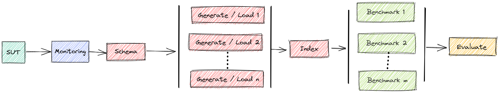

# Example: Benchmark PgDuckDB

This example shows how to benchmark PgDuckDB, PostgreSQL with the DuckDB extension, with TPC-H on a single node.



[PgDuckDB](https://github.com/duckdb/pg_duckdb) is PostgreSQL with the extension `pg_duckdb`, which embeds the analytical engine of [DuckDB](https://duckdb.org/).
Bexhoma runs the image `pgduckdb/pgduckdb:18-v1.1.1` and uses the scripts and loaders of PostgreSQL.
With `-xdfe` the queries on PostgreSQL tables run in DuckDB's engine, otherwise in PostgreSQL's own executor.

**The results are not official benchmark results.
Exact performance depends on a number of parameters.
You may get different results.
These examples are solely to illustrate how to use bexhoma and show the result evaluation.**

References:
1. [pg_duckdb](https://github.com/duckdb/pg_duckdb)
1. [DuckDB](https://duckdb.org/)
1. [PgDuckDB in Docker](https://hub.docker.com/r/pgduckdb/pgduckdb)
1. [TPC-H](https://www.tpc.org/tpch/)
1. [Orchestrating DBMS Benchmarking in the Cloud with Kubernetes](https://doi.org/10.1007/978-3-030-94437-7_6)
1. Test script of this page: [test-docs-pgduckdb.sh](https://github.com/Beuth-Erdelt/Benchmark-Experiment-Host-Manager/blob/master/scripts/test-docs-pgduckdb.sh), [test-docs-pgduckdb.ps1](https://github.com/Beuth-Erdelt/Benchmark-Experiment-Host-Manager/blob/master/scripts/test-docs-pgduckdb.ps1)


## Perform TPC-H Benchmark

You will have to change the node selectors there (to names of nodes, that exist in your cluster - or to leave out the corresponding parameters):
```bash
BEXHOMA_NODE_SUT="cl-worker11"
BEXHOMA_NODE_LOAD="cl-worker19"
BEXHOMA_NODE_BENCHMARK="cl-worker19"
LOG_DIR="./logs_tests"
BEXHOMA_MS=1
BEXHOMA_STORAGE_CLASS="shared"

mkdir -p $LOG_DIR
```

For performing the experiment we can run the [tpch file](https://github.com/Beuth-Erdelt/Benchmark-Experiment-Host-Manager/blob/master/tpch.py).

Example:
```bash
bexhoma tpch \
  -dbms PgDuckDB \
  -xdfe \
  -sf 1 \
  -nlp 8 \
  -nlt 8 \
  -xii -xic -xis \
  -xdt \
  -ms $BEXHOMA_MS \
  -tr \
  -lr 64Gi \
  -rr 64Gi \
  -rss 50Gi \
  -rnn $BEXHOMA_NODE_SUT -rnl $BEXHOMA_NODE_LOAD -rnb $BEXHOMA_NODE_BENCHMARK \
  --set deployment[bexhoma-deployment-pg-duck].container[dbms].random_page_cost=1.1 \
  --set deployment[bexhoma-deployment-pg-duck].container[dbms].effective_io_concurrency=200 \
  --set deployment[bexhoma-deployment-pg-duck].container[dbms].io_method=io_uring \
  --set deployment[bexhoma-deployment-pg-duck].container[dbms].max_parallel_workers_per_gather=2 \
  --set deployment[bexhoma-deployment-pg-duck].container[dbms].max_parallel_workers=4 \
  --set deployment[bexhoma-deployment-pg-duck].container[dbms].max_worker_processes=6 \
  --set deployment[bexhoma-deployment-pg-duck].container[dbms].shared_buffers=20GB \
  --set deployment[bexhoma-deployment-pg-duck].container[dbms].effective_cache_size=48GB \
  --set deployment[bexhoma-deployment-pg-duck].container[dbms].work_mem=1GB \
  --set deployment[bexhoma-deployment-pg-duck].container[dbms].maintenance_work_mem=2GB \
  run &>$LOG_DIR/docs_tpch_pgduckdb.log
```

This runs the TPC-H power test of [Example: Benchmark PostgreSQL](Example-PostgreSQL.md), with the same PostgreSQL settings (`--set`), on PgDuckDB in DuckDB's engine (`-xdfe`).

### Status

You can watch the status while benchmark is running via `bexhoma status`

```bash
Dashboard: Running
Cluster Prometheus: Running
Message Queue: Running
Data directory: Running
Result directory: Running

```

The code of the experiment is its unique identifier.
You can find the number also in the output of the benchmark script.

### Cleanup

The script is supposed to clean up and remove everything from the cluster that is related to the experiment after finishing.
If something goes wrong, you can also clean up manually with `bexperiment stop` (removes everything) or `bexperiment stop -e <code>` (removes everything that is related to experiment `<code>`).

### Evaluate Results

At the end of a benchmark you will see a summary like

<details>
<summary>Show <a href="https://github.com/Beuth-Erdelt/Benchmark-Experiment-Host-Manager/blob/master/logs_tests/docs_tpch_pgduckdb_summary.md" target="_blank" rel="noopener">docs_tpch_pgduckdb.log</a></summary>

```markdown
## Show Summary

### Workload
TPC-H Queries SF=1
* Type: tpch
* Duration: 354s 
* Code: 1793713078
* This includes the reading queries of TPC-H.
* This experiment compares run time and resource consumption of TPC-H queries in different DBMS.
  * TPC-H (SF=1) data is loaded and benchmark is executed.
  * Query ordering is Q1 - Q22.
  * All instances use the same query parameters.
  * Timeout per query is 1800.
  * Data transfer volume per query is also measured.
  * PgDuckDB queries are forced through the DuckDB execution engine.
  * Import sets indexes, constraints, statistics recomputation after loading.
  * Load durability is relaxed (-xld; restored after the load).
  * Experiment uses bexhoma version 0.11.12.
  * Experiment is limited to DBMS ['PgDuckDB'].
  * Import is handled by 8 processes (pods).
  * Loading is fixed to cl-worker38.
  * Benchmarking is fixed to cl-worker38.
  * SUT is fixed to cl-worker36.
  * Database uses ephemeral storage of size 50Gi.
  * Loading is tested with [8] threads, split into [8] pods.
  * Benchmarking is tested with [1] threads, split into [1] pods.
  * Benchmarking is run as [1] times the number of benchmarking pods.
  * Experiment is run once.
  * Maximum DBMS across the whole cluster is 10.
  * Results are validated against basic correctness requirements.
  * Deployment parameter overrides: [({'kind': 'deployment', 'workload': 'bexhoma-deployment-pg-duck', 'config': '', 'container': 'dbms', 'param': 'random_page_cost'}, '1.1'), ({'kind': 'deployment', 'workload': 'bexhoma-deployment-pg-duck', 'config': '', 'container': 'dbms', 'param': 'effective_io_concurrency'}, '200'), ({'kind': 'deployment', 'workload': 'bexhoma-deployment-pg-duck', 'config': '', 'container': 'dbms', 'param': 'io_method'}, 'io_uring'), ({'kind': 'deployment', 'workload': 'bexhoma-deployment-pg-duck', 'config': '', 'container': 'dbms', 'param': 'max_parallel_workers_per_gather'}, '2'), ({'kind': 'deployment', 'workload': 'bexhoma-deployment-pg-duck', 'config': '', 'container': 'dbms', 'param': 'max_parallel_workers'}, '4'), ({'kind': 'deployment', 'workload': 'bexhoma-deployment-pg-duck', 'config': '', 'container': 'dbms', 'param': 'max_worker_processes'}, '6'), ({'kind': 'deployment', 'workload': 'bexhoma-deployment-pg-duck', 'config': '', 'container': 'dbms', 'param': 'shared_buffers'}, '20GB'), ({'kind': 'deployment', 'workload': 'bexhoma-deployment-pg-duck', 'config': '', 'container': 'dbms', 'param': 'effective_cache_size'}, '48GB'), ({'kind': 'deployment', 'workload': 'bexhoma-deployment-pg-duck', 'config': '', 'container': 'dbms', 'param': 'work_mem'}, '1GB'), ({'kind': 'deployment', 'workload': 'bexhoma-deployment-pg-duck', 'config': '', 'container': 'dbms', 'param': 'maintenance_work_mem'}, '2GB')].
  * SUT requests 4 CPU and 64Gi RAM. RAM limit is 64Gi.

### Connections
* pgduckdb-1-1-1-1-1 uses docker image pgduckdb/pgduckdb:18-v1.1.1
  * RAM:2164173156352
  * CPU:INTEL(R) XEON(R) PLATINUM 8570
  * Cores:224
  * host:6.8.0-147-generic
  * node:cl-worker36
  * disk:803166
  * datadisk:2758
  * volume_size:1.8T
  * volume_used:785G
  * cpu_list:0-223
  * args:['-c', 'shared_preload_libraries=pg_duckdb', '-c', 'max_connections=640', '-c', 'max_worker_processes=6', '-c', 'max_parallel_workers=4', '-c', 'max_parallel_workers_per_gather=2', '-c', 'max_parallel_maintenance_workers=4', '-c', 'shared_buffers=20GB', '-c', 'effective_cache_size=48GB', '-c', 'work_mem=1GB', '-c', 'maintenance_work_mem=2GB', '-c', 'autovacuum=off', '-c', 'wal_level=minimal', '-c', 'max_wal_senders=0', '-c', 'max_wal_size=32GB', '-c', 'checkpoint_timeout=1h', '-c', 'checkpoint_completion_target=1.0', '-c', 'lock_timeout=30s', '-c', 'idle_in_transaction_session_timeout=30000', '-c', 'random_page_cost=1.1', '-c', 'effective_io_concurrency=200', '-c', 'io_method=io_uring']
  * requests_cpu:4
  * requests_memory:64Gi
  * limits_memory:64Gi
  * resources_total: 4.0 CPU, 64.0 GiB RAM requested in 1 pods
    * sut: 1 x, 4.0 CPU, 64.0 GiB RAM
  * load_durability: relaxed
  * eval_parameters
    * code:1793713078

### SUT Container Restarts
* bexhoma-sut-pgduckdb-1-1793713078-59f4cc9f6d-whvnr: 0

### Workflow

#### Actual

* DBMS PgDuckDB-1 - Experiment 1 Client 1: tpch (1 pods)

#### Planned

* DBMS PgDuckDB-1 - Experiment 1 Client 1: tpch (1 pods)

### Loading

#### Per Run

|              |   experiment_run |   SF |   time_load |   time_preload |   time_generate |   time_ingest |   time_postload |   loading_pods |   terminals | tenant_id   | type_tenants   |   num_tenants | vol_tenants   |   Throughput [SF/h] | loading_inherited   |
|:-------------|-----------------:|-----:|------------:|---------------:|----------------:|--------------:|----------------:|---------------:|------------:|:------------|:---------------|--------------:|:--------------|--------------------:|:--------------------|
| PgDuckDB-1-1 |                1 |    1 |       57.00 |           2.00 |           28.00 |          9.00 |           14.00 |              8 |           0 |             | None           |             0 | False         |               63.16 | False               |

### Benchmarking

#### Per Connection

| DBMS               | configuration   | phase          | job              |   experiment_run |   client |   benchmark_run |   pod_count |   SF |   num_of_queries |   num_of_executions |   time [s] |   Geo Times [s] |   Power@Size [~Q/h] |   Throughput@Size |   tenant_id | pod                |
|:-------------------|:----------------|:---------------|:-----------------|-----------------:|---------:|----------------:|------------:|-----:|-----------------:|--------------------:|-----------:|----------------:|--------------------:|------------------:|------------:|:-------------------|
| pgduckdb-1-1-1-1-1 | PgDuckDB-1      | pgduckdb-1-1-1 | pgduckdb-1-1-1-1 |                1 |        1 |               1 |           1 | 1.00 |               22 |                  22 |         26 |            0.75 |             5079.26 |           3046.15 |          -1 | pgduckdb-1-1-1-1-1 |

#### Per Phase

|                | phase          |   experiment_run |   client |   benchmark_run |   pod_count |   SF |   num_of_queries |   num_of_executions |   time [s] |   Geo Times [s] |   Power@Size [~Q/h] |   Throughput@Size |   tenant_id |
|:---------------|:---------------|-----------------:|---------:|----------------:|------------:|-----:|-----------------:|--------------------:|-----------:|----------------:|--------------------:|------------------:|------------:|
| pgduckdb-1-1-1 | pgduckdb-1-1-1 |                1 |        1 |               1 |           1 | 1.00 |               22 |                  22 |         26 |            0.75 |             5079.26 |           3046.15 |          -1 |

#### Query Completion per Phase

| phase          |   pods | Pricing Summary Report (TPC-H Q1)   | Minimum Cost Supplier Query (TPC-H Q2)   | Shipping Priority (TPC-H Q3)   | Order Priority Checking Query (TPC-H Q4)   | Local Supplier Volume (TPC-H Q5)   | Forecasting Revenue Change (TPC-H Q6)   | Volume Shipping Query (TPC-H Q7)   | National Market Share (TPC-H Q8)   | Product Type Profit Measure (TPC-H Q9)   | Returned Item Reporting Query (TPC-H Q10)   | Important Stock Identification (TPC-H Q11)   | Shipping Modes and Order Priority (TPC-H Q12)   | Customer Distribution (TPC-H Q13)   | Promotion Effect Query (TPC-H Q14)   | Top Supplier Query (TPC-H Q15)   | Parts/Supplier Relationship (TPC-H Q16)   | Small-Quantity-Order Revenue (TPC-H Q17)   | Large Volume Customer (TPC-H Q18)   | Discounted Revenue (TPC-H Q19)   | Potential Part Promotion (TPC-H Q20)   | Suppliers Who Kept Orders Waiting Query (TPC-H Q21)   | Global Sales Opportunity Query (TPC-H Q22)   | complete   |
|:---------------|-------:|:------------------------------------|:-----------------------------------------|:-------------------------------|:-------------------------------------------|:-----------------------------------|:----------------------------------------|:-----------------------------------|:-----------------------------------|:-----------------------------------------|:--------------------------------------------|:---------------------------------------------|:------------------------------------------------|:------------------------------------|:-------------------------------------|:---------------------------------|:------------------------------------------|:-------------------------------------------|:------------------------------------|:---------------------------------|:---------------------------------------|:------------------------------------------------------|:---------------------------------------------|:-----------|
| pgduckdb-1-1-1 |      1 | 1/1                                 | 1/1                                      | 1/1                            | 1/1                                        | 1/1                                | 1/1                                     | 1/1                                | 1/1                                | 1/1                                      | 1/1                                         | 1/1                                          | 1/1                                             | 1/1                                 | 1/1                                  | 1/1                              | 1/1                                       | 1/1                                        | 1/1                                 | 1/1                              | 1/1                                    | 1/1                                                   | 1/1                                          | yes        |

Pods that completed each query, out of the pods the phase ran (`completed/pods`). Counted per phase, so a failure in one phase does not change another phase's row. `complete` = every pod completed every active query.

### Latency of Timer Execution [ms]
| Queries                                             |   pgduckdb-1-1-1-1-1 |
|:----------------------------------------------------|---------------------:|
| Pricing Summary Report (TPC-H Q1)                   |              1237.28 |
| Minimum Cost Supplier Query (TPC-H Q2)              |               578.04 |
| Shipping Priority (TPC-H Q3)                        |               793.92 |
| Order Priority Checking Query (TPC-H Q4)            |               840.65 |
| Local Supplier Volume (TPC-H Q5)                    |              1212.57 |
| Forecasting Revenue Change (TPC-H Q6)               |               415.11 |
| Volume Shipping Query (TPC-H Q7)                    |               703.61 |
| National Market Share (TPC-H Q8)                    |              1183.95 |
| Product Type Profit Measure (TPC-H Q9)              |              1894.36 |
| Returned Item Reporting Query (TPC-H Q10)           |               780.62 |
| Important Stock Identification (TPC-H Q11)          |               240.68 |
| Shipping Modes and Order Priority (TPC-H Q12)       |               823.62 |
| Customer Distribution (TPC-H Q13)                   |               359.85 |
| Promotion Effect Query (TPC-H Q14)                  |               491.04 |
| Top Supplier Query (TPC-H Q15)                      |               422.82 |
| Parts/Supplier Relationship (TPC-H Q16)             |               204.58 |
| Small-Quantity-Order Revenue (TPC-H Q17)            |              1536.80 |
| Large Volume Customer (TPC-H Q18)                   |              1014.41 |
| Discounted Revenue (TPC-H Q19)                      |               600.55 |
| Potential Part Promotion (TPC-H Q20)                |              1074.16 |
| Suppliers Who Kept Orders Waiting Query (TPC-H Q21) |              2526.67 |
| Global Sales Opportunity Query (TPC-H Q22)          |               225.61 |

### Errors (failed queries)

No errors

### Warnings (result mismatch)

No warnings

### Tests
* TEST passed: Loading measured in this experiment
* TEST passed: Data parameters as requested
* TEST passed: Init scripts without errors
* TEST passed: No SUT container restarts
* TEST skipped: SUT data survived container restarts (no restarts)
* TEST passed: Geo Times [s] contains no 0 or NaN
* TEST passed: Power@Size [~Q/h] contains no 0 or NaN
* TEST passed: Throughput@Size contains no 0 or NaN
* TEST passed: No SQL errors
* TEST passed: No SQL warnings
* TEST passed: All active queries counted in the totals
* TEST skipped: EXPLAIN captured for every active query (-se/--store-explain not used)
* TEST passed: Workflow as planned
```

</details>

To see the summary again you can simply call `bexhoma summary -e <code>` with the experiment code.

Results are transformed into pandas DataFrames and can be inspected in detail.
See for example the [Jupyter notebooks](https://github.com/Beuth-Erdelt/Benchmark-Experiment-Host-Manager/tree/master/notebooks/), in particular [Collector-TPC-H.ipynb](https://github.com/Beuth-Erdelt/Benchmark-Experiment-Host-Manager/blob/master/notebooks/Collector-TPC-H.ipynb).

You can connect to an evaluation server locally by `bexhoma jupyter`.
This forwards ports, so you have
* a Jupyter notebook server at http://localhost:8888


## Monitoring

[Monitoring](Monitoring.html) can be activated for DBMS only (`-m`) or for all components (`-mc`).
Metrics are sampled every few seconds, so the benchmarking phase should take at least a minute.
This run uses SF=10 (`-sf`).

```bash
bexhoma tpch \
  -dbms PgDuckDB \
  -xdfe \
  -sf 10 \
  -nlp 8 \
  -nlt 8 \
  -xii -xic -xis \
  -xdt \
  -m \
  -mc \
  -ms $BEXHOMA_MS \
  -tr \
  -lr 64Gi \
  -rr 64Gi \
  -rss 150Gi \
  -rnn $BEXHOMA_NODE_SUT -rnl $BEXHOMA_NODE_LOAD -rnb $BEXHOMA_NODE_BENCHMARK \
  --set deployment[bexhoma-deployment-pg-duck].container[dbms].random_page_cost=1.1 \
  --set deployment[bexhoma-deployment-pg-duck].container[dbms].effective_io_concurrency=200 \
  --set deployment[bexhoma-deployment-pg-duck].container[dbms].io_method=io_uring \
  --set deployment[bexhoma-deployment-pg-duck].container[dbms].max_parallel_workers_per_gather=2 \
  --set deployment[bexhoma-deployment-pg-duck].container[dbms].max_parallel_workers=4 \
  --set deployment[bexhoma-deployment-pg-duck].container[dbms].max_worker_processes=6 \
  --set deployment[bexhoma-deployment-pg-duck].container[dbms].shared_buffers=20GB \
  --set deployment[bexhoma-deployment-pg-duck].container[dbms].effective_cache_size=48GB \
  --set deployment[bexhoma-deployment-pg-duck].container[dbms].work_mem=1GB \
  --set deployment[bexhoma-deployment-pg-duck].container[dbms].maintenance_work_mem=2GB \
  run &>$LOG_DIR/docs_tpch_pgduckdb_monitoring.log
```

### Example Result

<details>
<summary>Show <a href="https://github.com/Beuth-Erdelt/Benchmark-Experiment-Host-Manager/blob/master/logs_tests/docs_tpch_pgduckdb_monitoring_summary.md" target="_blank" rel="noopener">docs_tpch_pgduckdb_monitoring.log</a></summary>

```markdown
## Show Summary

### Workload
TPC-H Queries SF=10
* Type: tpch
* Duration: 640s 
* Code: 1793713447
* This includes the reading queries of TPC-H.
* This experiment compares run time and resource consumption of TPC-H queries in different DBMS.
  * TPC-H (SF=10) data is loaded and benchmark is executed.
  * Query ordering is Q1 - Q22.
  * All instances use the same query parameters.
  * Timeout per query is 1800.
  * Data transfer volume per query is also measured.
  * PgDuckDB queries are forced through the DuckDB execution engine.
  * Import sets indexes, constraints, statistics recomputation after loading.
  * Load durability is relaxed (-xld; restored after the load).
  * Experiment uses bexhoma version 0.11.12.
  * System metrics are monitored by a cluster-wide installation.
  * Experiment is limited to DBMS ['PgDuckDB'].
  * Import is handled by 8 processes (pods).
  * Loading is fixed to cl-worker38.
  * Benchmarking is fixed to cl-worker38.
  * SUT is fixed to cl-worker36.
  * Database uses ephemeral storage of size 150Gi.
  * Loading is tested with [8] threads, split into [8] pods.
  * Benchmarking is tested with [1] threads, split into [1] pods.
  * Benchmarking is run as [1] times the number of benchmarking pods.
  * Experiment is run once.
  * Maximum DBMS across the whole cluster is 10.
  * Results are validated against basic correctness requirements.
  * Deployment parameter overrides: [({'kind': 'deployment', 'workload': 'bexhoma-deployment-pg-duck', 'config': '', 'container': 'dbms', 'param': 'random_page_cost'}, '1.1'), ({'kind': 'deployment', 'workload': 'bexhoma-deployment-pg-duck', 'config': '', 'container': 'dbms', 'param': 'effective_io_concurrency'}, '200'), ({'kind': 'deployment', 'workload': 'bexhoma-deployment-pg-duck', 'config': '', 'container': 'dbms', 'param': 'io_method'}, 'io_uring'), ({'kind': 'deployment', 'workload': 'bexhoma-deployment-pg-duck', 'config': '', 'container': 'dbms', 'param': 'max_parallel_workers_per_gather'}, '2'), ({'kind': 'deployment', 'workload': 'bexhoma-deployment-pg-duck', 'config': '', 'container': 'dbms', 'param': 'max_parallel_workers'}, '4'), ({'kind': 'deployment', 'workload': 'bexhoma-deployment-pg-duck', 'config': '', 'container': 'dbms', 'param': 'max_worker_processes'}, '6'), ({'kind': 'deployment', 'workload': 'bexhoma-deployment-pg-duck', 'config': '', 'container': 'dbms', 'param': 'shared_buffers'}, '20GB'), ({'kind': 'deployment', 'workload': 'bexhoma-deployment-pg-duck', 'config': '', 'container': 'dbms', 'param': 'effective_cache_size'}, '48GB'), ({'kind': 'deployment', 'workload': 'bexhoma-deployment-pg-duck', 'config': '', 'container': 'dbms', 'param': 'work_mem'}, '1GB'), ({'kind': 'deployment', 'workload': 'bexhoma-deployment-pg-duck', 'config': '', 'container': 'dbms', 'param': 'maintenance_work_mem'}, '2GB')].
  * SUT requests 4 CPU and 64Gi RAM. RAM limit is 64Gi.

### Connections
* pgduckdb-1-1-1-1-1 uses docker image pgduckdb/pgduckdb:18-v1.1.1
  * RAM:2164173156352
  * CPU:INTEL(R) XEON(R) PLATINUM 8570
  * Cores:224
  * host:6.8.0-147-generic
  * node:cl-worker36
  * disk:840270
  * datadisk:27210
  * volume_size:1.8T
  * volume_used:821G
  * cpu_list:0-223
  * args:['-c', 'shared_preload_libraries=pg_duckdb', '-c', 'max_connections=640', '-c', 'max_worker_processes=6', '-c', 'max_parallel_workers=4', '-c', 'max_parallel_workers_per_gather=2', '-c', 'max_parallel_maintenance_workers=4', '-c', 'shared_buffers=20GB', '-c', 'effective_cache_size=48GB', '-c', 'work_mem=1GB', '-c', 'maintenance_work_mem=2GB', '-c', 'autovacuum=off', '-c', 'wal_level=minimal', '-c', 'max_wal_senders=0', '-c', 'max_wal_size=32GB', '-c', 'checkpoint_timeout=1h', '-c', 'checkpoint_completion_target=1.0', '-c', 'lock_timeout=30s', '-c', 'idle_in_transaction_session_timeout=30000', '-c', 'random_page_cost=1.1', '-c', 'effective_io_concurrency=200', '-c', 'io_method=io_uring']
  * requests_cpu:4
  * requests_memory:64Gi
  * limits_memory:64Gi
  * resources_total: 4.0 CPU, 64.0 GiB RAM requested in 1 pods
    * sut: 1 x, 4.0 CPU, 64.0 GiB RAM
  * load_durability: relaxed
  * eval_parameters
    * code:1793713447

### SUT Container Restarts
* bexhoma-sut-pgduckdb-1-1793713447-79db76c8bb-26ccg: 0

### Workflow

#### Actual

* DBMS PgDuckDB-1 - Experiment 1 Client 1: tpch (1 pods)

#### Planned

* DBMS PgDuckDB-1 - Experiment 1 Client 1: tpch (1 pods)

### Loading

#### Per Run

|              |   experiment_run |   SF |   time_load |   time_preload |   time_generate |   time_ingest |   time_postload |   loading_pods |   terminals | tenant_id   | type_tenants   |   num_tenants | vol_tenants   |   Throughput [SF/h] | loading_inherited   |
|:-------------|-----------------:|-----:|------------:|---------------:|----------------:|--------------:|----------------:|---------------:|------------:|:------------|:---------------|--------------:|:--------------|--------------------:|:--------------------|
| PgDuckDB-1-1 |                1 |   10 |      215.00 |           2.00 |           24.00 |         82.00 |           97.00 |              8 |           0 |             | None           |             0 | False         |              167.44 | False               |

### Benchmarking

#### Per Connection

| DBMS               | configuration   | phase          | job              |   experiment_run |   client |   benchmark_run |   pod_count |    SF |   num_of_queries |   num_of_executions |   time [s] |   Geo Times [s] |   Power@Size [~Q/h] |   Throughput@Size |   tenant_id | pod                |
|:-------------------|:----------------|:---------------|:-----------------|-----------------:|---------:|----------------:|------------:|------:|-----------------:|--------------------:|-----------:|----------------:|--------------------:|------------------:|------------:|:-------------------|
| pgduckdb-1-1-1-1-1 | PgDuckDB-1      | pgduckdb-1-1-1 | pgduckdb-1-1-1-1 |                1 |        1 |               1 |           1 | 10.00 |               22 |                  22 |        165 |            5.89 |             6267.96 |           4800.00 |          -1 | pgduckdb-1-1-1-1-1 |

#### Per Phase

|                | phase          |   experiment_run |   client |   benchmark_run |   pod_count |    SF |   num_of_queries |   num_of_executions |   time [s] |   Geo Times [s] |   Power@Size [~Q/h] |   Throughput@Size |   tenant_id |
|:---------------|:---------------|-----------------:|---------:|----------------:|------------:|------:|-----------------:|--------------------:|-----------:|----------------:|--------------------:|------------------:|------------:|
| pgduckdb-1-1-1 | pgduckdb-1-1-1 |                1 |        1 |               1 |           1 | 10.00 |               22 |                  22 |        165 |            5.89 |             6267.96 |           4800.00 |          -1 |

#### Query Completion per Phase

| phase          |   pods | Pricing Summary Report (TPC-H Q1)   | Minimum Cost Supplier Query (TPC-H Q2)   | Shipping Priority (TPC-H Q3)   | Order Priority Checking Query (TPC-H Q4)   | Local Supplier Volume (TPC-H Q5)   | Forecasting Revenue Change (TPC-H Q6)   | Volume Shipping Query (TPC-H Q7)   | National Market Share (TPC-H Q8)   | Product Type Profit Measure (TPC-H Q9)   | Returned Item Reporting Query (TPC-H Q10)   | Important Stock Identification (TPC-H Q11)   | Shipping Modes and Order Priority (TPC-H Q12)   | Customer Distribution (TPC-H Q13)   | Promotion Effect Query (TPC-H Q14)   | Top Supplier Query (TPC-H Q15)   | Parts/Supplier Relationship (TPC-H Q16)   | Small-Quantity-Order Revenue (TPC-H Q17)   | Large Volume Customer (TPC-H Q18)   | Discounted Revenue (TPC-H Q19)   | Potential Part Promotion (TPC-H Q20)   | Suppliers Who Kept Orders Waiting Query (TPC-H Q21)   | Global Sales Opportunity Query (TPC-H Q22)   | complete   |
|:---------------|-------:|:------------------------------------|:-----------------------------------------|:-------------------------------|:-------------------------------------------|:-----------------------------------|:----------------------------------------|:-----------------------------------|:-----------------------------------|:-----------------------------------------|:--------------------------------------------|:---------------------------------------------|:------------------------------------------------|:------------------------------------|:-------------------------------------|:---------------------------------|:------------------------------------------|:-------------------------------------------|:------------------------------------|:---------------------------------|:---------------------------------------|:------------------------------------------------------|:---------------------------------------------|:-----------|
| pgduckdb-1-1-1 |      1 | 1/1                                 | 1/1                                      | 1/1                            | 1/1                                        | 1/1                                | 1/1                                     | 1/1                                | 1/1                                | 1/1                                      | 1/1                                         | 1/1                                          | 1/1                                             | 1/1                                 | 1/1                                  | 1/1                              | 1/1                                       | 1/1                                        | 1/1                                 | 1/1                              | 1/1                                    | 1/1                                                   | 1/1                                          | yes        |

Pods that completed each query, out of the pods the phase ran (`completed/pods`). Counted per phase, so a failure in one phase does not change another phase's row. `complete` = every pod completed every active query.

### Latency of Timer Execution [ms]
| Queries                                             |   pgduckdb-1-1-1-1-1 |
|:----------------------------------------------------|---------------------:|
| Pricing Summary Report (TPC-H Q1)                   |             12166.17 |
| Minimum Cost Supplier Query (TPC-H Q2)              |              2114.15 |
| Shipping Priority (TPC-H Q3)                        |              7243.30 |
| Order Priority Checking Query (TPC-H Q4)            |              7446.29 |
| Local Supplier Volume (TPC-H Q5)                    |             10039.23 |
| Forecasting Revenue Change (TPC-H Q6)               |              3938.43 |
| Volume Shipping Query (TPC-H Q7)                    |              6325.22 |
| National Market Share (TPC-H Q8)                    |             10805.60 |
| Product Type Profit Measure (TPC-H Q9)              |              9582.98 |
| Returned Item Reporting Query (TPC-H Q10)           |              6222.97 |
| Important Stock Identification (TPC-H Q11)          |              1660.56 |
| Shipping Modes and Order Priority (TPC-H Q12)       |              6282.77 |
| Customer Distribution (TPC-H Q13)                   |              2685.63 |
| Promotion Effect Query (TPC-H Q14)                  |              5634.04 |
| Top Supplier Query (TPC-H Q15)                      |              5040.88 |
| Parts/Supplier Relationship (TPC-H Q16)             |              1344.10 |
| Small-Quantity-Order Revenue (TPC-H Q17)            |             12152.87 |
| Large Volume Customer (TPC-H Q18)                   |             13591.24 |
| Discounted Revenue (TPC-H Q19)                      |              6168.76 |
| Potential Part Promotion (TPC-H Q20)                |              5668.84 |
| Suppliers Who Kept Orders Waiting Query (TPC-H Q21) |             17812.05 |
| Global Sales Opportunity Query (TPC-H Q22)          |              2046.05 |

### Errors (failed queries)

No errors

### Warnings (result mismatch)

No warnings

### Monitoring

### Loading phase: SUT deployment

| DBMS             |   CPU [CPUs] |   Max CPU |   Max RAM [Gb] |   Max RAM Cached [Gb] |
|:-----------------|-------------:|----------:|---------------:|----------------------:|
| pgduckdb-1-1-1-1 |       470.37 |      3.58 |           6.33 |                 21.65 |

### Loading phase: component data generator

| DBMS             | CPU [CPUs]   |   Max CPU |   Max RAM [Gb] |   Max RAM Cached [Gb] |
|:-----------------|:-------------|----------:|---------------:|----------------------:|
| pgduckdb-1-1-1-1 | n/a          |         0 |           0.00 |                  0.00 |

### Loading phase: component loader

| DBMS             |   CPU [CPUs] |   Max CPU |   Max RAM [Gb] |   Max RAM Cached [Gb] |
|:-----------------|-------------:|----------:|---------------:|----------------------:|
| pgduckdb-1-1-1-1 |       102.59 |      1.87 |           0.00 |                  0.93 |

### Benchmarking phase: SUT deployment

| DBMS             |   CPU [CPUs] |   Max CPU |   Max RAM [Gb] |   Max RAM Cached [Gb] |
|:-----------------|-------------:|----------:|---------------:|----------------------:|
| pgduckdb-1-1-1-1 |       439.07 |      3.63 |           7.61 |                 23.69 |

### Benchmarking phase: component benchmarker

| DBMS             |   CPU [CPUs] |   Max CPU |   Max RAM [Gb] |   Max RAM Cached [Gb] |
|:-----------------|-------------:|----------:|---------------:|----------------------:|
| pgduckdb-1-1-1-1 |        18.22 |      0.45 |           0.31 |                  0.32 |

### Missing Monitoring Metrics
* CPU Throttling Rate [s/s] for connection pgduckdb-1-1-1-1 (bexhoma-metrics-pgduckdb-1-1-1-1-benchmarking.log, expected: series exists only while non-zero)
* CPU Throttled Time [s] for connection pgduckdb-1-1-1-1 (bexhoma-metrics-pgduckdb-1-1-1-1-benchmarking.log, expected: series exists only while non-zero)
* Memory Usage, Working Set [MiB] for connection pgduckdb-1-1-1-1 (bexhoma-metrics-pgduckdb-1-1-1-1-datagenerator.log, expected: data pre-existing)
* Memory Usage incl. Page Cache [MiB] for connection pgduckdb-1-1-1-1 (bexhoma-metrics-pgduckdb-1-1-1-1-datagenerator.log, expected: data pre-existing)
* CPU Utilization [CPUs] for connection pgduckdb-1-1-1-1 (bexhoma-metrics-pgduckdb-1-1-1-1-datagenerator.log, expected: data pre-existing)
* CPU Throttling Rate [s/s] for connection pgduckdb-1-1-1-1 (bexhoma-metrics-pgduckdb-1-1-1-1-datagenerator.log, expected: data pre-existing)
* CPU Utilization Time [s] for connection pgduckdb-1-1-1-1 (bexhoma-metrics-pgduckdb-1-1-1-1-datagenerator.log, expected: data pre-existing)
* CPU User Time [s] for connection pgduckdb-1-1-1-1 (bexhoma-metrics-pgduckdb-1-1-1-1-datagenerator.log, expected: data pre-existing)
* CPU Throttled Time [s] for connection pgduckdb-1-1-1-1 (bexhoma-metrics-pgduckdb-1-1-1-1-datagenerator.log, expected: data pre-existing)
* CPU System Time [s] for connection pgduckdb-1-1-1-1 (bexhoma-metrics-pgduckdb-1-1-1-1-datagenerator.log, expected: data pre-existing)
* Filesystem Write Total, Largest Device (RAID Counted Once) [MiB] for connection pgduckdb-1-1-1-1 (bexhoma-metrics-pgduckdb-1-1-1-1-datagenerator.log, expected: data pre-existing)
* Filesystem Read Total, Largest Device (RAID Counted Once) [MiB] for connection pgduckdb-1-1-1-1 (bexhoma-metrics-pgduckdb-1-1-1-1-datagenerator.log, expected: data pre-existing)
* CPU Throttling Rate [s/s] for connection pgduckdb-1-1-1-1 (bexhoma-metrics-pgduckdb-1-1-1-1-loader.log, expected: series exists only while non-zero)
* CPU Throttled Time [s] for connection pgduckdb-1-1-1-1 (bexhoma-metrics-pgduckdb-1-1-1-1-loader.log, expected: series exists only while non-zero)
* CPU Throttling Rate [s/s] for connection pgduckdb-1-1-1-1 (bexhoma-metrics-pgduckdb-1-1-1-1-loading.log, expected: series exists only while non-zero)
* CPU Throttled Time [s] for connection pgduckdb-1-1-1-1 (bexhoma-metrics-pgduckdb-1-1-1-1-loading.log, expected: series exists only while non-zero)

### Tests
* TEST passed: Loading measured in this experiment
* TEST passed: Data parameters as requested
* TEST passed: Init scripts without errors
* TEST passed: No SUT container restarts
* TEST skipped: SUT data survived container restarts (no restarts)
* TEST passed: Loading phase: SUT deployment contains no 0 or NaN in CPU [CPUs]
* TEST skipped: Loading phase: component data generator contains 0 or NaN in CPU [CPUs] (data pre-existing)
* TEST passed: Loading phase: component loader contains no 0 or NaN in CPU [CPUs]
* TEST passed: Benchmarking phase: SUT deployment contains no 0 or NaN in CPU [CPUs]
* TEST passed: Benchmarking phase: component benchmarker contains no 0 or NaN in CPU [CPUs]
* TEST skipped: Monitoring metrics missing (data pre-existing; series exists only while non-zero)
* TEST passed: Geo Times [s] contains no 0 or NaN
* TEST passed: Power@Size [~Q/h] contains no 0 or NaN
* TEST passed: Throughput@Size contains no 0 or NaN
* TEST passed: No SQL errors
* TEST passed: No SQL warnings
* TEST passed: All active queries counted in the totals
* TEST skipped: EXPLAIN captured for every active query (-se/--store-explain not used)
* TEST passed: Workflow as planned
```

</details>

### Application Metrics

The template has a `postgres_exporter` sidecar, as PostgreSQL; `-ma` collects the metric set `postgresql`, see [Example: Benchmark PostgreSQL](Example-PostgreSQL.md#application-metrics).


## Persistent Storage

The default behaviour of bexhoma is that the database is stored inside the ephemeral storage of the Docker container.
If your cluster allows dynamic provisioning of volumes, you might request a persistent storage of a certain type (storageClass) and size.
With repetitions (`-nc`), `-rsr` removes an existing volume only before the first repetition and later repetitions reuse it without loading; `-rsrp` removes it before every repetition. See [Concepts](Concepts.html).

```bash
bexhoma tpch \
  -dbms PgDuckDB \
  -xdfe \
  -sf 1 \
  -nc 2 \
  -nlp 8 \
  -nlt 8 \
  -xii -xic -xis \
  -xdt \
  -ms $BEXHOMA_MS \
  -tr \
  -lr 64Gi \
  -rr 64Gi \
  -rsr \
  -rss 50Gi \
  -rst $BEXHOMA_STORAGE_CLASS \
  -rnn $BEXHOMA_NODE_SUT -rnl $BEXHOMA_NODE_LOAD -rnb $BEXHOMA_NODE_BENCHMARK \
  --set deployment[bexhoma-deployment-pg-duck].container[dbms].random_page_cost=1.1 \
  --set deployment[bexhoma-deployment-pg-duck].container[dbms].effective_io_concurrency=200 \
  --set deployment[bexhoma-deployment-pg-duck].container[dbms].io_method=io_uring \
  --set deployment[bexhoma-deployment-pg-duck].container[dbms].max_parallel_workers_per_gather=2 \
  --set deployment[bexhoma-deployment-pg-duck].container[dbms].max_parallel_workers=4 \
  --set deployment[bexhoma-deployment-pg-duck].container[dbms].max_worker_processes=6 \
  --set deployment[bexhoma-deployment-pg-duck].container[dbms].shared_buffers=20GB \
  --set deployment[bexhoma-deployment-pg-duck].container[dbms].effective_cache_size=48GB \
  --set deployment[bexhoma-deployment-pg-duck].container[dbms].work_mem=1GB \
  --set deployment[bexhoma-deployment-pg-duck].container[dbms].maintenance_work_mem=2GB \
  run &>$LOG_DIR/docs_tpch_pgduckdb_storage.log
```

### Example Result

<details>
<summary>Show <a href="https://github.com/Beuth-Erdelt/Benchmark-Experiment-Host-Manager/blob/master/logs_tests/docs_tpch_pgduckdb_storage_summary.md" target="_blank" rel="noopener">docs_tpch_pgduckdb_storage.log</a></summary>

```markdown
## Show Summary

### Workload
TPC-H Queries SF=1
* Type: tpch
* Duration: 670s 
* Code: 1793715761
* This includes the reading queries of TPC-H.
* This experiment compares run time and resource consumption of TPC-H queries in different DBMS.
  * TPC-H (SF=1) data is loaded and benchmark is executed.
  * Query ordering is Q1 - Q22.
  * All instances use the same query parameters.
  * Timeout per query is 1800.
  * Data transfer volume per query is also measured.
  * PgDuckDB queries are forced through the DuckDB execution engine.
  * Import sets indexes, constraints, statistics recomputation after loading.
  * Load durability is relaxed (-xld; restored after the load).
  * Experiment uses bexhoma version 0.11.12.
  * Experiment is limited to DBMS ['PgDuckDB'].
  * Import is handled by 8 processes (pods).
  * Loading is fixed to cl-worker38.
  * Benchmarking is fixed to cl-worker38.
  * SUT is fixed to cl-worker36.
  * Database is persisted to disk of type nvme and size 50Gi. Persistent storage is removed at experiment start.
  * Loading is tested with [8] threads, split into [8] pods.
  * Benchmarking is tested with [1] threads, split into [1] pods.
  * Benchmarking is run as [1] times the number of benchmarking pods.
  * Experiment is run 2 times.
  * Maximum DBMS across the whole cluster is 10.
  * Results are validated against basic correctness requirements.
  * Deployment parameter overrides: [({'kind': 'deployment', 'workload': 'bexhoma-deployment-pg-duck', 'config': '', 'container': 'dbms', 'param': 'random_page_cost'}, '1.1'), ({'kind': 'deployment', 'workload': 'bexhoma-deployment-pg-duck', 'config': '', 'container': 'dbms', 'param': 'effective_io_concurrency'}, '200'), ({'kind': 'deployment', 'workload': 'bexhoma-deployment-pg-duck', 'config': '', 'container': 'dbms', 'param': 'io_method'}, 'io_uring'), ({'kind': 'deployment', 'workload': 'bexhoma-deployment-pg-duck', 'config': '', 'container': 'dbms', 'param': 'max_parallel_workers_per_gather'}, '2'), ({'kind': 'deployment', 'workload': 'bexhoma-deployment-pg-duck', 'config': '', 'container': 'dbms', 'param': 'max_parallel_workers'}, '4'), ({'kind': 'deployment', 'workload': 'bexhoma-deployment-pg-duck', 'config': '', 'container': 'dbms', 'param': 'max_worker_processes'}, '6'), ({'kind': 'deployment', 'workload': 'bexhoma-deployment-pg-duck', 'config': '', 'container': 'dbms', 'param': 'shared_buffers'}, '20GB'), ({'kind': 'deployment', 'workload': 'bexhoma-deployment-pg-duck', 'config': '', 'container': 'dbms', 'param': 'effective_cache_size'}, '48GB'), ({'kind': 'deployment', 'workload': 'bexhoma-deployment-pg-duck', 'config': '', 'container': 'dbms', 'param': 'work_mem'}, '1GB'), ({'kind': 'deployment', 'workload': 'bexhoma-deployment-pg-duck', 'config': '', 'container': 'dbms', 'param': 'maintenance_work_mem'}, '2GB')].
  * SUT requests 4 CPU and 64Gi RAM. RAM limit is 64Gi.

### Connections
* pgduckdb-1-1-1-1-1 uses docker image pgduckdb/pgduckdb:18-v1.1.1
  * RAM:2164173156352
  * CPU:INTEL(R) XEON(R) PLATINUM 8570
  * Cores:224
  * host:6.8.0-147-generic
  * node:cl-worker36
  * disk:906550
  * datadisk:2757
  * volume_size:49G
  * volume_used:2.7G
  * cpu_list:0-223
  * args:['-c', 'shared_preload_libraries=pg_duckdb', '-c', 'max_connections=640', '-c', 'max_worker_processes=6', '-c', 'max_parallel_workers=4', '-c', 'max_parallel_workers_per_gather=2', '-c', 'max_parallel_maintenance_workers=4', '-c', 'shared_buffers=20GB', '-c', 'effective_cache_size=48GB', '-c', 'work_mem=1GB', '-c', 'maintenance_work_mem=2GB', '-c', 'autovacuum=off', '-c', 'wal_level=minimal', '-c', 'max_wal_senders=0', '-c', 'max_wal_size=32GB', '-c', 'checkpoint_timeout=1h', '-c', 'checkpoint_completion_target=1.0', '-c', 'lock_timeout=30s', '-c', 'idle_in_transaction_session_timeout=30000', '-c', 'random_page_cost=1.1', '-c', 'effective_io_concurrency=200', '-c', 'io_method=io_uring']
  * requests_cpu:4
  * requests_memory:64Gi
  * limits_memory:64Gi
  * resources_total: 4.0 CPU, 64.0 GiB RAM requested in 1 pods
    * sut: 1 x, 4.0 CPU, 64.0 GiB RAM
  * load_durability: relaxed
  * eval_parameters
    * code:1793715761
* pgduckdb-1-2-1-1-1 uses docker image pgduckdb/pgduckdb:18-v1.1.1
  * RAM:2164173156352
  * CPU:INTEL(R) XEON(R) PLATINUM 8570
  * Cores:224
  * host:6.8.0-147-generic
  * node:cl-worker36
  * disk:906739
  * datadisk:2757
  * volume_size:49G
  * volume_used:2.7G
  * cpu_list:0-223
  * args:['-c', 'shared_preload_libraries=pg_duckdb', '-c', 'max_connections=640', '-c', 'max_worker_processes=6', '-c', 'max_parallel_workers=4', '-c', 'max_parallel_workers_per_gather=2', '-c', 'max_parallel_maintenance_workers=4', '-c', 'shared_buffers=20GB', '-c', 'effective_cache_size=48GB', '-c', 'work_mem=1GB', '-c', 'maintenance_work_mem=2GB', '-c', 'autovacuum=off', '-c', 'wal_level=minimal', '-c', 'max_wal_senders=0', '-c', 'max_wal_size=32GB', '-c', 'checkpoint_timeout=1h', '-c', 'checkpoint_completion_target=1.0', '-c', 'lock_timeout=30s', '-c', 'idle_in_transaction_session_timeout=30000', '-c', 'random_page_cost=1.1', '-c', 'effective_io_concurrency=200', '-c', 'io_method=io_uring']
  * requests_cpu:4
  * requests_memory:64Gi
  * limits_memory:64Gi
  * resources_total: 4.0 CPU, 64.0 GiB RAM requested in 1 pods
    * sut: 1 x, 4.0 CPU, 64.0 GiB RAM
  * load_durability: relaxed
  * eval_parameters
    * code:1793715761

### Inherited Loading
* loading skipped, loading times copied from an earlier repetition: PgDuckDB-1-2

### Data Parameters of Reused Volumes
* PgDuckDB-1: DDL values of the volume: index_method=btree, btree_dedup=on, statistics_target=100, extended_statistics=off
* PgDuckDB-1: loading values of the volume: script=Schema, indexing=Index_and_Constraints_and_Statistics

### SUT Container Restarts
* bexhoma-sut-pgduckdb-1-1793715761-7b987f9b9f-bm42w: 0
* bexhoma-sut-pgduckdb-1-1793715761-65495798b6-92tpq: 0

### Workflow

#### Actual

* DBMS PgDuckDB-1 - Experiment 1 Client 1: tpch (1 pods)
* DBMS PgDuckDB-1 - Experiment 2 Client 1: tpch (1 pods)

#### Planned

* DBMS PgDuckDB-1 - Experiment 1 Client 1: tpch (1 pods)
* DBMS PgDuckDB-1 - Experiment 2 Client 1: tpch (1 pods)

### Loading

#### Per Run

|              |   experiment_run |   SF |   time_load |   time_preload |   time_generate |   time_ingest |   time_postload |   loading_pods |   terminals | tenant_id   | type_tenants   |   num_tenants | vol_tenants   |   Throughput [SF/h] | loading_inherited   |
|:-------------|-----------------:|-----:|------------:|---------------:|----------------:|--------------:|----------------:|---------------:|------------:|:------------|:---------------|--------------:|:--------------|--------------------:|:--------------------|
| PgDuckDB-1-1 |                1 |    1 |       55.00 |           2.00 |           29.00 |          8.00 |           13.00 |              8 |           0 |             | None           |             0 | False         |               65.45 | False               |
| PgDuckDB-1-2 |                2 |    1 |       55.00 |           2.00 |           29.00 |          8.00 |           13.00 |              8 |           0 |             | None           |             0 | False         |               65.45 | True                |

### Benchmarking

#### Per Connection

| DBMS               | configuration   | phase          | job              |   experiment_run |   client |   benchmark_run |   pod_count |   SF |   num_of_queries |   num_of_executions |   time [s] |   Geo Times [s] |   Power@Size [~Q/h] |   Throughput@Size |   tenant_id | pod                |
|:-------------------|:----------------|:---------------|:-----------------|-----------------:|---------:|----------------:|------------:|-----:|-----------------:|--------------------:|-----------:|----------------:|--------------------:|------------------:|------------:|:-------------------|
| pgduckdb-1-1-1-1-1 | PgDuckDB-1      | pgduckdb-1-1-1 | pgduckdb-1-1-1-1 |                1 |        1 |               1 |           1 | 1.00 |               22 |                  22 |         22 |            0.67 |             5693.14 |           3600.00 |          -1 | pgduckdb-1-1-1-1-1 |
| pgduckdb-1-2-1-1-1 | PgDuckDB-1      | pgduckdb-1-2-1 | pgduckdb-1-2-1-1 |                2 |        1 |               1 |           1 | 1.00 |               22 |                  22 |         20 |            0.67 |             5684.91 |           3960.00 |          -1 | pgduckdb-1-2-1-1-1 |

#### Per Phase

|                | phase          |   experiment_run |   client |   benchmark_run |   pod_count |   SF |   num_of_queries |   num_of_executions |   time [s] |   Geo Times [s] |   Power@Size [~Q/h] |   Throughput@Size |   tenant_id |
|:---------------|:---------------|-----------------:|---------:|----------------:|------------:|-----:|-----------------:|--------------------:|-----------:|----------------:|--------------------:|------------------:|------------:|
| pgduckdb-1-1-1 | pgduckdb-1-1-1 |                1 |        1 |               1 |           1 | 1.00 |               22 |                  22 |         22 |            0.67 |             5693.14 |           3600.00 |          -1 |
| pgduckdb-1-2-1 | pgduckdb-1-2-1 |                2 |        1 |               1 |           1 | 1.00 |               22 |                  22 |         20 |            0.67 |             5684.91 |           3960.00 |          -1 |

#### Query Completion per Phase

| phase          |   pods | Pricing Summary Report (TPC-H Q1)   | Minimum Cost Supplier Query (TPC-H Q2)   | Shipping Priority (TPC-H Q3)   | Order Priority Checking Query (TPC-H Q4)   | Local Supplier Volume (TPC-H Q5)   | Forecasting Revenue Change (TPC-H Q6)   | Volume Shipping Query (TPC-H Q7)   | National Market Share (TPC-H Q8)   | Product Type Profit Measure (TPC-H Q9)   | Returned Item Reporting Query (TPC-H Q10)   | Important Stock Identification (TPC-H Q11)   | Shipping Modes and Order Priority (TPC-H Q12)   | Customer Distribution (TPC-H Q13)   | Promotion Effect Query (TPC-H Q14)   | Top Supplier Query (TPC-H Q15)   | Parts/Supplier Relationship (TPC-H Q16)   | Small-Quantity-Order Revenue (TPC-H Q17)   | Large Volume Customer (TPC-H Q18)   | Discounted Revenue (TPC-H Q19)   | Potential Part Promotion (TPC-H Q20)   | Suppliers Who Kept Orders Waiting Query (TPC-H Q21)   | Global Sales Opportunity Query (TPC-H Q22)   | complete   |
|:---------------|-------:|:------------------------------------|:-----------------------------------------|:-------------------------------|:-------------------------------------------|:-----------------------------------|:----------------------------------------|:-----------------------------------|:-----------------------------------|:-----------------------------------------|:--------------------------------------------|:---------------------------------------------|:------------------------------------------------|:------------------------------------|:-------------------------------------|:---------------------------------|:------------------------------------------|:-------------------------------------------|:------------------------------------|:---------------------------------|:---------------------------------------|:------------------------------------------------------|:---------------------------------------------|:-----------|
| pgduckdb-1-1-1 |      1 | 1/1                                 | 1/1                                      | 1/1                            | 1/1                                        | 1/1                                | 1/1                                     | 1/1                                | 1/1                                | 1/1                                      | 1/1                                         | 1/1                                          | 1/1                                             | 1/1                                 | 1/1                                  | 1/1                              | 1/1                                       | 1/1                                        | 1/1                                 | 1/1                              | 1/1                                    | 1/1                                                   | 1/1                                          | yes        |
| pgduckdb-1-2-1 |      1 | 1/1                                 | 1/1                                      | 1/1                            | 1/1                                        | 1/1                                | 1/1                                     | 1/1                                | 1/1                                | 1/1                                      | 1/1                                         | 1/1                                          | 1/1                                             | 1/1                                 | 1/1                                  | 1/1                              | 1/1                                       | 1/1                                        | 1/1                                 | 1/1                              | 1/1                                    | 1/1                                                   | 1/1                                          | yes        |

Pods that completed each query, out of the pods the phase ran (`completed/pods`). Counted per phase, so a failure in one phase does not change another phase's row. `complete` = every pod completed every active query.

### Latency of Timer Execution [ms]
| Queries                                             |   pgduckdb-1-1-1-1-1 |   pgduckdb-1-2-1-1-1 |
|:----------------------------------------------------|---------------------:|---------------------:|
| Pricing Summary Report (TPC-H Q1)                   |              1002.81 |              1128.65 |
| Minimum Cost Supplier Query (TPC-H Q2)              |               356.53 |               404.42 |
| Shipping Priority (TPC-H Q3)                        |               642.13 |               785.83 |
| Order Priority Checking Query (TPC-H Q4)            |               659.19 |               757.57 |
| Local Supplier Volume (TPC-H Q5)                    |               924.62 |               783.76 |
| Forecasting Revenue Change (TPC-H Q6)               |               512.86 |               527.10 |
| Volume Shipping Query (TPC-H Q7)                    |               637.96 |               670.03 |
| National Market Share (TPC-H Q8)                    |              1142.82 |              1620.34 |
| Product Type Profit Measure (TPC-H Q9)              |              1535.20 |               900.74 |
| Returned Item Reporting Query (TPC-H Q10)           |               586.80 |               653.96 |
| Important Stock Identification (TPC-H Q11)          |               206.36 |               205.24 |
| Shipping Modes and Order Priority (TPC-H Q12)       |               681.14 |               702.57 |
| Customer Distribution (TPC-H Q13)                   |               461.12 |               313.68 |
| Promotion Effect Query (TPC-H Q14)                  |               873.65 |               614.73 |
| Top Supplier Query (TPC-H Q15)                      |               510.26 |               485.95 |
| Parts/Supplier Relationship (TPC-H Q16)             |               185.76 |               212.43 |
| Small-Quantity-Order Revenue (TPC-H Q17)            |              1378.67 |              1299.80 |
| Large Volume Customer (TPC-H Q18)                   |               689.13 |               736.57 |
| Discounted Revenue (TPC-H Q19)                      |               583.82 |               606.05 |
| Potential Part Promotion (TPC-H Q20)                |               794.46 |               639.12 |
| Suppliers Who Kept Orders Waiting Query (TPC-H Q21) |              1881.29 |              2559.48 |
| Global Sales Opportunity Query (TPC-H Q22)          |               199.18 |               220.48 |

### Errors (failed queries)

No errors

### Warnings (result mismatch)

No warnings

### Tests
* TEST passed: Loading measured in this experiment
* TEST passed: Data parameters as requested
* TEST passed: Init scripts without errors
* TEST passed: No SUT container restarts
* TEST skipped: SUT data survived container restarts (no restarts)
* TEST passed: Geo Times [s] contains no 0 or NaN
* TEST passed: Power@Size [~Q/h] contains no 0 or NaN
* TEST passed: Throughput@Size contains no 0 or NaN
* TEST passed: No SQL errors
* TEST passed: No SQL warnings
* TEST passed: All active queries counted in the totals
* TEST skipped: EXPLAIN captured for every active query (-se/--store-explain not used)
* TEST passed: Workflow as planned
```

</details>


## Variants

### Executor of PostgreSQL

Without `-xdfe`, the queries run in PostgreSQL's own executor; only the extension is loaded.

```bash
bexhoma tpch \
  -dbms PgDuckDB \
  -sf 1 \
  -nlp 8 \
  -nlt 8 \
  -xii -xic -xis \
  -xdt \
  -ms $BEXHOMA_MS \
  -tr \
  -lr 64Gi \
  -rr 64Gi \
  -rss 50Gi \
  -rnn $BEXHOMA_NODE_SUT -rnl $BEXHOMA_NODE_LOAD -rnb $BEXHOMA_NODE_BENCHMARK \
  --set deployment[bexhoma-deployment-pg-duck].container[dbms].random_page_cost=1.1 \
  --set deployment[bexhoma-deployment-pg-duck].container[dbms].effective_io_concurrency=200 \
  --set deployment[bexhoma-deployment-pg-duck].container[dbms].io_method=io_uring \
  --set deployment[bexhoma-deployment-pg-duck].container[dbms].max_parallel_workers_per_gather=2 \
  --set deployment[bexhoma-deployment-pg-duck].container[dbms].max_parallel_workers=4 \
  --set deployment[bexhoma-deployment-pg-duck].container[dbms].max_worker_processes=6 \
  --set deployment[bexhoma-deployment-pg-duck].container[dbms].shared_buffers=20GB \
  --set deployment[bexhoma-deployment-pg-duck].container[dbms].effective_cache_size=48GB \
  --set deployment[bexhoma-deployment-pg-duck].container[dbms].work_mem=1GB \
  --set deployment[bexhoma-deployment-pg-duck].container[dbms].maintenance_work_mem=2GB \
  run &>$LOG_DIR/docs_tpch_pgduckdb_postgresql_engine.log
```

#### Example Result

<details>
<summary>Show <a href="https://github.com/Beuth-Erdelt/Benchmark-Experiment-Host-Manager/blob/master/logs_tests/docs_tpch_pgduckdb_postgresql_engine_summary.md" target="_blank" rel="noopener">docs_tpch_pgduckdb_postgresql_engine.log</a></summary>

```markdown
## Show Summary

### Workload
TPC-H Queries SF=1
* Type: tpch
* Duration: 299s 
* Code: 1793714132
* This includes the reading queries of TPC-H.
* This experiment compares run time and resource consumption of TPC-H queries in different DBMS.
  * TPC-H (SF=1) data is loaded and benchmark is executed.
  * Query ordering is Q1 - Q22.
  * All instances use the same query parameters.
  * Timeout per query is 1800.
  * Data transfer volume per query is also measured.
  * Import sets indexes, constraints, statistics recomputation after loading.
  * Load durability is relaxed (-xld; restored after the load).
  * Experiment uses bexhoma version 0.11.12.
  * Experiment is limited to DBMS ['PgDuckDB'].
  * Import is handled by 8 processes (pods).
  * Loading is fixed to cl-worker38.
  * Benchmarking is fixed to cl-worker38.
  * SUT is fixed to cl-worker36.
  * Database uses ephemeral storage of size 50Gi.
  * Loading is tested with [8] threads, split into [8] pods.
  * Benchmarking is tested with [1] threads, split into [1] pods.
  * Benchmarking is run as [1] times the number of benchmarking pods.
  * Experiment is run once.
  * Maximum DBMS across the whole cluster is 10.
  * Results are validated against basic correctness requirements.
  * Deployment parameter overrides: [({'kind': 'deployment', 'workload': 'bexhoma-deployment-pg-duck', 'config': '', 'container': 'dbms', 'param': 'random_page_cost'}, '1.1'), ({'kind': 'deployment', 'workload': 'bexhoma-deployment-pg-duck', 'config': '', 'container': 'dbms', 'param': 'effective_io_concurrency'}, '200'), ({'kind': 'deployment', 'workload': 'bexhoma-deployment-pg-duck', 'config': '', 'container': 'dbms', 'param': 'io_method'}, 'io_uring'), ({'kind': 'deployment', 'workload': 'bexhoma-deployment-pg-duck', 'config': '', 'container': 'dbms', 'param': 'max_parallel_workers_per_gather'}, '2'), ({'kind': 'deployment', 'workload': 'bexhoma-deployment-pg-duck', 'config': '', 'container': 'dbms', 'param': 'max_parallel_workers'}, '4'), ({'kind': 'deployment', 'workload': 'bexhoma-deployment-pg-duck', 'config': '', 'container': 'dbms', 'param': 'max_worker_processes'}, '6'), ({'kind': 'deployment', 'workload': 'bexhoma-deployment-pg-duck', 'config': '', 'container': 'dbms', 'param': 'shared_buffers'}, '20GB'), ({'kind': 'deployment', 'workload': 'bexhoma-deployment-pg-duck', 'config': '', 'container': 'dbms', 'param': 'effective_cache_size'}, '48GB'), ({'kind': 'deployment', 'workload': 'bexhoma-deployment-pg-duck', 'config': '', 'container': 'dbms', 'param': 'work_mem'}, '1GB'), ({'kind': 'deployment', 'workload': 'bexhoma-deployment-pg-duck', 'config': '', 'container': 'dbms', 'param': 'maintenance_work_mem'}, '2GB')].
  * SUT requests 4 CPU and 64Gi RAM. RAM limit is 64Gi.

### Connections
* pgduckdb-1-1-1-1-1 uses docker image pgduckdb/pgduckdb:18-v1.1.1
  * RAM:2164173156352
  * CPU:INTEL(R) XEON(R) PLATINUM 8570
  * Cores:224
  * host:6.8.0-147-generic
  * node:cl-worker36
  * disk:849481
  * datadisk:2758
  * volume_size:1.8T
  * volume_used:830G
  * cpu_list:0-223
  * args:['-c', 'shared_preload_libraries=pg_duckdb', '-c', 'max_connections=640', '-c', 'max_worker_processes=6', '-c', 'max_parallel_workers=4', '-c', 'max_parallel_workers_per_gather=2', '-c', 'max_parallel_maintenance_workers=4', '-c', 'shared_buffers=20GB', '-c', 'effective_cache_size=48GB', '-c', 'work_mem=1GB', '-c', 'maintenance_work_mem=2GB', '-c', 'autovacuum=off', '-c', 'wal_level=minimal', '-c', 'max_wal_senders=0', '-c', 'max_wal_size=32GB', '-c', 'checkpoint_timeout=1h', '-c', 'checkpoint_completion_target=1.0', '-c', 'lock_timeout=30s', '-c', 'idle_in_transaction_session_timeout=30000', '-c', 'random_page_cost=1.1', '-c', 'effective_io_concurrency=200', '-c', 'io_method=io_uring']
  * requests_cpu:4
  * requests_memory:64Gi
  * limits_memory:64Gi
  * resources_total: 4.0 CPU, 64.0 GiB RAM requested in 1 pods
    * sut: 1 x, 4.0 CPU, 64.0 GiB RAM
  * load_durability: relaxed
  * eval_parameters
    * code:1793714132

### SUT Container Restarts
* bexhoma-sut-pgduckdb-1-1793714132-76c457c75b-65b89: 0

### Workflow

#### Actual

* DBMS PgDuckDB-1 - Experiment 1 Client 1: tpch (1 pods)

#### Planned

* DBMS PgDuckDB-1 - Experiment 1 Client 1: tpch (1 pods)

### Loading

#### Per Run

|              |   experiment_run |   SF |   time_load |   time_preload |   time_generate |   time_ingest |   time_postload |   loading_pods |   terminals | tenant_id   | type_tenants   |   num_tenants | vol_tenants   |   Throughput [SF/h] | loading_inherited   |
|:-------------|-----------------:|-----:|------------:|---------------:|----------------:|--------------:|----------------:|---------------:|------------:|:------------|:---------------|--------------:|:--------------|--------------------:|:--------------------|
| PgDuckDB-1-1 |                1 |    1 |       53.00 |           1.00 |           21.00 |          8.00 |           17.00 |              8 |           0 |             | None           |             0 | False         |               67.92 | False               |

### Benchmarking

#### Per Connection

| DBMS               | configuration   | phase          | job              |   experiment_run |   client |   benchmark_run |   pod_count |   SF |   num_of_queries |   num_of_executions |   time [s] |   Geo Times [s] |   Power@Size [~Q/h] |   Throughput@Size |   tenant_id | pod                |
|:-------------------|:----------------|:---------------|:-----------------|-----------------:|---------:|----------------:|------------:|-----:|-----------------:|--------------------:|-----------:|----------------:|--------------------:|------------------:|------------:|:-------------------|
| pgduckdb-1-1-1-1-1 | PgDuckDB-1      | pgduckdb-1-1-1 | pgduckdb-1-1-1-1 |                1 |        1 |               1 |           1 | 1.00 |               22 |                  22 |         18 |            0.31 |            12088.70 |           4400.00 |          -1 | pgduckdb-1-1-1-1-1 |

#### Per Phase

|                | phase          |   experiment_run |   client |   benchmark_run |   pod_count |   SF |   num_of_queries |   num_of_executions |   time [s] |   Geo Times [s] |   Power@Size [~Q/h] |   Throughput@Size |   tenant_id |
|:---------------|:---------------|-----------------:|---------:|----------------:|------------:|-----:|-----------------:|--------------------:|-----------:|----------------:|--------------------:|------------------:|------------:|
| pgduckdb-1-1-1 | pgduckdb-1-1-1 |                1 |        1 |               1 |           1 | 1.00 |               22 |                  22 |         18 |            0.31 |            12088.70 |           4400.00 |          -1 |

#### Query Completion per Phase

| phase          |   pods | Pricing Summary Report (TPC-H Q1)   | Minimum Cost Supplier Query (TPC-H Q2)   | Shipping Priority (TPC-H Q3)   | Order Priority Checking Query (TPC-H Q4)   | Local Supplier Volume (TPC-H Q5)   | Forecasting Revenue Change (TPC-H Q6)   | Volume Shipping Query (TPC-H Q7)   | National Market Share (TPC-H Q8)   | Product Type Profit Measure (TPC-H Q9)   | Returned Item Reporting Query (TPC-H Q10)   | Important Stock Identification (TPC-H Q11)   | Shipping Modes and Order Priority (TPC-H Q12)   | Customer Distribution (TPC-H Q13)   | Promotion Effect Query (TPC-H Q14)   | Top Supplier Query (TPC-H Q15)   | Parts/Supplier Relationship (TPC-H Q16)   | Small-Quantity-Order Revenue (TPC-H Q17)   | Large Volume Customer (TPC-H Q18)   | Discounted Revenue (TPC-H Q19)   | Potential Part Promotion (TPC-H Q20)   | Suppliers Who Kept Orders Waiting Query (TPC-H Q21)   | Global Sales Opportunity Query (TPC-H Q22)   | complete   |
|:---------------|-------:|:------------------------------------|:-----------------------------------------|:-------------------------------|:-------------------------------------------|:-----------------------------------|:----------------------------------------|:-----------------------------------|:-----------------------------------|:-----------------------------------------|:--------------------------------------------|:---------------------------------------------|:------------------------------------------------|:------------------------------------|:-------------------------------------|:---------------------------------|:------------------------------------------|:-------------------------------------------|:------------------------------------|:---------------------------------|:---------------------------------------|:------------------------------------------------------|:---------------------------------------------|:-----------|
| pgduckdb-1-1-1 |      1 | 1/1                                 | 1/1                                      | 1/1                            | 1/1                                        | 1/1                                | 1/1                                     | 1/1                                | 1/1                                | 1/1                                      | 1/1                                         | 1/1                                          | 1/1                                             | 1/1                                 | 1/1                                  | 1/1                              | 1/1                                       | 1/1                                        | 1/1                                 | 1/1                              | 1/1                                    | 1/1                                                   | 1/1                                          | yes        |

Pods that completed each query, out of the pods the phase ran (`completed/pods`). Counted per phase, so a failure in one phase does not change another phase's row. `complete` = every pod completed every active query.

### Latency of Timer Execution [ms]
| Queries                                             |   pgduckdb-1-1-1-1-1 |
|:----------------------------------------------------|---------------------:|
| Pricing Summary Report (TPC-H Q1)                   |              1349.69 |
| Minimum Cost Supplier Query (TPC-H Q2)              |               159.60 |
| Shipping Priority (TPC-H Q3)                        |               441.20 |
| Order Priority Checking Query (TPC-H Q4)            |               129.78 |
| Local Supplier Volume (TPC-H Q5)                    |               206.67 |
| Forecasting Revenue Change (TPC-H Q6)               |               220.31 |
| Volume Shipping Query (TPC-H Q7)                    |               255.93 |
| National Market Share (TPC-H Q8)                    |               177.26 |
| Product Type Profit Measure (TPC-H Q9)              |               671.50 |
| Returned Item Reporting Query (TPC-H Q10)           |               306.02 |
| Important Stock Identification (TPC-H Q11)          |                58.50 |
| Shipping Modes and Order Priority (TPC-H Q12)       |               417.87 |
| Customer Distribution (TPC-H Q13)                   |               669.09 |
| Promotion Effect Query (TPC-H Q14)                  |               252.60 |
| Top Supplier Query (TPC-H Q15)                      |               305.25 |
| Parts/Supplier Relationship (TPC-H Q16)             |               345.03 |
| Small-Quantity-Order Revenue (TPC-H Q17)            |               521.35 |
| Large Volume Customer (TPC-H Q18)                   |              2226.77 |
| Discounted Revenue (TPC-H Q19)                      |                96.88 |
| Potential Part Promotion (TPC-H Q20)                |               223.19 |
| Suppliers Who Kept Orders Waiting Query (TPC-H Q21) |               623.56 |
| Global Sales Opportunity Query (TPC-H Q22)          |                74.84 |

### Errors (failed queries)

No errors

### Warnings (result mismatch)

No warnings

### Tests
* TEST passed: Loading measured in this experiment
* TEST passed: Data parameters as requested
* TEST passed: Init scripts without errors
* TEST passed: No SUT container restarts
* TEST skipped: SUT data survived container restarts (no restarts)
* TEST passed: Geo Times [s] contains no 0 or NaN
* TEST passed: Power@Size [~Q/h] contains no 0 or NaN
* TEST passed: Throughput@Size contains no 0 or NaN
* TEST passed: No SQL errors
* TEST passed: No SQL warnings
* TEST passed: All active queries counted in the totals
* TEST skipped: EXPLAIN captured for every active query (-se/--store-explain not used)
* TEST passed: Workflow as planned
```

</details>


## Refresh Stream

`-xrs N` runs the TPC-H refresh functions RF1 (insert new orders) and RF2 (delete old orders) as an additional job next to the query streams, see [TPC-H](Example-TPC-H.md#refresh-stream).
For PgDuckDB, the loader image of PostgreSQL is used, since PgDuckDB speaks the PostgreSQL protocol: RF1 is applied with `\COPY` and RF2 with a temporary table and a bulk `DELETE`.
Here, 3 query streams run in parallel with a refresh stream of 3 RF1+RF2 pairs.

```bash
bexhoma tpch \
  -dbms PgDuckDB \
  -sf 1 \
  -nlp 8 \
  -nlt 8 \
  -xii \
  -xic \
  -xis \
  -ne 3 \
  -xrs 3 \
  -ms $BEXHOMA_MS \
  -tr \
  -lr 64Gi \
  -rr 64Gi \
  -rss 50Gi \
  -rnn $BEXHOMA_NODE_SUT -rnl $BEXHOMA_NODE_LOAD -rnb $BEXHOMA_NODE_BENCHMARK \
  run &>$LOG_DIR/docs_tpch_pgduckdb_refresh.log
```

<details>
<summary>Show <a href="https://github.com/Beuth-Erdelt/Benchmark-Experiment-Host-Manager/blob/master/logs_tests/docs_tpch_pgduckdb_refresh_summary.md" target="_blank" rel="noopener">docs_tpch_pgduckdb_refresh.log</a></summary>

```markdown
## Show Summary

### Workload
TPC-H Queries SF=1
* Type: tpch
* Duration: 377s 
* Code: 1793810687
* This includes the reading queries of TPC-H.
* This experiment compares run time and resource consumption of TPC-H queries in different DBMS.
  * TPC-H (SF=1) data is loaded and benchmark is executed.
  * Query ordering is Q1 - Q22.
  * All instances use the same query parameters.
  * Timeout per query is 1800.
  * A TPC-H refresh stream (RF1+RF2) runs in parallel, with 3 pair(s) applied per round.
  * Import sets indexes, constraints, statistics recomputation after loading.
  * Load durability is relaxed (-xld; restored after the load).
  * Experiment uses bexhoma version 0.11.12.
  * Experiment is limited to DBMS ['PgDuckDB'].
  * Import is handled by 8 processes (pods).
  * Loading is fixed to cl-worker38.
  * Benchmarking is fixed to cl-worker38.
  * SUT is fixed to cl-worker36.
  * Database uses ephemeral storage of size 50Gi.
  * Loading is tested with [8] threads, split into [8] pods.
  * Benchmarking is tested with [1] threads, split into [1] pods.
  * Benchmarking is run as [3] times the number of benchmarking pods.
  * Experiment is run once.
  * Maximum DBMS across the whole cluster is 10.
  * Results are validated against basic correctness requirements.
  * SUT requests 4 CPU and 64Gi RAM. RAM limit is 64Gi.

### Connections
* pgduckdb-1-1-1-1-1 uses docker image pgduckdb/pgduckdb:18-v1.1.1
  * RAM:2164173156352
  * CPU:INTEL(R) XEON(R) PLATINUM 8570
  * Cores:224
  * host:6.8.0-147-generic
  * node:cl-worker36
  * disk:853213
  * datadisk:2757
  * volume_size:1.8T
  * volume_used:834G
  * cpu_list:0-223
  * args:['-c', 'shared_preload_libraries=pg_duckdb', '-c', 'max_connections=640', '-c', 'max_worker_processes=16', '-c', 'max_parallel_workers=16', '-c', 'max_parallel_workers_per_gather=8', '-c', 'max_parallel_maintenance_workers=4', '-c', 'shared_buffers=16GB', '-c', 'effective_cache_size=40GB', '-c', 'work_mem=512MB', '-c', 'maintenance_work_mem=2GB', '-c', 'autovacuum=off', '-c', 'wal_level=minimal', '-c', 'max_wal_senders=0', '-c', 'max_wal_size=32GB', '-c', 'checkpoint_timeout=1h', '-c', 'checkpoint_completion_target=1.0', '-c', 'lock_timeout=30s', '-c', 'idle_in_transaction_session_timeout=30000']
  * requests_cpu:4
  * requests_memory:64Gi
  * limits_memory:64Gi
  * resources_total: 4.0 CPU, 64.0 GiB RAM requested in 1 pods
    * sut: 1 x, 4.0 CPU, 64.0 GiB RAM
  * load_durability: relaxed
  * eval_parameters
    * code:1793810687
* pgduckdb-1-1-1-1-2 uses docker image pgduckdb/pgduckdb:18-v1.1.1
  * RAM:2164173156352
  * CPU:INTEL(R) XEON(R) PLATINUM 8570
  * Cores:224
  * host:6.8.0-147-generic
  * node:cl-worker36
  * disk:853213
  * datadisk:2757
  * volume_size:1.8T
  * volume_used:834G
  * cpu_list:0-223
  * args:['-c', 'shared_preload_libraries=pg_duckdb', '-c', 'max_connections=640', '-c', 'max_worker_processes=16', '-c', 'max_parallel_workers=16', '-c', 'max_parallel_workers_per_gather=8', '-c', 'max_parallel_maintenance_workers=4', '-c', 'shared_buffers=16GB', '-c', 'effective_cache_size=40GB', '-c', 'work_mem=512MB', '-c', 'maintenance_work_mem=2GB', '-c', 'autovacuum=off', '-c', 'wal_level=minimal', '-c', 'max_wal_senders=0', '-c', 'max_wal_size=32GB', '-c', 'checkpoint_timeout=1h', '-c', 'checkpoint_completion_target=1.0', '-c', 'lock_timeout=30s', '-c', 'idle_in_transaction_session_timeout=30000']
  * requests_cpu:4
  * requests_memory:64Gi
  * limits_memory:64Gi
  * resources_total: 4.0 CPU, 64.0 GiB RAM requested in 1 pods
    * sut: 1 x, 4.0 CPU, 64.0 GiB RAM
  * load_durability: relaxed
  * eval_parameters
    * code:1793810687
* pgduckdb-1-1-1-1-3 uses docker image pgduckdb/pgduckdb:18-v1.1.1
  * RAM:2164173156352
  * CPU:INTEL(R) XEON(R) PLATINUM 8570
  * Cores:224
  * host:6.8.0-147-generic
  * node:cl-worker36
  * disk:853213
  * datadisk:2757
  * volume_size:1.8T
  * volume_used:834G
  * cpu_list:0-223
  * args:['-c', 'shared_preload_libraries=pg_duckdb', '-c', 'max_connections=640', '-c', 'max_worker_processes=16', '-c', 'max_parallel_workers=16', '-c', 'max_parallel_workers_per_gather=8', '-c', 'max_parallel_maintenance_workers=4', '-c', 'shared_buffers=16GB', '-c', 'effective_cache_size=40GB', '-c', 'work_mem=512MB', '-c', 'maintenance_work_mem=2GB', '-c', 'autovacuum=off', '-c', 'wal_level=minimal', '-c', 'max_wal_senders=0', '-c', 'max_wal_size=32GB', '-c', 'checkpoint_timeout=1h', '-c', 'checkpoint_completion_target=1.0', '-c', 'lock_timeout=30s', '-c', 'idle_in_transaction_session_timeout=30000']
  * requests_cpu:4
  * requests_memory:64Gi
  * limits_memory:64Gi
  * resources_total: 4.0 CPU, 64.0 GiB RAM requested in 1 pods
    * sut: 1 x, 4.0 CPU, 64.0 GiB RAM
  * load_durability: relaxed
  * eval_parameters
    * code:1793810687

### SUT Container Restarts
* bexhoma-sut-pgduckdb-1-1793810687-788999774b-mcnh8: 0

### Workflow

#### Actual

* DBMS PgDuckDB-1 - Experiment 1 Client 1: tpch (3 pods), tpch_refresh (1 pods)

#### Planned

* DBMS PgDuckDB-1 - Experiment 1 Client 1: tpch (3 pods), tpch_refresh (1 pods)

### Loading

#### Per Run

|              |   experiment_run |   SF |   time_load |   time_preload |   time_generate |   time_ingest |   time_postload |   loading_pods |   terminals | tenant_id   | type_tenants   |   num_tenants | vol_tenants   |   Throughput [SF/h] | loading_inherited   |
|:-------------|-----------------:|-----:|------------:|---------------:|----------------:|--------------:|----------------:|---------------:|------------:|:------------|:---------------|--------------:|:--------------|--------------------:|:--------------------|
| PgDuckDB-1-1 |                1 |    1 |       53.00 |           3.00 |           24.00 |          7.00 |           16.00 |              8 |           0 |             | None           |             0 | False         |               67.92 | False               |

### Benchmarking

#### Per Connection

| DBMS               | configuration   | phase          | job              |   experiment_run |   client |   benchmark_run |   pod_count |   SF |   num_of_queries |   num_of_executions |   time [s] |   Geo Times [s] |   Power@Size [~Q/h] |   Throughput@Size |   tenant_id | pod                |
|:-------------------|:----------------|:---------------|:-----------------|-----------------:|---------:|----------------:|------------:|-----:|-----------------:|--------------------:|-----------:|----------------:|--------------------:|------------------:|------------:|:-------------------|
| pgduckdb-1-1-1-1-1 | PgDuckDB-1      | pgduckdb-1-1-1 | pgduckdb-1-1-1-1 |                1 |        1 |               1 |           1 | 1.00 |               22 |                  22 |         10 |            0.21 |            17115.48 |           7920.00 |          -1 | pgduckdb-1-1-1-1-1 |
| pgduckdb-1-1-1-1-2 | PgDuckDB-1      | pgduckdb-1-1-1 | pgduckdb-1-1-1-1 |                1 |        1 |               1 |           1 | 1.00 |               22 |                  22 |          9 |            0.21 |            16847.83 |           8800.00 |          -1 | pgduckdb-1-1-1-1-2 |
| pgduckdb-1-1-1-1-3 | PgDuckDB-1      | pgduckdb-1-1-1 | pgduckdb-1-1-1-1 |                1 |        1 |               1 |           1 | 1.00 |               22 |                  22 |          9 |            0.21 |            16820.69 |           8800.00 |          -1 | pgduckdb-1-1-1-1-3 |

#### Per Phase

|                | phase          |   experiment_run |   client |   benchmark_run |   pod_count |   SF |   num_of_queries |   num_of_executions |   time [s] |   Geo Times [s] |   Power@Size [~Q/h] |   Throughput@Size |   tenant_id |
|:---------------|:---------------|-----------------:|---------:|----------------:|------------:|-----:|-----------------:|--------------------:|-----------:|----------------:|--------------------:|------------------:|------------:|
| pgduckdb-1-1-1 | pgduckdb-1-1-1 |                1 |        1 |               1 |           3 | 1.00 |               66 |                  66 |         10 |            0.21 |            16927.48 |          23760.00 |          -1 |

#### Query Completion per Phase

| phase          |   pods | Pricing Summary Report (TPC-H Q1)   | Minimum Cost Supplier Query (TPC-H Q2)   | Shipping Priority (TPC-H Q3)   | Order Priority Checking Query (TPC-H Q4)   | Local Supplier Volume (TPC-H Q5)   | Forecasting Revenue Change (TPC-H Q6)   | Volume Shipping Query (TPC-H Q7)   | National Market Share (TPC-H Q8)   | Product Type Profit Measure (TPC-H Q9)   | Returned Item Reporting Query (TPC-H Q10)   | Important Stock Identification (TPC-H Q11)   | Shipping Modes and Order Priority (TPC-H Q12)   | Customer Distribution (TPC-H Q13)   | Promotion Effect Query (TPC-H Q14)   | Top Supplier Query (TPC-H Q15)   | Parts/Supplier Relationship (TPC-H Q16)   | Small-Quantity-Order Revenue (TPC-H Q17)   | Large Volume Customer (TPC-H Q18)   | Discounted Revenue (TPC-H Q19)   | Potential Part Promotion (TPC-H Q20)   | Suppliers Who Kept Orders Waiting Query (TPC-H Q21)   | Global Sales Opportunity Query (TPC-H Q22)   | complete   |
|:---------------|-------:|:------------------------------------|:-----------------------------------------|:-------------------------------|:-------------------------------------------|:-----------------------------------|:----------------------------------------|:-----------------------------------|:-----------------------------------|:-----------------------------------------|:--------------------------------------------|:---------------------------------------------|:------------------------------------------------|:------------------------------------|:-------------------------------------|:---------------------------------|:------------------------------------------|:-------------------------------------------|:------------------------------------|:---------------------------------|:---------------------------------------|:------------------------------------------------------|:---------------------------------------------|:-----------|
| pgduckdb-1-1-1 |      3 | 3/3                                 | 3/3                                      | 3/3                            | 3/3                                        | 3/3                                | 3/3                                     | 3/3                                | 3/3                                | 3/3                                      | 3/3                                         | 3/3                                          | 3/3                                             | 3/3                                 | 3/3                                  | 3/3                              | 3/3                                       | 3/3                                        | 3/3                                 | 3/3                              | 3/3                                    | 3/3                                                   | 3/3                                          | yes        |

Pods that completed each query, out of the pods the phase ran (`completed/pods`). Counted per phase, so a failure in one phase does not change another phase's row. `complete` = every pod completed every active query.

### tpch_refresh

| connection         | phase          | job              |   experiment_run |   client |   benchmark_run |   pod_count | benchmark_begin     | benchmark_end       |   benchmark_duration |
|:-------------------|:---------------|:-----------------|-----------------:|---------:|----------------:|------------:|:--------------------|:--------------------|---------------------:|
| pgduckdb-1-1-1-2-1 | pgduckdb-1-1-1 | pgduckdb-1-1-1-2 |                1 |        1 |               2 |           1 | 2026-11-04 17:49:58 | 2026-11-04 17:50:00 |                    2 |

### Latency of Timer Execution [ms]
| Queries                                             |   pgduckdb-1-1-1-1-1 |   pgduckdb-1-1-1-1-2 |   pgduckdb-1-1-1-1-3 |
|:----------------------------------------------------|---------------------:|---------------------:|---------------------:|
| Pricing Summary Report (TPC-H Q1)                   |               651.90 |               656.22 |               666.43 |
| Minimum Cost Supplier Query (TPC-H Q2)              |               153.81 |               155.74 |               176.59 |
| Shipping Priority (TPC-H Q3)                        |               234.76 |               282.00 |               282.10 |
| Order Priority Checking Query (TPC-H Q4)            |               127.72 |               127.33 |               125.88 |
| Local Supplier Volume (TPC-H Q5)                    |               207.83 |               207.97 |               209.85 |
| Forecasting Revenue Change (TPC-H Q6)               |               134.36 |               133.48 |               134.28 |
| Volume Shipping Query (TPC-H Q7)                    |               264.71 |               268.54 |               271.94 |
| National Market Share (TPC-H Q8)                    |               150.54 |               150.67 |               150.20 |
| Product Type Profit Measure (TPC-H Q9)              |               372.35 |               372.72 |               373.26 |
| Returned Item Reporting Query (TPC-H Q10)           |               384.66 |               383.59 |               384.76 |
| Important Stock Identification (TPC-H Q11)          |                58.36 |                54.81 |                55.47 |
| Shipping Modes and Order Priority (TPC-H Q12)       |               212.00 |               213.51 |               201.78 |
| Customer Distribution (TPC-H Q13)                   |               629.14 |               628.26 |               598.21 |
| Promotion Effect Query (TPC-H Q14)                  |               151.93 |               151.50 |               154.60 |
| Top Supplier Query (TPC-H Q15)                      |               158.02 |               156.65 |               157.50 |
| Parts/Supplier Relationship (TPC-H Q16)             |               181.11 |               180.57 |               179.82 |
| Small-Quantity-Order Revenue (TPC-H Q17)            |               727.83 |               658.19 |               649.93 |
| Large Volume Customer (TPC-H Q18)                   |              2092.33 |              2049.85 |              2048.71 |
| Discounted Revenue (TPC-H Q19)                      |                40.40 |                42.99 |                41.71 |
| Potential Part Promotion (TPC-H Q20)                |                84.41 |                97.10 |                94.45 |
| Suppliers Who Kept Orders Waiting Query (TPC-H Q21) |               213.99 |               235.58 |               238.40 |
| Global Sales Opportunity Query (TPC-H Q22)          |                70.52 |                72.98 |                73.54 |

### Errors (failed queries)

No errors

### Warnings (result mismatch)

No warnings

### Tests
* TEST passed: Loading measured in this experiment
* TEST passed: Data parameters as requested
* TEST passed: Init scripts without errors
* TEST passed: No SUT container restarts
* TEST skipped: SUT data survived container restarts (no restarts)
* TEST passed: Geo Times [s] contains no 0 or NaN
* TEST passed: Power@Size [~Q/h] contains no 0 or NaN
* TEST passed: Throughput@Size contains no 0 or NaN
* TEST passed: No SQL errors
* TEST passed: No SQL warnings
* TEST passed: All active queries counted in the totals
* TEST skipped: EXPLAIN captured for every active query (-se/--store-explain not used)
* TEST passed: Workflow as planned
```

</details>

The section `### tpch_refresh` shows the refresh job: it applied the 3 pairs in ---------------------: s, while the query streams ran.


## Technical Details

### Configuration of Bexhoma

In `cluster.config` there is a section:

```python
'PgDuckDB': {
    'abbreviation': 'pgd',
    'loadData': 'psql -U postgres -d {database} < {scriptname}',
    'delay_prepare': 0,
    'template': {
        'version': 'v1.1.1',
        'alias': 'General-F',
        'docker_alias': 'GP-F',
        'JDBC': {
            'driver': "org.postgresql.Driver",
            'auth': ["postgres", ""],
            'url': 'jdbc:postgresql://{serverip}:9091/{database}?reWriteBatchedInserts=true&currentSchema={schema}',
            'jar': 'postgresql-42.5.0.jar',
            'database': 'postgres',
            'schema': 'public',
            'explain': ['EXPLAIN (VERBOSE, FORMAT JSON) {query}'],
        }
    },
    'logfile': '/usr/local/data/logfile',
    'datadir': '/var/lib/postgresql/data/',
    'priceperhourdollar': 0.0,
    'monitor': { ... },  # as PostgreSQL
},
```

It is the configuration of [PostgreSQL](Example-PostgreSQL.md#configuration-of-bexhoma), with its own abbreviation (`pgd`), so its volumes are not shared with PostgreSQL.

### Deployment

* [deploymenttemplate-PgDuckDB.yml](https://github.com/Beuth-Erdelt/Benchmark-Experiment-Host-Manager/blob/master/k8s/deploymenttemplate-PgDuckDB.yml): one SUT pod, deployment `bexhoma-deployment-pg-duck`, image `pgduckdb/pgduckdb:18-v1.1.1`.
* After the start, a hook creates the extension (`CREATE EXTENSION IF NOT EXISTS pg_duckdb`) and, with `-xdfe` (environment variable `DUCKDB_FORCE_EXECUTION`), sets `duckdb.force_execution = true` for the role `postgres`.
* Server options are set as for PostgreSQL, e.g. `--set deployment[bexhoma-deployment-pg-duck].container[dbms].work_mem=1GB`.

### Schema and Scripts

PgDuckDB uses the scripts of PostgreSQL (`config.path_experiment_docker = 'PostgreSQL'`) and its TPC-H loader (`jobtemplate-loading-tpch-PostgreSQL.yml`).
It uses the TPC-H DDL parameters of [PostgreSQL](Example-PostgreSQL.md#schema-and-scripts).

### Load Durability

With `-xld`, the durability scripts of PostgreSQL run, see [PostgreSQL](Example-PostgreSQL.md#load-durability), with a result for [TPC-H unsafe](https://github.com/Beuth-Erdelt/Benchmark-Experiment-Host-Manager/blob/master/logs_tests/docs_durability_tpch_pgduckdb_unsafe_summary.md).

### Reset Scripts

With `-ar`, the reset of PostgreSQL runs before each benchmarking round, see [PostgreSQL](Example-PostgreSQL.md#reset-scripts), with a result for [TPC-H](https://github.com/Beuth-Erdelt/Benchmark-Experiment-Host-Manager/blob/master/logs_tests/docs_reset_tpch_pgduckdb_summary.md).


## SSB

The Star Schema Benchmark runs on PgDuckDB, too, in DuckDB's engine, see [Example: SSB](Example-SSB.md).
